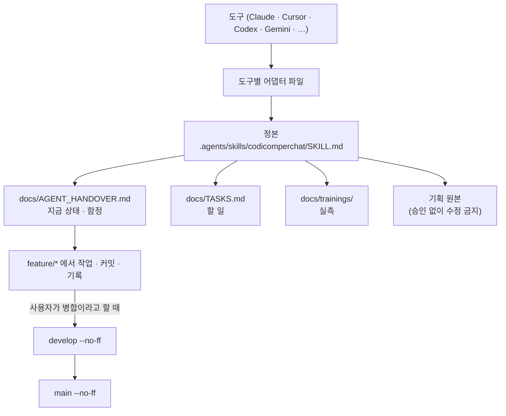

# .agents/ 스킬 허브

이 폴더는 여러 AI 에이전트 도구(Claude, Grok, Cursor, Codex, Antigravity, Gemini, Manus, Kimi, Ollama, OpenCode, Qwen, Windsurf …)가 공통으로 참조하는 **정본 규칙**을 담는다.

```text
.agents/
├── AGENTS.md                          # 진입 지시 (여기부터 읽기 시작)
├── README.md                          # 이 파일
└── skills/
    └── codicomperchat/
        └── SKILL.md                  # 정본 스킬 (전체 규칙)
```

현재 상태는 [docs/AGENT_HANDOVER.md](../docs/AGENT_HANDOVER.md), 할 일은 [docs/TASKS.md](../docs/TASKS.md), 실측과 판단은 [docs/trainings/](../docs/trainings/README.md), 전체 기능 목록은 [docs/FEATURES.md](../docs/FEATURES.md), 그 중 지금 공개 주소에서 열리는 범위는 [docs/STATUS.md](../docs/STATUS.md)에 있다(규칙 정본이 아니라 "지금 어디까지 왔나" 문서).

도구별 폴더(`.claude/`, `.cursor/`, `.codex/`, `.grok/`, `.antigravity/`, `.gemini/`, `.manus/`, `.kimi/`, `.ollama/`, `.opencode/`, `.qwen/`, `.windsurf/`)는 이 정본을 가리키거나 요약 복제한 어댑터다. 규칙을 바꿀 때는 이 폴더와 루트 `AGENTS.md`를 먼저 고치고, 어댑터는 그 다음에 맞춘다. `node --test scripts/adapters.test.mjs`가 어댑터끼리 규칙 목록이 어긋났는지 본다(CI에서도 돈다). 새 도구를 더할 때는 그 시험의 `ADAPTERS`에도 한 줄 넣는다.

**공동 작업자가 다른 도구를 쓸 때를 대비한 어댑터다.** 각 도구가 이 폴더·파일 이름을 실제로 자동으로 읽는지는 확인하지 않았다(`.claude/`·`.cursor/` 외에는 써 본 적이 없다). 도구가 읽지 않으면 루트 `AGENTS.md`나 이 폴더의 정본을 직접 가리키게 설정한다.

<!-- logic-structure -->
아래는 이 파일이 가리키는 규칙이 실제로 흐르는 순서다.

```text
도구(Claude·Cursor·Codex·Grok·Gemini·…) ─▶ 도구별 폴더의 어댑터 파일
                                              │ 가리킨다
                                              ▼
                     .agents/skills/codicomperchat/SKILL.md (정본)
                                              ▲
루트 AGENTS.md (자동으로 읽는 도구용 요약) ───┘
규칙을 바꿀 때: 정본 → 루트 AGENTS.md → 어댑터(.codex/AGENTS.md 목록 기준) → node --test scripts/adapters.test.mjs
```

<!-- logic-mermaid -->

mermaid로 본 같은 흐름:


