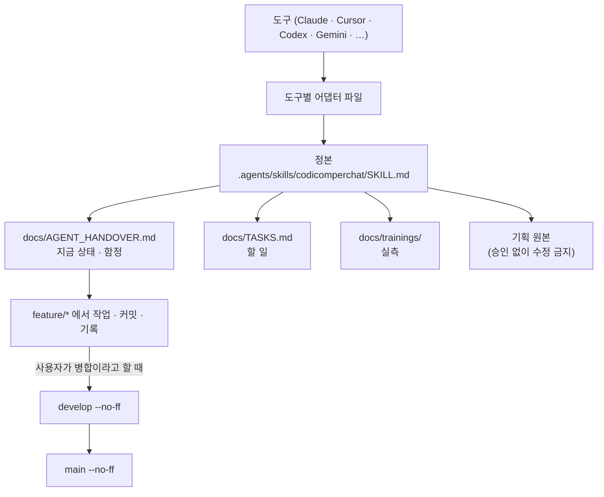
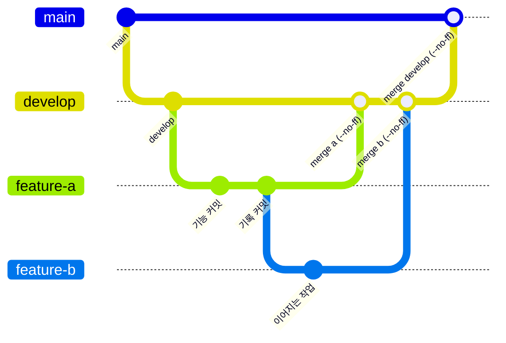
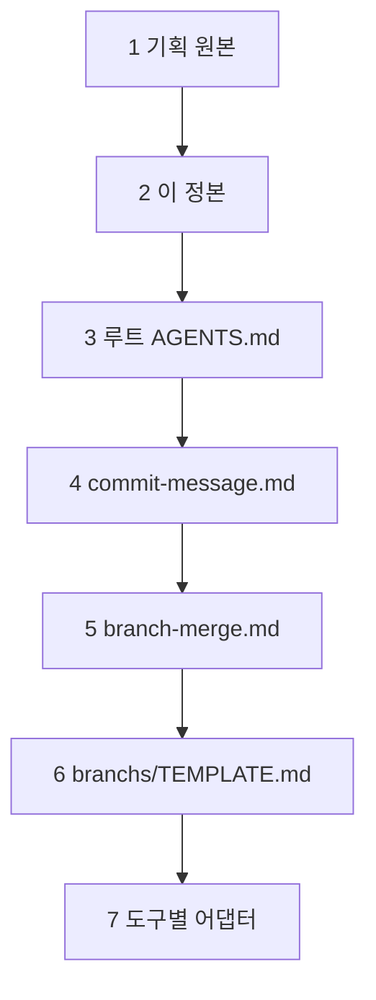

# 코디컴퍼챗(CodiComperChat) 에이전트 협업 스킬 — 정본

이 문서는 모든 AI 에이전트(Claude, Grok, Cursor, Codex, Antigravity 등)가 이 저장소에서 작업할 때 따라야 하는 **정본 규칙**이다.
도구별 어댑터(`.claude/`, `.cursor/`, `.codex/`, `.grok/`, `.antigravity/`, `.gemini/`, `.manus/`, `.kimi/`, `.ollama/`, `.opencode/`, `.qwen/`, `.windsurf/` 등)는 이 문서를 요약·복제한 것이며, 내용이 어긋나면 **이 문서가 이긴다.**

---

<!-- logic-structure -->
## 로직 구조 (규칙이 흐르는 순서)

```text
이 도구가 읽는 파일 (어댑터)
        │ 가리킨다
        ▼
.agents/skills/codicomperchat/SKILL.md   ← 정본. 어긋나면 정본이 이긴다
        │ 읽는 순서
        ├─▶ docs/AGENT_HANDOVER.md        지금 상태 · 함정 · 약속
        ├─▶ docs/TASKS.md                 할 일 (사용자 몫은 대신 하지 않는다)
        ├─▶ docs/trainings/               실측 (프롬프트·판정·그림을 고치기 전에)
        └─▶ CodiComperChat_project_plan.md  기획 원본 (승인 없이 수정 금지)

작업 흐름
  feature/* 브랜치 ─▶ 커밋 (type(scope) 영어 + 한국어 요약)
        │                └─▶ docs/branchs/commits/ 기록 (scripts/record-commit.mjs)
        ▼  사용자가 "병합"이라고 할 때만
  develop (--no-ff) ─▶ main (--no-ff) ─▶ 푸시는 요청할 때만

충돌할 때 (1장): 기획 원본 > 이 정본 > 루트 AGENTS.md > commit-message > branch-merge > TEMPLATE > 도구별 어댑터
```

<!-- logic-mermaid -->

### 규칙이 흐르는 순서



### 브랜치와 병합



### 우선순위 (1장)



## 0. 원본 보존 원칙 (최상위, 예외 없음)

- 루트의 `CodiComperChat_project_plan.md`는 이 프로젝트의 **기획 원본**이다. 대화로 합의된 제품 정의·차별점·컨텐츠 구조·기술 구조·v1 범위가 여기 담겨 있다.
- 에이전트는 이 문서의 **설계 의도, 문단 구조, 워딩, 예시(캐릭터 "린" 등)를 임의로 수정·삭제·재작성·요약 대체하지 않는다.** 오타 수정 같은 사소한 교정도 사용자 확인 없이 하지 않는다.
- 이 원본과 충돌하는 결정이 필요하면:
  1. 먼저 사용자에게 확인한다 (말없이 진행 금지).
  2. 승인되면 기존 문단을 조용히 지우는 대신, 문서 상단 `문서 버전`을 올리고 변경 이력을 남기거나, 해당 절 아래에 갱신 내용을 추가하는 방식으로만 반영한다.
- 이 원칙은 캐릭터 카드 예시, 화면 지도, API 계약처럼 이 문서에서 파생되는 다른 기획/디자인 산출물에도 동일하게 적용된다 — 사용자가 명시적으로 요청한 범위만 고치고, 나머지 구조·워딩·디자인은 그대로 둔다.
- 이 원칙은 아래 어떤 규칙(브랜치, 커밋, docs 구조)과 충돌하더라도 **항상 우선한다.**

---

## 1. 정본 우선순위 (충돌 시)

1. `CodiComperChat_project_plan.md` (루트) ← **제품/기획 원본. §0 원칙 적용**
2. `.agents/skills/codicomperchat/SKILL.md` ← **이 문서. 에이전트 작업 방식 정본**
3. 루트 `AGENTS.md` ← 에이전트 자동 로드 요약
4. `docs/guidance/commit-message.md` ← 커밋 메시지 상세
5. `docs/guidance/branch-merge.md` ← 브랜치·병합 상세
6. `docs/branchs/TEMPLATE.md` ← 커밋 기록 md 템플릿
7. 도구별 어댑터 (`.grok/`, `.claude/`, `.cursor/`, `.codex/`, `.antigravity/`, `.gemini/`, `.manus/`, `.kimi/`, `.ollama/`, `.opencode/`, `.qwen/`, `.windsurf/` …) ← 정본을 가리키는 복제

---

## 2. 에이전트 규칙 파일 맵

### 정본·공통

| 경로 | 용도 |
|------|------|
| `.agents/skills/codicomperchat/SKILL.md` | 정본 스킬 (이 문서) |
| `.agents/AGENTS.md` | 짧은 진입 지시 |
| `.agents/README.md` | 스킬 허브 설명 |
| `AGENTS.md` (루트) | Grok/Codex 등 자동 로드용 요약 |
| `docs/AGENT_HANDOVER.md` | 인수인계(현재 상태·작업 약속·함정·해야 할 일) — 규칙 정본이 아니라 상태 문서 |
| `docs/TASKS.md` | 작업 지시서(다음에 할 일, 선행 조건, 끝난 기준) |
| `docs/FEATURES.md` | 전체 기능 카탈로그 |
| `docs/trainings/` | 실제로 돌려 본 결과와 판단. 프롬프트·판정·그림을 고치기 전에 읽는다 |
| `docs/plan/WORLD_COPPERCHAT.md` | 월드코퍼챗(세계관·여러 인물·파트·코퍼맵·미니게임) 정본. 기획 원본 밖의 사용자 요청 기능 |
| `docs/.assets/README.md` | README·문서 그림과 영상, 다시 만드는 스크립트 |
| `docs/guidance/owner-checklist.md` | 소유자만 할 수 있는 일과 하는 법 |

**주의:** 스킬 파일은 반드시 `.agents/skills/codicomperchat/SKILL.md` 경로에 둔다. `.agents/SKILL.md`처럼 루트에 바로 두면 일부 도구가 찾지 못한다.

### 도구별 어댑터

- `.grok/skills/codicomperchat/SKILL.md`, `.grok/rules/codicomperchat.md`
- `.claude/CLAUDE.md`, `.claude/skills/codicomperchat/SKILL.md`
- `.cursor/rules/codicomperchat.mdc`, `.cursor/skills/codicomperchat/SKILL.md`
- `.codex/AGENTS.md`, `.codex/skills/codicomperchat/SKILL.md`
- `.antigravity/AGENTS.md`
- `.gemini/GEMINI.md`, `.qwen/QWEN.md`, `.windsurf/rules/codicomperchat.md`, `.manus/AGENTS.md`, `.kimi/AGENTS.md`, `.ollama/AGENTS.md`, `.opencode/AGENTS.md` (2026-11-06, 공동 작업자 대비. 각각 `skills/codicomperchat/SKILL.md` 포인터도 있다. 도구가 파일을 자동으로 읽는지는 확인하지 않았다)
- 어댑터가 어긋나지 않았는지는 `node --test scripts/adapters.test.mjs`로 본다. 규칙을 바꾸면 `.codex/AGENTS.md`의 목록을 기준으로 어댑터를 같이 고친다

### 도구가 자동 생성하는 파일 (우리 규칙 아님, 손대지 말 것)

| 경로 | 생성 주체 | 성격 |
|------|-----------|------|
| `apps/web/AGENTS.md`, `apps/web/CLAUDE.md`, `console/AGENTS.md`, `console/CLAUDE.md` | `next dev`, `next typegen` (Next.js 16) | 해당 Next 버전의 주의사항 안내. 시험이나 타입 검사가 다시 쓰면 작업과 섞어 커밋하지 않고 `git checkout -- <파일>`로 되돌린다. Next 코드를 고치기 전에 안내대로 `node_modules/next/dist/docs/`를 읽는다 |

이 파일들은 **작업 방식(커밋/브랜치/문서) 규칙이 아니다.** 프레임워크 사용법만 다루므로 이 정본과 충돌하지 않으며, 충돌하는 것처럼 보이면 이 정본이 이긴다. 손으로 고치지 않는다.

규칙을 고칠 때는 **정본(이 문서) + 루트 `AGENTS.md`를 먼저** 수정하고, 어댑터들은 그에 맞춰 동기화한다.

에이전트가 커밋 전에 열어야 할 문서 순서: 이 스킬 → `commit-message.md` → `branch-merge.md` → `TEMPLATE.md` → (백엔드/AI 작업이면) `docs/plan/CURRENT_STACK.md` → 관련 API/도메인 문서

---

## 3. 커밋 메시지 규칙 (필수)

| 구간 | 언어 |
|------|------|
| type / scope | **영어** (`feat`, `fix`, `docs` …) |
| 제목 요약 | **한국어** |
| 본문 | **한국어** |
| 바닥글 | **한국어** |

형식:
```text
type(scope): 한국어 한 줄 요약

한국어 본문 (무엇을·왜)

관련: …
후속: …
```

- type 예: `feat` `fix` `docs` `chore` `refactor` `test` `perf` `ci` `style` `build`
- scope 예: `web` `api` `ai` `db` `prisma` `docs` `branchs` `docker` `infra`
- 제목 끝 마침표 금지
- `type(scope):` 뒤 한 칸
- ✅ `feat(api): 캠페인 상태 갱신 엔드포인트 추가`
- ❌ `feat(ai): add summarize endpoint` (요약 영어 금지)
- ❌ `작업함` / type 없는 한 줄
- 병합 메시지 관례: `merge: feature/xxx into develop (no-ff)`

상세: `docs/guidance/commit-message.md`

---

## 4. 커밋 기록 md (필수 · 예외 없음)

커밋 메시지와 **별개로** 남긴다. **생략 금지.** merge·작은 수정도 생략 금지.

| 항목 | 규칙 |
|------|------|
| 경로 | **`docs/branchs/commits/` 만** |
| 금지 | `docs/commits/` · 다른 폴더 · "나중에/푸시만" |
| 시점 | 커밋 **전 또는 직후** |
| 템플릿 | `docs/branchs/TEMPLATE.md` |
| 목록 | `docs/branchs/README.md` 표에도 링크 추가 |
| 기록 파일 | 같은 브랜치에 커밋. 푸시는 사용자가 요청할 때만 |
| 작성기 | `node scripts/record-commit.mjs --name <kebab-이름> --notes <본문 파일> --commit` (`--trailer`는 선택) |

파일명:
```text
YYMMDD_HHMM_[커밋ID]_[커밋이름]_[커밋브랜치].md
```
예: `260915_1420_a1b2c3d_campaign-state-api_feature-api.md`

- `YYMMDD` = 연2+월+일 (구분자 없음)
- `HHMM` = 시분 **한 덩어리** (중간에 `_` 넣지 않음)
- 커밋이름 = kebab-case, 공백/`/` 금지
- 브랜치 `/` → `-` (`feature/api` → `feature-api`)
- 시각은 `git log -1 --format=%ci` 권장

본문 필수 섹션은 `docs/branchs/TEMPLATE.md` 참고 (제목/커밋번호 · 주 내용 · 상세 · 결과).

---

## 5. 브랜치·병합 규칙 (필수)

```text
main          ← 배포 통합만
└── develop   ← 개발 통합만
      ├── feature/*
      ├── bugfix/*
      └── experimental/*
```

| 필수 | 내용 |
|------|------|
| 작업·커밋 | `feature/*` 등에서만 |
| 일자 통합 | develop / main 만 |
| 병합 | **`git merge --no-ff`** (FF 금지) |
| feature 완료 | 사용자가 "병합"이라고 말하면 develop에 --no-ff |
| 푸시 | 사용자가 요청할 때만 |
| 배포 | release/* 검증 후 main |

금지:
- feature끼리 장기 합치기
- develop 없이 main에 feature 직행
- 일상 기능을 develop에 직접 커밋
- FF merge (그래프가 일자로 뭉개짐)
- force-push (명시 요청 제외)
- `.env` 시크릿 커밋

```bash
git checkout develop
git pull origin develop
git merge --no-ff feature/xxx -m "merge: feature/xxx into develop (no-ff)"
# 병합 기록을 남기고 시험 결과를 보고한다. 푸시는 요청받았을 때만 한다.
```

상세: `docs/guidance/branch-merge.md`

---

## 6. 프로젝트/스택 규칙 (에이전트도 준수)

**출처: `CodiComperChat_project_plan.md` §7, §9, §13에서 시작해, 구현하며 사용자가 결정한 것을 반영했다. 지금 값의 정본은 `docs/plan/CURRENT_STACK.md`다. 에이전트가 임의로 스택을 바꾸거나 범위를 넓히지 않는다.**

- 프론트: **Next.js (React, TSX)** — 이용자 사이트 `apps/web/`, 운영 콘솔 `console/`
- 도메인/상태 API: **Nest.js (TypeScript)** — `apps/api/`
- AI 추론·그림: **FastAPI (Python)** — `services/ai/` (로컬 Ollama + 서버 안 그림 엔진)
- DB: **PostgreSQL**. Redis·벡터 DB는 쓰지 않는다 (요청 한도는 메모리/PostgreSQL, 대기열은 프로세스 메모리, 지식 검색은 2-gram BM25)
- ORM: Nest 쪽 **Prisma**

저장소 구조:
```text
repo/
├── apps/
│   ├── web/          # Next.js 이용자 사이트
│   └── api/          # Nest.js
├── console/          # Next.js 운영 콘솔
├── services/
│   └── ai/           # FastAPI
├── deploy/           # 운영 구성 (GPU 서버 한 대)
├── e2e/              # Playwright
└── docker-compose.yml  # 개발용 보조 서비스
```

역할 분리 원칙 (계획서 7.1, 위반 금지):
- 프론트는 FastAPI를 직접 호출하지 않는다
- FastAPI는 내부망에서만 Nest가 호출한다
- 학습 API(`/train`)는 외부에 열지 않는다 (v1에서는 경로만 두고 막아 둔다)
- Next.js Route에 무거운 추론을 넣지 않는다 (타임아웃·메모리)

API 경계 (계획서 13.1, 13.2) — 웹이 치는 것과 내부 전용을 섞지 않는다:
- Nest가 밖으로 여는 것: `/auth/*`, `/characters`, `/campaigns`, `/campaigns/:id/messages`, `/campaigns/:id/sessions/:sid/close`, `/campaigns/:id/logbook`, `/studio/*` 등
- FastAPI가 안으로만 여는 것: `/infer`, `/summarize`, `/critique-test`, `/train` — **웹이 `/infer`를 직접 알아서는 안 된다.**

핵심 도메인 (계획서 7.5, 테이블명 확정은 Prisma 단계에서): `User` `Character` `LoreEntry` `Campaign` `CampaignState` `Session` `Message` `MemoryChunk`

범위 (에이전트가 임의로 확장 구현하지 않는다):
- 계획서 §9의 v1: 공식 캐릭터 1~3명, 캠페인 템플릿 1개, 창작 공방
- 사용자 결정으로 v1 밖에서 넓힌 것: 유저 캐릭터 공개, 코디포토넷, 웹툰, 오퍼레이션, 비밀 퀘스트, 성인 모드 등. 전체 목록은 `docs/FEATURES.md`
- 여전히 없는 것: 카드 마켓, 자체 LLM 학습, 멀티플레이/파티 채팅, 음성 통화, 일정/할일/검색류 생산성 기능, 복잡한 전투 룰북

새 기능은 사용자가 요청한 것만 넣는다. 포트/인프라 값은 `docs/plan/CURRENT_STACK.md`에서 관리한다. 이 문서를 고치지 않고 코드에서만 포트를 정하지 않는다.

---

## 7. docs/ 폴더 체계와 작성 규칙

진입점: `docs/README.md`

| 폴더 | 용도 | 작성 규칙 |
|------|------|-----------|
| `plan/` | 스택 스냅샷·DB·테스트·API 계약 등 기획서에서 파생된 개발 스펙 | `CodiComperChat_project_plan.md`와 모순되면 원본이 우선, 여기서 수정 |
| `Architecture/` | 시스템·계층·데이터흐름·배포 구조 | 구현이 바뀌면 여기 먼저 갱신, ASCII/mermaid 권장 |
| `branchs/` | 브랜치·커밋 기록 | `commits/` + `TEMPLATE.md` + `README.md` 목록 필수 |
| `guidance/` | 실행·기능 가이드 | 전제 → 명령 → 기대결과, 포트/ENV는 표로 |
| `find_debug/` | 날짜별 디버그 일지 | `YYYY-MM-DD.md`, 증상/원인/해결/재발방지 |
| `repeater/` | 재발 가능한 인프라 이슈 지식 | 환경/증상/원인/해결/검증 명령 |
| `vaildates/` | 배포·데모 전 수동 검증 체크리스트 | 폴더명 스펠링 `vaildates` 의도적 유지, 교정 금지 |
| `web_management/` | 배포 전/중/후, 포트 인벤토리 | pre-deploy / docker-deploy / ports-inventory / post-deploy |
| `trainings/` | 실제로 돌려 본 결과와 판단 (모델 학습 기록이 아님) | 돌려 본 것만, 표본 크기와 날짜를 붙여 적는다. 실패도 적는다. 캐릭터 카드 원문·비밀·실 유저 데이터 금지 |
| `assets/readme/` | 루트 README의 그림·영상 | `scripts/readme-media/`로 실제 앱에서 만든다. 손으로 고치거나 꾸민 화면을 넣지 않는다 |

새 하위 폴더가 더 필요해지면 이 표에 추가하고 용도를 적는다 — 말없이 폴더만 만들지 않는다.

**값은 한곳에만 적는다.** 어떤 값을 어느 문서가 맡는지는 `docs/README.md`의 "문서 정본 표"를 따른다. 시험 수처럼 자주 바뀌는 값은 정본에만 적고, 다른 문서는 링크로 가리킨다.

### docs에서 절대 하지 말 것
- `docs/commits/`에 기록 (금지) → `docs/branchs/commits/`만
- 커밋 기록 생략
- 구현을 바꾸면서 `Architecture/`나 `docs/plan/CURRENT_STACK.md`를 갱신하지 않음
- 루트 `CodiComperChat_project_plan.md`를 `docs/` 안으로 옮기거나 이름을 바꿈 (원본 위치 보존, §0 참고)

---

## 8. 한 줄 요약

1. **§0 원본 보존 원칙이 항상 최우선** — 기획 원본은 사용자 승인 없이 건드리지 않는다
2. **에이전트 정본 스킬 하나**(이 문서) + 도구별 어댑터는 그걸 가리키게
3. **커밋:** type/scope 영어, **요약·본문·바닥글 한국어**
4. **매 커밋마다** `docs/branchs/commits/`에 템플릿 md + 목록 표 갱신 (생략 금지, 잘못된 경로 금지)
5. **작업은 feature**, **합칠 때만 develop/main + `--no-ff`**
6. **스택·범위는 `docs/plan/CURRENT_STACK.md` 기준**, 임의로 프레임워크를 바꾸거나 범위를 넓히지 않는다
7. 시크릿·force-push 금지
8. **병합은 사용자가 말할 때만, 푸시는 요청할 때만**

---

## 9. 사용자와 합의한 작업 방식

모든 에이전트에 똑같이 적용한다. 이전 대화 기록은 도구 사이에 넘어가지 않으므로 여기에 적어 둔다.

- 응답은 **한국어, 간결, 결과 중심**. 못 한 것과 확인하지 못한 것은 숨기지 않고 말한다.
- 사용자가 "작업 ㄴㄴ"라고 하면 설명만 한다.
- 큰 기능은 만들기 전에 방향을 한 번 묻는다. 비용이 드는 일과 바깥으로 나가는 일은 먼저 확인한다.
- 사용자의 개발 서버(web·api·ai·console)를 켜거나 끄거나 죽이지 않는다. 내가 켠 것만 내가 끈다.
- 개발 서버가 켜져 있을 때 `npm run build:api`를 하지 않는다(`dist`를 지워 서버가 죽는다). `npm run typecheck:api`나 `npm run build:verify --workspace api`를 쓴다.
- 시험을 통과시키려고 시간 제한을 늘리거나 시험을 건너뛰지 않는다. 결과를 읽은 뒤에 기록을 쓴다.
- `.env`, 키, DB 비밀번호, `AUTH_SECRET`, SMTP·토스 값은 출력하거나 커밋하지 않는다. `services/ai/models/`의 모델 파일도 커밋하지 않는다.
- 다른 프로젝트의 도커 컨테이너(`storyforge-postgres`)를 건드리지 않고, `docker system prune`과 `wsl --shutdown`을 하지 않는다.
- 바닥글의 `Co-Authored-By`는 쓰는 도구의 안내가 정한 값만 쓴다. 안내가 없으면 넣지 않는다.

**문서에 사실을 적을 때**

- 돌려 보지 않은 것을 됐다고 적지 않는다. 확인하지 못했으면 "확인하지 못했다"고 적는다.
- 자주 바뀌는 수는 정본(`docs/README.md`의 문서 정본 표)에만 적는다.
- 모델 평가는 흔들린다. 같은 코드로 4/8과 2/8이 나왔다. 8번으로 개선을 말하지 않는다.
- 평가가 미달이면 기준을 낮추거나 장면을 바꾸지 않고 그대로 적는다.

**명령을 쓸 때**

- 시험·병합과 커밋을 한 명령으로 묶지 않는다. 결과를 읽고 다음 명령을 쓴다. 도구의 Bash에 넣은 `set -e`는 실패해도 멈추지 않을 수 있다.
- 따옴표가 든 긴 heredoc은 실행 전에 깨지기 쉽다. 파일 쓰기 도구로 스크립트를 만들어 돌린다.
- 데모나 측정에 쓸 서버는 전용 포트와 전용 DB로 띄운다(`scripts/readme-media/`). 끝나면 내가 켠 것만 끈다.
