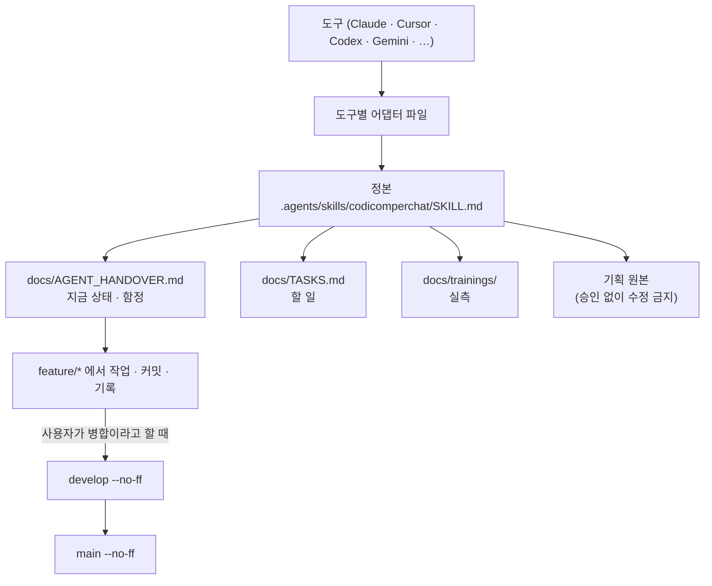

# codicomperchat (Claude 어댑터)

이 파일은 정본이 아니다. 전체 규칙은 다음을 읽는다:

→ `.agents/skills/codicomperchat/SKILL.md`

특히 §0 원본 보존 원칙(루트 `CodiComperChat_project_plan.md` 임의 수정 금지)을 가장 먼저 확인한다.

<!-- logic-structure -->
아래는 이 파일이 가리키는 규칙이 실제로 흐르는 순서다.

```text
이 도구가 읽는 파일 (어댑터)
        │ 가리킨다
        ▼
.agents/skills/codicomperchat/SKILL.md   ← 정본. 어긋나면 정본이 이긴다
        │ 읽는 순서
        ├─▶ docs/AGENT_HANDOVER.md        지금 상태 · 함정 · 약속
        ├─▶ docs/TASKS.md                 할 일 (사용자 몫은 대신 하지 않는다)
        ├─▶ docs/trainings/               실측 (프롬프트·판정·그림을 고치기 전에)
        └─▶ CodiComperChat_project_plan.md  기획 원본 (승인 없이 수정 금지)

작업 흐름
  feature/* 브랜치 ─▶ 커밋 (type(scope) 영어 + 한국어 요약)
        │                └─▶ docs/branchs/commits/ 기록 (scripts/record-commit.mjs)
        ▼  사용자가 "병합"이라고 할 때만
  develop (--no-ff) ─▶ main (--no-ff) ─▶ develop을 main에 맞춤 ─▶ 푸시는 요청할 때만 (둘 다 같이)
```

<!-- logic-mermaid -->

mermaid로 본 같은 흐름:


