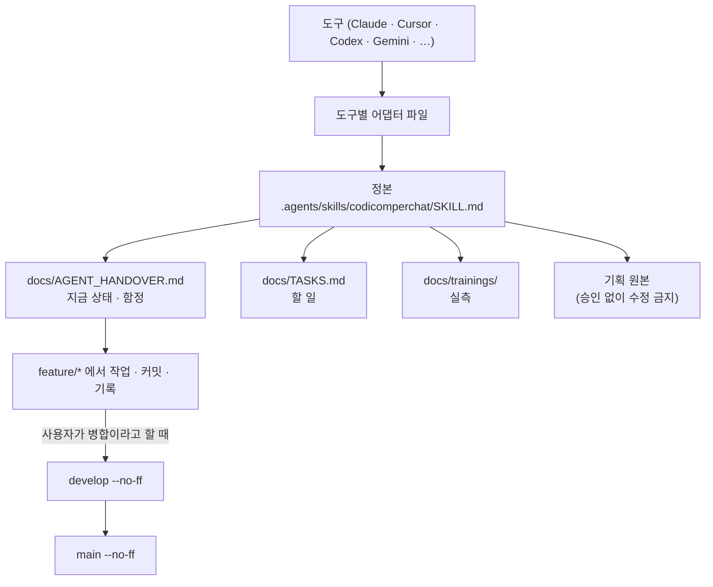

# codicomperchat 규칙 (Windsurf 어댑터)

정본은 `.agents/skills/codicomperchat/SKILL.md`다. 어긋나면 정본이 이긴다.

- §0 원본 보존 원칙: 루트 `CodiComperChat_project_plan.md`를 사용자 승인 없이 수정하지 않는다.
- 커밋: type/scope 영어, 요약·본문·바닥글 한국어.
- 매 커밋마다 `docs/branchs/commits/`에 기록(`docs/branchs/TEMPLATE.md`) — 생략 금지.
- 브랜치: `feature/*`에서 작업, `develop`/`main` 병합은 `--no-ff`만.
- 스택: Next.js(`apps/web`) / Nest.js(`apps/api`) / FastAPI(`services/ai`), 프론트→FastAPI 직접 호출 금지.
- 시작 전: `docs/AGENT_HANDOVER.md`(지금 상태·함정), `docs/TASKS.md`(할 일), `docs/STATUS.md`(코드에 있는 기능과 지금 열리는 범위)를 읽는다.
- 병합은 사용자가 "병합"이라고 말할 때만, 푸시는 요청할 때만 한다.
- 사용자의 개발 서버를 켜거나 끄지 않는다. 켜져 있을 때 `npm run build:api`를 하지 않는다.
- 시험을 통과시키려고 시간 제한을 늘리거나 건너뛰지 않는다.
- `.env`·키·DB 비밀번호를 출력하거나 커밋하지 않는다. `services/ai/models/`도 커밋하지 않는다.
- 프롬프트·판정·그림을 고치기 전에 `docs/trainings/`를 읽고, 고친 뒤 실제 모델 평가를 다시 돌려 그대로 적는다.
- 시험·병합과 커밋을 한 명령으로 묶지 않는다.
- 답은 한국어로 간결하게. 확인하지 못한 것은 그렇게 말한다.

<!-- logic-structure -->
아래는 이 파일이 가리키는 규칙이 실제로 흐르는 순서다.

```text
이 도구가 읽는 파일 (어댑터)
        │ 가리킨다
        ▼
.agents/skills/codicomperchat/SKILL.md   ← 정본. 어긋나면 정본이 이긴다
        │ 읽는 순서
        ├─▶ docs/AGENT_HANDOVER.md        지금 상태 · 함정 · 약속
        ├─▶ docs/TASKS.md                 할 일 (사용자 몫은 대신 하지 않는다)
        ├─▶ docs/trainings/               실측 (프롬프트·판정·그림을 고치기 전에)
        └─▶ CodiComperChat_project_plan.md  기획 원본 (승인 없이 수정 금지)

작업 흐름
  feature/* 브랜치 ─▶ 커밋 (type(scope) 영어 + 한국어 요약)
        │                └─▶ docs/branchs/commits/ 기록 (scripts/record-commit.mjs)
        ▼  사용자가 "병합"이라고 할 때만
  develop (--no-ff) ─▶ main (--no-ff) ─▶ 푸시는 요청할 때만
```

<!-- logic-mermaid -->

mermaid로 본 같은 흐름:


