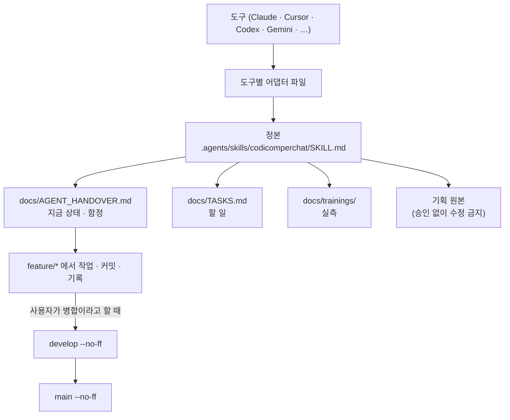

# CodiComperChat — Agent Rules (요약)

이 파일은 Grok/Codex 등 루트 `AGENTS.md`를 자동 로드하는 도구를 위한 요약이다.
전체 규칙(정본)은 `.agents/skills/codicomperchat/SKILL.md`에 있다 — 충돌 시 그 문서가 이긴다.

## 0. 원본 보존 원칙 (최우선, 예외 없음)

루트의 `CodiComperChat_project_plan.md`는 제품 기획 원본이다. **이 문서의 설계 의도·구조·워딩을 사용자 승인 없이 수정·삭제·재작성하지 않는다.** 변경이 필요하면 먼저 사용자에게 확인하고, 승인 시에도 기존 내용을 조용히 지우지 말고 버전을 올리거나 변경 이력을 추가하는 방식으로만 반영한다. 이 원칙은 다른 모든 규칙보다 우선한다.

## 핵심 규칙 (상세는 정본 스킬 참고)

- **커밋 메시지**: `type(scope):` 는 영어, **요약·본문·바닥글은 한국어**. 예: `feat(api): 캠페인 상태 갱신 엔드포인트 추가`
- **커밋 기록 md**: 매 커밋마다 `docs/branchs/commits/`에 `docs/branchs/TEMPLATE.md` 형식으로 남긴다. 생략 금지, 다른 경로 금지.
- **브랜치**: 작업은 `feature/*`에서만, `develop`/`main` 병합은 항상 `git merge --no-ff`. FF·force-push·`.env` 커밋 금지.
- **병합·푸시**: 병합은 사용자가 "병합"이라고 말할 때만, 푸시는 요청할 때만. 병합과 푸시를 함께 시키면 feature→develop→main(둘 다 --no-ff) 병합과 기록을 끝낸 뒤 develop을 main에 맞추고 둘을 같이 푸시한다. main 병합 전에 develop만 먼저 푸시하지 않는다.
- **개발 서버**: 사용자의 서버를 켜거나 끄지 않고, 켜져 있을 때 `npm run build:api`를 하지 않는다. 합의한 작업 방식 전체는 정본 §9.
- **스택**: Next.js(`apps/web`) · Nest.js(`apps/api`) · FastAPI(`services/ai`) · 운영 콘솔(`console`) · PostgreSQL/Prisma. 프론트는 FastAPI를 직접 호출하지 않는다. v1 범위(계획서 §9)를 임의로 넓히지 않는다.

읽는 순서: `.agents/skills/codicomperchat/SKILL.md` → `docs/AGENT_HANDOVER.md`(지금 상태·함정) → `docs/TASKS.md`(할 일) → `docs/trainings/`(실측, 프롬프트·판정을 고칠 때) → `docs/FEATURES.md`(전체 기능, 코드 기준) → `docs/STATUS.md`(지금 공개 주소에서 열리는 범위) → `CodiComperChat_project_plan.md` → `docs/guidance/commit-message.md` → `docs/guidance/branch-merge.md` → `docs/branchs/TEMPLATE.md`

<!-- logic-structure -->
아래는 이 파일이 가리키는 규칙이 실제로 흐르는 순서다.

```text
이 도구가 읽는 파일 (어댑터)
        │ 가리킨다
        ▼
.agents/skills/codicomperchat/SKILL.md   ← 정본. 어긋나면 정본이 이긴다
        │ 읽는 순서
        ├─▶ docs/AGENT_HANDOVER.md        지금 상태 · 함정 · 약속
        ├─▶ docs/TASKS.md                 할 일 (사용자 몫은 대신 하지 않는다)
        ├─▶ docs/trainings/               실측 (프롬프트·판정·그림을 고치기 전에)
        └─▶ CodiComperChat_project_plan.md  기획 원본 (승인 없이 수정 금지)

작업 흐름
  feature/* 브랜치 ─▶ 커밋 (type(scope) 영어 + 한국어 요약)
        │                └─▶ docs/branchs/commits/ 기록 (scripts/record-commit.mjs)
        ▼  사용자가 "병합"이라고 할 때만
  develop (--no-ff) ─▶ main (--no-ff) ─▶ develop을 main에 맞춤 ─▶ 푸시는 요청할 때만 (둘 다 같이)
```

<!-- logic-mermaid -->

mermaid로 본 같은 흐름:


