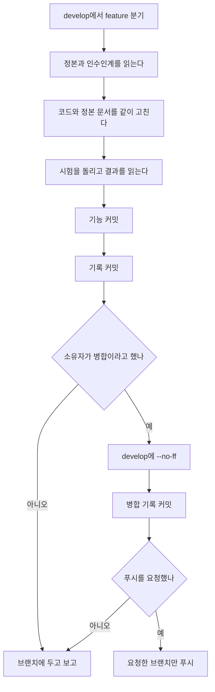
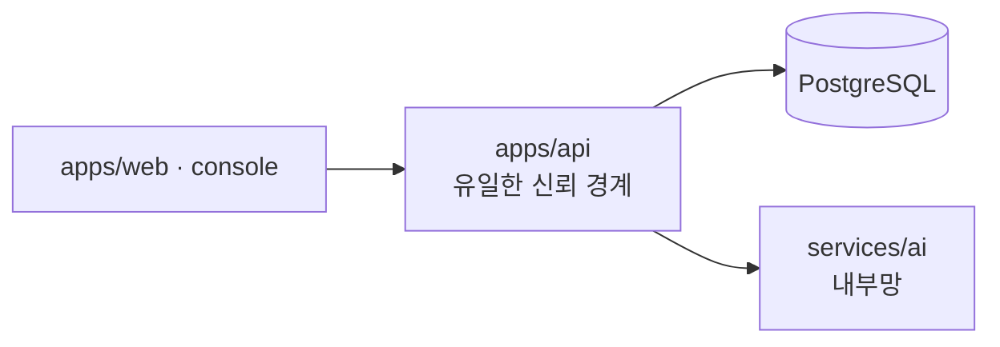

# 기여 안내

이 문서는 **권리자가 이 저장소에서 일하도록 허락한 사람**과, 그 사람을 돕는 AI 에이전트가 같은 순서로 일하게 하는 입구다. 바깥에 기능을 내놓아 달라는 초대가 아니다.

규칙의 문장 정본은 [.agents/skills/codicomperchat/SKILL.md](.agents/skills/codicomperchat/SKILL.md)다. 이 문서, README, 도구별 어댑터(`.cursor/`, `.claude/`, `.codex/` 등)가 정본과 어긋나면 **정본이 이긴다.** 여기에는 순서를 적고, 바뀌기 쉬운 수(시험 개수, 테이블 수, 포트의 운영 값)는 적지 않는다. 그 값은 [docs/README.md](docs/README.md)의 문서 정본 표가 가리키는 문서에만 있다.

저장소와 그 안의 코드·문서·캐릭터 카드·프롬프트는 독점이다. 허락의 범위는 [LICENSE](LICENSE)가 정한다. 취약점은 풀 리퀘스트로 알리지 말고 [SECURITY.md](SECURITY.md)의 신고 절차를 따른다.

최종 정리 2026-11-08. 순서는 같다. 기획 원본과 날짜가 붙은 기록은 이 안내를 고칠 때도 다시 쓰지 않는다.

<!-- logic-structure -->
## 로직 구조

```text
develop 에서 feature/* 를 딴다
        │
        ▼
읽기 ─▶ SKILL.md (§0 원본 보존) · AGENT_HANDOVER · TASKS · 고칠 영역의 정본 문서
        │
        ▼
고치기 ─▶ 코드와, 그 값이 사는 정본 문서를 같은 브랜치에서
        │     웹은 Nest만 부른다. Nest만 DB와 AI를 안다
        ▼
시험 ──▶ 결과를 읽는다. 실패를 커밋 명령과 한 줄로 묶지 않는다
        │     시간 제한을 늘리거나 시험을 건너뛰지 않는다
        ▼
커밋 ──▶ type(scope): 한국어 요약
        │     이어서 record-commit.mjs 가 기록 커밋을 따로 만든다
        ▼
보고 ──▶ 돌린 시험, 못 돌린 시험, 남은 위험을 적는다
        │
        ├─ 소유자가 "병합"이라고 할 때만  develop --no-ff  (+ 병합 기록)
        └─ 소유자가 푸시하라고 할 때만    origin 에 푸시
```

<!-- logic-mermaid -->

### 한 작업의 순서



### 호출이 지나가는 경계



웹이나 콘솔이 FastAPI를 직접 부르면 그 변경은 받아들이지 않는다. AI 서비스는 데이터베이스를 모른다.

## 1. 시작하기 전에

일을 고르기 전에 이 순서로 읽는다. 이전 대화는 다음 세션으로 넘어가지 않으므로, 합의는 문서에 있는 것만 합의다.

| 순서 | 문서 | 여기서 얻는 것 |
|------|------|----------------|
| 1 | [SKILL.md](.agents/skills/codicomperchat/SKILL.md) §0, §9 | 기획 원본을 승인 없이 고치지 않는다는 원칙. 사람과 에이전트의 작업 약속 |
| 2 | [AGENT_HANDOVER.md](docs/AGENT_HANDOVER.md) | 지금 상태, 이미 겪은 함정, 검증 명령 |
| 3 | [TASKS.md](docs/TASKS.md) | 막히지 않은 다음 일. 소유자 몫은 대신 하지 않는다 |
| 4 | 고칠 영역의 정본 | [문서 정본 표](docs/README.md#문서-정본-표). 프롬프트·판정·그림을 건드리면 [trainings/](docs/trainings/README.md)를 먼저 |

로컬에서 가입부터 대화까지 띄우는 절차는 [getting-started](docs/guidance/getting-started.md)에만 있다. 환경변수 표는 [environment](docs/guidance/environment.md)가 맡는다. 이 문서는 그 절차를 다시 적지 않는다.

소유자만 할 수 있는 일(저장소 공개 범위, 돈, 계약, 약관의 법적 이름, 서버 계약)은 [owner-checklist](docs/guidance/owner-checklist.md)에 있다. 그 일을 문서에 "필요함"이라고 적는 것까지가 기여자의 몫이다.

## 2. 변경의 크기

| 크기 | 예 | 시작 전에 |
|------|----|-----------|
| 작은 수정 | 오타가 아닌 동작 버그, 시험이 잡는 회귀, 문서가 코드와 어긋난 한 곳 | 바로 브랜치를 따서 고친다. 기획 원본은 여기 넣지 않는다 |
| 한 기능 | 화면, API, 마이그레이션이 함께 바뀌는 일 | 사용자가 그 기능을 요청했는지 확인한다. 요청이 없으면 만들지 않는다 |
| 방향이 갈리는 일 | 새 도메인, 결제 재개, 모델 교체, 성인 모드를 공개 서버에서 켜기 | 만들기 전에 방향을 한 번 묻는다. 비용이 나가거나 밖으로 나가는 일도 먼저 묻는다 |
| 손대지 않는 일 | 아래 3장 | 제안만 하고 파일을 고치지 않는다 |

범위를 넓히는 제안은 코드보다 먼저 말로 한다. 계획서 §9의 v1에 없는 것 가운데, 사용자가 이미 넣자고 정한 기능은 [FEATURES.md](docs/FEATURES.md)에 있다. 그 목록에 없고 요청도 없는 기능은 넣지 않는다. 여전히 없는 것의 예: 카드 마켓, 자체 LLM 학습, 음성 통화, 파티 채팅.

## 3. 고치지 않는 것

| 대상 | 이유 | 대신 |
|------|------|------|
| [CodiComperChat_project_plan.md](CodiComperChat_project_plan.md)의 설계, 문단, 워딩, 예시 | 기획 원본. §0이 최상위 | 필요하면 물어 본다. 승인 후에도 기존 문단을 지우지 않고 버전과 이력을 남긴다 |
| `.env`, 키, DB 비밀번호, `AUTH_SECRET`, SMTP, 결제 키 | 비밀 | 이름만 `.env.example`에 적는다. 값은 대화·문서·커밋에 붙이지 않는다 |
| `services/ai/models/`의 가중치 | 수 GB, git 제외 | 파일 이름과 라이선스는 [photonet-engine](docs/guidance/photonet-engine.md)와 [THIRD_PARTY_NOTICES.md](THIRD_PARTY_NOTICES.md) |
| 웹·콘솔 → FastAPI 직접 호출, Route 안의 무거운 추론 | 신뢰 경계와 타임아웃 | Nest를 거쳐 호출한다 |
| `apps/web/AGENTS.md`, `apps/web/CLAUDE.md`, `console/AGENTS.md`, `console/CLAUDE.md`의 자동 갱신 | `next dev`·`next typegen`이 다시 쓴다 | 시험이 바꿔 놓았으면 `git checkout -- <파일>`로 되돌린다. 손으로 고치지 않는다 |
| `docs/vaildates/`의 철자 | 폴더 이름 `vaildates`는 의도적이다 | 고치지 않는다 |
| 다른 프로젝트의 도커(`storyforge-postgres`), `docker system prune`, `wsl --shutdown` | 이 저장소의 일이 아니다 | 내가 만든 컨테이너만 다룬다 |
| 돌고 있는 개발 서버를 끄거나 `npm run build:api` | `dist`가 지워지며 서버가 죽는다 | 타입은 `npm run typecheck:api`. 빌드 확인은 `npm run build:verify --workspace api` |

개발 서버를 켠 사람은 그 서버의 주인이다. 에이전트는 자기가 켠 프로세스만 끈다.

## 4. 코드를 두는 곳

| 넣는 것 | 위치 | 두지 않는 곳 |
|---------|------|----------------|
| 화면, 서버 액션, 브라우저가 받는 중계 | `apps/web/` | FastAPI 주소, 비밀이 든 프롬프트 원문 |
| 운영자 화면 | `console/` | 이용자 사이트 안의 `/admin` (옛 주소는 콘솔로 보낸다) |
| 로그인, 권한, 코레딧, 소유, 상태 변경 | `apps/api/` | 웹 Route, Python 서비스 |
| 스키마 | `apps/api/prisma/schema.prisma`와 마이그레이션 한 쌍 | 적용만 하고 SQL을 저장소에 남기지 않기 |
| 모델 호출, 그림, 검수 규칙 | `services/ai/` | 웹, 그리고 DB 접속 |
| 화면 자동 시험 | `e2e/` | 개발 서버와 같은 포트·같은 DB |
| 운영 구성 | `deploy/` | 개발용 `docker-compose.yml`과 섞기 |
| 왜 그렇게 정했는지 | `docs/trainings/`, `docs/find_debug/` | 캐릭터 카드 원문, 비밀 설정, 실제 이용자 데이터 |

Prisma 스키마는 `npx prisma format`으로 전체 정렬하지 않는다. 필요한 줄만 고치고, 마이그레이션 SQL은 사람이 읽을 수 있게 폴더로 남긴다.

포트를 코드에서만 바꾸지 않는다. 개발·e2e·데모는 서로 다른 포트와 DB를 쓴다. 값의 정본은 [CURRENT_STACK](docs/plan/CURRENT_STACK.md)와 [ports-inventory](docs/web_management/ports-inventory.md)다.

## 5. 브랜치

```text
main          배포 통합. 직접 기능 커밋 금지
└── develop   개발 통합. 직접 기능 커밋 금지
      ├── feature/*        요청된 기능, 문서
      ├── bugfix/*         버그
      └── experimental/*   아직 검증하지 않은 시도
```

```bash
git checkout develop
git pull origin develop
git checkout -b feature/짧은-이름
```

| 한다 | 하지 않는다 |
|------|-------------|
| 작업과 커밋은 `feature/*`, `bugfix/*`, `experimental/*`에서만 | `develop`이나 `main`에 기능 커밋 |
| 끝난 기능은 소유자가 "병합"이라고 한 뒤 `git merge --no-ff` | fast-forward로 이력을 한 줄로 만들기 |
| 기능 위에 기능을 쌓으면 아래 브랜치부터 병합 | feature끼리 오래 붙여 두기 |
| 푸시는 요청받은 브랜치만 | force-push, `main`으로 feature 직행 |

한 브랜치는 한 가지 목적만 담는다. 이름에 슬래시는 `feature/` 한 번만 쓴다. 상세와 병합 순서는 [branch-merge](docs/guidance/branch-merge.md)다.

## 6. 커밋

메시지는 두 언어를 섞되 자리를 지킨다. `type`과 `scope`만 영어이고, 요약·본문·바닥글은 한국어다. 제목 끝에 마침표를 찍지 않는다.

```text
type(scope): 한국어로 무엇을 위해 고쳤는지

왜 이 변경이 필요한지. 화면과 시험으로 확인한 사실을 한두 문장.

관련: docs/plan/… 또는 SECURITY.md
후속: 이번 커밋이 남긴 일. 없으면 적지 않는다
```

| type | 쓸 때 |
|------|--------|
| `feat` | 요청된 동작이 새로 생긴다 |
| `fix` | 있던 동작이 잘못되어 바로잡는다 |
| `docs` | 동작은 그대로고 문서만 바뀐다 |
| `refactor` | 밖에서 보이는 동작은 그대로고 구조만 바뀐다 |
| `test` | 시험만 추가·수정한다 |
| `perf` | 같은 동작을 더 짧게 만든다 |
| `chore` `ci` `build` | 빌드, 도구, 의존성 |

scope는 고친 자리에 맞춘다. `web` `api` `ai` `console` `db` `prisma` `docs` `branchs` `docker` `infra`. 좋은 예는 `feat(api): 캠페인 상태 갱신 엔드포인트 추가`다. `feat(api): add campaign endpoint`처럼 요약을 영어로 쓰면 규칙 위반이다.

커밋마다 기록을 **또 하나의 커밋**으로 남긴다. 기능 커밋과 기록 커밋을 합치지 않는다. 기록 파일은 `docs/branchs/commits/`에만 두고, `docs/commits/`는 만들지 않는다.

```bash
node scripts/record-commit.mjs --name <kebab-이름> --notes <본문 파일> --commit
```

`--notes` 파일은 `docs/branchs/TEMPLATE.md`의 `## 주 내용`부터 끝까지다. 제목과 표는 스크립트가 커밋에서 읽는다. 바닥글의 `Co-Authored-By`는 쓰는 도구가 그 줄을 넣으라고 했을 때만 `--trailer`로 붙인다. 안내가 없으면 넣지 않는다.

시험이 실패한 뒤 같은 셸 줄에서 커밋까지 가지 않는다. 실패 결과가 기록에 "통과"로 적힌 적이 있다. 시험을 읽고, 그 다음에 커밋한다.

## 7. 확인

바꾼 층만 돌린다. 수를 이 문서에 적지 않는다. 기대 개수는 [TESTING.md](docs/plan/TESTING.md)를 본다.

| 고친 곳 | 돌릴 것 |
|---------|---------|
| `apps/api` | `npm run typecheck:api`, `npm run test:api` |
| `apps/web`, `console` | 해당 디렉터리에서 `npx next typegen` 후 `npx tsc --noEmit`. 생성되는 AGENTS·CLAUDE 파일은 되돌린다 |
| `e2e` 또는 화면 흐름 | `npm run test:e2e`. `npx playwright test`만 치면 준비 단계가 빠져 이름이 부딪친다 |
| `services/ai` 규칙 | `python -m unittest discover tests` (저장소의 venv) |
| 프롬프트·판정·그림 품질 | `evals`. 가짜 LLM e2e는 흐름만 본다. 실측은 [trainings](docs/trainings/README.md)에 표본 수와 날짜를 적어 남긴다 |
| 문서의 mermaid | `node scripts/check-mermaid.mjs` |
| 어댑터가 정본을 가리키는지 | `node --test scripts/adapters.test.mjs` |
| 병합 직전 전체 | [AGENT_HANDOVER.md](docs/AGENT_HANDOVER.md)의 검증 명령. 못 돌린 항목은 못 돌렸다고 보고한다 |

전체 e2e 앞에는 그림 엔진을 끈다. 16GB 메모리에서는 개발 서버와 브라우저가 같이 떠 있으면 시험이 시간 초과로 떨어진다. 그 실패를 막으려고 제한 시간을 늘리거나 `test.skip`을 넣지 않는다. 같은 시험이 반복되면 결함으로 보고, 실행마다 다른 시험이면 메모리와 실패 목록을 적는다. 경과는 `docs/find_debug/YYYY-MM-DD.md`에 증상·원인·해결·재현 명령으로 남긴다.

Windows PowerShell 5.1은 `&&`로 명령을 잇지 못한다. 문서의 bash 예는 Git Bash에서 돌린다. 한글과 역슬래시가 들어간 `node -e`는 깨지기 쉬우니, 긴 스크립트는 파일로 저장해 실행한다.

## 8. 문서

코드를 바꾸면 그 사실의 정본 문서도 같은 브랜치에서 고친다. 시험 개수, 테이블 개수, 포트, 환경변수 이름을 여러 문서에 복사하지 않는다. [문서 정본 표](docs/README.md#문서-정본-표)에 없는 새 종류의 값이 생기면 표를 먼저 고치고 한곳에만 적는다.

| 바뀐 사실 | 같이 여는 문서 |
|-----------|----------------|
| 동작하는 기능이 늘거나 줄어듦 | [FEATURES.md](docs/FEATURES.md), 필요하면 [API_DOCUMENTATION.md](docs/API_DOCUMENTATION.md) |
| 테이블·컬럼 | [DATABASE.md](docs/plan/DATABASE.md) |
| 계층, 호출 방향, 배포 모양 | `docs/Architecture/` |
| 스택·포트 | [CURRENT_STACK.md](docs/plan/CURRENT_STACK.md) |
| 환경변수 | [environment.md](docs/guidance/environment.md)와 `.env.example` |
| 보안 장치나 공개 전 체크 | [SECURITY.md](SECURITY.md) |
| 재발하는 환경 문제 | `docs/repeater/` (환경, 증상, 원인, 해결, 확인 명령) |

돌려 보지 않은 것을 됐다고 적지 않는다. 모델 평가는 같은 코드에서도 오르내린다. 기준을 낮추거나 성공한 장면만 골라 개선이라고 쓰지 않는다. 실패한 횟수도 적는다.

README의 그림과 영상은 `scripts/readme-media/`로 실제 화면에서 만든다. 꾸민 화면을 넣지 않는다.

## 9. 병합, 푸시, 보고

기여자는 브랜치를 준비한다. 통합은 소유자의 말이다.

1. 병합 요청 전에는 7장의 시험을 돌리고, 돌린 것과 못 돌린 것을 보고에 적는다.
2. 소유자가 "병합"이라고 하면 `develop`에서 `git merge --no-ff`만 쓴다. 쌓인 브랜치는 아래부터 올린다. 병합 커밋 메시지는 `merge: feature/이름 into develop (no-ff)`다.
3. 병합 커밋에도 기록 파일을 남긴다. 절차는 [branch-merge](docs/guidance/branch-merge.md)다.
4. 푸시는 그 문장으로 요청받은 브랜치만 한다. 병합했다고 푸시까지 따라가지 않는다.
5. `main`은 배포 통합이다. feature를 `main`에 직접 넣지 않는다.

보고에는 다음이 있다. 브랜치 이름, 사용자가 볼 수 있는 변화, 돌린 명령과 결과, 일부러 하지 않은 것, 남은 위험. 확인하지 못한 문장은 "확인하지 못했다"로 끝낸다.

## 10. 올리기 전에 스스로 보는 목록

- [ ] 기획 원본과 비밀값, 모델 파일이 커밋에 없다
- [ ] 웹이 FastAPI를 직접 부르지 않는다. 권한·코레딧·성인 조건은 Nest가 매 요청 DB로 본다
- [ ] 요청하지 않은 기능과 범위 확장이 없다
- [ ] 정본 문서가 코드와 같은 브랜치에 있다. 수를 복사해 붙여 넣지 않았다
- [ ] 시험은 결과를 읽은 뒤에 커밋했다. 실패한 시험을 제한 시간으로 덮지 않았다
- [ ] 커밋 제목이 `type(scope): 한국어`이고, `docs/branchs/commits/` 기록이 뒤따른다
- [ ] 자동 생성된 `AGENTS.md`·`CLAUDE.md`를 되돌렸다
- [ ] 이용자 데이터, 비밀 설정, 카드 원문을 문서와 시험 이름에 넣지 않았다

## 11. 막혔을 때

| 증상 | 먼저 볼 곳 |
|------|------------|
| 예전과 같은 환경 문제가 다시 난다 | [repeater](docs/repeater/README.md) |
| 이번만의 버그를 추적 중이다 | `docs/find_debug/`에 날짜 파일로 남긴다 |
| 명령이 Windows에서만 깨진다 | [AGENT_HANDOVER.md](docs/AGENT_HANDOVER.md)의 함정 표 |
| 보안 결함이다 | 수정 커밋을 공개 이슈로 열기 전에 [SECURITY.md](SECURITY.md) |
| 돈이 들거나 소유자 계정으로만 된다 | [owner-checklist](docs/guidance/owner-checklist.md). 멈추고 묻는다 |

규칙을 바꿔야 하면 정본 [SKILL.md](.agents/skills/codicomperchat/SKILL.md)와 루트 [AGENTS.md](AGENTS.md)를 먼저 고치고, 도구별 어댑터는 그 다음에 맞춘다. 어댑터만 고치고 정본을 그대로 두면 다음 세션이 옛 규칙을 따른다.
