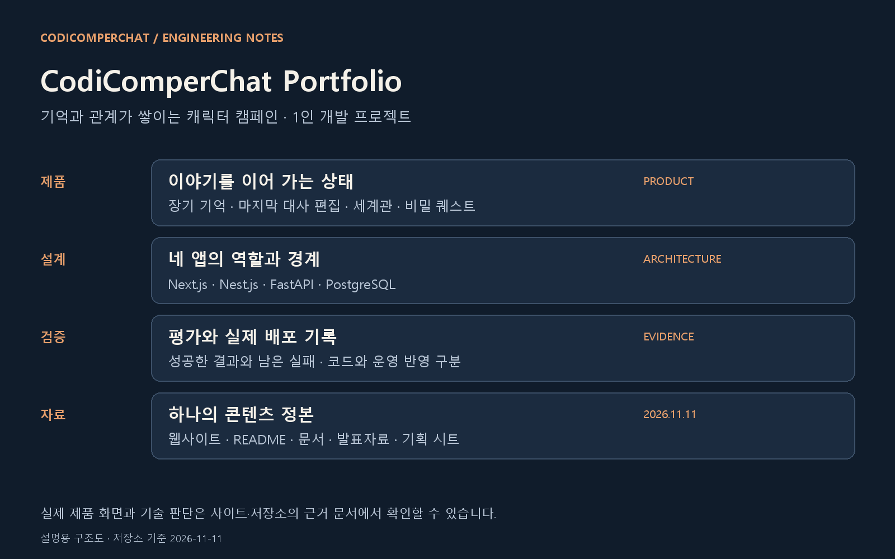
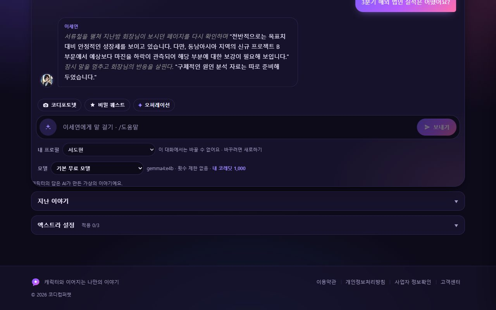
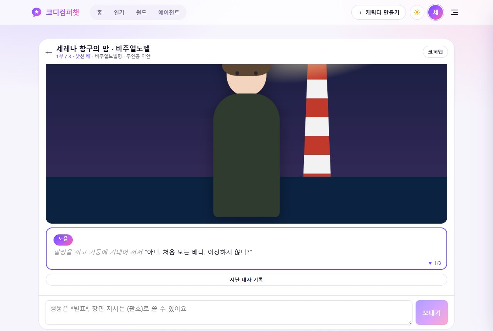
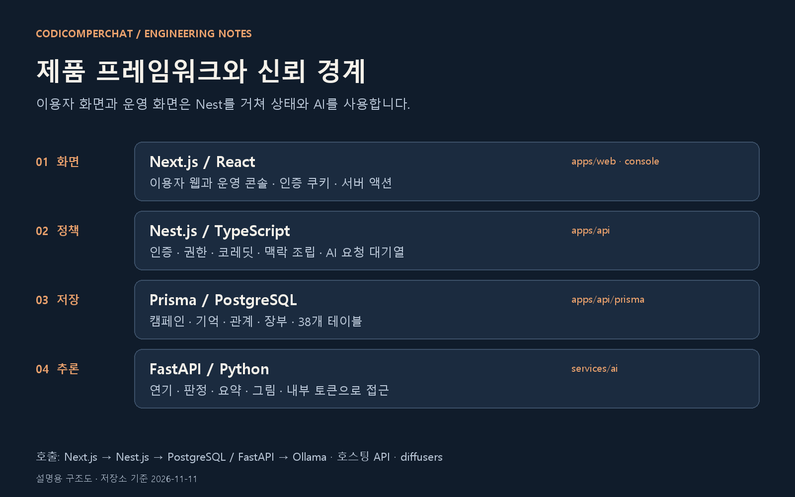
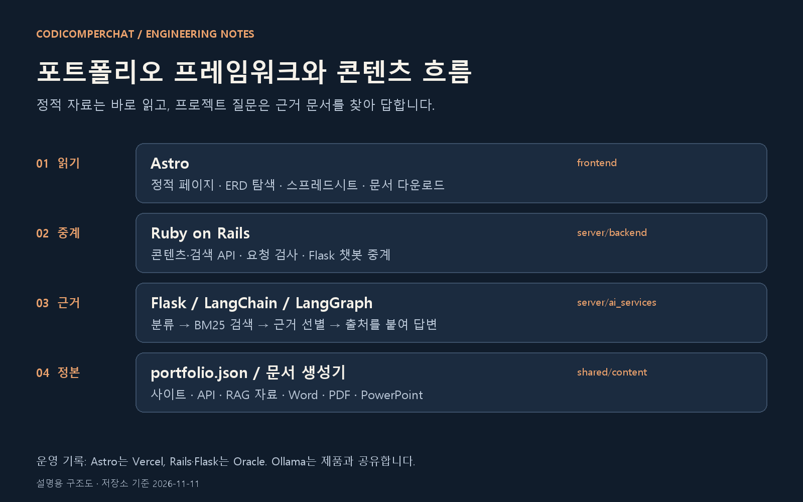
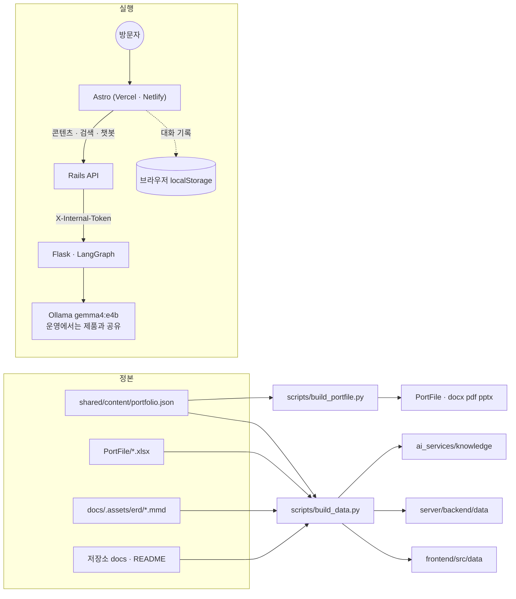

# 코디컴퍼챗 개발 포트폴리오



기억과 관계가 쌓이는 캐릭터 캠페인 「코디컴퍼챗」의 설계·구현·운영 기록입니다. 기획부터 웹·백엔드·AI·배포까지 맡은 1인 프로젝트를 실제 화면과 기술 판단으로 소개합니다. **2026-11-11 저장소 기준**으로 사이트, 다운로드 문서, 기획 시트와 AI 가이드의 근거 자료를 함께 갱신했습니다.

[포트폴리오 사이트](https://codicomperchat-portfolio.vercel.app) · [제품 사이트](https://codicomperchat-web.vercel.app) · [프레임워크 소개](https://codicomperchat-portfolio.vercel.app/frameworks) · [개발 기록](https://codicomperchat-portfolio.vercel.app/updates)

## 최근 변경

| 날짜 | 구현과 기록 | 운영 반영 |
|---|---|---|
| 11월 11일 | 호스팅 SSE, CPU 예비 입력·출력 축소, 배경 작업 예비 금지, 접근 오류 로그 | 제품 api·ai 재배포 대기. 개선 후 운영 속도 미측정 |
| 11월 9일 | 1:1 웹소켓 토큰 전달과 개인사 검사 후 최종 본문 교체 | 공개 API 적용 확인 필요 |
| 11월 8일 | 마지막 대사 수정·삭제·다시 쓰기, 직접 기억·자동 사실 수집, 때·곳 표시, 고객 문의 | 최신 코드와 운영 이미지를 구분 |
| 11월 8일 | 포트폴리오 Rails·Flask를 Oracle에 배포 | 당시 질문 한 번 약 50초. 제품과 Ollama 공유 시 지연·503 경험 |

시험 수는 [TESTING.md](../docs/plan/TESTING.md)의 날짜별 기록입니다. 11월 11일 기록은 API 249개·AI 단위 92개이며, E2E 사례 123개 전체가 현재 통과한다는 뜻은 아닙니다. 최근 실행에는 미해결 3건이 있습니다. 나레이션 48/48·보상 장면 20/20은 **11월 6일 e4b 평가**이고 호스팅 31B는 재평가 전입니다.

## 실제 제품 화면





기존 화면 이미지는 실제 개발 환경 캡처입니다. 그림 엔진·운영 콘솔 연결·메일·프리미엄 등 코드에 있어도 공개 서버에서 준비 중인 기능은 [STATUS.md](../docs/STATUS.md)와 [인수인계](../docs/AGENT_HANDOVER.md)를 기준으로 구분합니다.

## 프레임워크 소개

### 제품 프레임워크



| 도구 | 맡은 일 | 실제 코드 |
|---|---|---|
| Next.js·React | 이용자 웹과 운영 콘솔, 인증 쿠키·서버 액션·API 중계 | `../apps/web`, `../console` |
| Nest.js | 인증·권한·코레딧·캠페인 상태·맥락 조립·AI 요청 대기열 | `../apps/api/src` |
| Prisma·PostgreSQL | 캠페인·메시지·기억·관계·코레딧 장부 | `../apps/api/prisma` |
| FastAPI | 연기·판정·요약·그림 검수와 모델 공급자 연결 | `../services/ai/app` |

웹과 콘솔은 Nest만 호출합니다. Nest가 권한과 소유를 검사하고 필요한 맥락을 조립한 뒤 내부 토큰으로 FastAPI를 부릅니다. FastAPI는 제품 DB를 직접 읽지 않습니다.

### 포트폴리오 프레임워크



| 도구 | 맡은 일 | 선택 이유 |
|---|---|---|
| Astro | 정적 12페이지와 다운로드 파일 | 자료는 API·모델 응답 없이 읽을 수 있게 생성 |
| Ruby on Rails | DB 없는 콘텐츠·시트·ERD·검색 API, 챗봇 중계 | 입력 검사와 외부 HTTP 경계를 한곳에서 관리 |
| Flask | AI 가이드 HTTP API | Python 검색·모델 도구와 연결 |
| LangChain·LangGraph | 문서 분할·BM25 검색·근거 선별·조건 분기·생성 | 근거가 없으면 생성하지 않는 흐름을 명시 |

프레임워크 이미지는 설명용 도식입니다. [SVG 원본](frontend/public/shots/framework-portfolio.svg)과 [생성기](scripts/build_visuals.py)를 함께 보관합니다.

## 자료와 페이지

| 읽을 것 | 사이트 경로 | 저장소 파일 |
|---|---|---|
| 제품과 네 앱 | `/`, `/frontend`, `/console`, `/backend`, `/ai` | [콘텐츠 정본](shared/content/portfolio.json) |
| 개발 기록과 프레임워크 | `/updates`, `/frameworks`, `/future` | [업데이트 구조](../docs/Architecture/portfolio.md) |
| 데이터 탐색 | `/data`, `/erd` | [기획 시트](PortFile/), [ERD 정본](../docs/plan/ERD.md) |
| AI 가이드 | `/chat` | [Flask 안내](server/ai_services/README.md), [Rails 안내](server/backend/README.md) |
| 읽기·편집·발표 자료 | `/files` | [PDF](PortFile/CodiComperChat_Portfolio.pdf), [Word](PortFile/CodiComperChat_Portfolio.docx), [PowerPoint](PortFile/CodiComperChat_Portfolio.pptx) |

## 디렉터리와 콘텐츠 생성

사이트(Astro)·API(Rails)·RAG 자료·문서가 `shared/content/portfolio.json`을 읽습니다. 스프레드시트와 ERD는 각각의 원본에서 뷰어 데이터를 만듭니다.

```text
PortFolio
├─ frontend/            Astro 정적 12페이지 (개발 기록 · 프레임워크 전용 페이지 포함)
├─ PortFile/            결과 문서: Portfolio.docx · .pdf · .pptx, 기획 스프레드시트 .xlsx
├─ server/
│  ├─ backend/          Rails 8 API (DB 없음): 콘텐츠 · 시트 · ERD · 검색, 챗봇 중계
│  ├─ ai_services/      Flask: LangGraph RAG 챗봇 (Oracle 배포, e4b 하나)
│  └─ docker-compose.yml  backend + ai (+ ollama) + caddy 를 한 기계에
├─ shared/
│  ├─ content/portfolio.json   콘텐츠 정본 (모든 결과물이 읽는다)
│  └─ data/                    sheets.json · erd.json (생성)
└─ scripts/
   ├─ build_data.py       xlsx · ERD → JSON, 저장소 문서 → 챗봇 RAG 자료
   ├─ build_visuals.py    설명용 PNG · SVG
   ├─ build_portfile.py   콘텐츠 → docx · pdf, 발표자료 생성 호출
   ├─ build_presentation.mjs  콘텐츠 → 편집 가능한 pptx
   └─ update_workbook.mjs    기존 기획 시트에 최근 기록 갱신
```

<!-- logic-structure -->
## 로직 구조



정적 페이지는 Vercel에서 제공합니다. 검색·챗봇은 `PUBLIC_API_BASE`의 Rails를 거쳐 Oracle의 Flask·Ollama로 연결합니다. 모델은 `gemma4:e4b` 하나이며, 현재 연결 여부는 챗봇의 상태 표시와 API `/health`로 확인합니다.

## 로컬 실행

```bash
# 1) 데이터 (문서·스프레드시트를 고쳤을 때만)
python PortFolio/scripts/build_data.py

# 2) AI 서비스 (Ollama에 gemma4:e4b가 있어야 한다)
cd PortFolio/server/ai_services && python -m venv .venv && ./.venv/Scripts/python.exe -m pip install -r requirements.txt && ./.venv/Scripts/python.exe run.py   # :5001

# 3) 백엔드
cd PortFolio/server/backend && bundle install && bin/rails server -p 3000

# 4) 사이트
cd PortFolio/frontend && npm install && npm run dev    # http://localhost:4321

# 콘텐츠·자료를 고친 뒤 (저장소 루트)
python PortFolio/scripts/build_visuals.py
python PortFolio/scripts/build_data.py
python PortFolio/scripts/build_portfile.py
npm run build --prefix PortFolio/frontend
```

문서 생성에는 `python-docx`, `reportlab`, `Pillow`가 필요합니다. 데이터 읽기에는 `openpyxl`, 발표자료·시트 편집에는 Node.js에서 불러올 수 있는 `@oai/artifact-tool`이 필요합니다. Codex에서는 제공된 런타임을 사용합니다. 다른 환경에서는 `ARTIFACT_NODE`로 해당 Node 경로를 지정할 수 있습니다. 원본과 `frontend/public/files`는 생성 후 함께 갱신합니다. 화면·파일·정본 복사본은 `python PortFolio/scripts/verify_portfolio.py`로 확인합니다.

## 배포

| 무엇 | 어디 | 설정 |
|------|------|------|
| 사이트 | Vercel 또는 Netlify (Root/Base directory `PortFolio/frontend`) | `vercel.json` · `netlify.toml`, 빌드 환경변수 `PUBLIC_API_BASE=https://<API 주소>` |
| 백엔드 + AI | Docker가 있는 서버 한 대 (둘을 묶어 배포) | `server/docker-compose.yml`, `server/.env.example` → `.env`. Ollama도 같은 기계면 `--profile ollama` |

- 바깥에는 Caddy의 80·443만 열린다. Flask와 Ollama는 내부망에만 있고, Rails만 내부 토큰을 붙여 Flask를 부른다.
- 비밀값(`SECRET_KEY_BASE`, `AI_INTERNAL_TOKEN`)은 서버 `.env`에만 둔다. Rails credentials(`master.key`)는 쓰지 않는다.
- 챗봇 모델은 `gemma4:e4b` 하나다. 12b와 나눠 고르지 않는다.
- **2026-11-07 실제 배포 상태**
  - 사이트(Astro): Vercel `codicomperchat-portfolio` → https://codicomperchat-portfolio.vercel.app (정적 10페이지, 문서 내려받기 포함, 전 페이지 200 확인). Git 연동 없이 GitHub 소스 배포로 올렸다(Vercel GitHub 앱이 연결돼 있지 않아 프로젝트 생성 때 저장소 연결이 거부됨) → **푸시해도 자동 배포되지 않는다.** 고친 뒤에는 다시 배포해야 한다.
  - **2026-11-08 갱신: 백엔드(Rails) + AI(Flask)를 기존 Oracle 서버에 올렸다** (`server/docker-compose.oracle.yml`). 주소 `https://portfolio-api.168-110-61-178.sslip.io`, 사이트의 `PUBLIC_API_BASE`가 이를 가리키도록 다시 배포했다. 챗 질문은 실측 약 50초, 제품 대화와 Ollama를 나눠 써서 겹치면 503이 날 수 있다. 절차: `docs/web_management/oracle-backend.md`.
  - (2026-11-07 메모, 위에서 대체됨) 당시에는 `docker compose config` 검사까지만 했고 서버가 없었다.

## 시험

| 무엇 | 명령 | 수 |
|------|------|-----|
| AI 서비스 | `cd server/ai_services && ./.venv/Scripts/python.exe -m pytest -q` | 16 |
| 백엔드 | `cd server/backend && bundle exec rails test` | 9 (검증 44) |
| 사이트 | `npm run build --prefix PortFolio/frontend` | 12페이지 |

## 실측 (2026-11-07, 이 PC)

- 챗봇 모델은 `gemma4:e4b` 하나다. 2026-11-07에 `gemma4:12b`로 한 번 재봤을 때는 질문 한 번에 12~56초(첫 호출은 모델 적재 포함 102초)였고, 근거 문서 번호가 붙었다.
- 근거 선별: BM25 점수만으로는 "고양이 사료 추천" 같은 무관한 질문도 걸려서, 질문 핵심어 포함률 0.5 이상만 근거로 쓴다.
