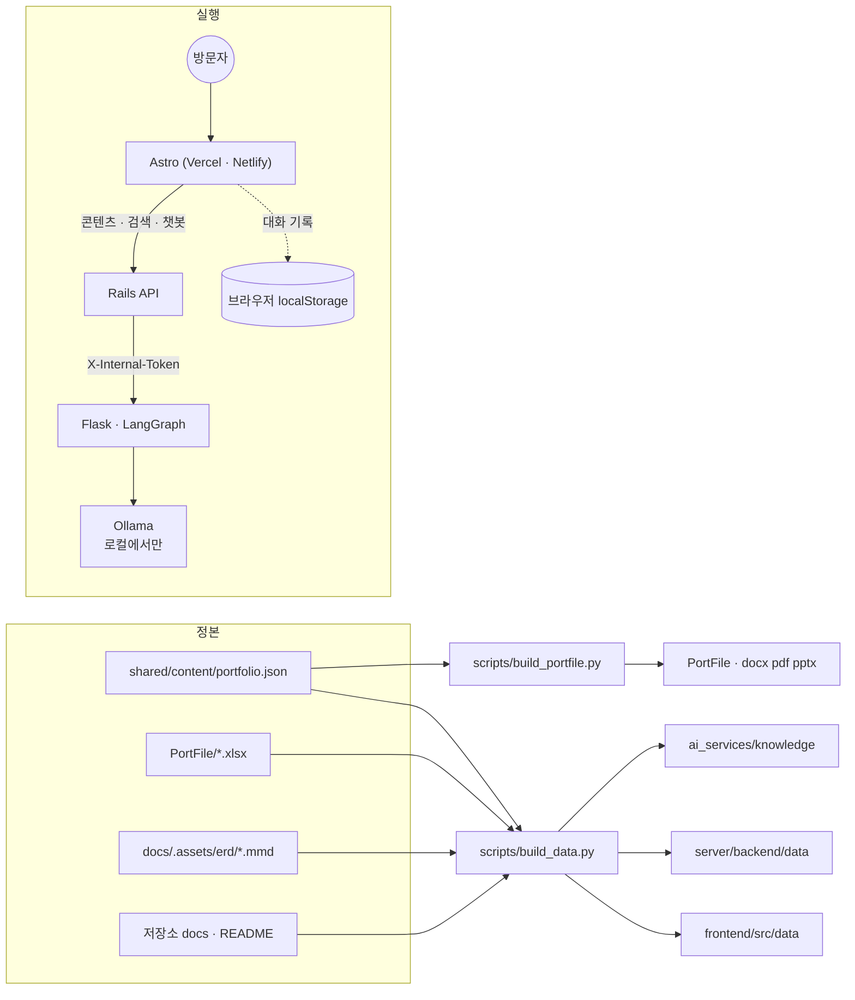

# PortFolio — 코디컴퍼챗 포트폴리오

1인 풀스택 프로젝트 「코디컴퍼챗」을 소개하는 포트폴리오 묶음. 사이트(Astro) · API(Ruby on Rails) · AI 가이드 챗봇(Flask + LangChain · LangGraph · RAG) · 문서(docx · pdf · pptx) · 기획 스프레드시트가 한 콘텐츠 정본에서 나온다.

```text
PortFolio
├─ frontend/            Astro 정적 사이트 (메인 · 층별 상세 5 · 스프레드시트 · ERD · AI 챗봇 · 문서)
├─ PortFile/            결과 문서: Portfolio.docx · .pdf · .pptx, 기획 스프레드시트 .xlsx
├─ server/
│  ├─ backend/          Rails 8 API (DB 없음): 콘텐츠 · 시트 · ERD · 검색, 챗봇 중계
│  ├─ ai_services/      Flask: LangGraph RAG 챗봇 (로컬에서만. 공개 사이트는 모델을 부르지 않음)
│  └─ docker-compose.yml  backend + ai (+ ollama) + caddy 를 한 기계에
├─ shared/
│  ├─ content/portfolio.json   콘텐츠 정본 (모든 결과물이 읽는다)
│  └─ data/                    sheets.json · erd.json (생성)
└─ scripts/
   ├─ build_data.py       xlsx · ERD → JSON, 저장소 문서 → 챗봇 RAG 자료
   └─ build_portfile.py   콘텐츠 → docx · pdf · pptx
```

<!-- logic-structure -->
## 로직 구조



공개된 사이트(Vercel)는 Astro 정적 페이지만 서빙한다. Rails · Flask · Ollama는 로컬에서 이 서버를 켰을 때만 동작하고, 모델은 `gemma4:e4b` 하나다.

## 로컬 실행

```bash
# 1) 데이터 (문서·스프레드시트를 고쳤을 때만)
python PortFolio/scripts/build_data.py

# 2) AI 서비스 (Ollama에 gemma4:e4b가 있어야 한다)
cd PortFolio/server/ai_services && python -m venv .venv && ./.venv/Scripts/python.exe -m pip install -r requirements.txt && ./.venv/Scripts/python.exe run.py   # :5001

# 3) 백엔드
cd PortFolio/server/backend && bundle install && bin/rails server -p 3000

# 4) 사이트
cd PortFolio/frontend && npm install && npm run dev    # http://localhost:4321

# 문서 다시 만들기
PortFolio/scripts/.venv/Scripts/python.exe PortFolio/scripts/build_portfile.py
```

## 배포

| 무엇 | 어디 | 설정 |
|------|------|------|
| 사이트 | Vercel 또는 Netlify (Root/Base directory `PortFolio/frontend`) | `vercel.json` · `netlify.toml`, 빌드 환경변수 `PUBLIC_API_BASE=https://<API 주소>` |
| 백엔드 + AI | Docker가 있는 서버 한 대 (둘을 묶어 배포) | `server/docker-compose.yml`, `server/.env.example` → `.env`. Ollama도 같은 기계면 `--profile ollama` |

- 바깥에는 Caddy의 80·443만 열린다. Flask와 Ollama는 내부망에만 있고, Rails만 내부 토큰을 붙여 Flask를 부른다.
- 비밀값(`SECRET_KEY_BASE`, `AI_INTERNAL_TOKEN`)은 서버 `.env`에만 둔다. Rails credentials(`master.key`)는 쓰지 않는다.
- 챗봇 모델은 `gemma4:e4b` 하나다. 12b와 나눠 고르지 않는다.
- **2026-11-07 실제 배포 상태**
  - 사이트(Astro): Vercel `codicomperchat-portfolio` → https://codicomperchat-portfolio.vercel.app (정적 10페이지, 문서 내려받기 포함, 전 페이지 200 확인). Git 연동 없이 GitHub 소스 배포로 올렸다(Vercel GitHub 앱이 연결돼 있지 않아 프로젝트 생성 때 저장소 연결이 거부됨) → **푸시해도 자동 배포되지 않는다.** 고친 뒤에는 다시 배포해야 한다.
  - **2026-11-08 갱신: 백엔드(Rails) + AI(Flask)를 기존 Oracle 서버에 올렸다** (`server/docker-compose.oracle.yml`). 주소 `https://portfolio-api.168-110-61-178.sslip.io`, 사이트의 `PUBLIC_API_BASE`가 이를 가리키도록 다시 배포했다. 챗 질문은 실측 약 50초, 제품 대화와 Ollama를 나눠 써서 겹치면 503이 날 수 있다. 절차: `docs/web_management/oracle-backend.md`.
  - (2026-11-07 메모, 위에서 대체됨) 당시에는 `docker compose config` 검사까지만 했고 서버가 없었다.

## 시험

| 무엇 | 명령 | 수 |
|------|------|-----|
| AI 서비스 | `cd server/ai_services && ./.venv/Scripts/python.exe -m pytest -q` | 12 |
| 백엔드 | `cd server/backend && bin/rails test` | 9 (검증 40) |
| 사이트 | `cd frontend && npx astro build` | 10페이지 |

## 실측 (2026-11-07, 이 PC)

- 챗봇 모델은 `gemma4:e4b` 하나다. 2026-11-07에 `gemma4:12b`로 한 번 재봤을 때는 질문 한 번에 12~56초(첫 호출은 모델 적재 포함 102초)였고, 근거 문서 번호가 붙었다.
- 근거 선별: BM25 점수만으로는 "고양이 사료 추천" 같은 무관한 질문도 걸려서, 질문 핵심어 포함률 0.5 이상만 근거로 쓴다.
