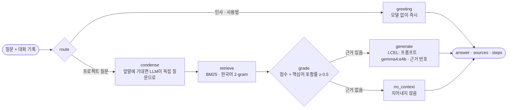

# PortFolio · AI 서비스 (Flask)

포트폴리오의 **AI 가이드 챗봇**. 저장소 문서·기획 스프레드시트·포트폴리오 콘텐츠를 근거로(RAG) 이 프로젝트가 어떻게 만들어졌는지 설명한다. LangChain으로 문서를 나누고 프롬프트·모델을 잇고, LangGraph로 질문 처리 흐름을 그래프로 짠다. 공개된 사이트는 이 서비스를 올리지 않아 모델을 부르지 않는다. 로컬에서 켤 때의 모델은 Ollama `gemma4:e4b` 하나다.

```bash
cd PortFolio/server/ai_services
python -m venv .venv && ./.venv/Scripts/python.exe -m pip install -r requirements.txt pytest
./.venv/Scripts/python.exe run.py                # http://127.0.0.1:5001
./.venv/Scripts/python.exe -m pytest -q          # 12개 (모델 없이, 가짜 채팅 모델)
```

<!-- logic-structure -->
## 로직 구조



| 단계 | LangChain / LangGraph | 판단 |
|------|------------------------|------|
| 자료 | `MarkdownHeaderTextSplitter` → `RecursiveCharacterTextSplitter`(900자, 겹침 120) | 제목 단위로 먼저 나눠 근거가 절 단위로 보이게. 뒤 조각에도 절 제목을 붙여 색인 |
| 검색 | `BM25Retriever` + 한국어 2-gram 토큰화 | 본 서비스의 페르소나 지식 검색과 같은 판단: 벡터 DB 없이, 조사·띄어쓰기에 덜 흔들리게 |
| 근거 선별 | 그래프의 `grade` 노드 | BM25 점수만 보면 "추천" 같은 흔한 낱말 하나로 무관한 질문도 걸린다 → 질문 핵심어(조사·서술어 제거, 한↔영 별칭) 중 절반 이상이 들어 있어야 근거 |
| 생성 | `ChatPromptTemplate` + `MessagesPlaceholder`(최근 8턴) + `ChatOllama` + `StrOutputParser` | 자료에 없는 것은 "찾지 못했다", 문장 끝에 [n] |
| 흐름 | `StateGraph` 노드 7개, 조건 분기 2개 | 인사는 모델을 부르지 않고, 근거가 없으면 생성으로 가지 않는다 |

## API

| 메서드 | 경로 | 응답 |
|--------|------|------|
| GET | `/health` | 조각 수, 자료 문서 수, 모델, Ollama 연결·모델 설치 여부 |
| GET | `/graph` | 그래프 mermaid · 노드 목록 |
| POST | `/chat` | `{message, history}` → `{answer, sources[{n, source, heading, score, snippet}], steps[{node, ms}], model, standalone, ms}` · 빈 질문·1000자 초과 400 · 두 모델 모두 실패 503 |

`AI_INTERNAL_TOKEN`이 있으면 `X-Internal-Token`이 맞는 요청만 받는다(Rails가 붙인다). `/health`는 토큰 없이 연다.

## 환경변수

| 키 | 기본 | 무엇 |
|----|------|------|
| `OLLAMA_BASE_URL` | `http://localhost:11434` | Ollama 주소 |
| `CHAT_MODEL` · `FALLBACK_MODEL` | `gemma4:e4b` · `gemma4:e4b` | 모델은 e4b 하나. 예비도 같은 이름이라 다른 모델로 넘어가지 않는다 |
| `RAG_TOP_K` · `RAG_MIN_SCORE` | 10 · 1.5 | 검색 후보 수, 최소 BM25 점수 |
| `AI_INTERNAL_TOKEN` | 비움 | Rails와 나눠 갖는 내부 토큰 |
| `ALLOWED_ORIGINS` | `http://localhost:4321` | 브라우저가 직접 부를 때의 CORS(보통은 Rails를 거친다) |

## 실측 (2026-11-07, 이 PC · RTX 4070 SUPER 12GB)

- 2026-11-07에 `gemma4:12b`로 재봤을 때 첫 호출 102초(모델 적재 포함), 이후 12~56초였다. 지금 모델은 `gemma4:e4b` 하나다. `gemma4`의 생각(thinking) 출력을 켜 두면 답 길이 상한을 생각에 다 써 **빈 답**이 나와서 `reasoning=False`로 끈다.
- `langchain-community`는 유지 종료 예고가 나왔다(BM25Retriever가 여기에 있다). 바꿀 때는 `rank_bm25`를 직접 쓰는 작은 Retriever로 옮긴다.

자료는 `PortFolio/scripts/build_data.py`가 `knowledge/`에 만든다. 문서를 고치면 다시 돌린다.
