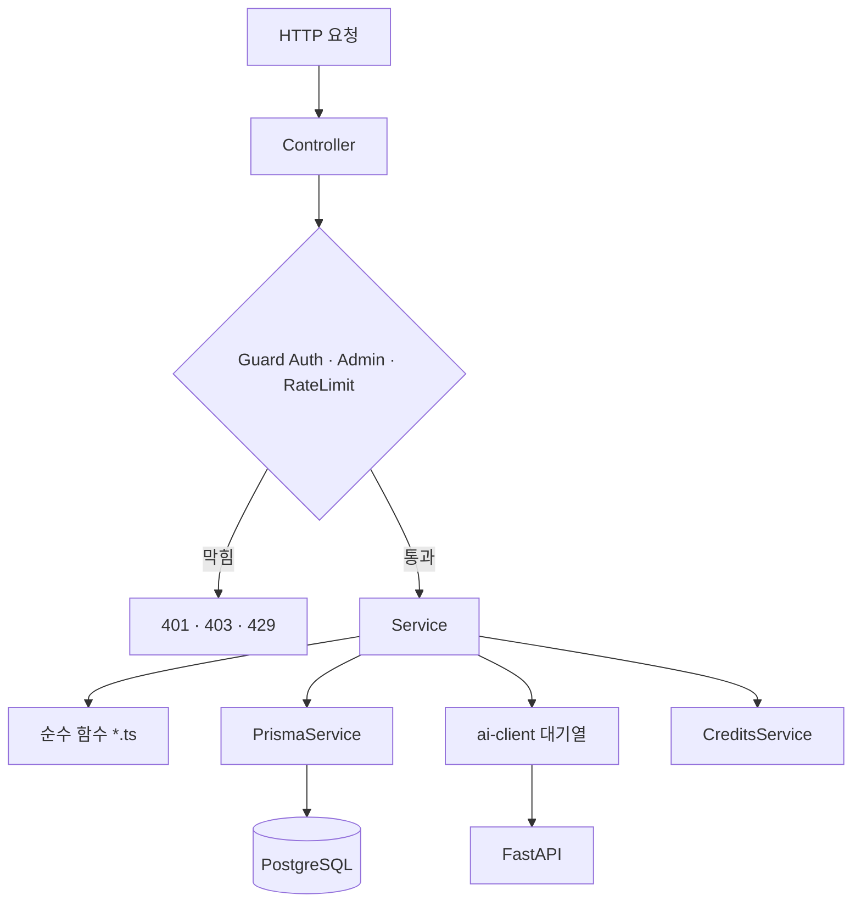
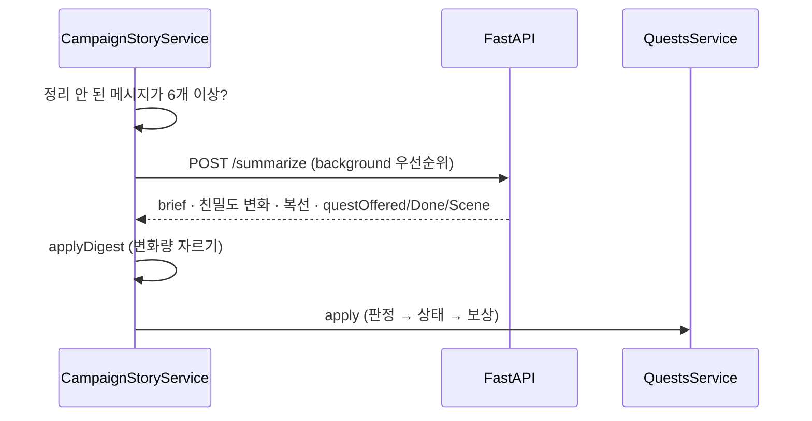
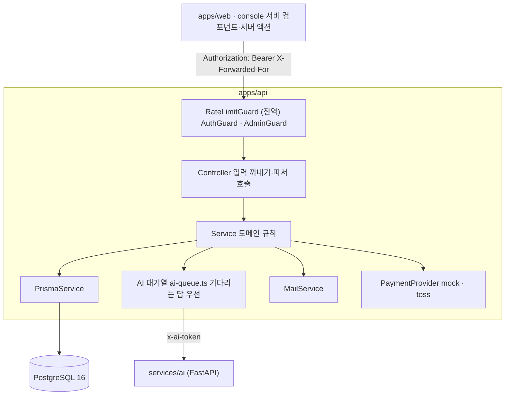
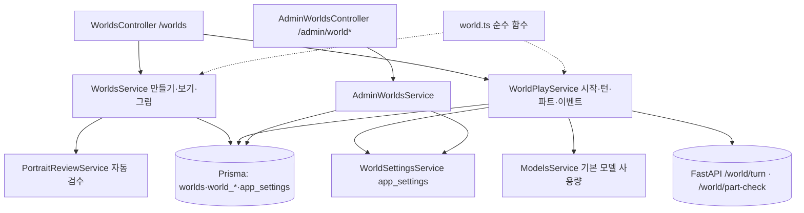

<!-- source: apps/api/README.md -->
# apps/api

코디컴퍼챗 도메인/상태 API. Nest.js 12 (TypeScript, ESM) + Prisma 7. 외부(웹·콘솔)에 공개되는 **유일한 백엔드**이고 **신뢰 경계**다 — 인증·권한·소유 확인·요청 한도·입력 검사를 모두 여기서 한다. DB 접근도 이 앱에만 있다. 운영(2026-11-07)에서는 Oracle에서 돌고, 대화 모델은 NVIDIA `gemma-4-31b-it`(막히면 `gemma4:e4b`)이다. 코드에 있는 기능과 지금 열리는 범위는 [../../docs/STATUS.md](../../docs/STATUS.md).

```bash
# 저장소 루트에서
npm install
cp apps/api/.env.example apps/api/.env      # DATABASE_URL, AUTH_SECRET(32자 이상) 필수
(cd apps/api && npx prisma migrate deploy && npm run prisma:seed)
npm run dev:api        # http://localhost:4000
npm run typecheck:api  # 개발 서버가 켜져 있을 땐 build:api 말고 이것 (dist를 지워 서버가 죽는다)
npm run test:api       # vitest (DB·SMTP가 있으면 통합 시험 포함)
```

## 로직 구조

```text
main.ts ─ 본문 파서(json · raw 그림 300kb) · CORS · 보안 헤더
   │
app.module.ts ─ 모듈 30여 개를 묶는다
   │
요청 ─▶ Controller ─▶ Guard (AuthGuard · AdminGuard · RateLimitGuard)
            │
            ▼
        Service ───────────────┬──────────────────────┬──────────────────────┐
            │                  │                      │                      │
            ▼                  ▼                      ▼                      ▼
     순수 함수 *.ts       PrismaService          ai-client.ts           CreditsService
     (*.spec.ts로 시험)   (PostgreSQL)           (AI 대기열 → FastAPI)  (차감·환불·보상)

대표 모듈
  character-chat ─ 대화 한 턴 (맥락 조립 → 1:1은 /infer/stream, 그 밖은 /infer → 개인사 검사 → 저장). 마지막 대사 수정·다시 쓰기, 때·곳
  campaign-state ─ 뒤에서 정리 (/summarize → 친밀도·복선·요약·퀘스트 판정 반영)
  quests         ─ 비밀 퀘스트 상태 (건넴 → 달성 → 보상 장면 한 번)
  worlds         ─ 월드코퍼챗 (세계관·플레이·파트·이벤트·보상)
  studio         ─ 공방 초안 → 3턴 테스트 → 발행
  operations     ─ 심리 탐구·일기·메시지·커뮤니티·코디포토넷·웹툰
```

### 요청이 지나가는 층



### 뒤에서 하는 이야기 정리



## 아키텍처



### 이 앱이 맡는 것

이 앱은 **신뢰 경계**다. 웹과 콘솔의 화면 거름망은 편의일 뿐이고, 아래는 모두 여기서 다시 판단한다.

| 판단 | 어떻게 | 어디 |
|------|--------|------|
| 누구인가 | JWT 서명 + 매 요청 DB로 계정·세대(`sessionVersion`)·정지 확인 | `auth/session.ts` |
| 운영자인가 | 토큰이 아니라 DB의 역할을 매번 읽는다 | `auth/admin.guard.ts` |
| 너무 많이 부르나 | `@RateLimit('이름')`이 붙은 라우트만 사람·IP별 고정 창으로 센다 | `security/rate-limit.ts` |
| 볼 수 있는 캐릭터인가 | 공개 범위·내려감·주인 확인. 공개 필드 목록으로만 읽어 비밀이 응답에 섞이지 않는다 | `characters/` |
| 이 모델을 써도 되나 | 준비 → 나이 → 월 상한 → 코레딧 순으로 잠금을 판단한다 | `models/models.ts` |
| 돈이 맞나 | 코레딧 잔액 확인과 차감을 한 문장으로, 실패하면 환불 | `credits/` |
| 운영 설정이 안전한가 | 개발용 스위치가 켜져 있으면 시작하지 않는다 | `security/production.ts` |

### 대화 한 턴 (`POST /characters/:id/chat`)

화면의 일반 1:1 보내기는 이 경로가 아니다. `POST /characters/:id/chat/live`로 일회용 표를 주고, 브라우저가 `/ws/chat`으로 붙으면 아래 4번이 `/infer/stream`이다. 로컬 조각만 소켓으로 나가고, 개인사 검사가 답을 고치면 화면 글을 바꾼 뒤 저장한다. 소켓은 추론을 나누지 않는다. 이 표의 HTTP는 명령어·빈 이어가기처럼 답이 끝난 뒤 한 덩어리로 온다.

| 순서 | 일 | 코드 |
|------|-----|------|
| 1 | 요청 한도(1분 20번), 로그인, 볼 수 있는 캐릭터, 고정된 프로필 확인 | `character-chat.controller.ts`, `character-chat.service.ts` |
| 2 | 맥락 조립: 카드 핵심, 지식 조각, 기억, 엑스트라, 상태, 최근 30턴. 비밀은 넣지 않는다 | `character-chat.context.ts`, `persona-rag/` |
| 3 | 모델을 고르고 횟수나 코레딧을 잡는다 | `models/models.service.ts` |
| 4 | 대기열을 지나 `/infer` 호출 | `ai/ai-client.ts`, `ai/ai-queue.ts` |
| 5 | 설정에 없는 개인사를 물은 턴이면 `/ground-check`, 지어냈으면 최대 2번 다시 쓴다 | `character-chat/grounding.ts` |
| 6 | 답을 받은 뒤에만 유저 말과 답을 저장한다. 못 받으면 잡은 것을 돌려준다 | `character-chat.service.ts` |
| 7 | 메시지 6개마다 뒤에서 기억·요약·친밀도·복선·퀘스트를 정리한다 | `memories/`, `campaign-state/`, `quests/` |

### 실패할 때

| 상황 | 응답 | 데이터 |
|------|------|--------|
| 요청 한도 초과 | 429, `Retry-After` | 변화 없음 |
| 기다리는 답이 대기열에서 60초 초과 | 503 | 저장 안 함, 코레딧 환불 |
| 모델 응답이 130초 초과 (배경 150초) | 504 | 저장 안 함, 코레딧 환불 |
| 그림 엔진 꺼짐 | 503 | 코레딧을 빼기 전에 막는다 |
| 그림 검수에서 막힘 | 422 | 코레딧 환불, 그림 저장 안 함 |
| 배경 정리 실패 | 응답에 영향 없음 | 다음 기회에 다시 |

데이터 모델은 [../../docs/plan/DATABASE.md](../../docs/plan/DATABASE.md), 상태의 흐름은 [../../docs/Architecture/data-flow.md](../../docs/Architecture/data-flow.md).

## 모듈 (`src/`)

| 모듈 | 하는 일 |
|------|---------|
| `auth` `account` | 가입·로그인·비밀번호·이메일 인증·재설정, 토큰 세대, 회원 탈퇴, **성인 확인**(`adult.ts`) |
| `characters` `character-chat` `conversations` | 캐릭터 목록·상세, 대화(컨텍스트 조립·새로하기·이어하기·대답 추천), 대화 기록 |
| `memories` `campaign-state` `chat-state` `extras` `personas` `persona-rag` | 기억, 지난 이야기(요약·친밀도·복선), 상태설정, 엑스트라, 내 프로필, 캐릭터 지식 검색 |
| `studio` | 공방: 초안·AI 초안·퀘스트 AI 제작·3턴 테스트·발행·초상·검수 |
| `quests` | 비밀 퀘스트: 진행·판정 반영·코레딧 보상 |
| `operations` | 오퍼레이션(심리 탐구·일기·메시지·커뮤니티), **코디포토넷**, **웹툰** |
| `credits` `models` `plan` `billing` | 코레딧(출석·차감·환불), 대화 모델 조건(강화 무료 하루 한도, 프리미엄 나이·월 상한), 요금 등급, 눌러서 프로로, 결제(보류) |
| `reports` `content-reports` `admin` | 캐릭터 신고, 그림 신고(접근 차단·계정 정지), 운영 콘솔용 통계·검수·관리 |
| `ai` `security` `mail` `agent-chat` `health` `prisma` | FastAPI 호출·대기열, 요청 한도, 메일, 안내 챗봇, 상태 확인, DB |
| `campaigns` | 계획서 §13.1 경로 자리(501). 실제 대화는 `character-chat` |

모듈은 `*.module.ts` + `*.controller.ts` + `*.service.ts`가 기본이고 계층은 Controller → Service → Prisma다(별도 Repository 없음). 입력 검증은 모듈마다 작은 파서 함수로 한다. 테이블 38개 — [../../docs/plan/DATABASE.md](../../docs/plan/DATABASE.md). 안내의 28개는 월드 표가 들어가기 전 수다.

- 엔드포인트 목록: [../../docs/API_DOCUMENTATION.md](../../docs/API_DOCUMENTATION.md)
- 계층 규칙: [../../docs/Architecture/layers.md](../../docs/Architecture/layers.md) · 폴더 구조: [../../docs/plan/PROJECT_STRUCTURE.md](../../docs/plan/PROJECT_STRUCTURE.md)
- 환경변수: [../../docs/guidance/environment.md](../../docs/guidance/environment.md)
- 보안 장치와 공개 전 필수: [../../SECURITY.md](../../SECURITY.md)

## 월드코퍼챗 모듈 (`src/worlds`, 2026-11-06)



- **결과는 서버가 정한다.** 미니게임 판정(`resolveEvent`), 보상 금액(`rewardFor`, `crypto.randomInt`), 숨긴 값은 `setup` JSON에만 두고 `publicView`로 화면에 보낼 것만 고른다.
- **보상 한도**는 `pg_advisory_xact_lock(hashtext('world-event:'+userId))` 안에서 센다. `status = OPEN`인 행만 바꿔 같은 이벤트 두 번 받기를 막는다.
- 시험: `world.spec.ts` 15개 + e2e `worlds.spec.ts` 6개. API 전체 226개(파일 30개).
- 정본 [../../docs/plan/WORLD_COPPERCHAT.md](../../docs/plan/WORLD_COPPERCHAT.md).

## 도구

`apps/api/scripts/`(루트에서 `npm run <이름> --workspace api -- …`): `user:role`(운영자 지정) · `user:plan`(등급) · `persona:build`·`persona:search`(캐릭터 지식) · `billing:check`(토스 연결) · `mail:check`(메일). `prisma:seed`는 공식 캐릭터(유지성, 비밀 퀘스트 포함)를 맞춘다.

## 주의

- **ESM이다.** 상대 import에는 `.js` 확장자를 붙인다 (`./app.module.js`). TS 파일을 가리켜도 `.js`로 쓴다.
- 테스트는 Jest가 아니라 **vitest**, 린트는 ESLint가 아니라 **oxlint**다(CI는 `--deny-warnings`).
- FastAPI(`services/ai`)는 이 앱만 내부망에서 호출한다. 웹이 직접 호출하지 않는다 (기획서 §7.1). 그래서 FastAPI에는 인증이 없다.
- 비밀(`Character.secret`·해금 조건)과 비밀 퀘스트의 달성 조건은 공개 응답에도 AI에도 싣지 않는다.