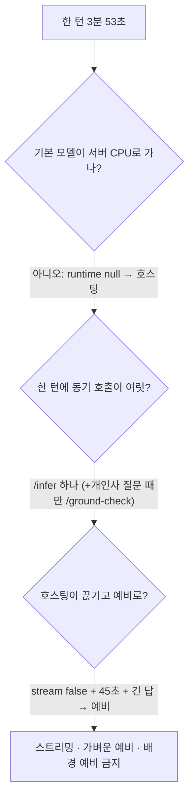

<!-- source: docs/find_debug/2026-11-11.md -->
# 2026-11-11 디버깅 기록

## 로직 구조

```text
한 턴 3분 53초 (배포)
   │ 기록된 값: 호스팅 짧은 인사 19초 · CPU 예비 32초 · 호스팅 시간 제한 45초
   ▼
45초 + (긴 프롬프트 CPU 예비 ≈ 3분) ≈ 3분 53초
   │ 고침
   ▼
호스팅 스트리밍(조각 사이 40초) · 가벼운 CPU 예비 · 배경 작업은 예비 금지
```

### 판단 과정



## 1. 1:1 한 턴 3분 53초

- **증상:** 배포 환경(Vercel 웹 + Oracle A1 2 OCPU, 대화는 NVIDIA 호스팅 `gemma-4-31b-it`, 예비 CPU `gemma4:e4b`)에서 한 턴이 약 3분 53초.
- **처음 의심:** 기본 모델이 서버 CPU로 간다? → `apps/api/src/models/models.ts`의 기본 모델은 `runtime: null`이라 `llm.py`에서 호스팅으로 간다. 아님.
- **두 번째:** 한 턴에 모델 호출이 여럿? → 기다리는 동안의 호출은 `/infer` 하나, 개인사 질문일 때만 `/ground-check`와 다시 쓰기. 기억·요약은 뒤에서(배경). 아님.
- **원인:** 호스팅 호출이 `stream: False`라 45초 안에 **답 전체**가 와야 했다. 넘기면 CPU 예비가 같은 긴 프롬프트를 처음부터 읽었다. 45초 + 약 3분이 보고된 시간과 맞는다. 배경 작업이 예비로 내려가면 하나뿐인 CPU 자리를 막는 것도 같이 고쳤다.
- **확인하지 못한 것:** 서버 개인키가 이 PC에 없어 서버 로그를 보지 못했다. 위 원인은 코드와 [../trainings/oracle-deploy-latency.md](../trainings/oracle-deploy-latency.md)의 기록값으로 맞춘 것이다.
- **고침과 시험:** [../trainings/oracle-deploy-latency.md](../trainings/oracle-deploy-latency.md) "2026-11-11".
- **재발 방지:** 바깥 호출의 시간 제한은 "전체"가 아니라 "조각 사이"에 건다. 예비는 가볍게, 배경 작업은 예비를 쓰지 않는다.

## 2. 웹·콘솔 빌드 타입 오류로 e2e가 시작조차 못 함

- **증상:** `npm run test:e2e`가 준비 단계(`e2e/prepare.mjs`의 웹 빌드)에서 멈췄다. Vercel 웹 빌드도 같은 검사를 지나므로 3527c5f 이후 배포가 실패했을 수 있다(Vercel 기록은 확인하지 못함).
- **원인 1:** `apps/web/app/characters/[id]/chat/character-chat.tsx` — 클로저 안의 `let replyId: number | null`을 새 메시지 id로 써 `number | null`이 `DisplayMessage.id`에 맞지 않았다(3527c5f). 상수로 받아 넣는다.
- **원인 2:** `console/app/page.tsx` — API가 보내는 `openInquiries`가 타입에 없었다(74b126a). 타입에 더한다.
- **남은 e2e 실패 3개 (이번 변경과 무관, 고치지 않음):** 빌드가 막혀 그동안 드러나지 않았다.
  - `worlds.spec.ts:142` 빈 턴에 400을 기대하지만 1751f2e(빈칸 보내기로 다음 장면) 뒤로 200
  - `mypage.spec.ts:5` 요금 카드의 강화 모델 이름을 고정값(`gemma4:12b`)으로 기대하지만 로컬 `.env`의 호스팅 모델 이름이 나온다
  - `security.spec.ts:121` 푸터 "약관 및 정책"의 이용약관 링크를 찾지 못함
- **재발 방지:** 웹을 건드린 커밋은 `npm run build:verify`(또는 웹 `tsc --noEmit`)를 같이 돌린다.

## 3. 배포에서 "LLM 호출 실패"가 사용자에게 그대로 보임

- **증상:** 배포 웹에서 대화가 "LLM 호출 실패"로 끝났다는 보고. 실제 오류 문장은 받지 못했다.
- **확인한 것:** Vercel 웹은 24시간 런타임 오류 없음·최신 배포 정상, 공개 API `/health` 200, NVIDIA 공개 목록에 `google/gemma-4-31b-it` 있음. 이 문구는 호스팅 API가 4xx를 돌려줄 때만 나온다(`llm.py`).
- **확인하지 못한 것:** 서버 개인키가 없어 AI 서비스 로그와 실제 NVIDIA 응답(키 만료·모델 접근 거부인지)을 보지 못했다. 근본 원인은 서버에서 확인해야 한다(→ 아래 명령).
- **고친 것:** 키 만료·결제·접근 거부(401·402·403·404)는 서버 설정 문제라 사용자가 기다리는 답이면 CPU 예비로 대신 답한다. 호스팅이 막힐 때마다 상태 코드와 응답 앞부분을 `codicomperchat.llm` 경고 로그로 남긴다. 400·422는 우리 요청 잘못이라 예비로 덮지 않는다. 배경 작업은 예전처럼 예비로 가지 않는다.
- **트레이드오프:** 키가 만료된 채로 두면 매 턴이 예비(느림)로 간다. 대신 사용자에게는 답이 간다. 로그의 "CPU 예비로 대신 답한다" 줄이 계속 보이면 키를 갈아야 한다.
- **서버에서 원인 확인:**

```bash
$SSH "cd ~/codicomperchat && $C logs --tail 200 ai | grep -E '호스팅 API 실패|LLM 호출 실패'"
```

- **재발 방지:** 외부 API 실패는 상태 코드와 함께 로그에 남긴다. 사용자에게 보이는 오류와 서버 로그의 원인이 한 줄로 이어져야 한다.