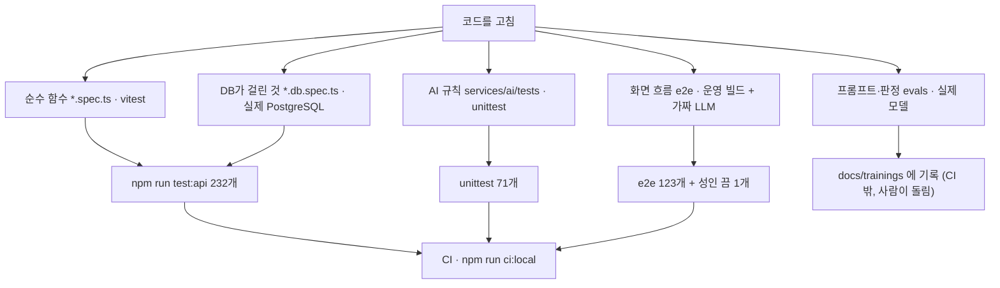
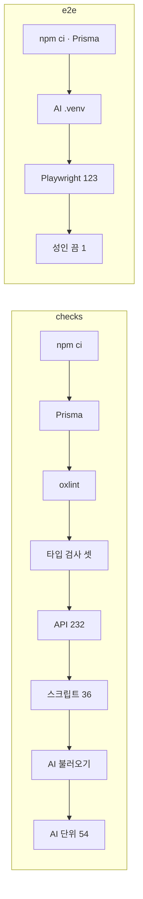

<!-- source: docs/plan/TESTING.md -->
# 테스트 전략

> 시험 수의 정본은 이 문서다. 다른 문서에는 수를 적지 않고 여기를 가리킨다.
>
> 상태(2026-11-07): **`apps/api` vitest 232개(파일 31개), 웹 화면 Playwright e2e 123개(파일 26개) + 성인 모드를 끈 서버 전용 1개, AI 품질 평가(`services/ai/evals`, 11묶음 + 별도 평가 7개), `services/ai` unittest 71개(파일 9개), 기록 작성기 시험 6개, 에이전트 어댑터 시험 30개가 실재.** 전체 e2e는 운영 빌드로 돌려 통과한다. 실제 모델 평가는 2026-11-06에 나레이션·보상 장면을 고친 뒤 모두 기준을 넘었다(아래 "실제 모델 평가").

## 로직 구조

```text
코드를 고침
  ├─ 순수 함수 ─▶ *.spec.ts (vitest, DB 없음)        ┐
  ├─ DB가 걸린 것 ─▶ *.db.spec.ts (실제 PostgreSQL)   ├─ npm run test:api (232)
  ├─ AI 규칙 ─▶ services/ai/tests (unittest, 모델 없음) (71)
  ├─ 화면 흐름 ─▶ e2e (운영 빌드 + 가짜 LLM) (123 + 성인 끔 1)
  └─ 프롬프트·판정 ─▶ evals.* (실제 모델, CI 밖, 사람이 돌림)
                         │
병합 전: typecheck · lint · 위 전부 ─▶ CI(GitHub Actions) / npm run ci:local
```

### 시험 층



### CI 두 잡



## 앱별 도구

| 앱 | 도구 | 상태 | 계층 |
|----|------|------|------|
| `apps/api` (Nest.js) | **vitest** (`vitest.config.ts` / `vitest.config.e2e.ts`), 린트는 **oxlint** | 실재 — 232개 통과(2026-11-07) | 순수 로직(카드 검증·성인 나이·퀘스트 진행·모델 조건·요청 한도·결제 상품 등)·DB가 필요한 저장소. 흐름은 e2e가 본다 |
| `apps/web` (Next.js) | **Playwright e2e** (`e2e/`, 가짜 LLM·가짜 그림 엔진, 별도 포트·DB) | 실재 — 117건 + 성인 끔 1건 통과 | 화면과 API 흐름 회귀(가입·대화·공방·신고·결제·코레딧·모델·오퍼레이션·코디포토넷·웹툰·성인 가드·비밀 퀘스트·테마·글 꾸미기). 사용법: [e2e/README.md](../../e2e/README.md) |
| `services/ai` 품질 | **evals** (`python -m evals.run`, 실제 모델) | 실재 — 11묶음 + 별도 7개(`adult_chat`·`world_turn` 2026-11-06) | 말투·설정 덮어쓰기·메타 발언·강의식·개인사 단정·판정 안정성·초상 검수 규칙·정상 그림·검수 안정성·나레이션·웹툰 콘티(`tone` 포함 11묶음). 사용법: [services/ai/README.md](../../services/ai/README.md) |
| `services/ai` (FastAPI) | **unittest** (`python -m unittest discover tests`) | 실재 — 71개(2026-11-07, 무료 호스팅 API 대화·스트리밍 시험 포함) | 그림 검수 규칙, 초상, 프리미엄 요청 모양, 장면 지시 나레이션, 보상 갈래 나누기·고르기, 대화 수위(성인·미성년자·강제 단서). 라우트 시험은 없다 |

> Nest 12는 Jest가 아니라 **vitest**로 스캐폴드된다. 이전 판 문서에 "Nest 기본 Jest"라고 적혀 있었으나 실제와 달라 바로잡았다.

## 명령

```bash
npm run test:api        # vitest 단위 테스트
npm run test:api:e2e    # vitest e2e (앱을 띄워 라우트 확인)
npm run test:e2e        # 웹 화면 e2e (Chrome, 가짜 LLM, 별도 DB, 운영 빌드). 빌드 포함 약 5분
npm run test:e2e:adult-off   # ADULT_MODE=off 서버의 화면. test:e2e 뒤에 돌린다(빌드를 다시 쓴다)
```

AI 품질은 `cd services/ai && ./.venv/Scripts/python.exe -m evals.run` (로컬 Ollama 필요).

**e2e를 돌릴 때는 그림 엔진(WebUI)을 끈다.** 포트·DB·빌드 폴더가 개발 환경과 겹치지 않아 개발 서버는 켜 둬도 된다. `next dev`로 돌리던 때는 RAM 16GB에서 무작위 시간 초과가 났고, 운영 빌드로 바꾼 뒤 남은 RAM 약 400MB에서도 통과했다([../find_debug/2026-11-03.md](../find_debug/2026-11-03.md)).

## 시험이 지키는 약속 (보안·안전 포함)

| 약속 | 어디서 |
|------|--------|
| 비밀·해금 조건·퀘스트 달성 조건이 공개 응답에 없다 | e2e `quest`, `studio`, `chat` |
| 남의 그림·대화·웹툰 컷은 404, 성인 그림은 성인 확인이 살아 있을 때만 | e2e `operations`(코디포토넷 수위), `webtoon` |
| 미성년자 관련 설정은 성인 모드에서 그리기 전에 거절하고 코레딧을 돌려준다 | e2e `operations`, `webtoon` |
| 코레딧이 음수가 되지 않고, 실패하면 환불, 퀘스트 보상은 계정×캐릭터당 한 번 | e2e `models`, `operations`, `quest`, `webtoon` |
| 요청 한도, 로그인 무차별 대입 방어, 토큰 세대(비밀번호 변경 시 이전 토큰 무효) | e2e `security`, `auth`, API 단위 |
| CSP·보안 헤더 | e2e `security` |

## 실제 모델 평가

가짜 LLM·가짜 그림 엔진은 흐름만 본다. 모델이나 프롬프트를 바꾸면 평가를 다시 돌린다. 기준을 낮춰 통과시키지 않는다.

최근 결과(2026-11-06, `gemma4:e4b`): 나레이션과 보상 장면을 고친 뒤 `evals.run` 11묶음 모두 통과(나레이션 16/16, 표본을 늘려 48/48), 보상 장면 20/20(갈래 고르기 6/6). 고치기 전에는 나레이션 7/12, 보상 2/8이었다. 이세연 판정 20/20, 유지성 판정 15/16, 잘못 통과 0건. 그림 가드는 2026-11-04에 2번 돌려 애니메이션을 1번 잘못 막았다.

표 전체, 실패 항목, 이전 결과 비교: [../trainings/eval-2026-11-06.md](../trainings/eval-2026-11-06.md). 미달 항목의 할 일: [../TASKS.md](../TASKS.md) 3장. 평가에 없는 손 확인은 서버 안 그림 엔진의 화풍별 품질이다.

## 자동 테스트보다 먼저 확인해야 하는 것 — 플레이테스트 시트 (계획서 §14)

이 제품의 핵심 실패는 유닛테스트로 잘 안 잡힌다("말투가 20턴 버티는가" 같은 것). 데모 전 통과 기준:

1. 첫 화면만 보고 "캐릭터챗" 외에 무엇이 다른지 한 문장으로 말할 수 있는가
2. 첫 5턴 안에 비서가 아니라 인물이 보이는가
3. 세션을 닫고 다시 열었을 때, 캐릭터가 시스템 로그가 아니라 자기 입으로 지난 일을 꺼내는가
4. 아직 잠긴 비밀을 유저가 유도해도 먼저 털지 않는가
5. 같은 질문 `"지금 뭐 해?"`를 공방 샘플과 실제 세션에서 비교해도 말투가 같은가
6. 관계 숫자를 숨겨도 대사만으로 관계가 변한 느낌이 나는가
7. 로어를 많이 넣은 카드에서 최근 장면이 흐려지지 않는가
8. FastAPI가 죽어도 Nest가 유저 메시지를 잃지 않는가 (적어도 저장)
9. 공방에서 갈등과 비밀이 비어 있으면 발행이 막히거나 강하게 경고되는가
10. 팀이 "학습이 없어서 차별점이 없다"고 느끼는가 — 느낀다면 상태 UI가 약하거나 카드가 약한 것이다. 모델 탓으로 가지 말 것

이 10문항이 실제 실행 가능한 체크리스트로 옮겨진 곳: [vaildates/mvp-checklist.md](../vaildates/mvp-checklist.md)

## 월드코퍼챗 시험 (2026-11-06)

| 층 | 파일 | 개수 | 보는 것 |
|----|------|------|---------|
| 순수 함수 | `apps/api/src/worlds/world.spec.ts` | 15 | 문서 검사(없는 장소·겹친 이름·좌표·빈 목표·모드), 발행 조건, 공개 범위, 보상 범위, 이벤트 조건, 사다리(가로줄 겹침 없음·출발점마다 도착 다름), 주사위(비기면 다시), 볼링, 미로(길이 있음·벽·시간), 숨긴 값 미전송, 조각 나누기 |
| AI 단위 | `services/ai/tests/test_world.py` | 9 | 제어 줄 떼기·없는 것 버리기·변형 제어 줄, 빈 답 채우기, 방식 형식, 수위(전체·성인·미성년자·강제), 이벤트 결과가 맨 끝, 파트 판정 근거 대조, 가짜 판정 |
| e2e | `e2e/tests/worlds.spec.ts` | 6 | 만들기(발행 조건·검수 세 갈래·공개 범위·목표 숨김), 플레이(파트 두 번 넘기기·완료·처음부터), 이벤트(보상 범위·하루 3번·중복 409·만료·남의 것 404), 운영자 API, 웹 화면 흐름, 콘솔 화면 |
| 실제 모델 | `services/ai/evals/world_turn.py` | 24회 | 방식 4가지 형식 23/24 |

e2e는 운영 설정을 바꾸므로 `test.describe.serial`로 돌리고 끝에 되돌린다. 이벤트 종류는 무작위라 화면 시험은 보이는 버튼에 맞춰 한 번 한다.

## 공방 발행 가드 (계획서 §6.3)

- 테스트 3턴에서 설명충/캐릭터 붕괴가 보이면 발행을 막거나 경고
- 비밀과 갈등 씨앗이 둘 다 비면 "캠페인 밀도 부족" 경고

이 로직은 FastAPI `POST /critique-test`가 판정하고 Nest `POST /studio/characters/:id/publish`가 게이트한다 (`API_DOCUMENTATION.md` 참고).

## 부하 측정 (`npm run bench`)

가짜 LLM을 느리고 한 번에 하나만 처리하게 만들어(`FAKE_LLM_DELAY_MS`, `FAKE_LLM_SERIAL=1`) 로컬 Ollama 한 대와 비슷한 상황을 흉내 낸다.
`npm run bench -- --users 8 --delay 1500`: 읽기 처리량, 동시 채팅 응답 시간, 이야기 정리(배경 작업) 지연, 연속 채팅 꼬리 지연을 잰다.

AI 호출은 `apps/api/src/ai/ai-queue.ts` 대기열을 지난다. 동시 호출 수는 `AI_CONCURRENCY`(기본 2, API 서버 한 대 기준 — 서버가 여러 대면 모델이 받는 동시 호출은 대수 × 이 값이므로 대수로 나눠 정한다), 기다리는 답이 배경 작업(기억·이야기 요약)보다 먼저 처리되고,
기다리는 답은 60초 넘게 줄서면 503, 모델 응답은 130초(배경 150초)가 넘으면 504로 끊는다. 현재 상태는 `GET /health`의 `ai`.

최근 측정(2026-11-06, 사용자 8명, 모델 1.5초 직렬): 연속 채팅 p95 12.0초(대기열 넣기 전 33.0초), 읽기 2300 req/s(p95 5ms), 이야기 정리 완료 p50 19.8초·p95 24.3초, 오류 0건. 이전 값과 비교: [../trainings/test-infrastructure.md](../trainings/test-infrastructure.md).

## CI (`.github/workflows/ci.yml`)

develop·main에 올리거나 PR을 열면 GitHub Actions가 돈다. 모델·돈·메일 없이 돈다(가짜 LLM, 가짜 결제, 메일은 폴더로).

| 단계 | 내용 |
|---|---|
| checks | `npm ci` → Prisma 생성·마이그레이션(PostgreSQL 16 서비스) → `oxlint --deny-warnings`(경고도 실패) → 타입 검사(api, web, console) → API 단위 테스트(DB 한도 저장소 시험 포함) → 기록 작성기·에이전트 어댑터 시험 → AI 서비스 불러오기(`compileall`, `import app.main`) → AI unittest |
| e2e | checks가 통과하면. PostgreSQL 서비스에 `codicomperchat_e2e`를 만들어 `npm run test:e2e`. 실패하면 화면·추적을 `e2e-results`로 올린다(7일 보관) |

AI 품질 평가(`evals`)는 실제 모델(Ollama)이 있어야 해서 CI에 넣지 않았다. 모델을 바꾸거나 프롬프트를 고치면 로컬에서 돌린다.

### CI를 내 PC에서 재현 (`npm run ci:local`)

GitHub Actions 결과를 바로 볼 수 없을 때, 같은 단계를 **지금 커밋의 깨끗한 클론**(`e2e/.tmp/ci-clone`)에서 돌린다. 내 PC에만 있는 파일·설치물·환경변수에 기대는 곳을 찾는 용도다.
DB는 개발 DB와 같은 서버에 `codicomperchat_ci`·`codicomperchat_ci_e2e`를 매번 새로 만들어 쓴다(개발 DB는 그대로). 개발 PC의 DB·키 환경변수는 넘기지 않는다. 커밋하지 않은 변경은 들어가지 않는다.
`npm run ci:local -- checks`·`-- e2e`로 나눠 돌릴 수 있고, 실패한 단계의 로그는 `e2e/.tmp/ci-logs/`에 남는다.

## 문서 그림 확인 (2026-11-06)

| 명령 | 보는 것 |
|------|---------|
| `node scripts/check-mermaid.mjs` | 모든 md의 ```mermaid 블록을 mermaid 11로 파싱(인터넷 필요). 2026-11-06: 161개 실패 0 |
| `node scripts/readme-media/diagrams.mjs`, `art.mjs` | 구조 그림 PNG 다시 만들기 |

## 운영 배포 확인 (2026-11-07, 손으로)

자동 시험이 아니라 실제 서버에서 한 번 손으로 확인한 것이다. 다시 올릴 때 같은 순서로 본다. 절차는 [../web_management/oracle-backend.md](../web_management/oracle-backend.md).

| 확인 | 방법 | 결과 |
|------|------|------|
| 공개 HTTPS → api | `curl https://api.168-110-61-178.sslip.io/health`, `/characters` | 200, 200. http는 308 |
| api → postgres | api 컨테이너에서 `/characters` 조회 | 캐릭터 2개 |
| api → ai (토큰) | api 컨테이너에서 `http://ai:8000/health`에 `x-ai-token` | 200 |
| ai → ollama | ai 컨테이너에서 `http://ollama:11434/api/tags` | 200 |
| 대화 모델 | `deploy/oracle/ai-deploy.sh` 6단계 | NVIDIA 19.0초, 예비 CPU 32.1초 |
| 웹 → api | `https://codicomperchat-web.vercel.app` 홈·인기에 API 캐릭터가 그려지는지 | 유지성·이세연 렌더링, Vercel 런타임 오류 0 |
| 못 한 것 | 로그인한 상태의 대화 한 턴, 인증 메일, 프록시 토큰이 IP 판단에 쓰이는지 | 시험 계정·SMTP가 필요 ([../TASKS.md](../TASKS.md) T04) |