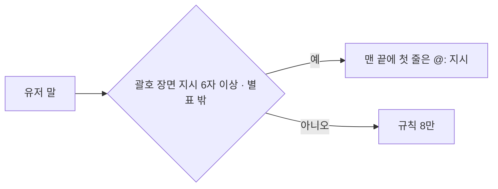
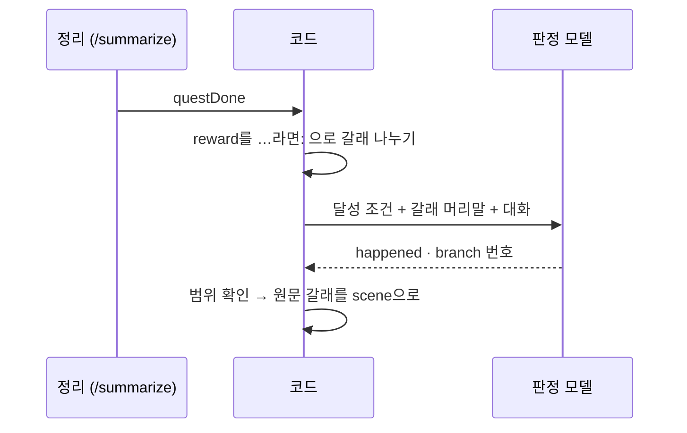

<!-- source: docs/trainings/narration-and-reward.md -->
# 나레이션과 보상 장면 고치기 (2026-11-06)

2026-11-06 전체 평가에서 기준에 못 미친 두 항목([eval-2026-11-06.md](eval-2026-11-06.md))을 같은 날 고쳤다. 모델은 `gemma4:e4b`, 모두 실제 모델로 쟀다.

| 항목 | 기준 | 고치기 전 | 고친 뒤 |
|------|------|-----------|---------|
| 장면 전환 나레이션 (`evals.run --suite narration`) | 80% | 7/12 | **48/48** (`--repeat 6`) |
| 퀘스트 보상 장면 (`evals.quest_reward`) | 75% | 2/8 | **20/20** (`--repeat 10`), 갈래 고르기 6/6 |

두 문제의 공통점은 **연기 모델에게 판단을 맡겼다**는 것이다. "장면이 바뀌었으면 나레이션을 쓴다", "맞는 갈래를 골라 펼친다"는 지시는 작은 모델이 잘 따르지 못했다. 판단은 코드나 판정 단계로 옮기고, 연기 모델에게는 이번 답에서 할 일 하나만 넘겼다.

## 로직 구조

```text
나레이션: 유저 말에 (괄호 장면 지시, 6자 이상, 별표 밖) ─▶ 맨 끝에 "첫 줄은 @:" 지시  (7/12 → 48/48)
보상 장면: 달성 판정 통과 ─▶ 코드가 …라면: 으로 갈래 나눔 ─▶ 모델은 번호만 ─▶ scene 저장
          ─▶ 다음 첫 답에 그 장면 하나만  (2/8 → 20/20)
공통: 연기 모델에게 판단을 맡기지 않는다
```

### 나레이션 지시



### 보상 갈래 고르기



## 보상 장면

### 무엇이 틀렸나

이세연의 보상 장면은 두 갈래다. 혼인이면 이름을 부르고 "공식 일정표에는 올리지 않겠습니다", 기혼의 충돌이면 사직서를 올려 두고 "결재는 회장님 몫입니다"라고 한다. 고치기 전에는 두 갈래를 모두 넘기고 "지금 일어난 일에 맞는 장면을 고르라"고 했다.

고치기 전 같은 날 다시 잰 결과는 2/8이었다. 충돌 장면 4번 중 4번 모두 혼인 갈래의 "공식 일정표" 대사를 쓰거나 사직서를 빼먹었다. 지시 문구를 강하게 하거나 위치를 옮겨도(2026-11-04) 고르는 일 자체를 못 했다.

### 시도

| 시도 | 결과 |
|------|------|
| 판정 모델에게 맞는 갈래의 글을 그대로 옮겨 쓰게 함 | 고르기 1/2. 충돌 대화에도 늘 첫 갈래(혼인)를 옮겼다 |
| 코드가 `…라면:` 머리말로 갈래를 원문 그대로 나누고, 모델은 달성 조건(갈래 설명)을 보고 **번호만** 고름. `happened`(실제로 일어난 일 한 문장)를 먼저 쓰게 함 | 고르기 6/6, 보상 장면 20/20 |

옮겨 쓰기는 고르기와 복사를 한 번에 시키는 일이었다. 나누기를 코드로 빼자 모델은 분류만 하면 됐다. 갈래 설명이 달성 조건(`objective`)에 이미 적혀 있다는 점도 컸다. 처음 시도에는 달성 조건을 넘기지 않았다.

### 지금 구조

```text
이야기 정리(/summarize) → 달성 판정 통과
  → reward_branches(reward): "…라면:" 머리말로 갈래를 원문 그대로 나눈다 (2개 이상일 때만)
  → 판정 모델: 달성 조건 + 갈래 머리말 + 대화 → {happened, branch}
  → 번호가 범위 밖이거나 형식이 깨지면 빈 문자열 (전체를 쓴다)
Nest: questState = { status: done, scene: 고른 장면 }
다음 첫 답: sceneNote에 그 장면 하나만. 고르지 못했으면 전체 + "갈래 하나만 펼친다"
```

- 고르기는 온도 0, 시드 고정이라 같은 대화면 같은 답이다. 그래서 고르기 사례는 반복하지 않고 대화 모양을 바꿔 6개로 늘렸다(청혼 승낙, 결혼식 나레이션, 혼인신고, 아내의 대면, 사내 폭로와 이혼 이야기).
- 갈래가 하나뿐인 보상(유지성 등)은 모델을 부르지 않는다.
- 고른 장면은 원문의 일부라 모델이 지어낸 장면이 들어갈 수 없다.
- 고르기 실패는 고치기 전 동작(전체를 넘김)으로 돌아간다. 달성 판정과 코레딧에는 영향이 없다.

### 한계

- 머리말 형식이 `…라면:`·`…다면:`이 아니면 갈래를 나누지 못하고 전체를 넘긴다. 유저가 만든 캐릭터의 보상 장면은 형식이 자유롭다.
- 고르기 사례 6개는 모두 이세연이다. 갈래가 셋 이상인 보상은 재지 않았다.

## 나레이션

### 무엇이 틀렸나

2026-11-06 실패 5건 중 4건은 "정전", "비가 그치고 해가 진다"처럼 시간·장소가 아닌 전환에서 첫 줄 `@:`를 빠뜨렸다. 규칙 8의 조건이 "시간이 흐르거나 장소가 바뀌면"이었다. 나머지 1건은 "라떼 한 잔 주세요"에 `@:`를 쓴 것이다. 고친 뒤 평범한 대화를 따로 8번 뽑아 보니 2번이 분위기 묘사("카페 안은 은은한 커피 향…")를 `@:` 줄로 썼다.

### 고친 것

| 고친 것 | 이유 |
|---------|------|
| 유저 말에 괄호 장면 지시가 있으면, 그 턴에만 프롬프트 맨 끝에 "이번 답의 형식: 유저가 장면 지시 (…)로 장면을 바꿨다. 첫 줄은 반드시 `@:`…"를 붙인다 | 조건 판단을 코드가 한다. 지시 문장을 그대로 보여 주고 시간·장소·날씨·주변 상황을 모두 적었다 |
| 괄호 안이 공백 빼고 6자 미만이거나 `*별표*` 안의 괄호면 장면 지시로 보지 않는다 | "(웃음)" 같은 추임새에 나레이션이 붙지 않게 |
| 메신저 채널에는 붙이지 않는다 | 문자는 장면 서술을 쓰지 않는다 |
| 보상 장면 지시(`sceneNote`)는 그 뒤, 맨 끝에 둔다 | 보상 장면이 더 중요하다 |
| 규칙 8에 "장면이 바뀌지 않으면(주문, 질문, 잡담) `@:` 줄을 한 줄도 쓰지 않는다. 소리·향·분위기는 *별표* 안에" | 분위기 묘사를 나레이션으로 쓰는 일을 막는다 |

평가의 평범한 대화도 2개에서 4개로 늘렸다("(웃음) 농담이에요.", "케이크도 있어요?").

### 결과

| 측정 | 결과 |
|------|------|
| `narration --repeat 3` (형식 지시만 넣음) | 17/18. "라떼 한 잔 주세요" 1번에 `@:` |
| `narration --repeat 4` (규칙 8도 고침) | 24/24 |
| `narration --repeat 6` | 48/48 |

### 한계

- 괄호 없이 대화로만 장면이 바뀌는 경우("벌써 밤이네요, 문 닫을 시간이죠?")는 규칙 8에만 기댄다. 평가에 그런 사례가 없다.
- 유저가 괄호를 자기 행동 묘사로 쓰면("(커피를 건넨다)") 나레이션이 붙는다. 6자 이상이면 장면 지시로 본다.

## 다른 평가에 영향이 없었나

규칙 8은 모든 대화에 들어가 전체 평가를 다시 돌렸다(`evals.run --repeat 2`). 11묶음이 모두 통과했다. 말투가 11/12로 1건 떨어졌는데, 그 답은 "지금 뭐 해?"에 반말이 섞인 경우였다. `tone --repeat 4`로 다시 재 24/24여서 흔들림으로 판단했다. 퀘스트 판정(`quest_seyeon`, `quest_yujiseong`)은 고르기가 달성 판정 뒤에만 돌아 다시 재지 않았다.

## 시험

- `services/ai/tests/test_narration_reward.py`: 장면 지시 찾기, 짧은 추임새·별표 제외, 메신저 제외, 보상 지시가 맨 끝, 갈래 나누기, 번호 고르기, 잘못된 답이면 전체로 돌아감, 갈래가 하나면 모델을 부르지 않음.
- `apps/api/src/quests/quest.spec.ts`: 고른 갈래를 상태에 남기고 그 장면만 지시, 빈 갈래 무시, 달성 전 상태의 갈래 무시.