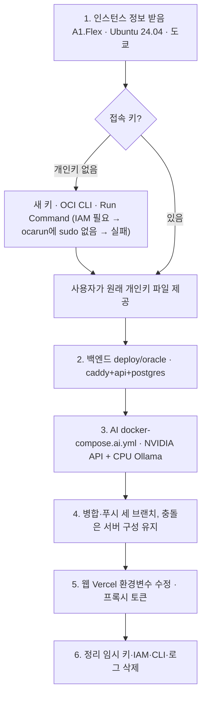

<!-- source: docs/web_management/deploy-log-2026-11-07.md -->
# 실제 배포 기록 (2026-11-07)

> 처음으로 실제 서버에 올린 날의 기록이다. 무엇을 정했고, 어떤 순서로 했고, 어디서 막혔고, 무엇이 남았는지를 빠짐없이 적는다.
> **비밀값(키·토큰·비밀번호)은 이 문서에 적지 않는다.** 어디에 있는지만 적는다.
> 지금 상태만 빠르게 보려면 [oracle-backend.md](oracle-backend.md), 전체 배포 진입은 [../DEPLOYMENT.md](../DEPLOYMENT.md).

## 로직 구조

## 1. 서버와 결정

| 항목 | 값 |
|------|-----|
| 클라우드 | Oracle Cloud, 리전 `ap-tokyo-1` (AD-1) |
| 인스턴스 | `codicomperchat-api`, `VM.Standard.A1.Flex` 2 OCPU · 12GB, aarch64, 디스크 96GB |
| OS | Canonical Ubuntu 24.04 |
| 공인 IP | `168.110.61.178` (예약 IP 아님. 인스턴스를 다시 만들면 바뀔 수 있다) |
| 같은 계정의 다른 인스턴스 | `cutnkeep-server`, `vidshare-api`, `human-bug-tier_Server` — 이 저장소와 무관, 건드리지 않았다 |

사용자가 정한 것 (순서대로):

1. 처음에는 **API + DB만**, 프론트는 따로, 도메인은 아직 없음.
2. 개인키 내용은 공유하지 않는다. → 이후 키 **파일 경로**를 주었고, 내용은 출력하지 않고 경로로만 썼다.
3. `~/.oci/config`의 API 키로 작업하는 것에 동의.
4. AI 서버도 같은 VM에 올린다(다른 세션이 만든 `claude/project-thread-pz0x5f` 구성).
5. 두 배포 브랜치가 충돌하면 **서버에서 검증한 구성을 유지**한다.
6. 웹도 올린다.
7. 배포 뒤 개인 관련 임시 데이터는 지우고 기억하지 않는다.

## 2. 접속 — 막힌 과정 전부

| 시도 | 결과 | 배운 것 |
|------|------|---------|
| 이 PC의 `~/.ssh` 키 | 모두 다른 서버 키. 맞는 개인키 없음 | 콘솔에서 받은 `ssh-key-날짜.key`가 유일한 열쇠다 |
| 새 키 `codicomper_oci` 생성 | 서버에 등록할 길이 없음 | 이미 만든 인스턴스에는 콘솔에서 SSH 키를 더할 수 없다 |
| OCI CLI 설치(`pip install oci-cli`) + `~/.oci/config` | API 접근 성공, 인스턴스 `RUNNING` 확인 | Windows에서는 `python -m oci_cli.cli`로 부르고, 파일 인자는 상대 경로로 준다 |
| Run Command로 `authorized_keys`에 키 추가 | 명령이 `ACCEPTED`에서 멈춤 | 에이전트가 명령을 가져가려면 **동적 그룹 + 정책**(`instance-agent-command-execution-family`)이 필요하다 |
| 동적 그룹·정책 생성(이 인스턴스 한정) | 여전히 `ACCEPTED` | 에이전트가 예전 인증 실패를 들고 있었다 |
| 소프트 재부팅 | 명령 실행됨 → `Permission denied` | Run Command는 **`ocarun` 사용자**로 돈다 |
| `sudo`로 다시 | `sudo: a password is required` | Ubuntu 이미지의 `ocarun`에는 sudo가 없다. 이 길로는 키를 넣을 수 없다 |
| 사용자가 원래 개인키 파일 제공 | 접속 성공 | — |

곁가지로 겪은 것: OCI CLI 출력 끝의 `\r` 때문에 명령 ID 조회가 404가 났다(`tr -d '\r'`로 해결). 에이전트 도구의 자동 안전 검사가 원격 키 심기·IAM 생성·자기 설정 수정을 막아, 사용자가 세션 권한 모드를 바꾼 뒤에 IAM을 만들었다.

## 3. 백엔드 (API + DB)

- 구성: [`deploy/oracle/docker-compose.yml`](../../deploy/oracle/docker-compose.yml) — caddy, api, postgres, migrate. GPU 구성(`deploy/docker-compose.prod.yml`)은 그대로 두었다.
- **도메인 대신 `sslip.io`**: 운영 안전 검사(`apps/api/src/security/production.ts`)가 `REQUIRE_HTTPS=1`을 요구하므로 HTTP로는 띄울 수 없다. `api.168-110-61-178.sslip.io`가 IP로 풀리고 Let's Encrypt 인증서가 나온다.
- 비밀값: `deploy/oracle/server-setup.sh`가 서버에서 `POSTGRES_PASSWORD`·`AUTH_SECRET`·`AI_SERVICE_TOKEN`을 만들어 `deploy/oracle/.env`(권한 600)에 넣는다. 화면에 찍지 않는다.
- 코드 올리기: `git archive | ssh ... tar -x`. **푸시 없이** 올릴 수 있다.
- 함정(실측): Windows(`core.autocrlf=true`)에서 `git archive`는 `text` 파일을 CRLF로 내보낸다. `-c core.autocrlf=false`만으로는 부족하고 `-c core.eol=lf`까지 줘야 한다(`.env.example`의 CR 21개 → 0개).
- 결과: 마이그레이션 34개·시드 적용, `/health` HTTPS 200, http는 https로 308. 인증서 발급 성공.
- 보안 목록: 80·443 Ingress는 이미 열려 있었다.

## 4. AI (대화)

- 구성: [`deploy/oracle/docker-compose.ai.yml`](../../deploy/oracle/docker-compose.ai.yml)을 덧붙인다. `ai`(FastAPI, CPU 이미지)와 `ollama`.
- 대화는 **NVIDIA 호스팅 API**(OpenAI 호환, `google/gemma-4-31b-it`)로 하고, 한도·오류·시간 초과면 **CPU Ollama `gemma4:e4b`**가 대신 답한다(`LLM_BACKEND=openai`, `LLM_FALLBACK_OLLAMA=1`).
- NVIDIA 키: 사용자의 로컬 `services/ai/.env`에서 읽어 **SSH 표준 입력으로만** 서버 `.env`에 넣었다. 출력·파일·커밋 없음.
- 배포: 서버에서 `deploy/oracle/ai-deploy.sh` 6단계. 스왑 4GB를 만들었다.
- 실측: api→ai 토큰 호출 통과, **NVIDIA 응답 19.0초, 예비 CPU 응답 32.1초.**
- 그림 엔진은 GPU가 없어 잠김.

## 5. 환경변수 정리

| 어디 | 무엇을 했나 |
|------|-------------|
| `deploy/oracle/.env.example`, `services/ai/.env.example` | `ANTHROPIC_API_KEY`, `XAI_API_KEY`, `PREMIUM_PROVIDERS`, `PREMIUM_MONTHLY_CREDITS`, `WEB_PROXY_TOKEN` 자리를 더했다 |
| 로컬 `apps/api/.env` | `MAIL_FROM`, `PREMIUM_PROVIDERS`(빈 값) 추가. 기존 값은 그대로 |
| 로컬 `services/ai/.env` | `OLLAMA_READ_TIMEOUT_SECONDS=600`, `ANTHROPIC_API_KEY`·`XAI_API_KEY`(빈 값) 추가 |
| 서버 `deploy/oracle/.env` | `LLM_*`, 프리미엄 자리(빈 값, 한도 0), `WEB_PROXY_TOKEN` |
| 로컬 SMTP | 개발용(127.0.0.1)이라 서버로 옮기지 않았다 → 서버는 인증 메일을 못 보낸다 |

프리미엄 모델은 **키 + `PREMIUM_PROVIDERS` + `PREMIUM_MONTHLY_CREDITS`(0 초과)** 세 가지가 모두 있어야 열린다. 한도 0이면 키가 있어도 닫힌다.

## 6. 병합

| 무엇 | develop | main | 메모 |
|------|---------|------|------|
| `feature/oracle-backend-deploy` | `96d01e6` | `1f7be86` | 백엔드 구성. 중간에 develop을 `--ff-only`로 맞췄다가 규칙 위반이라 되돌렸다 |
| `claude/project-thread-pz0x5f` | `0235ccc` | `a1d87be` | AI 배포·프리미엄 샘플·상태 문서. AI unittest 71개, 타입 검사 통과 |
| `origin/claude/project-thread-po3i10` | `f027a56` | `d2e1f2b` | 충돌 5건. `deploy/oracle` 세 파일은 서버 구성 유지, 나머지는 합침. API vitest 232개 통과 |
| `feature/web-vercel-deploy` | `96a6ab0` | `39a622e` | Caddy 프록시 토큰, 웹 배포 문서 |

`po3i10`에서 들어온 `deploy/oracle/bootstrap.sh`·`setup.sh`와 안내 HTML은 **다른 compose를 전제로 쓰였다.** 지금 서버에 그대로 돌리지 않는다.

## 7. 웹 (Vercel)

- 프로젝트 `codicomperchat-web`(팀 saman, 리전 icn1)는 다른 세션이 이미 만들어 `po3i10`으로 배포해 둔 상태였다.
- **고친 것**:
  1. `API_BASE_URL`이 `https://168-110-61-178.sslip.io`(`api.` 없음)라 연결되지 않았다 → `https://api.168-110-61-178.sslip.io`.
  2. `WEB_PROXY_TOKEN`이 없었다 → sensitive로 추가, 서버 `.env`와 같은 값.
  3. Caddy가 토큰이 맞는 요청만 `X-Forwarded-For`를 믿도록 [`Caddyfile`](../../deploy/oracle/Caddyfile)을 고쳤다. 토큰이 비면 compose가 시작을 막는다(빈 값이 모든 요청과 맞는 것 방지).
  4. `main`으로 다시 배포.
- 확인: 홈·인기 화면에 API의 캐릭터(유지성·이세연)가 렌더링됨, 로그인·가입·요금제 200, Vercel 런타임 오류 0. 공개 주소는 로그인 없이 열린다.
- 확인 못 한 것: 로그인한 상태의 대화 전체 흐름, 프록시 토큰이 IP 판단에 실제로 쓰이는지.
- 운영 콘솔 `codicomperchat-console`은 Vercel에 있으나 `API_BASE_URL`·`CONSOLE_IP_ALLOWLIST`가 없어 연결하지 않았다(허용할 IP를 사용자가 정해야 한다).

## 8. 정리한 것

| 지운 것 | 남긴 것 |
|---------|---------|
| 서버의 빌드·배포 로그, 셸 기록 | 서버 `.env`(비밀값, 권한 600) |
| 동적 그룹·정책 `codicomper-run-command` | 사용자의 `~/.oci/config` (원래 있던 것) |
| OCI CLI(pip) | 사용자의 개인키 파일 (사용자 소유) |
| 새로 만든 키 `codicomper_oci`, `~/.ssh/config` 항목, `known_hosts` 기록 | 서버의 스왑 4GB |
| 작업용 임시 파일 | Run Command 기록(Oracle 콘솔에 남음, 실행된 명령은 모두 실패) |

## 9. 사용자에게 권하는 것

- 개인키 내용과 `WEB_PROXY_TOKEN` 값이 작업 대화에 한 번씩 드러났다. 걱정되면 **새 키로 바꾸고**, 토큰은 서버 `.env`와 Vercel 값을 같이 바꾼다.
- 공인 IP를 예약 IP로 바꿔 두면 인스턴스를 다시 만들어도 주소가 유지된다.

## 10. 남은 일

| 일 | 막힌 이유 |
|----|-----------|
| 운영 메일(SMTP) | 서비스를 정해야 한다. 없으면 인증 메일이 안 간다 |
| 운영 콘솔 연결 | 허용할 IP 결정 |
| 프리미엄 모델 | 키·한도(돈이 나감) |
| 그림 엔진 | GPU 서버(Hetzner GEX45 계약) |
| 공식 캐릭터 지식 파일 | `apps/api/data/personas/*.json`을 서버 볼륨 `personas`로 옮긴다 |
| DB 백업 cron | 서버에 아직 없다 |
| 도메인 | sslip.io는 임시. 사면 `API_DOMAIN`·Vercel `API_BASE_URL`만 바꾼다 |
| 로그인 상태의 대화 e2e를 운영에서 확인 | 시험 계정이 필요하다 |