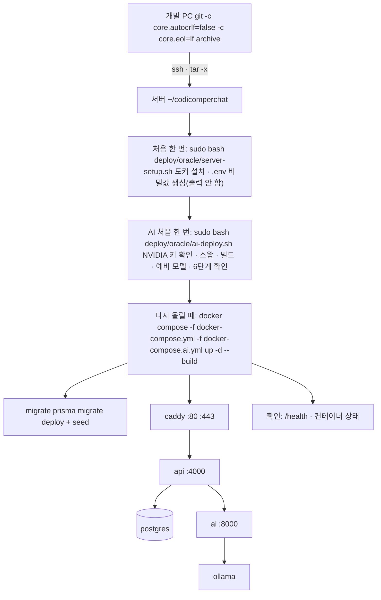

<!-- source: docs/web_management/oracle-backend.md -->
# Oracle Cloud 운영 서버 (API · DB · AI)

> **지금 실제로 돌고 있는 서버의 정본이다**(2026-11-07). 웹은 Vercel에 있고 이 서버의 API를 부른다.
> 처음 올린 과정과 막힌 곳 전부: [deploy-log-2026-11-07.md](deploy-log-2026-11-07.md). AI 배포 스크립트 설명: [ai-deploy-handover.md](ai-deploy-handover.md).
> 전체 운영 목표(GPU 서버 한 대, 그림 엔진 포함)는 [docker-deploy.md](docker-deploy.md)이고 그 결정은 바뀌지 않았다.

| 항목 | 값 |
|------|-----|
| 서버 | Oracle `codicomperchat-api`, `VM.Standard.A1.Flex` 2 OCPU · 12GB · 스왑 4GB, Ubuntu 24.04 aarch64, 도쿄, `168.110.61.178`, 사용자 `ubuntu` |
| 접속 | 인스턴스를 만들 때 받은 개인키 파일(사용자 PC에만 있다. 저장소·문서에 경로·내용을 적지 않는다) |
| 구성 | [`deploy/oracle/docker-compose.yml`](../../deploy/oracle/docker-compose.yml)(caddy · api · migrate · postgres) + [`docker-compose.ai.yml`](../../deploy/oracle/docker-compose.ai.yml)(ai · ollama) |
| 바깥 주소 | `https://api.168-110-61-178.sslip.io` (Caddy가 Let's Encrypt 인증서 자동 발급·갱신) |
| 대화 모델 | NVIDIA 호스팅 API `google/gemma-4-31b-it`, 막히면 CPU Ollama `gemma4:e4b` |
| 웹 | Vercel `codicomperchat-web` → `https://codicomperchat-web.vercel.app` (푸터 `/project` 소개 페이지 포함, `PORTFOLIO_URL`로 포트폴리오 사이트 버튼) |
| 포트폴리오 사이트 | Vercel `codicomperchat-portfolio` → `https://codicomperchat-portfolio.vercel.app` (Astro 정적 10페이지. 챗봇·빠른 찾기용 Rails·Flask는 같은 Oracle 서버에 얹었다: `https://portfolio-api.168-110-61-178.sslip.io`. 모델은 제품과 같은 Ollama의 `gemma4:e4b` 하나를 나눠 쓴다 — 아래 "포트폴리오 챗봇 서버" 참고) |
| 비밀값 | 서버 `~/codicomperchat/deploy/oracle/.env`(root, 권한 600). 키 목록은 [../guidance/environment.md](../guidance/environment.md) "운영에서 실제로 쓰는 값" |

## 배포 상태 (2026-11-07)

| 무엇 | 상태 |
|------|------|
| 마지막 배포 | 2026-11-08, `main` `0fc2302`. 서버 api·ai·migrate를 다시 빌드(마이그레이션 35개, 새 칸 `memory_chunks.pinned`·`sceneTime`·`scenePlace` 확인)하고 Vercel 웹·포트폴리오 사이트를 같은 커밋으로 다시 배포 |
| 컨테이너 | caddy · api · postgres · ai · ollama 실행 중 (api·postgres·ai healthy), migrate는 기동 때 한 번. 2026-11-08 재배포 기준 마이그레이션 35개 + 시드(처음 올린 2026-11-07 기록은 34개) |
| 확인 | `/health` HTTPS 200, `/characters` 200, http는 https로 308. api→postgres(캐릭터 2개), api→ai(토큰) 200, ai→ollama 200. `ai-deploy.sh` 6단계: NVIDIA 응답 19.0초, 예비 CPU 응답 32.1초 |
| 공식 세계관 | 「코퍼 시티: 멈춘 시계탑」을 시드로 만듦(2026-11-07 재배포의 migrate 단계): 공개·발행, 장소 10 · 그림 4 · 지도 170,802B. `/worlds`·지도 API 200, 웹 월드 목록에 보임 |
| 웹 | Vercel 환경변수 `API_BASE_URL=https://api.168-110-61-178.sslip.io`(**`api.` 접두사가 빠지면 연결되지 않는다**), `WEB_PROXY_TOKEN`(sensitive, 서버 `.env`와 같은 값), `CONSOLE_BASE_URL`, `REQUIRE_HTTPS=1`. 홈·인기 화면에 API의 캐릭터(유지성·이세연)가 렌더링됨, 런타임 오류 0 |
| 비어 있는 값 | `MAIL_SMTP_URL`·`MAIL_FROM`(인증 메일 안 감), `WEB_BASE_URL`, `ANTHROPIC_API_KEY`·`XAI_API_KEY`·`PREMIUM_PROVIDERS`(프리미엄 "준비 중", `PREMIUM_MONTHLY_CREDITS=0`) |
| 안 올린 것 | 그림 엔진(GPU 없음), 공식 캐릭터 지식 파일(`apps/api/data/personas/*.json`, 볼륨 `personas`가 비어 있다). 운영 콘솔(`codicomperchat-console`)은 Vercel에 있지만 `API_BASE_URL`·`CONSOLE_IP_ALLOWLIST`가 없어 API에 연결되지 않았다 |
| 백업 | 아직 cron 없음 ([../TASKS.md](../TASKS.md) T04) |

프리미엄을 열 때는 서버 `.env`에 키·`PREMIUM_PROVIDERS`·`PREMIUM_MONTHLY_CREDITS`(0 초과)를 적고 `api`·`ai`를 다시 띄운다. 키는 채팅·커밋에 붙이지 않는다.

## 로직 구조



## 처음 한 번 (사람)

1. Oracle 콘솔 → 인스턴스의 서브넷 → Security List에 Ingress `0.0.0.0/0` TCP **80**, **443**. 80은 인증서 발급에 필요하다(2026-11-07에는 이미 열려 있었다).
2. 접속 키: 인스턴스를 만들 때 받은 개인키 파일을 쓴다. **이미 만든 인스턴스에는 콘솔에서 SSH 키를 더할 수 없고**, Run Command는 Ubuntu에서 sudo 없는 `ocarun`으로 돌아 `authorized_keys`를 고칠 수 없다. 키를 잃었으면 인스턴스를 다시 만든다(과정: [deploy-log-2026-11-07.md](deploy-log-2026-11-07.md) 2장).
3. (권장) 공인 IP를 예약 IP로 바꿔 두면 인스턴스를 다시 만들어도 주소가 유지된다.

## 올리기 · 다시 올리기

개인키 파일 경로를 `KEY`에 두고 저장소 루트(Git Bash)에서 돌린다.

```bash
KEY=/path/to/ssh-key.key
SSH="ssh -i $KEY -o IdentitiesOnly=yes ubuntu@168.110.61.178"
C="sudo docker compose --env-file deploy/oracle/.env -f deploy/oracle/docker-compose.yml -f deploy/oracle/docker-compose.ai.yml"

# 1) 코드 올리기 (푸시 없이 이 PC의 main을 보낸다)
git -c core.autocrlf=false -c core.eol=lf archive --format=tar main | $SSH "mkdir -p ~/codicomperchat && tar -x -C ~/codicomperchat"

# 2) 처음 한 번만
$SSH "sudo bash ~/codicomperchat/deploy/oracle/server-setup.sh"
$SSH "cd ~/codicomperchat && sudo bash deploy/oracle/ai-deploy.sh"

# 3) 다시 올리기 (코드·설정이 바뀌었을 때)
$SSH "cd ~/codicomperchat && $C up -d --build"

# 4) 확인
$SSH "cd ~/codicomperchat && $C ps"
curl https://api.168-110-61-178.sslip.io/health
```

- **포트폴리오 챗봇 서버 (2026-11-08)**: `PortFolio/server/docker-compose.oracle.yml`(프로젝트명 `portfolio`)이 제품 망(`codicomperchat_edge`·`codicomperchat_internal`, external)에 `pf-backend`(Rails, 400MB 상한)·`pf-ai`(Flask, 800MB 상한)를 붙인다. 제품 Caddy가 `PORTFOLIO_API_DOMAIN`(`portfolio-api.168-110-61-178.sslip.io`, `deploy/oracle/.env`에 추가) 사이트 블록으로 `pf-backend:3000`에 넘긴다. 비밀값(`PortFolio/server/.env`의 `SECRET_KEY_BASE`·`AI_INTERNAL_TOKEN`)은 서버에서 만들었고 권한 600이다. 올리기: `cd ~/codicomperchat/PortFolio/server && sudo docker compose --env-file .env -f docker-compose.oracle.yml up -d --build`. 실측: `/api/v1/health` 200(chunks 629), 챗 질문 약 50초에 200·CORS 통과. **위험**: Ollama가 한 번에 한 요청만 처리해서 제품 대화와 겹치면 챗봇이 180초 제한에 걸려 503이 난다(첫 질문에서 실제로 겪음). 사이트의 `PUBLIC_API_BASE`는 Vercel 환경변수로 넣었다(바꾸면 다시 배포해야 반영).
- **compose 파일은 항상 두 개를 함께 준다.** 하나만 주면 `ai`·`ollama`가 고아 컨테이너가 되고 api가 AI를 못 부른다.
- Windows(`core.autocrlf=true`)에서 그냥 `git archive`를 하면 파일이 CRLF로 나가 `.env` 값 끝에 `\r`이 붙는다. `core.autocrlf=false`만으로는 `text`로 정한 파일이 Windows 기본 `core.eol`(CRLF)로 나가서, `core.eol=lf`까지 준다(2026-11-07 실측: `.env.example`의 CR 21개 → 0개).
- `deploy/oracle/.env`는 서버에서 처음 한 번 만들어지고 다시 덮어쓰지 않는다. 비밀값은 서버에만 있다. 값을 바꿀 때는 `sudo nano`로 고치고 위 3)을 다시 돌린다.
- `deploy/oracle/bootstrap.sh`·`setup.sh`(다른 브랜치에서 들어옴)는 다른 compose를 전제로 쓰였다. **이 서버에서 돌리지 않는다.**

## 자주 쓰는 점검

```bash
$SSH "cd ~/codicomperchat && $C logs --tail 50 api"       # API 로그
$SSH "cd ~/codicomperchat && $C logs --tail 50 ai"        # AI 로그 (키 값은 찍히지 않는다)
$SSH "cd ~/codicomperchat && $C exec -T api node -e \"fetch('http://ai:8000/health',{headers:{'x-ai-token':process.env.AI_SERVICE_TOKEN}}).then(r=>console.log(r.status))\""   # api→ai
$SSH "free -m; df -h /"                                    # 메모리·디스크
```

## 웹(Vercel)과 연결

- 웹의 `API_BASE_URL`은 `https://api.168-110-61-178.sslip.io`. 브라우저가 아니라 Next 서버가 API를 부르므로 CORS 설정은 없다.
- 웹은 Vercel에서 API를 부르므로 Caddy가 보는 주소는 늘 Vercel이다. 그래서 웹이 실제 이용자 IP를 `X-Forwarded-For`로 넘기고, **`X-Web-Proxy-Token`이 서버 `.env`의 `WEB_PROXY_TOKEN`과 맞을 때만** Caddy가 그 IP를 믿는다([`Caddyfile`](../../deploy/oracle/Caddyfile)). 값이 비면 compose가 caddy를 띄우지 않는다.
- 토큰을 바꿀 때는 서버 `.env`와 Vercel 환경변수를 같이 바꾸고, caddy를 다시 띄우고(`$C up -d caddy`), Vercel을 다시 배포한다.
- 도메인을 사면: DNS A 레코드를 서버 IP로, 서버 `.env`의 `API_DOMAIN`과 Vercel의 `API_BASE_URL`만 바꾼다.
- 웹 주소가 정해지면 서버 `.env`의 `WEB_BASE_URL`을 채우고 api를 다시 띄운다(메일 속 링크).