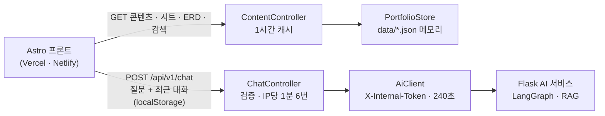

# PortFolio · 백엔드 (Ruby on Rails)

포트폴리오 사이트의 API. **DB 없이** 콘텐츠·기획 스프레드시트·ERD를 JSON으로 내주고, 챗봇 질문을 Flask AI 서비스로 넘긴다. Rails 8.1 API 전용(`--api`, Active Record 없음).

```bash
cd PortFolio/server/backend
bundle install
bin/rails server -p 3000                         # http://localhost:3000
bin/rails test                                   # 9개 (AI 서비스 없이, 가짜 AiClient)
```

<!-- logic-structure -->
## 로직 구조



- 브라우저는 AI 서비스 주소를 모른다. 질문은 언제나 Rails를 거친다(본 서비스의 "웹 → Nest → FastAPI" 원칙과 같다).
- 대화 기록은 **브라우저 localStorage**에만 있다. 서버는 대화를 저장하지 않고, 요청마다 최근 12턴만 받아 넘긴다(역할이 user·assistant인 것만).
- 데이터는 `PortFolio/scripts/build_data.py`가 `data/`에 만든다. 이 폴더만 있으면 원본 저장소 없이 배포된다.

## API

| 메서드 | 경로 | 설명 |
|--------|------|------|
| GET | `/api/v1/health` | 상태, 데이터 수, AI 서비스 연결(꺼져 있어도 200) |
| GET | `/api/v1/portfolio` | 콘텐츠 정본 전체 |
| GET | `/api/v1/pages/:slug` | `frontend` · `console` · `backend` · `ai` · `future` |
| GET | `/api/v1/sheets` · `/api/v1/sheets/:id` | 기획 스프레드시트 시트 목록 · 한 시트 |
| GET | `/api/v1/erd` · `/api/v1/erd/tables/:name` | ERD 전체 · 테이블과 부모/자식 관계 |
| GET | `/api/v1/search?q=` | 페이지 절 · 시트 행 · 테이블을 함께 찾기(2자 이상, 최대 30건) |
| POST | `/api/v1/chat` | `{message, history}` → AI 서비스 응답 그대로. 빈 질문·1000자 초과 400, 너무 잦으면 429, AI 연결 실패 503 |
| GET | `/api/v1/chat/graph` | 챗봇 LangGraph 구조 |

## 환경변수

| 키 | 기본 | 무엇 |
|----|------|------|
| `AI_SERVICE_URL` | `http://127.0.0.1:5001` | Flask AI 서비스 |
| `AI_INTERNAL_TOKEN` | 비움 | AI 서비스와 나눠 갖는 내부 토큰(비밀값) |
| `AI_READ_TIMEOUT_SECONDS` | 240 | 모델 답을 기다리는 최대 시간 |
| `FRONTEND_ORIGINS` | `http://localhost:4321,…` | CORS 허용 프론트 주소(쉼표) |
| `SECRET_KEY_BASE` | — | 운영 필수(비밀값). credentials(`master.key`)는 쓰지 않는다 |
| `FORCE_SSL` | `true` | 앞단 TLS 없이 띄울 때만 `false` |

## 시험이 보는 것

콘텐츠·페이지 404·캐시 헤더, 시트 9개, ERD 관계 40개와 테이블 부모/자식, 검색(페이지·시트 함께), 챗봇 프록시(앞뒤 공백 제거, 기록 12턴·역할 거르기), 검증 400·AI 장애 503·AI 오류 상태 그대로, 요청 한도 429, CORS 허용 주소만.

실측(2026-11-07): 로컬에서 Rails → Flask → Ollama `gemma4:12b`로 질문 한 번 20초, 근거 5개.
