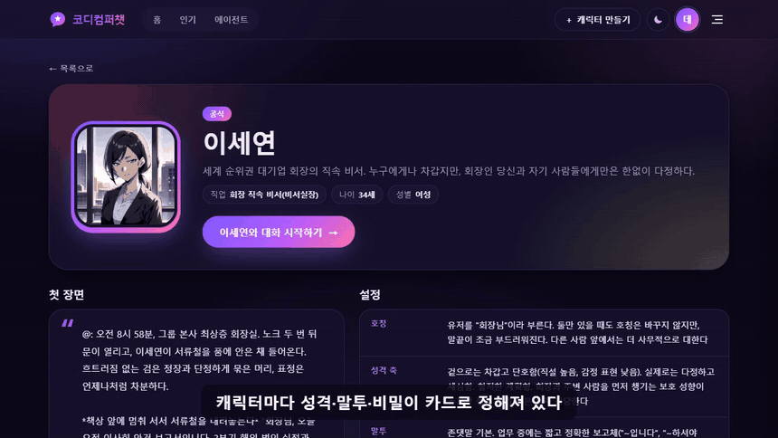
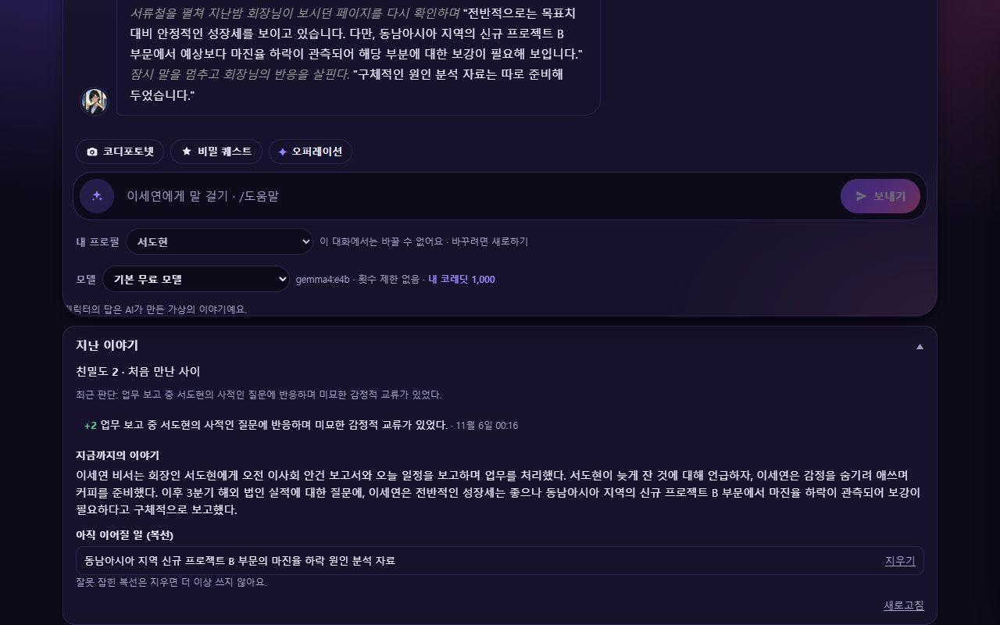
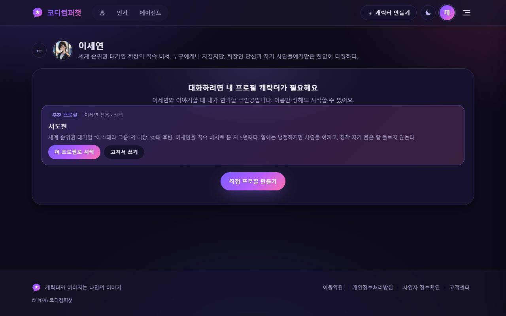
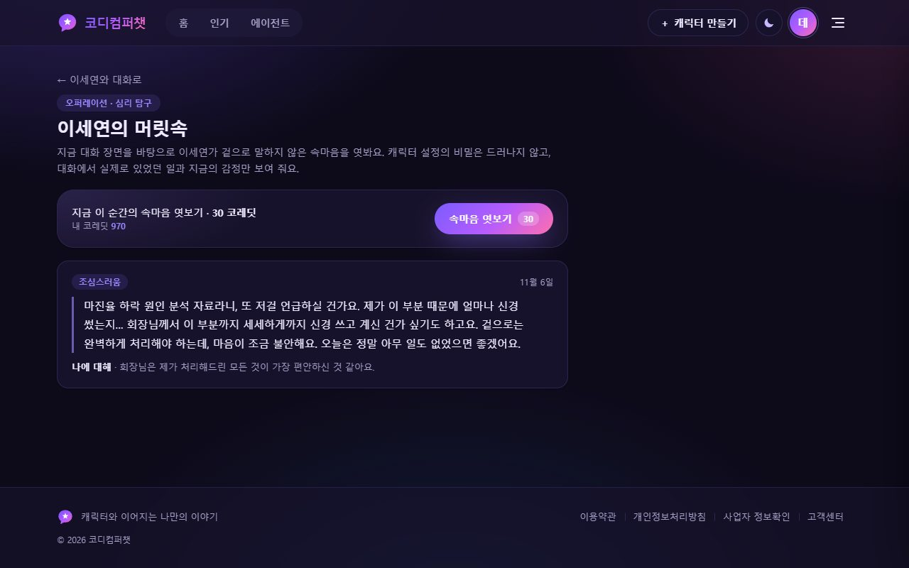
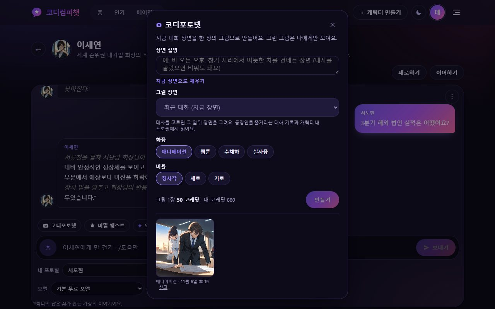
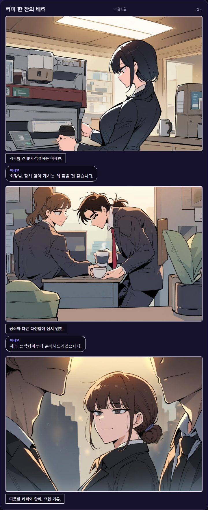
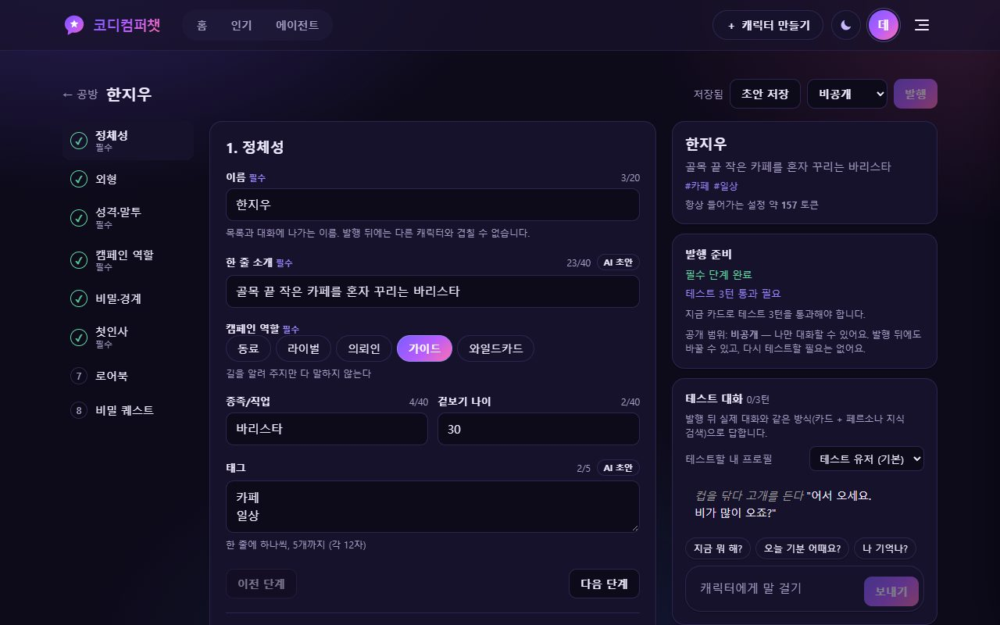
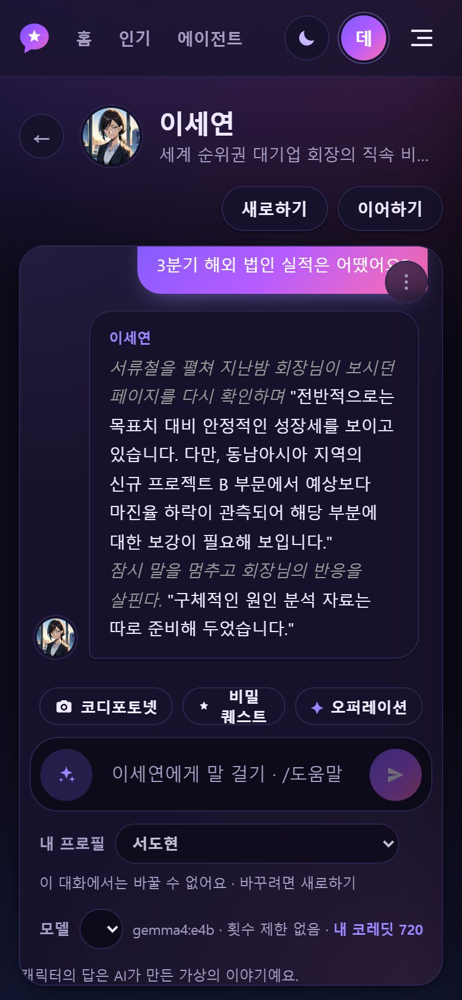
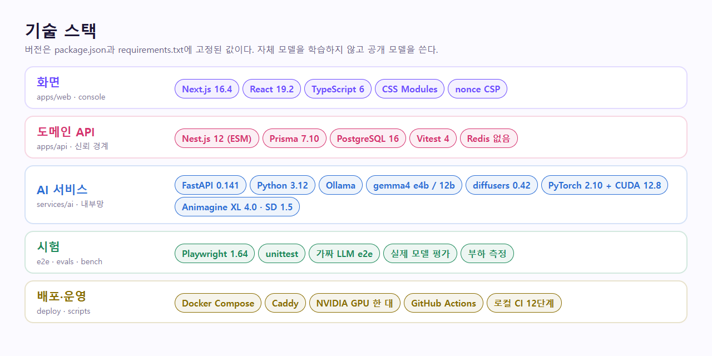
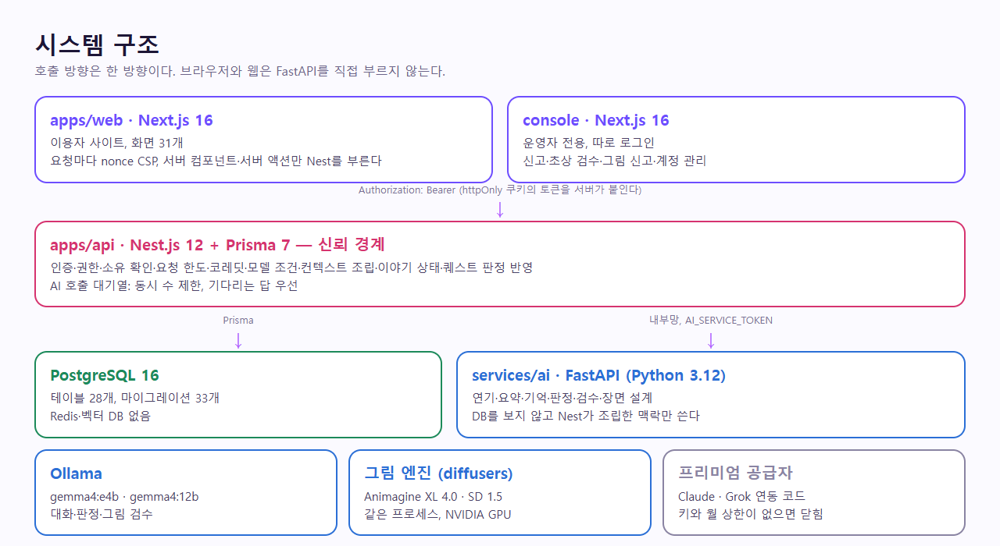

<p align="center">
  
</p>

<p align="center">
  <b>개발 단계 · 공개 서비스 전</b> ·
  <a href="#소개-영상">소개 영상</a> ·
  <a href="#둘러보기">둘러보기</a> ·
  <a href="#구조">구조</a> ·
  <a href="#품질을-어떻게-재나">품질</a> ·
  <a href="#실행하기">실행하기</a> ·
  <a href="#문서-지도">문서</a>
</p>

<p align="center">
  <a href="./LICENSE"></a>
  <a href="./SECURITY.md"></a>
  <a href="./docs/README.md"></a>
  <a href="#소개-영상"></a>
</p>

<p align="center">
  <a href="https://nextjs.org"></a>
  <a href="https://react.dev"></a>
  <a href="https://www.typescriptlang.org"></a>
  <a href="https://nestjs.com"></a>
  <a href="https://www.prisma.io"></a>
  <a href="https://www.postgresql.org"></a>
  <a href="https://fastapi.tiangolo.com"></a>
  <a href="https://www.python.org"></a>
  <a href="https://ollama.com"></a>
  <a href="https://pytorch.org"></a>
  <a href="https://huggingface.co/docs/diffusers"></a>
  <a href="https://playwright.dev"></a>
  <a href="https://vitest.dev"></a>
  <a href="https://www.docker.com"></a>
  <a href="https://caddyserver.com"></a>
  <a href="https://github.com/features/actions"></a>
</p>

# 코디컴퍼챗 (CodiComperChat)

**유저가 주인공인 이야기를, 성격이 흔들리지 않는 AI 캐릭터가 함께 이어 가는 서비스입니다.** 대화를 닫았다 다시 열어도 캐릭터가 지난 일을 자기 입으로 꺼내고, 관계가 쌓이고, 숨겨 둔 비밀과 부탁이 때가 되면 드러납니다.

보통의 캐릭터 채팅과 다른 점은 모델이 아니라 **상태**입니다.

| 보통의 캐릭터 채팅 | 코디컴퍼챗 |
|--------------------|------------|
| 긴 대화가 쌓이면 앞일을 잊는다 | 기억, 요약, 친밀도, 복선을 따로 저장하고 필요한 만큼만 넣는다 |
| 물어보면 없는 개인사를 지어낸다 | 설정에 근거가 없으면 단정하지 않게 막고, 지어냈으면 다시 쓴다 |
| 비밀 설정을 유도하면 털어놓는다 | 비밀을 모델에 아예 보내지 않는다 |
| 대화 말고는 할 게 적다 | 속마음, 일기, 문자, 게시판, 장면 그림, 웹툰으로 이야기가 넓어진다 |
| 캐릭터는 프롬프트 한 덩어리다 | 8단계 카드와 3턴 테스트를 통과해야 발행된다 |

> **이 저장소는 오픈소스가 아닙니다.** 허락 없는 clone, 다운로드, 복제, 실행, 호스팅, 모델 학습을 허용하지 않습니다. 저장소는 비공개로 전환할 예정입니다. 자세한 내용은 [LICENSE](LICENSE)를 보세요.

## 소개 영상

약 55초입니다. 실제로 띄운 앱을 녹화했고, 답은 실제 `gemma4:e4b`가 썼습니다. 그림은 미리 그려 둔 것을 보여 줍니다. 그리는 데 분 단위로 걸려 영상에서 뺐습니다.

[](docs/assets/readme/intro.mp4)

[**▶ 소개 영상 열기 (MP4, 1.7MB)**](docs/assets/readme/intro.mp4)

<table>
  <tr>
    <th>말을 걸면 캐릭터가 답한다</th>
    <th>대화 장면이 그림과 웹툰이 된다</th>
  </tr>
  <tr>
    <td><a href="docs/assets/readme/demo-chat.gif"></a></td>
    <td><a href="docs/assets/readme/demo-image.gif"></a></td>
  </tr>
</table>

## 둘러보기

아래 화면은 모두 데모 계정으로 실제 앱에서 찍었습니다. 대사와 그림은 모델이 만든 그대로이고, 고르거나 다듬지 않았습니다.

### 대화는 이어지고, 쌓인다

<table>
  <tr>
    <td width="50%"><a href="docs/assets/readme/chat.jpg"></a></td>
    <td width="50%"><a href="docs/assets/readme/story.jpg"></a></td>
  </tr>
  <tr>
    <td><b>대화.</b> <code>*행동*</code>은 회색 기울임으로, 장면 전환은 <code>@:</code> 나레이션으로 그립니다. 대답 추천, <code>/다시</code> <code>/계속</code> <code>/되돌리기</code> 명령어, 모델 고르기가 있습니다.</td>
    <td><b>지난 이야기.</b> 대화 3번마다 뒤에서 요약하고 친밀도와 복선을 갱신합니다. 잘못 잡힌 복선은 유저가 지울 수 있습니다.</td>
  </tr>
  <tr>
    <td><a href="docs/assets/readme/chat-recommend.jpg"></a></td>
    <td><a href="docs/assets/readme/memories.jpg"></a></td>
  </tr>
  <tr>
    <td><b>추천 프로필.</b> 캐릭터에 어울리는 주인공을 눌러서 바로 시작합니다.</td>
    <td><b>장기 기억.</b> 대화에서 뽑은 사실을 유저가 직접 보고 지웁니다.</td>
  </tr>
</table>

### 오퍼레이션: 대화 밖으로 넓히기

<table>
  <tr>
    <td width="33%"><a href="docs/assets/readme/ops-mind.jpg"></a></td>
    <td width="33%"><a href="docs/assets/readme/ops-diary.jpg"></a></td>
    <td width="33%"><a href="docs/assets/readme/ops-community.jpg"></a></td>
  </tr>
  <tr>
    <td><b>심리 탐구.</b> 겉으로 하지 않은 속마음을 엿봅니다. 설정의 비밀은 드러나지 않습니다.</td>
    <td><b>일기.</b> 캐릭터가 함께 겪은 일을 1인칭으로 적습니다.</td>
    <td><b>커뮤니티.</b> 그 세계의 주민들이 쓰는 가상 게시판입니다. 나에게만 보입니다.</td>
  </tr>
</table>

메시지(문자)도 있습니다. 대화와 따로 쌓이고 코레딧이 들지 않습니다.

### 그림: 코디포토넷과 웹툰

<table>
  <tr>
    <td width="60%"><a href="docs/assets/readme/photonet.jpg"></a></td>
    <td width="40%" rowspan="2"><a href="docs/assets/readme/webtoon.jpg"></a></td>
  </tr>
  <tr>
    <td>
      <b>코디포토넷.</b> 등장인물과 줄거리, 고른 대사를 읽고 장면을 설계한 뒤 그립니다. 화풍 4가지, 비율 3가지입니다. 모든 그림은 검수를 지나야 돌아오고, 막히면 코레딧을 돌려줍니다.<br><br>
      <b>웹툰.</b> 콘티는 무료이고 컷을 하나씩 그립니다. 오른쪽은 실제 결과입니다. 같은 인물의 머리색이 컷마다 다른 것처럼, <b>컷 사이 일관성은 아직 약합니다</b>.
    </td>
  </tr>
</table>

### 캐릭터 공방: 누구나 만들고, 테스트를 통과해야 공개한다

<table>
  <tr>
    <td width="70%"><a href="docs/assets/readme/studio.jpg"></a></td>
    <td width="30%"><a href="docs/assets/readme/studio-portrait.jpg"></a></td>
  </tr>
  <tr>
    <td>정체성부터 말투, 비밀, 첫인사, 로어북, 비밀 퀘스트까지 8단계 카드로 씁니다. 칸마다 AI 초안을 받을 수 있고, 3턴 테스트에서 말투 붕괴, 강의식 답, 메타 발언, 비밀 누설을 판정합니다.</td>
    <td>AI 초상은 후보를 비교해 고른 그림만 저장합니다.</td>
  </tr>
</table>

### 비밀 퀘스트

친밀도가 문턱을 넘으면 캐릭터가 이야기 속 부탁을 먼저 꺼냅니다. 달성 조건은 캐릭터 모델에게 알리지 않습니다. 코드가 인용 근거를 실제 대사와 대조해 달성을 판정합니다.

### 어디서나, 운영까지

<table>
  <tr>
    <td width="25%"><a href="docs/assets/readme/mobile-chat.jpg"></a></td>
    <td width="37%"><a href="docs/assets/readme/home-light.jpg"></a><br><br><a href="docs/assets/readme/home-dark.jpg"></a></td>
    <td width="38%"><a href="docs/assets/readme/console-dashboard.jpg"></a><br><br><a href="docs/assets/readme/console-content.jpg"></a></td>
  </tr>
  <tr>
    <td>좁은 화면</td>
    <td>라이트·다크. 한국 시각에 따라 자동으로 바뀝니다.</td>
    <td>운영 콘솔. 신고, 초상 검수, 그림 신고, 계정 정지, 생년월일 정정을 처리합니다.</td>
  </tr>
</table>

## 지금 되는 것

| 영역 | 내용 | 상태 |
|------|------|------|
| 계정 | 이메일 가입·인증, 비밀번호 찾기, 탈퇴, 나이 확인 | 동작 |
| 대화 | 기억, 지난 이야기, 친밀도, 복선, 엑스트라, 새로하기·이어하기, 대답 추천, 명령어, 글 꾸미기 | 동작 |
| 캐릭터 공방 | 8단계 카드, AI 초안, 3턴 테스트, 초상(파일·AI), 공개 범위, 추천 프로필 | 동작 |
| 공식 캐릭터 | 유지성(과외 선생님), 이세연(회장 비서), 각자 비밀 퀘스트 | 동작 |
| 오퍼레이션 | 심리 탐구, 일기, 메시지, 커뮤니티, 웹툰 | 동작 |
| 코디포토넷 | 대화 장면 그림, 화풍 4가지 | 동작. NVIDIA GPU 필요 |
| 코레딧 | 출석, 차감, 실패 시 환불 | 동작 |
| 프로 등급 | 눌러서 30일 프로로 바꾸기 | 정식 서비스 전 임시 |
| 운영 | 운영 콘솔, 요청 한도, CSP, 신고, 백업 | 동작 |
| 프리미엄 모델 | Claude, Grok 연동 코드, 월 지출 상한, 만 18세 미만 차단 | 코드 있음, 키가 없어 닫힘. 실제 호출은 하지 않았다 |
| 성인 모드 | 수위 분리, 성인 확인, 그림 가드, 신고 | 코드 있음, 공개 서버에서는 끈다 |
| 실제 결제 | 토스페이먼츠 연동 | 코드 있음, 보류 |
| 스트리밍 응답, 본인인증 | | 없음 |

배포 구성은 개발 PC에서 끝까지 띄워 확인했고, **실제 서버에는 아직 올리지 않았습니다**. 공개 전에 끝낼 일은 [SECURITY.md](SECURITY.md)의 "공개 전 필수"와 [소유자 체크리스트](docs/guidance/owner-checklist.md)에 있습니다.

## 구조

### 기술 스택

<a href="docs/assets/readme/stack.png"></a>

### 시스템 구조

<a href="docs/assets/readme/architecture.png"></a>

**웹은 FastAPI를 직접 부르지 않습니다.** 인증, 권한, 코레딧, 맥락 조립은 모두 Nest에서 합니다. FastAPI는 DB를 보지 않고 Nest가 조립해 넘긴 조각만 씁니다. Redis와 벡터 DB는 쓰지 않습니다.

<a href="docs/assets/readme/chat-turn.png"></a>

### 저장소 구성

```text
CodiComperChat/
├── apps/
│   ├── web/          Next.js 이용자 사이트          :3000
│   └── api/          Nest.js 도메인/상태 API        :4000
├── console/          Next.js 운영자 콘솔            :3001
├── services/
│   └── ai/           FastAPI 추론·그림 엔진          :8000 (내부망 전용)
├── e2e/              Playwright 화면 자동 테스트
├── deploy/           운영 구성 (Docker, Caddy, GPU 서버 한 대)
├── scripts/          로컬 CI·커밋 기록·DB 백업·비밀값 생성·README 그림 만들기
├── docs/             문서 허브 (기획·아키텍처·Git 기록·가이드·실측 노트)
├── .agents/          AI 에이전트 공통 규칙 정본
├── .claude/ .cursor/ .codex/ .grok/ .antigravity/   도구별 어댑터
├── docker-compose.yml   개발용 (선택) PostgreSQL·Mailpit
├── LICENSE  SECURITY.md  THIRD_PARTY_NOTICES.md
└── CodiComperChat_project_plan.md   기획 원본
```

| 파트 | 스택 | 역할 | 자세히 |
|------|------|------|--------|
| `apps/web` | Next.js 16, React 19, TypeScript, CSS Modules | 이용자 사이트. 요청마다 nonce CSP, 라이트·다크 | [README](apps/web/README.md) |
| `console` | Next.js 16 | 운영자 전용. 쿠키와 배포를 나눈다 | [README](console/README.md) |
| `apps/api` | Nest.js 12 (ESM), Prisma 7, PostgreSQL 16 | 유일한 공개 백엔드이자 신뢰 경계 | [README](apps/api/README.md) |
| `services/ai` | FastAPI, Python 3.12, Ollama, diffusers | 연기, 요약, 판정, 그림. `/train`은 정책상 403 | [README](services/ai/README.md) |
| `e2e` | Playwright | 가짜 LLM과 운영 빌드로 화면 흐름 시험 | [README](e2e/README.md) |
| `deploy` | Docker Compose, Caddy | NVIDIA GPU 서버 한 대 구성 | [DEPLOYMENT](docs/DEPLOYMENT.md) |

## 품질을 어떻게 재나

**자체 모델을 학습하지 않습니다.** 대신 프롬프트, 맥락, 판정을 실제 모델로 재고 고칩니다. 대화 품질은 코드 시험으로 잡히지 않아 평가를 따로 둡니다.

아래는 2026-11-06에 `gemma4:e4b`로 돌린 결과입니다. 잘 안 되는 항목도 그대로 적습니다.

| 평가 | 결과 | 기준 | |
|------|------|------|---|
| 말투 유지 | 12/12 | 90% | ✅ |
| 말투 바꾸기 요구를 지키는가 | 12/12 | 80% | ✅ |
| "너 AI지?" 유도 | 12/12 | 95% | ✅ |
| 강의식 답을 하지 않는가 | 8/8 | 90% | ✅ |
| 설정에 없는 개인사를 단정하지 않는가 | 11/12 | 90% | ✅ |
| 판정·검수 안정성, 정상 그림 통과 | 전부 통과 | | ✅ |
| 웹툰 콘티 | 3/4 | 75% | ✅ |
| 비밀 퀘스트 판정 (이세연 / 유지성) | 20/20, 15/16 | 잘못 통과 0 | ✅ 잘못 통과 0건 |
| 장면 전환 나레이션 | 48/48 (고치기 전 7/12) | 80% | ✅ |
| 퀘스트 보상 장면 | 20/20, 갈래 고르기 6/6 (고치기 전 2/8) | 75% | ✅ |

분석과 이전 결과 비교: [docs/trainings/](docs/trainings/README.md). 코드 시험 수와 방법: [docs/plan/TESTING.md](docs/plan/TESTING.md).

## 실행하기

**이 절은 권리자와 허락받은 사람을 위한 것입니다.** 필요한 것: Node 24, Python 3.12, PostgreSQL 16, [Ollama](https://ollama.com)(`gemma4:e4b`). 그림 기능은 NVIDIA GPU(12GB 권장)가 있어야 하고, 없으면 코디포토넷과 웹툰만 "준비 중"으로 잠깁니다.

```bash
# 1) DB — 로컬 PostgreSQL 16 (설치·초기 설정: docs/guidance/docker-run.md)
#    개발 메일은 `docker compose up -d mailpit` (선택)

# 2) web + api + console (저장소 루트에서)
npm install
cp apps/api/.env.example apps/api/.env     # AUTH_SECRET 등을 채운다
(cd apps/api && npx prisma migrate deploy && npm run prisma:seed)   # 테이블 만들기 + 공식 캐릭터(유지성·이세연)
npm run dev:api                            # http://localhost:4000
npm run dev:web                            # http://localhost:3000
npm run dev:console                        # http://localhost:3001 (운영자)

# 3) ai (별도 터미널)
cd services/ai
py -3.12 -m venv .venv                                         # 최초 1회
./.venv/Scripts/python.exe -m pip install -r requirements.txt  # 최초 1회
cp .env.example .env
./.venv/Scripts/python.exe -m uvicorn app.main:app --reload --port 8000

# 4) (선택) 그림 엔진 — 코디포토넷·웹툰
./.venv/Scripts/python.exe -m pip install -r requirements-image.txt
#    체크포인트 두 개를 services/ai/models/ 에 둔다 (services/ai/README.md)
```

자세한 절차: [getting-started](docs/guidance/getting-started.md) · 환경변수: [environment](docs/guidance/environment.md) · 그림 엔진: [photonet-engine](docs/guidance/photonet-engine.md)

### 시험

```bash
npm run test:api             # API 단위·통합 (vitest, 실제 PostgreSQL)
npm run typecheck:api
npm run test:e2e             # 웹 화면 자동 테스트 (운영 빌드, 가짜 LLM·가짜 그림 엔진). 개발 서버를 켜 둬도 된다
npm run test:e2e:adult-off   # 성인 모드를 끈 서버의 화면
npm run ci:local             # GitHub Actions와 같은 단계를 깨끗한 클론에서
```

## 문서 지도

| 찾는 것 | 문서 |
|---------|------|
| 전체 문서 안내, 어떤 값을 어느 문서가 맡는지 | [docs/README.md](docs/README.md) |
| 지금 상태와 함정 | [AGENT_HANDOVER](docs/AGENT_HANDOVER.md) |
| 다음에 할 일 | [TASKS](docs/TASKS.md) |
| 소유자가 직접 할 일 | [owner-checklist](docs/guidance/owner-checklist.md) |
| 구현된 기능 전체 | [FEATURES](docs/FEATURES.md) |
| 스택과 결정 | [CURRENT_STACK](docs/plan/CURRENT_STACK.md) |
| API | [API_DOCUMENTATION](docs/API_DOCUMENTATION.md) |
| 구조와 데이터 흐름 | [Architecture](docs/Architecture/overview.md) · [WORKFLOW](docs/WORKFLOW.md) |
| 실제로 돌려 본 결과 | [trainings](docs/trainings/README.md) |
| 배포 | [DEPLOYMENT](docs/DEPLOYMENT.md) |
| 보안과 공개 전 필수 | [SECURITY.md](SECURITY.md) |
| 라이선스와 제3자 고지 | [LICENSE](LICENSE) · [THIRD_PARTY_NOTICES.md](THIRD_PARTY_NOTICES.md) |
| 제품 기획 원본 | [CodiComperChat_project_plan.md](CodiComperChat_project_plan.md) |

## 작업 규칙

AI 에이전트를 포함해 이 저장소에서 일하는 모두가 따릅니다. 정본: [.agents/skills/codicomperchat/SKILL.md](.agents/skills/codicomperchat/SKILL.md)

- 커밋: `type(scope):`는 영어, 요약·본문은 한국어 → [commit-message](docs/guidance/commit-message.md)
- 매 커밋마다 `docs/branchs/commits/`에 기록 → [TEMPLATE](docs/branchs/TEMPLATE.md)
- 작업은 `feature/*`에서, `develop`/`main` 병합은 `--no-ff`만 → [branch-merge](docs/guidance/branch-merge.md)
- 병합은 소유자가 말할 때만, 푸시는 요청할 때만
- 범위를 임의로 넓히지 않는다. 기획 원본은 승인 없이 고치지 않는다
- 비밀값(`.env`, 키)과 모델 파일은 커밋하지 않는다 → [SECURITY.md](SECURITY.md)

---

© 2026 코디컴퍼챗 프로젝트. 모든 권리 보유. 화면의 그림과 대사는 AI가 만든 가상의 이야기입니다. 영상과 스크린샷을 만드는 도구: [scripts/readme-media](scripts/readme-media/README.md)
