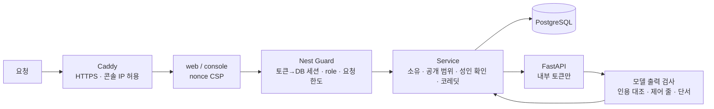
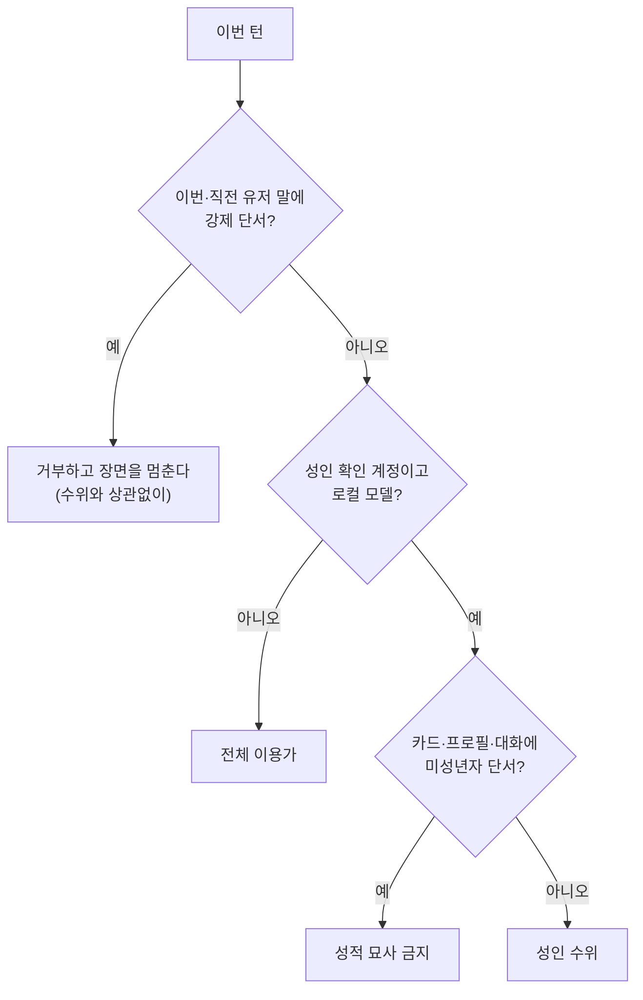
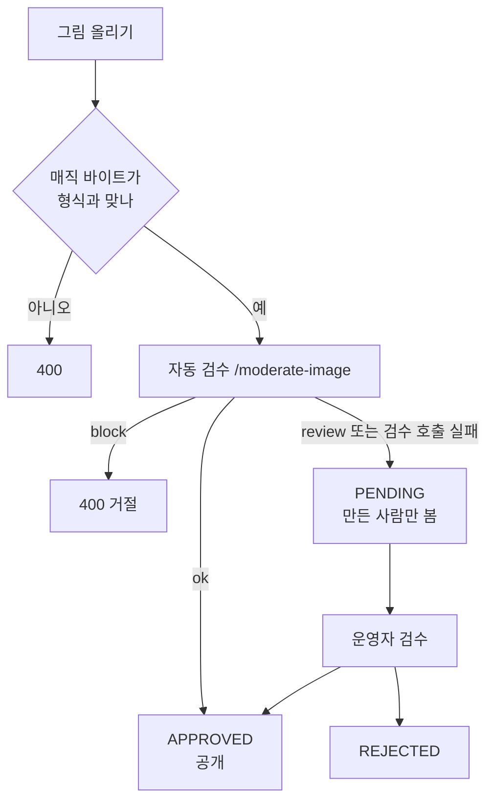

# 보안 정책

코디컴퍼챗은 계정·대화·결제·성인 확인 정보를 다루는 서비스다. 이 문서는 (1) 취약점을 신고하는 법, (2) **지금 구현돼 있는 보안 장치**, (3) **아직 없거나 공개 전에 반드시 해야 하는 것**을 사실대로 적는다. 구현 내용은 코드에서 확인한 것만 적었고, 위치를 함께 적어 두었다.

> 상태(2026-11-06): 개발 단계이며 **배포 전**이다. 아직 공개 서비스가 아니다. 아래 "공개 전 필수"를 끝내기 전에는 인터넷에 열지 않는다.

**바로 가기:** [취약점 신고](#취약점-신고) · [위협과 대응](#위협과-대응) · [구현된 장치](#지금-구현된-보안-장치) · [직접 확인하는 법](#직접-확인하는-법) · [알려진 한계](#알려진-한계) · [공개 전 필수](#공개-전-필수-체크리스트) · [사고가 났을 때](#사고가-났을-때)

<!-- logic-structure -->
## 로직 구조

```text
요청 ─▶ Caddy(HTTPS, 콘솔은 IP 허용 목록) ─▶ web/console ─▶ Nest
                                                            │
        ┌───────────────────────────────────────────────────┤ 모든 판단은 여기서
        ▼                                                   ▼
  AuthGuard: 토큰 → DB 세션 (매 요청)              RateLimitGuard: DB 버킷(계정·IP·이메일)
  AdminGuard: DB의 role (매 요청)                  CSP: 요청마다 nonce (web·console)
        │
        ▼
  Service: 소유·공개 범위·성인 확인(매 턴 DB)·코레딧(한 문장 차감)·보상(잠금·기본키)
        │
        ├─▶ 모델로 가는 것: 비밀·달성 조건·파트 목표는 넣지 않거나 방향만
        ├─▶ 모델에서 오는 것: 근거 인용 대조 · 제어 줄 검사 · 수위 단서는 코드가 찾음
        └─▶ 그림: 매직 바이트 검사 → 자동 검수(막힘/대기/통과) → 운영자 검수
FastAPI: 내부망 + AI_SERVICE_TOKEN만 통과(루프백 /health 예외), 운영 시작 때 안전 설정 확인
```

<!-- logic-mermaid -->

### 신뢰 경계와 검사 순서



### 수위 판단



### 그림이 올라올 때



## 취약점 신고

보안 문제를 발견하면 **공개 이슈로 올리지 말고** 비공개로 알려 주세요.

- 서비스의 **고객센터**(`/support`)로 알려 주세요. 저장소를 비공개로 전환하기로 해(2026-11-03) GitHub 쪽 신고 창구는 쓰지 않는다.
- 보안 전용 메일은 두지 않았다. 도메인을 정한 뒤 필요하면 `security@도메인`을 만든다.
- 이 저장소는 독점 코드다. 신고를 위해 코드를 읽는 것은 [LICENSE](LICENSE)가 허용하지만, 복제·실행은 허용하지 않는다.

신고에 담아 주면 좋은 것: 영향받는 화면·경로, 재현 방법, 예상되는 영향, (가능하면) 고치는 방법. **다른 이용자의 데이터를 열어 보거나 서비스를 방해하지 않는 범위**에서 확인해 주세요. 선의로 이 범위를 지킨 신고는 법적 조치의 대상으로 삼지 않는다.

대응 목표(약속이 아닌 목표): 접수 확인 3영업일, 심각도 판단과 계획 안내 7일. 지원하는 버전은 `main`과 `develop`의 최신 커밋뿐이다.

범위 밖: 사회공학·물리 공격, 서드파티(Ollama·PostgreSQL 등) 자체의 취약점(해당 프로젝트에 신고), 무차별 대입·부하 시험 자체, 개발용 설정(Mailpit·가짜 결제·가짜 LLM)에서만 나타나는 문제.

## 구조와 신뢰 경계

```text
브라우저 → apps/web(Next) → apps/api(Nest) → services/ai(FastAPI) → Ollama / 그림 엔진
              console(Next, 운영자) ─────────↗        └→ PostgreSQL (api만)
```

- 신뢰 경계는 **Nest(`apps/api`)** 다. 인증·권한·소유 확인·요청 한도·입력 검사는 모두 여기서 한다. 웹의 화면 거름망(`proxy.ts`)은 1차 거름일 뿐이고 권한 판단은 Nest가 다시 한다.
- 브라우저는 Nest를 직접 부르지 않는다(서버 컴포넌트·서버 액션만). 그래서 CORS를 열지 않았다.
- FastAPI는 DB를 보지 않고, **Nest만** 부른다. `AI_SERVICE_TOKEN`이 있으면 그 헤더가 맞는 요청만 받고, 비우면 **루프백만** 받는다(`/health`도 루프백만 토큰 없이). 운영(`APP_ENV=production`)은 토큰이 필수다.

## 위협과 대응

코드가 실제로 막는 것과 남은 위험을 한눈에 보는 표다. 위치와 세부 값은 아래 절에 있다.

| 위협 | 대응 | 시험 | 남은 위험 |
|------|------|------|-----------|
| 비밀번호 추측 | 이메일+IP·IP별 요청 한도, scrypt, 시간 차이 제거 | e2e `security`, `auth`, 단위 | 고정 창이라 경계에서 두 배까지 지나간다 |
| 토큰 탈취 | httpOnly 쿠키, 7일 만료, 비밀번호 변경 시 세대 무효화 | e2e `email` | 갱신 토큰이 없어 새면 만료 전까지 쓸 수 있다 |
| 남의 데이터 열람 | 모든 경로에서 소유 확인, 그림은 만든 사람에게만 | e2e `operations`, `webtoon`, `studio` | 없음(확인된 것 기준) |
| 운영자 권한 탈취 | DB 역할을 매 요청 확인, 콘솔 쿠키 분리, IP 허용 목록 | e2e `console`, 단위 | 허용 목록을 운영 값으로 넣어야 한다 |
| 스크립트 삽입(XSS) | HTML을 넣지 않고 React 요소로만 그림, 요청마다 nonce CSP | e2e `format`, `security` | 없음(확인된 것 기준) |
| 모델 유도·프롬프트 주입 | 비밀을 모델에 보내지 않음, 인용 근거를 코드가 대조 | `evals`, e2e `quest` | 완전히 막을 수 없다. 권한 판단은 모델에 맡기지 않는다 |
| 미성년자 관련 콘텐츠 | 그리기 전 글 거절, 부정 프롬프트, 그림 검수, 신고·정지 | e2e `operations`, `webtoon`, `evals.photonet_guard` | 판정이 확률적이다. 자기 신고라 나이를 증명하지 못한다 |
| 비용 폭주 | 코레딧 선차감, 요청 한도, 프리미엄 월 상한, 대기열 | e2e `models`, 단위 | 동시 요청이 겹치면 답 몇 번만큼 넘을 수 있다 |
| 내부 AI 직접 호출 | 포트 비공개, 토큰 또는 루프백 | 운영 구성에서 401 확인 | 없음(확인된 것 기준) |
| 비밀값 유출 | `.env` git 제외, 운영 시작 검사 | 전체 이력 검색 0건(2026-11-06) | 정규식으로 찾은 것이라 모든 형식을 보장하지 못한다 |

## 지금 구현된 보안 장치

### 계정·세션
| 항목 | 내용 | 위치 |
|------|------|------|
| 비밀번호 저장 | scrypt(소금 16바이트, 키 64바이트), 비교는 `timingSafeEqual`. 길이 8~상한 검사 | `apps/api/src/auth/password.ts`, `auth.dto.ts` |
| 로그인 토큰 | HS256 JWT, 7일. 키(`AUTH_SECRET`)가 없거나 32자 미만이면 **서버가 시작되지 않는다** | `auth/token.ts` |
| 토큰 무효화 | 토큰에 계정 세대(`sessionVersion`)를 싣고, 비밀번호 변경·재설정 때 올려 이전 토큰을 모두 끊는다. 매 요청 DB로 계정이 아직 있는지·세대가 맞는지 확인 | `auth/session.ts` |
| 웹 세션 쿠키 | `httpOnly`, `sameSite=lax`, 운영에서 `secure`. 운영 콘솔은 따로(`console_session`, SameSite=Strict) | `apps/web/app/actions/auth.ts` |
| 로그인 시간 차이 | 없는 이메일도 해시 비교 시간을 들여, 응답 시간으로 가입 여부를 알아내지 못하게 | `auth/auth.service.ts` |
| 이메일 인증·비밀번호 재설정 | 일회용 토큰(32바이트 무작위), **DB에는 SHA-256 해시만**, 인증 24시간·재설정 30분, 가장 최근 메일의 링크만 유효, "안 쓴 것만 쓴 것으로" 한 문장으로 바꿔 동시 클릭도 한 번만 통과 | `auth/email-token.ts` |
| 운영자 권한 | `AdminGuard`가 토큰이 아니라 **DB의 role을 매번** 읽는다(내려오면 바로 막힘) | `auth/admin.guard.ts` |
| 회원 탈퇴 | 비밀번호 재확인 + 확인 문구. 데이터 삭제, 발행 캐릭터는 먼저 내림, 결제 기록만 법정 보관(계정 연결 끊음) | `account/` |

### 요청·입력
| 항목 | 내용 | 위치 |
|------|------|------|
| 요청 한도 | 로그인(이메일+IP, IP), 가입, 비밀번호, 메일 발송, 비밀번호 찾기, 메일 토큰 맞히기, 대화·추천·공방 AI·기억·업로드·신고·결제·**그림 만들기(코디포토넷·웹툰)** 등 사람(또는 IP)별 고정 창. 기본은 서버 메모리, 여러 대면 `RATE_LIMIT_STORE=db` | `security/rate-limit.ts`, `rate-store.ts` |
| 실제 IP | `trust proxy`를 루프백·사설망으로만 한정해, 공개 주소에서 온 요청이 `X-Forwarded-For`로 IP를 꾸미지 못하게 | `apps/api/src/main.ts` |
| AI 호출 대기열 | 동시 호출 수 제한, 기다리는 답 우선, 대기 60초 초과 503·응답 130초 초과 504 — 한 사람이 모델을 독점하지 못하게 | `ai/ai-queue.ts` |
| SQL | Prisma(매개변수 바인딩). 직접 쓴 SQL은 태그 템플릿(`$queryRaw`)으로만 | `apps/api` 전체 |
| 이미지 업로드(초상) | 형식 3종, 150KB, 본문 상한 300KB, **파일 첫 바이트(매직 넘버)가 선언한 형식과 맞는지** 서버가 다시 검사(브라우저를 믿지 않음) | `studio/portrait.ts`, `main.ts` |
| 이미지 응답 | `Content-Type` 고정, `nosniff`, `private, no-store`, CSP `sandbox` — 그림이 문서로 실행되지 못하게 | `operations/*.controller.ts` |

### 브라우저
| 항목 | 내용 | 위치 |
|------|------|------|
| CSP | 요청마다 새 nonce + `strict-dynamic`: 사용자가 쓴 글에 `<script>`가 섞여도 실행되지 않는다. `object-src 'none'`, `frame-ancestors 'none'`, `form-action` 제한. 위반은 `/api/csp-report`로 받아 로그(쿼리 제거·본문 16KB·분당 30줄 제한) | `apps/web/proxy.ts`, `app/api/csp-report/route.ts` |
| 보안 헤더 | `X-Content-Type-Options`, `X-Frame-Options: DENY`, `Referrer-Policy`, `Permissions-Policy`(카메라·마이크·위치·결제 차단). API도 `nosniff`·`DENY`·`no-referrer`, `x-powered-by` 숨김. https 응답에는 HSTS(`max-age=15552000; includeSubDomains`). `REQUIRE_HTTPS=1`이면 공개 호스트의 http를 https로 보낸다. 운영(`NODE_ENV=production`)인데 이 값이 없으면 공개 호스트는 503, API는 시작하지 않는다 | `apps/web/next.config.ts`, `apps/web/proxy.ts`, `console/proxy.ts`, `apps/api/src/security/https.ts`, `main.ts` |
| 글 렌더링 | 대화 글은 HTML로 넣지 않는다. 마크다운 비슷한 표기를 읽어 **React 요소로만** 그린다 | `apps/web/lib/chat-format.ts`, `components/chat-text.tsx` |
| 외부 자원 | 외부 글꼴·CDN CSS 없음. 외부 스크립트는 요금 화면의 토스 결제창뿐 | CSP |

### 비밀·개인정보
| 항목 | 내용 |
|------|------|
| 캐릭터 비밀 | `Character.secret`·해금 조건은 **어떤 공개 응답에도 싣지 않고 AI에도 보내지 않는다**(공개 필드 목록으로 select). 비밀 퀘스트의 **달성 조건**도 캐릭터(모델)에게 알리지 않고 판정에만 쓴다 |
| 응답에서 뺀 칸 | `passwordHash`, `tokenHash`, 생년월일(`birthDate`)·동의 시각 — 응답에는 `adult`와 `birthDateSet` 여부만, 운영 콘솔에는 만 나이만 |
| 비밀 파일 | `.env*`는 git 제외(`.env.example`만 올림). 페르소나 지식 JSON·모델 가중치도 git 제외 |
| 결제 | 키는 Nest에만 있고 웹에는 공개 키만. 승인 때 **서버가 금액을 주문과 다시 대조**. 실제 결제는 보류하고, 정식 서비스 전까지 `PRO_CLICK`으로 눌러서 프로로 바꾼다(운영 기본 켜짐, 토스를 켜면 닫힘) |
| 개인정보 | 이메일, 표시 이름, 비밀번호 해시, (나이 확인·성인 모드 사용자) 생년월일·동의 시각, 대화·기억·그림. 결제 기록은 법정 보관 |

### 콘텐츠 안전 (AI)
| 항목 | 내용 |
|------|------|
| 초상 자동 검수 | 올린 그림을 로컬 모델이 판정(성적·미성년자·잔혹·혐오·자해·실존 인물 사진) → 통과 / 운영자 검수 / 거절. 승인된 것만 남에게 보임 |
| 코디포토넷·웹툰 | **전체 이용가(기본)** 와 **성인 모드**를 따로 만든다. 성인 모드는 이메일 인증 + 만 19세 + 동의가 있어야 하고(서버가 매번 DB로 확인, 동의를 거두면 성인 그림이 목록·본문에서 바로 사라짐), 실사풍 금지, **미성년자 관련 설정은 그리기 전에 거절**, 그림 검수(어려 보이는 인물·강제적 성 묘사·실존 인물·실사 유사도 90 이상·혐오·자해 차단) |
| 대화 수위 | 전체 이용가가 기본. 성인 확인을 마친 계정만 성인 수위이고 Nest가 매 턴 DB로 다시 본다. 성인 수위는 로컬 모델에서만(프리미엄 공급자는 각자 정책). 카드·프로필·대화의 미성년자 단서와 이번·직전 유저 말의 강제 단서는 코드가 찾아 그 턴의 성적 진행을 막는다. **대화 글의 출력 검사는 없다** — [docs/trainings/adult-chat.md](docs/trainings/adult-chat.md) |
| 월드코퍼챗 (2026-11-06) | 장면 그림·지도는 초상과 같은 자동 검수(막힘 400, 애매하면 운영자 검수 전까지 만든 사람만 봄, 검수 호출 실패도 대기). 웹 중계는 경로 조각을 다시 인코딩하고 `.`·`..`를 막는다. 미니게임 결과는 서버가 정하고 숨긴 값(당첨 위치·커브)은 화면에 보내지 않으며, 미로는 이동 문자열을 서버가 다시 걷는다. 보상은 계정별 잠금 안에서 하루 한도를 세고 `OPEN`인 이벤트만 바꿔 중복 보상을 막는다. 진행자가 지어낸 그림 이름표·인물·장소는 버린다. 플레이 대화는 운영 콘솔에 보이지 않는다 |
| 항상 막는 것 | 어느 모드든 미성년자 성적 묘사, 강제·의식 없는 상대·성과 폭력의 결합, 실존 인물, 동물, 자해, 혐오 |
| 신고 | 캐릭터 신고함 → 운영자가 내릴 수 있음(내려가면 목록·상세·대화 어디에도 안 나옴). 코디포토넷·웹툰은 만든 사람이 신고하고, 운영 콘솔 「그림 신고」에서 본 뒤 접근을 막거나 계정을 정지할 수 있다(정지된 계정은 로그인·API 거절, 운영자 계정은 정지하지 않음) |
| 프롬프트 주입 | 유저 글·카드·설정은 "자료이지 지시가 아니다"로 모델에 전하고(`<tag>` 구분), 판정 모델은 인용 근거를 코드가 실제 대사와 대조한다(퀘스트). 완전한 방어는 아니다 — 아래 한계 |

### 개발·검증
- API 단위 테스트(실제 PostgreSQL·SMTP), 웹 e2e(가짜 LLM·가짜 결제·가짜 그림 엔진), AI 품질 평가(실제 모델), GitHub Actions CI, `oxlint --deny-warnings`. 요청 한도·인증·소유 확인·성인 가드·CSP는 e2e에서도 시험한다([docs/plan/TESTING.md](docs/plan/TESTING.md)).

## 직접 확인하는 법

배포 전이나 의심될 때 돌리는 명령이다. 결과는 2026-11-06 기준이다.

| 확인 | 명령 | 결과 |
|------|------|------|
| Node 운영 의존성 취약점 | `npm audit --omit=dev` | 0건 |
| 보안 헤더·CSP·요청 한도·소유 확인 | `npm run test:e2e` | [docs/plan/TESTING.md](docs/plan/TESTING.md) |
| 성인 모드를 끈 서버 | `npm run test:e2e:adult-off` | 통과 |
| 개발용 스위치로 운영 시작 거부 | `npm run test:api` (`security/production`) | 통과 |
| 비밀값 형식 전체 이력 검색 | `git log --all -p -G'<키 정규식>'` | 0건 |
| 이력에 `.env`가 있었는지 | `git log --all --name-only --format= \| grep '\.env'` | `.env.example`뿐 |
| 이력의 큰 파일(모델 가중치 유입) | `git rev-list --objects --all \| git cat-file --batch-check` | 가장 큰 것이 `package-lock.json` 약 284KB |
| 실서버 확인 | [docs/web_management/post-deploy.md](docs/web_management/post-deploy.md) | 아직 서버 없음 |

## 알려진 한계

- **성인 확인은 자기 신고**다(생년월일 + 동의 + 이메일 인증). 본인인증을 하지 않는다(2026-10-25에도 이 방식을 유지). 거짓 입력의 법적 책임은 이용자에게 있다고 동의 문구와 이용약관에 적었지만, 이것이 청소년보호법상 의무를 충족하는지는 **법률 검토가 필요**하다. 약관·처리방침은 코드와 맞춘 초안이며 변호사 검토를 대신하지 않는다.
- 로컬 모델의 판정(검수·퀘스트·성인 가드)은 **확률적**이다. 부적절한 그림을 놓치거나 정상 그림을 막을 수 있다. 막는 쪽은 코레딧을 돌려준다.
- 성인 대화의 금지선(미성년자·강제)은 **입력에서만** 찾는다. 단어 기반이라 돌려 쓴 표현은 놓칠 수 있고, 모델이 스스로 선을 넘는 글을 쓰면 막지 못한다. 신고와 운영 콘솔이 마지막 선이다.
- 프롬프트 주입은 완전히 막을 수 없다. 서버 쪽 권한·소유·성인·비밀 가드는 모델 출력에 기대지 않고 코드로 한다.
- 로그인 토큰은 7일이며 갱신 토큰이 없다. 토큰이 새면 만료나 비밀번호 변경 전까지 쓸 수 있다.
- 요청 한도는 고정 창이라 창 경계에서 한도의 두 배까지 지나갈 수 있다. 기본(메모리) 저장은 서버가 여러 대면 합쳐지지 않는다.
- 운영 로그의 개인정보 마스킹 정책이 문서로 정해져 있지 않다.
- 개발용 `docker-compose.yml`의 postgres는 약한 개발 비밀번호다. 포트는 `127.0.0.1:5432`에만 연다. **개발 PC에서만** 쓴다. Mailpit도 `127.0.0.1`에만 열린다.

## 공개 전 필수 (체크리스트)

- [x] **FastAPI를 외부에서 못 닿게** (코드·구성): 토큰 또는 루프백. 운영 compose는 포트를 열지 않고 토큰을 필수로 요구한다. 토큰 없이 401을 실제로 확인했다.
- [x] **TLS** (구성, 2026-11-03): Caddy가 인증서를 받고 `X-Forwarded-*`를 덮어쓴다. 앱은 `REQUIRE_HTTPS=1`일 때 공개 호스트의 http를 https로 보내고 HSTS를 붙인다. 내부 호스트만 `REQUIRE_HTTPS_EXEMPT_HOSTS`로 뺀다. 남은 일 — 실제 도메인에서 인증서 발급 확인.
- [x] **운영 콘솔** (코드): 운영의 공개 호스트는 `CONSOLE_IP_ALLOWLIST`에 있는 IP만. `CONSOLE_ALLOW_PUBLIC=1`이 아니면 막는다. 남은 일 — 허용 목록을 운영 값으로 넣기. 쿠키 SameSite=Strict는 보조다.
- [ ] **비밀값 점검**: 생성기 `node scripts/generate-prod-secrets.mjs` (출력만, 파일에 쓰지 않음). `AUTH_SECRET`·`AI_SERVICE_TOKEN`·DB 비밀번호·SMTP·토스 키를 운영용으로 새로 만들고 저장소에 남기지 않는다. 개발 값 재사용 금지. **2026-11-07 Oracle 서버용 `AUTH_SECRET`·`AI_SERVICE_TOKEN`·DB 비밀번호·`WEB_PROXY_TOKEN`은 서버에서 새로 만들어 서버 `.env`(권한 600)와 Vercel(sensitive)에만 두었다.** SMTP·토스 키는 아직 없다. 작업 대화에 개인키 내용과 `WEB_PROXY_TOKEN` 값이 한 번씩 드러났으니 교체를 권한다([docs/TASKS.md](docs/TASKS.md) U10).
- [x] **개발용 스위치** (코드): `NODE_ENV=production` / `APP_ENV=production`이면 `LLM_FAKE`, `IMAGE_FAKE`, `MODEL_PREMIUM_FAKE`, `BILLING_PROVIDER=mock`, `MAIL_OUTBOX_DIR`이 있으면 시작하지 않는다. Mailpit은 개발 compose 전용이다.
- [x] **서버 대수**: 한 대로 정했다(2026-11-03). 여러 대로 늘리면 `RATE_LIMIT_STORE=db`, AI 대기열은 서버 대수만큼 따로 센다는 점을 감안한다.
- [ ] **성인 확인의 법률 검토**: 방식은 자기 신고를 유지한다(2026-10-25). 본인인증을 넣을지는 변호사 검토. 신고·검토·접근 차단·계정 정지는 콘솔 「그림 신고」에 있다.
- [x] **Gemma 라이선스** (2026-11-03 정정): 쓰는 Gemma 4는 Apache 2.0이고 예전 Gemma 금지 정책의 적용 대상이 아니다. 근거는 [THIRD_PARTY_NOTICES.md](THIRD_PARTY_NOTICES.md).
- [ ] **성인 모드의 공개 여부**: 청소년 보호법의 나이·본인 확인(지금은 자기 신고), 음란물 유통 규정, 호스팅 약관(Hetzner는 금지)을 변호사와 확인한다. 확인 전에는 공개하지 않는다. 코드로는 운영 compose의 `ADULT_MODE=off` 기본값이 막는다.
- [ ] **프리미엄 공급자**: 키는 `services/ai`에만 둔다. 서비스 쪽 월 상한은 `PREMIUM_MONTHLY_CREDITS`이고(운영에서 넣지 않으면 열리지 않는다, 2026-11-04), 동시 요청이 겹치면 조금 넘을 수 있어 공급자 콘솔의 월 한도도 함께 건다. `PRO_CLICK`을 닫을지 함께 정한다. 만 18세 미만 차단은 자기 신고 생년월일로 구현했다(2026-11-03, 본인인증은 아니다). xAI 사용 정책을 읽는다.
- [ ] **개인정보**: 처리방침 법률 검토, 보관 기간·파기, 생년월일 보관 필요성, 로그 마스킹.
- [x] **백업·복구** (2026-11-03): `scripts/db-backup.sh`, 새 DB로 복구 연습 1회 성공([docs/web_management/backup-restore.md](docs/web_management/backup-restore.md)). 남은 일 — 서버 cron 등록, 서버 밖 저장소로 복사.
- [x] **의존성 점검** (2026-11-03, npm은 2026-11-06 재확인): `npm audit --omit=dev` 14건(치명 1) → **0건**(Next.js 16.4.4, Nodemailer 10.3). `pip-audit`은 torch 2.10.0에 2건이 남았다(PYSEC-2026-139 pt2 로더, PYSEC-2025-194 `torch.jit.script`). 둘 다 로컬에서 그 기능을 쓸 때의 문제이고, 이 서비스는 safetensors만 읽고 해당 기능을 부르지 않으며 이용자 파일을 torch에 넘기지 않아 올리지 않았다. 개발 의존성의 npm 경고는 운영 이미지 실행 경로가 아니다. 남은 일 — 서드파티 라이선스 전체 검토.
- [ ] **GitHub 설정**: 저장소 비공개 전환(2026-11-03 결정, 아직 공개 상태), 기본 브랜치 보호(`main`·`develop`), 비밀 스캔(secret scanning) 켜기. 비공개 저장소에서는 요금제에 따라 제한될 수 있다(미확인). `gh`가 로그인돼 있지 않아 설정은 읽지도 바꾸지도 못했다.
- [x] **저장소에 비밀값 없음** (2026-11-03): 작업 트리에서 API 키·개인 키 형식을 검색해 없음. `.env`는 추적되지 않는다. 2026-11-06에 전체 이력도 키 형식으로 검색해 0건이었고 `.env` 파일이 올라간 적이 없다. GitHub secret scanning은 설정한 뒤 다시 확인한다.
- [x] **운영 로그** (2026-11-03): Nest·FastAPI의 로그 호출을 읽었다. 대화 본문·비밀번호를 남기지 않는다. 받는 사람 주소와 메일 본문을 남기는 곳은 메일 설정이 없는 개발 경로뿐이다. 마스킹 정책 문서는 아직 없다.

## 사고가 났을 때

서비스를 연 뒤에 쓰는 순서다. 아직 실제로 겪은 적은 없다.

| 단계 | 할 일 |
|------|-------|
| 1. 막기 | 신고된 그림은 콘솔 「그림 신고」에서 접근 차단, 계정은 정지, 캐릭터는 내린다. 프리미엄 지출이 의심되면 `PREMIUM_PROVIDERS`를 비우고 `api`를 다시 띄운다 |
| 2. 범위 확인 | 서버 로그와 `credit_ledger`로 언제, 어느 계정, 무엇이 닿았는지 본다. 그림 내용과 대화 본문은 로그에 남지 않는다 |
| 3. 끊기 | 토큰이 샜으면 `AUTH_SECRET`을 바꿔 모든 로그인을 끊는다. 내부 토큰이 샜으면 `AI_SERVICE_TOKEN`을 바꾼다 |
| 4. 복구 | 코드나 설정을 고치고 [백업](docs/web_management/backup-restore.md)이 필요한지 판단한다 |
| 5. 알리기 | 개인정보가 유출됐으면 법이 정한 신고·통지 의무를 변호사와 확인한다 |
| 6. 남기기 | `docs/find_debug/`에 날짜별로 적고, 다시 터질 일이면 `docs/repeater/`로 옮긴다 |

### 비밀값을 실수로 올렸다면

1. 즉시 그 값을 **폐기하고 새로 발급**한다(지우는 것만으로는 부족하다 — git 기록에 남는다).
2. 기록에서 지우려면 저장소 관리자가 이력 재작성을 판단한다(강제 푸시는 사용자 승인 필요, [docs/guidance/branch-merge.md](docs/guidance/branch-merge.md)).
3. 영향 범위(어디에 쓰이던 값인지)를 확인하고 필요하면 모든 로그인 토큰을 끊는다(`AUTH_SECRET`을 바꾸면 모든 토큰이 무효가 된다).

관련 문서: [docs/API_DOCUMENTATION.md](docs/API_DOCUMENTATION.md)(요청 한도·보안 헤더), [docs/plan/OPERATIONS.md](docs/plan/OPERATIONS.md)(성인 모드), [docs/guidance/environment.md](docs/guidance/environment.md)(환경변수), [LICENSE](LICENSE), [THIRD_PARTY_NOTICES.md](THIRD_PARTY_NOTICES.md)
