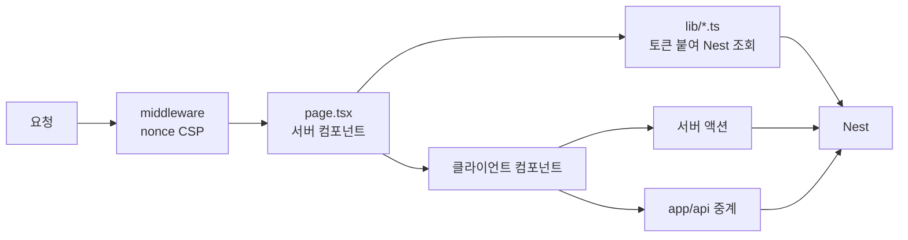
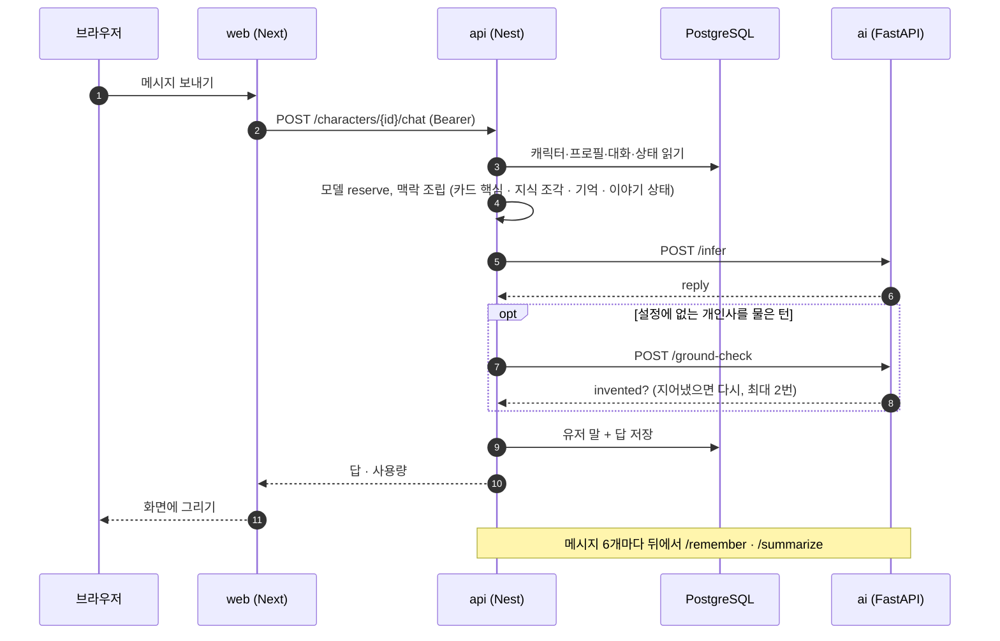
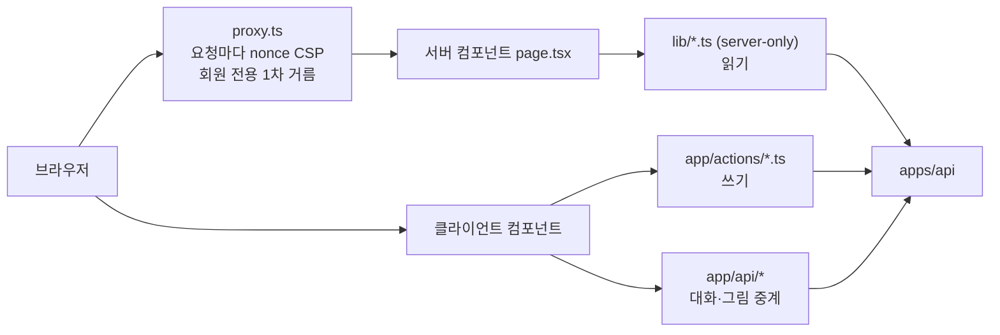
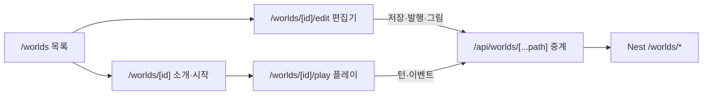

# apps/web

코디컴퍼챗 이용자 사이트. Next.js 16 (App Router, React 19, TypeScript, CSS Modules).

```bash
# 저장소 루트에서
npm install
npm run dev:web     # http://localhost:3000  (API가 http://localhost:4000 에 켜져 있어야 한다)
npm run build:web
```

<!-- logic-structure -->
## 로직 구조

```text
요청 ─▶ middleware (nonce CSP · 보안 헤더)
          │
          ▼
   app/**/page.tsx (서버 컴포넌트)
          │ lib/*.ts — 쿠키의 토큰을 붙여 Nest 조회 (server-only)
          ▼
   화면 렌더링 ─▶ 클라이언트 컴포넌트 (입력·창·게임)
                        │
          ┌─────────────┴──────────────┐
          ▼                            ▼
   app/actions/*.ts (서버 액션)    app/api/**/route.ts (중계)
   폼 제출·로그인·만들기            대화·월드·그림 본문 흘려보내기
          └─────────────┬──────────────┘
                        ▼
                Nest (Bearer 토큰)        ※ FastAPI는 부르지 않는다
```

<!-- logic-mermaid -->

### 요청 흐름



### 대화 화면에서 보내기



## 무엇이 있나

화면 35개. 홈·인기·캐릭터 상세, **대화**(기억·지난 이야기·상태설정·엑스트라·모델 고르기·명령어·글 꾸미기), **오퍼레이션**(심리 탐구·일기·메시지·커뮤니티·웹툰), **코디포토넷**·**비밀 퀘스트**·**성인 확인** 열림 상자, 캐릭터 **공방**(8단계), 대화 목록, 마이페이지·설정(테마·성인 확인), 로그인·가입·이메일 인증·비밀번호 찾기, 요금(눌러서 프로로, 실제 결제는 보류), 약관.

- **Nest만 부른다** — 데이터 읽기는 `lib/*.ts`(서버 전용), 쓰기는 `app/actions/*.ts`(서버 액션). 브라우저는 Nest 주소도 토큰도 모른다(토큰은 httpOnly 쿠키).
- `app/api/`는 그림 중계(초상·코디포토넷·웹툰 컷)와 CSP 보고 받기뿐이다. 무거운 추론을 넣지 않는다.
- **엄격한 CSP**: `proxy.ts`가 요청마다 새 nonce를 만든다. 외부 스크립트·이미지·프레임을 붙이면 거기에 출처를 더해야 한다.
- 글은 HTML로 넣지 않는다. `lib/chat-format.ts`가 표기를 읽고 `components/chat-text.tsx`가 React 요소로만 그린다.
- 디자인 토큰은 `app/globals.css`(라이트·다크, 한국 시각 자동 전환). 색·그림자·둥글기는 토큰만 쓴다.

## 아키텍처



브라우저는 Nest 주소도 토큰도 모른다. 로그인 토큰은 httpOnly `session` 쿠키에 있고, 서버 쪽 코드가 꺼내 `Authorization`으로 붙인다. 그래서 CORS를 열지 않았다.

### 화면 지도

| 묶음 | 경로 |
|------|------|
| 둘러보기 | `/` `/popular` `/characters/:id` `/agents` |
| 대화 | `/characters/:id/chat`, `…/saved` `…/memories` `…/settings` |
| 오퍼레이션 | `…/chat/mind` `…/diary` `…/messages` `…/community` `…/webtoon` |
| 공방 | `/studio` `/studio/:id` |
| 내 것 | `/library` `/me` `/settings` |
| 계정 | `/login` `/signup` `/verify-email` `/forgot-password` `/reset-password` |
| 요금 | `/pricing` `/billing/mock` `/billing/success` `/billing/fail` |
| 안내 | `/terms` `/privacy` `/business` `/support` |

코디포토넷, 비밀 퀘스트, 성인 확인은 화면이 아니라 대화 화면의 열림 상자다. `/library`, `/studio`, `/me`, `/billing`, 대화 화면은 로그인 전용이다.

### 중계 라우트 (`app/api/`)

| 경로 | 왜 필요한가 |
|------|-------------|
| `characters/[id]/chat`, `chat/[action]`, `chat/suggestions` | 클라이언트 컴포넌트가 답을 기다리는 동안 대기 표시를 그리려고. 쿠키의 토큰을 붙여 넘기기만 한다 |
| `characters/[id]/portrait`, `photonet/[imageId]`, `webtoon/[webtoonId]/[index]`, `studio/[id]/portrait` | ``는 토큰을 못 붙인다. 서버가 붙여 받고 `no-store`로 돌려준다 |
| `agent-chat` | 비로그인도 쓰는 안내 챗봇 |
| `csp-report` | CSP 위반 보고를 받아 로그로 남긴다 |

무거운 추론은 여기 넣지 않는다.

### 지키는 규칙

| 규칙 | 이유 |
|------|------|
| 글을 HTML로 넣지 않는다 | 사용자·모델이 쓴 글에 `<script>`가 섞여도 실행되지 않게. `lib/chat-format.ts` → `components/chat-text.tsx` |
| 외부 자원을 붙이지 않는다 | CSP. 외부 스크립트는 요금 화면의 토스 결제창뿐이다 |
| 날짜는 `lib/format-time.ts`로 그린다 | `toLocaleString`은 하이드레이션 불일치가 난다 |
| 실제 IP를 `X-Forwarded-For`로 넘긴다 | 안 넘기면 Nest가 모든 이용자를 웹 서버 한 명으로 세어 사이트 전체가 막힌다. `lib/client-ip.ts` |
| 색·그림자·둥글기는 토큰만 쓴다 | 라이트·다크 두 벌을 유지하려고. `app/globals.css` |
| 버튼 이름과 역할을 바꾸면 `e2e/tests`도 고친다 | 시험이 접근성 이름으로 화면을 찾는다 |

Next.js 16은 예전 판과 다르다. 코드를 고치기 전에 `AGENTS.md`의 안내대로 `node_modules/next/dist/docs/`를 읽는다.

## 월드코퍼챗 (2026-11-06)



- 서버 컴포넌트는 `lib/worlds.ts`(로그인 쿠키의 토큰을 붙여 Nest 조회), 클라이언트는 `/api/worlds/*` 중계만 부른다. 중계는 경로 조각을 다시 인코딩하고 `.`·`..`·빈 조각을 400으로 막는다. 그림 응답은 `sandbox` CSP와 `nosniff`를 붙여 흘려보낸다.
- 플레이(`play/world-play.tsx`)는 방식마다 다르게 그린다: 기본 채팅·메신저는 말풍선, 소설은 문단, 비주얼노벨은 무대 + 대사 상자. 이벤트 창은 `play/event-game.tsx`(사다리·제비 SVG, 주사위, 볼링 슬라이더, 미로 키보드).
- 코퍼맵(`copper-map.tsx`)은 소개·편집기(누르면 핀)·플레이(지금 위치)가 같이 쓴다.
- 정본 [../../docs/plan/WORLD_COPPERCHAT.md](../../docs/plan/WORLD_COPPERCHAT.md).

## Vercel 배포 (2026-11-07)

운영 웹은 Vercel 프로젝트 `codicomperchat-web`(팀 saman, 리전 `icn1`)에서 `main`을 빌드해 돈다. 주소 `https://codicomperchat-web.vercel.app`. 빌드·리전 설정은 [`vercel.json`](vercel.json)(`framework: nextjs`, `regions: ["icn1"]`). 이 저장소는 모노레포라 Vercel 프로젝트는 `apps/web` 폴더를 빌드 대상으로 삼는다.

| 환경변수(Vercel) | 값 | 비고 |
|------------------|-----|------|
| `API_BASE_URL` | `https://api.168-110-61-178.sslip.io` | **`api.` 접두사 필수.** 빠지면 Caddy 사이트 이름과 안 맞아 연결되지 않는다(2026-11-07에 실제로 틀려 있었다) |
| `WEB_PROXY_TOKEN` | (sensitive) | 서버 `.env`와 같은 값. 있으면 실제 이용자 IP와 함께 보내 Caddy가 그 IP를 믿는다(`lib/client-ip.ts`) |
| `CONSOLE_BASE_URL` | 콘솔 Vercel 주소 | 빌드할 때 `/admin` 리다이렉트에 박힌다. 바꾸면 다시 배포한다 |
| `REQUIRE_HTTPS` | `1` | 운영 필수. 없으면 공개 호스트가 503 |

- 웹 서버(함수)가 API를 부르므로 브라우저는 API 주소를 모르고, CORS 설정도 없다.
- 함수 실행 시간 상한은 요금제에 따라 다르다. API의 AI 대기 제한(`AI_TIMEOUT_MS`, 기본 280초)은 이 상한보다 짧게 둔다.
- 환경변수를 바꾼 뒤에는 **다시 배포해야** 적용된다.
- 연결 확인: 홈·인기 화면에 API의 캐릭터가 그려지면 웹 → API → DB가 이어진 것이다. 절차와 상태: [../../docs/web_management/oracle-backend.md](../../docs/web_management/oracle-backend.md).

## 문서

- 라우트·내비게이션 구조: [../../docs/plan/NAVIGATION_IA.md](../../docs/plan/NAVIGATION_IA.md)
- 폴더 구조: [../../docs/plan/PROJECT_STRUCTURE.md](../../docs/plan/PROJECT_STRUCTURE.md)
- 디자인: [../../docs/plan/DESIGN.md](../../docs/plan/DESIGN.md) · 화면 가이드: [../../docs/guidance/web-frontend.md](../../docs/guidance/web-frontend.md)
- 실행 가이드: [../../docs/guidance/getting-started.md](../../docs/guidance/getting-started.md)
- 보안: [../../SECURITY.md](../../SECURITY.md)

`AGENTS.md`와 `CLAUDE.md`는 Next가 자동 생성·갱신한다. 손으로 고치지 않고, 바뀌면 커밋하지 말고 되돌린다.
