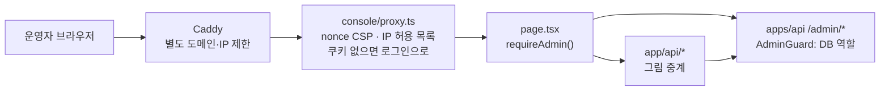

# console

코디컴퍼챗 **운영 콘솔**. 운영자(`role=ADMIN`)만 쓰는 별도 Next.js 앱이다 (Next.js 16, React 19, TypeScript, CSS Modules). 이용자 사이트(`apps/web`)와 따로 띄우고, 따로 로그인한다.

```bash
# 저장소 루트에서
npm install
npm run dev:console     # http://localhost:3001  (API는 http://localhost:4000 이 켜져 있어야 한다)
npm run build:console
```

## 아키텍처



이용자 사이트와 코드·쿠키·배포를 나눈 이유는 세 가지다. 운영 화면을 다른 도메인에 두고 허용한 IP만 들여보낼 수 있고, 운영자 쿠키가 이용자 쿠키와 섞이지 않으며, 장애와 배포를 따로 다룰 수 있다. 공방은 만드는 사람이 이용자라 `apps/web`에 있다.

| 처리 | 남기는 것 | 되돌리기 |
|------|-----------|----------|
| 캐릭터 내리기 | 사유. 만든 사람이 공방에서 본다 | 복구 |
| 초상 반려 | 사유. 만든 사람이 공방에서 본다 | 새 그림을 올리면 다시 검수 |
| 그림 접근 차단 | 처리 사유 | 되돌리는 화면 없음 |
| 계정 정지 | 정지 사유. 로그인과 API가 거절된다. 운영자 계정은 정지하지 않는다 | 계정 정지 해제 |
| 환불 | 사유. 토스가 성공해야 기록을 바꾼다 | 되돌리는 화면 없음 |
| 생년월일 고치기 | 서버 로그에 대상·운영자·사유. 성인 확인이 풀린다 | 다시 고치기 |

## 화면

| 경로 | 하는 일 |
|------|---------|
| `/` | 대시보드: 처리할 일(열린 신고·초상 검수 대기·내려간 캐릭터), 이용자, 캐릭터·대화, AI 호출 대기열 |
| `/reports` | 신고함: 신고 많은 순, 캐릭터 내리기(사유 필수)·신고 기각·복구 |
| `/portraits` | 초상 검수: 자동 검수가 넘긴 초상을 승인·반려(사유 필수) |
| `/content` | 그림 신고: 코디포토넷·웹툰 그림을 보고 접근 차단·계정 정지·문제없음, 정지 해제 |
| `/characters` | 캐릭터 관리: 비공개·내려간 것까지 찾기·거르기, 신고 없이 내리기·복구 |
| `/users` | 계정 등급: 이메일로 찾아 프로/무료 변경, 결제 내역·환불, 사유를 남기고 생년월일 고치기 |
| `/login` | 운영자 로그인 |

## 보안

- 로그인은 이용자와 같은 계정이지만 **운영자만** 들어온다. 쿠키는 `console_session`(httpOnly, SameSite=Strict, 12시간)이라 이용자 사이트의 `session`과 섞이지 않는다
- 권한 확인은 세 겹이다: `proxy.ts`(쿠키 없으면 로그인으로) → 각 페이지의 `requireAdmin()`(Nest에 토큰 확인, 역할 ADMIN) → Nest `AdminGuard`(DB의 역할)
- `proxy.ts`가 요청마다 nonce CSP(외부 출처 없음)를 붙이고, 모든 응답에 `X-Robots-Tag: noindex`를 단다
- 콘솔도 **Nest만** 부른다(FastAPI 직접 호출 금지). **바깥에 그대로 열지 않는다** — 운영 구성은 Caddy와 앱(`CONSOLE_IP_ALLOWLIST`)에서 IP를 두 번 거른다. 사내망·VPN·IP 허용 뒤에, 이용자 사이트와 다른 도메인으로 ([배포 점검](../docs/DEPLOYMENT.md))

## 환경변수

`.env` 없이 기본값으로 돈다 ([전체 표](../docs/guidance/environment.md)).

| 키 | 기본값 | 무엇 |
|----|--------|------|
| `API_BASE_URL` | `http://localhost:4000` | Nest 주소 (서버에서만 쓰인다) |
| `WEB_BASE_URL` | `http://localhost:3000` | 이용자 사이트 주소 (캐릭터 이름을 누르면 실제 화면으로) |
| `NEXT_DIST_DIR` | `.next` | e2e는 `.next-e2e` |

## 폴더

```text
console/
├── proxy.ts          # CSP(nonce) + 로그인 화면 말고는 쿠키 없으면 로그인으로
├── app/
│   ├── layout.tsx    # 왼쪽 메뉴 셸 (로그인 전에는 가운데 상자만)
│   ├── page.tsx      # 대시보드 (GET /admin/stats)
│   ├── login/ reports/ portraits/ content/ characters/ users/
│   ├── actions/      # 서버 액션: 로그인·로그아웃, 운영자 처리
│   └── api/          # 운영자 전용 그림 중계
├── components/       # 메뉴, 페이지 머리말, 확인 상자, 폼, 로고
└── lib/              # api.ts(Nest 주소·쿠키·requireAdmin), relay.ts, 타입, 시간 표시
```

- 운영 절차: [../docs/guidance/operations.md](../docs/guidance/operations.md)
- 폴더 구조: [../docs/plan/PROJECT_STRUCTURE.md](../docs/plan/PROJECT_STRUCTURE.md)
- 테스트: 저장소 루트 `e2e/`의 `console.spec.ts` 등 (콘솔은 e2e에서 포트 3102)

`AGENTS.md`와 `CLAUDE.md`는 Next가 자동 생성·갱신한다. 손으로 고치지 않고, 바뀌면 커밋하지 말고 되돌린다.
