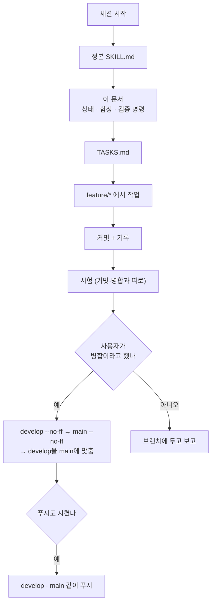
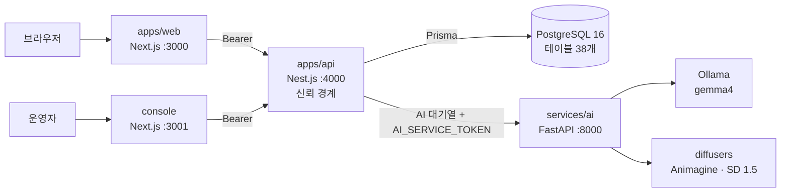
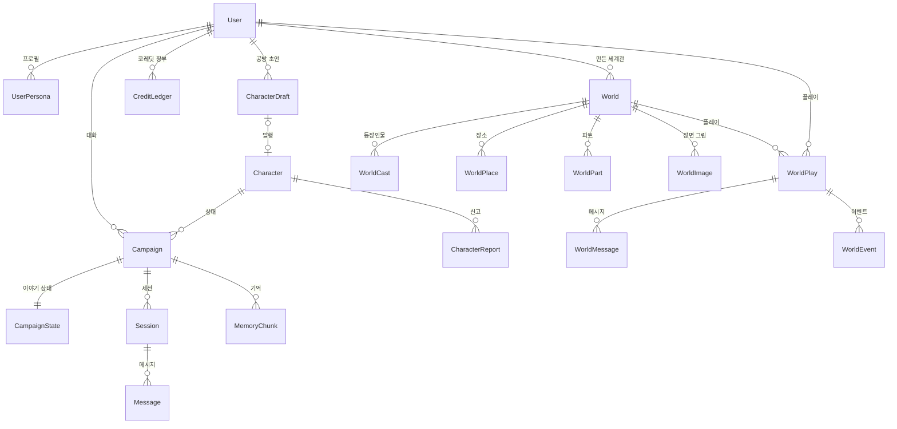
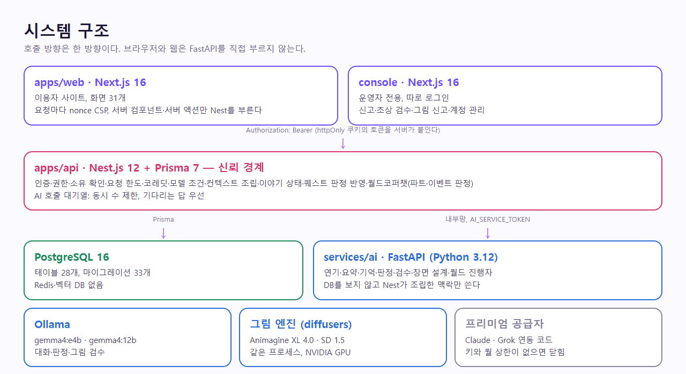
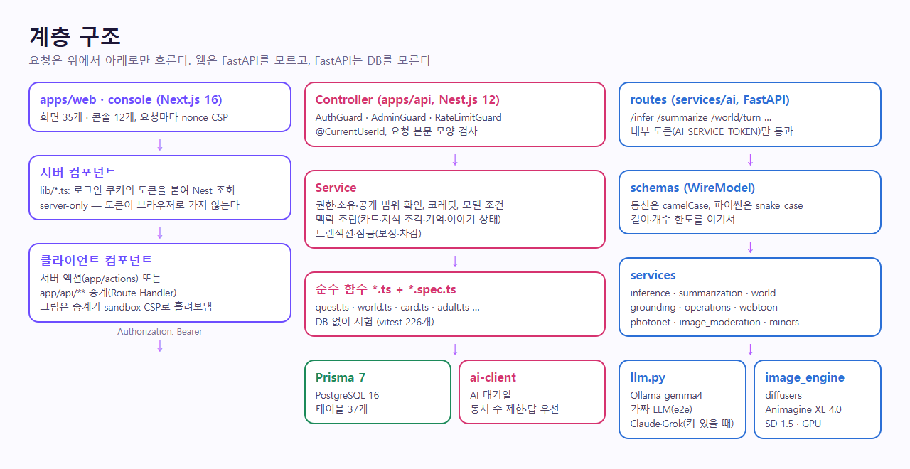
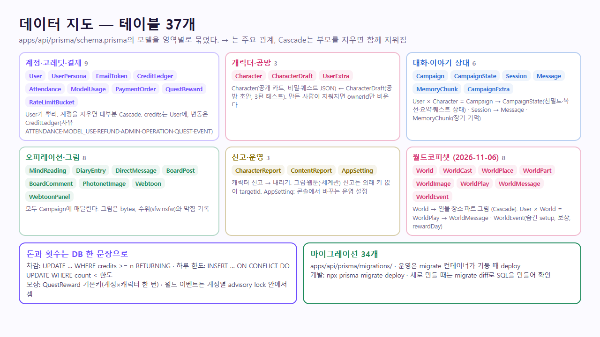

# 에이전트 인수인계

이 저장소의 작업을 이어받는 AI 에이전트(와 사람)를 위한 문서다. **여기부터 읽는다.** 규칙의 정본은 `.agents/skills/codicomperchat/SKILL.md`, 할 일의 정본은 [TASKS.md](TASKS.md)이고, 이 문서는 "지금 어디까지 왔고, 어디서 걸려 넘어지는가"를 적는다. Cursor 등 어떤 도구로 이어받아도 이전 대화는 볼 수 없으니, 합의한 내용은 이 문서들에서 찾는다. 최종 갱신 2026-11-12.

## 기본 대화 지연 개선 작업

`feature/gemma-latency-memory`에서 첫 답 60초·다음 기본 답 완료 30초 목표로 출력 예산과 준비 조회를 줄이고 기억 갱신을 수정했다. 첫 요청 당시 없던 대화를 다음 요청에서 다시 찾으며, 최신 요약·관계를 읽는다. 짧은 세션의 이전 이야기 요약과 삭제된 기억의 검색 결과도 회귀 시험에 포함했다. 측정과 제한은 [대화 지연 실측](trainings/chat-latency.md)에 있다.

운영 반영과 운영 웹 경로 측정은 남아 있다. `ubuntu@168.110.61.178` 기본 SSH 공개키 인증이 거절되어 사용자에게 SSH 별칭 또는 키 파일 경로를 요청했다. 로컬 GPU의 목표 시간 통과를 운영 CPU의 통과로 보고하면 안 된다. 이 작업의 병합·푸시 승인은 별도로 확인해야 한다.

<!-- logic-structure -->
## 로직 구조

```text
세션 시작
  ├─▶ 1. 정본 SKILL.md (§0 원본 보존, §9 약속)
  ├─▶ 2. 이 문서: 지금 상태 · 함정 · 검증 명령
  ├─▶ 3. TASKS.md (사용자 몫은 대신 하지 않는다)
  └─▶ 4. 고칠 곳의 trainings/ (프롬프트·판정을 건드리면)
        │
작업 ───┤ feature/* 에서 → 커밋마다 기록 → 시험 (병합·커밋과 한 명령으로 묶지 않는다)
        │
끝 ─────┴─▶ 사용자가 "병합"이라고 할 때만 develop(--no-ff) → main(--no-ff) → develop을 main에 맞춤
            푸시는 요청할 때만, develop·main을 같이(main 병합 전에 develop만 먼저 푸시하지 않는다)
            개발 서버를 켜거나 끄지 않는다 · 켜져 있으면 build:api 금지
```

<!-- logic-mermaid -->

### 세션 흐름



### 시스템 구조



이 그림은 로컬 개발 모양이다. 지금 공개 주소에서 열리는 범위는 [STATUS.md](STATUS.md), 서버 값은 [web_management/oracle-backend.md](web_management/oracle-backend.md).

### 데이터 관계



## 1. 한 줄 요약

캐릭터 캠페인 동행 플랫폼. 웹(Next)·콘솔(Next)·API(Nest)·AI(FastAPI) 네 앱이 연결되어 **로컬에서 실제로 동작**하고, 운영 구성(`deploy/`)도 개발 PC에서 끝까지 띄워 확인했다. **2026-11-07에 실제로 올렸다.** 웹은 Vercel(`https://codicomperchat-web.vercel.app`), API·DB·AI(대화)는 Oracle Cloud ARM VM(`https://api.168-110-61-178.sslip.io`). 운영 콘솔 연결·그림 엔진·메일은 아직이고, 전체 운영 서버(Hetzner GEX45, GPU)는 계약을 기다린다. 과정 전부: [web_management/deploy-log-2026-11-07.md](web_management/deploy-log-2026-11-07.md).

| 항목 | 지금 |
|------|------|
| 배포 | **운영 중**(2026-11-07, **공개 전 필수 확인이 남음**: 처리방침의 국외 이전 표가 실제 구성과 다르다 — U11): Vercel 웹 + Oracle A1.Flex(caddy·api·postgres·ai·ollama). 상태 [web_management/oracle-backend.md](web_management/oracle-backend.md), 과정 [web_management/deploy-log-2026-11-07.md](web_management/deploy-log-2026-11-07.md). 접속 키는 사용자 PC에만 있고 저장소·문서에 적지 않는다. 비어 있는 값: SMTP, 프리미엄 키. 콘솔은 API에 연결 안 함. 전체 운영(Hetzner GEX45, GPU)은 계약 전 |
| 병합 | 2026-11-07까지의 작업을 `develop`과 `main`에 병합했다: `feature/oracle-backend-deploy`, `claude/project-thread-pz0x5f`, `origin/claude/project-thread-po3i10`(충돌은 서버 구성 유지), `feature/web-vercel-deploy`, `feature/docs-final-update` |
| 원격(GitHub) | `develop`과 `main`을 2026-11-07에 푸시했다. Vercel 웹은 `main`에서 배포한다. 저장소는 **공개** 상태였고, 비공개 전환은 사용자가 한다. GitHub Actions 결과는 `gh`가 로그인돼 있지 않아 확인하지 못했다 |
| 로컬 브랜치 | 병합 끝난 브랜치를 2026-11-04에 `git branch -d`로 지웠다. 이름은 병합 커밋과 `docs/branchs/README.md`에 남아 있다 |
| DB | 마이그레이션 36개, 테이블 38개(월드코퍼챗 9개 포함). 36번째 `20261108150000_support_inquiries`는 고객센터 문의. 이미 떠 있는 DB에는 `npx prisma migrate deploy`가 필요하다 |
| 시험 | 수와 방법은 [plan/TESTING.md](plan/TESTING.md), 실측은 [trainings/](trainings/README.md). 2026-11-07 병합 뒤: API vitest 232개(파일 31), AI unittest 71개, API·웹 타입 검사 통과. e2e는 그날 돌리지 않았다 |
| 취약점 | `npm audit --omit=dev` 0건. torch 2건은 영향 없는 경로라 그대로 둠([../SECURITY.md](../SECURITY.md)) |
| PR | `gh`가 로그인돼 있지 않아 PR·저장소 설정을 다루지 못한다 |

### 2026-11-11 — 대화 속도·호스팅 실패 고침 (코드는 병합됨, **서버에는 아직 안 올림**)

- 배포에서 1:1 한 턴이 3분 53초였다. 원인(코드와 기록값으로 맞춘 것, 서버 로그는 못 봄): 호스팅 호출이 한 번에 받기라 45초에 끊기면 긴 프롬프트를 CPU 예비가 처음부터 읽었다. 고침: 호스팅 스트리밍(조각 사이 40초·전체 150초), 가벼운 예비(최근 8개·320토큰), 배경 작업은 예비로 가지 않음(`X-AI-Priority`). [trainings/oracle-deploy-latency.md](trainings/oracle-deploy-latency.md) "2026-11-11".
- 배포 웹에서 "LLM 호출 실패"가 보고됨: 호스팅 4xx(키·접근 오류 401·402·403·404)도 예비로 대신 답하고 원인을 `codicomperchat.llm` 경고 로그로 남긴다. **근본 원인은 확정 못 함**(서버 개인키 없음) → [find_debug/2026-11-11.md](find_debug/2026-11-11.md) 3장의 명령으로 서버 로그를 본다.
- 웹·콘솔 빌드 타입 오류 두 곳을 고쳤다. 빌드가 막혀 드러나지 않던 e2e 실패 3개는 **고치지 않았다**(월드 빈 턴 400 기대, 마이페이지 모델 이름, 푸터 약관 링크).
- **서버 반영은 사용자 몫**: `api`와 `ai`를 다시 빌드해야 한다 → [TASKS.md](TASKS.md) U13. 올리기 전까지 배포 속도·오류는 그대로다.
- 로컬 개발 DB에 `20261106120000_world_copperchat`이 적용되지 않아 `worlds` 테이블 오류(P2021)가 난다 → `cd apps/api && npx prisma migrate deploy`(사용자가 실행).
- 병합·푸시 순서와 다른 세션 확인 절차를 규칙으로 박았다(위 3장 "작업 약속").

### 2026-11-08 — 대화 고치기·장기 기억·때와 곳

- 1:1 대화는 **마지막 대사 한 줄**만 수정·삭제할 수 있고, 점 세 개 메뉴의 "변경사항 추천"으로 방향을 적으면 그 줄만 다시 쓴다. 그 위 줄에는 메뉴가 없다. Oracle API 이미지는 이 제한으로 다시 올리지 않았다.
- 기억 화면에서 직접 적을 수 있다. 직접 적은 기억은 매 턴 넣고, 모델은 지금 말과 맞을 때만 꺼낸다. 유저가 자기 프로필이나 상대 설정을 말한 턴은 뒤에서 `/notice-facts`로 자동 저장한다.
- 때·곳은 대화(와 세계관) 위에 보이고, 시간·장소 단서가 있을 때만 바뀐다. 내 말풍선은 상대와 같은 면 색이다.
- 조사는 코드와 답에서 `이(가)` 괄호를 쓰지 않고 받침에 맞게 고친다. 주고받기 문장을 시스템 프롬프트 끝 규칙 앞에 넣었다. **모델 평가 11묶음은 다시 돌리지 않았다.**

### 2026-11-08 — 살아있는 문서만 지금 수에 맞춤

- 루트 README, 문서 허브, 스택, DB, 배포 진입, 아키텍처 개요를 마이그레이션 35개와 대화 도구에 맞췄다. 기획 원본, 커밋 기록, 실측 노트, 디버그 일지, 포트폴리오 지식 스냅샷은 그때의 문장으로 두었다.
- 기본 무료 대화는 `gemma4:e4b`를 그대로 쓰고, 강화 무료는 키가 있으면 NVIDIA `gemma-4-31b-it`으로 보낸다. 막히면 예비는 `gemma4:e4b`다. 클라우드 채팅이 제한 시간 안에 응답하는지는 아직 확인하지 않았다. 입력 없이 보내면 1:1과 월드가 다음 장면을 예상해 잇는다.
- 고객센터에서 로그인한 이용자가 운영자에게 문의를 보내고, 콘솔에서 답하면 그 화면에 다시 보인다. 운영 이미지는 이 표를 아직 모른다.

### 2026-11-07 — 실제 배포

- **웹**: Vercel `codicomperchat-web`(팀 saman, icn1). 환경변수 `API_BASE_URL`(반드시 `api.` 접두사), `WEB_PROXY_TOKEN`(sensitive), `CONSOLE_BASE_URL`, `REQUIRE_HTTPS=1`. `main`에서 배포.
- **API·DB·AI**: Oracle `codicomperchat-api`(A1.Flex 2 OCPU·12GB, Ubuntu 24.04, 도쿄, `168.110.61.178`). 구성 `deploy/oracle/docker-compose.yml` + `docker-compose.ai.yml`. 대화는 NVIDIA 호스팅 API `gemma-4-31b-it`, 막히면 CPU Ollama `gemma4:e4b`(실측 19초/32초).
- **Caddy**: `sslip.io` 이름으로 인증서. `WEB_PROXY_TOKEN`이 맞는 요청만 웹이 넘긴 이용자 IP를 믿는다.
- **비밀값 위치**: 서버 `deploy/oracle/.env`(권한 600), Vercel 환경변수, 사용자 로컬 `.env`. 저장소·문서에는 없다.
- **사용자 결정**: 처음엔 API+DB만 → AI도 같은 VM → 웹도 Vercel. 두 배포 브랜치 충돌은 서버 구성 유지. 배포 뒤 임시 키·IAM·CLI는 지웠다.
- **남은 것**: SMTP, 콘솔 연결(허용 IP), 프리미엄 키·한도, 그림 엔진(GPU), 페르소나 파일을 서버 볼륨으로, DB 백업 cron, 도메인.
- **문서를 보강하며 드러난 것(2026-11-07, 코드로 확인)** — 공개 전에 본다:
  - **개인정보**: `LLM_BACKEND=openai`면 프리미엄이 아닌 **모든 대화 모델 호출과 그림 검수 입력이 NVIDIA 호스팅 API로 간다.** 서비스 처리방침의 국외 이전 표에는 Anthropic·xAI만 있다. → TASKS U11·U12, [../SECURITY.md](../SECURITY.md) "제3자에게 나가는 데이터"
  - **성인 모드**: "성인 대화는 로컬 모델에서만"이 호스팅 백엔드에서는 코드로 지켜지지 않는다. 운영 `ADULT_MODE=off`에만 기댄다. → T05
  - **모델 고르기**: 대화의 기본은 로컬 `gemma4:e4b`, 강화는 키가 있으면 `gemma-4-31b-it`이다. 강화 한도·코레딧은 그대로다. 예비는 `gemma4:e4b`로 내린다. 서버에서 잘못된 키로 한 턴을 보지는 않았다. → T06
  - **품질**: 평가 11묶음은 `gemma4:e4b`로 맞춰져 있어 운영의 호스팅 31B는 재지 않았다. → Q08, [trainings/oracle-deploy-latency.md](trainings/oracle-deploy-latency.md)
  - API 문서는 Nest 라우트 155개·FastAPI 24개 모두 있음을 대조했다(경로만).

### 2026-11-06 늦게 더해진 것

- **월드코퍼챗**(사용자 요청): 세계관을 누구나 만들고, 진행자 모델이 여러 인물을 연기한다. 대화 방식 4가지(기본 채팅·비주얼노벨·소설·메신저), 파트(3턴마다 근거 인용 판정), 코퍼맵, 이벤트 미니게임 5종(승리 20~50·패배 5~10 코레딧, 하루 3번). 웹 `/worlds`, 콘솔 `/worlds`, API `apps/api/src/worlds/`, AI `services/ai/app/services/world.py`. 정본 [plan/WORLD_COPPERCHAT.md](plan/WORLD_COPPERCHAT.md).
- 사용자 결정: 보상 하루 3회(콘솔에서 바꿈), 이벤트는 서버가 확률로, 세계관은 누구나 공방처럼.
- 알려진 한계: 진행자가 인물의 장소 이동을 거의 쓰지 않는다(0/24). 긴 플레이의 요약이 없다. 세계관 신고 화면이 없다.
- 시험: API 226개(파일 30), e2e 123개(파일 26) + 성인 끔 1개, AI 단위 54개(파일 7), 평가 11묶음 + 별도 7개.

## 2. 읽는 순서

1. `.agents/skills/codicomperchat/SKILL.md` — 정본 규칙. **§0 원본 보존: 루트 `CodiComperChat_project_plan.md`는 사용자 승인 없이 수정하지 않는다.**
2. 이 문서
3. [TASKS.md](TASKS.md) — **다음에 할 일**(선행 조건·끝난 기준)
4. [FEATURES.md](FEATURES.md) — **모든 기능의 목록**(화면·API·코드·문서·시험). 코드 기준이다
5. [STATUS.md](STATUS.md) — **그 기능 중 지금 공개 주소에서 열리는 것**
6. [plan/CURRENT_STACK.md](plan/CURRENT_STACK.md) — 스택·결정 사항 정본
7. 프롬프트·판정·그림을 고치려면: [trainings/](trainings/README.md)
8. 필요한 것만: [Architecture/overview.md](Architecture/overview.md) · [WORKFLOW.md](WORKFLOW.md)(AI 호출 흐름) · [plan/OPERATIONS.md](plan/OPERATIONS.md) · [plan/SECRET_QUEST.md](plan/SECRET_QUEST.md) · [guidance/photonet-engine.md](guidance/photonet-engine.md) · [../SECURITY.md](../SECURITY.md) · [../THIRD_PARTY_NOTICES.md](../THIRD_PARTY_NOTICES.md)
9. 커밋·병합 전: [guidance/commit-message.md](guidance/commit-message.md) · [guidance/branch-merge.md](guidance/branch-merge.md) · [branchs/TEMPLATE.md](branchs/TEMPLATE.md)

## 3. 작업 약속 (사용자와 합의된 것)

**저장소 규칙**
- 커밋 메시지: `type(scope):`는 영어, 요약·본문·바닥글은 한국어. 바닥글의 `Co-Authored-By` 줄은 쓰는 도구의 안내가 정하는 값을 쓰고, 안내가 없으면 넣지 않는다.
- **매 커밋마다** `docs/branchs/commits/`에 [TEMPLATE.md](branchs/TEMPLATE.md) 형식의 기록 md를 남기고 `docs/branchs/README.md` 목록에 넣는다(생략 금지, 다른 경로 금지). 병합 때는 병합 기록도 남긴다.
- 작업은 **작업별 `feature/*` 브랜치**에서, `develop`/`main`에는 **`git merge --no-ff`만**(FF·force-push 금지). 기능 브랜치 위에 다른 기능을 쌓으면 아래 브랜치를 먼저 병합한다.
- **병합은 사용자가 "병합"이라고 말할 때만, 푸시는 푸시를 요청할 때만** 한다. 병합 후 시험을 돌린 결과를 보고한다.
- **병합과 푸시를 함께 시키면 순서가 정해져 있다**(2026-11-11 사용자 지시): feature → develop(`--no-ff`) → main(`--no-ff`) → develop을 main에 맞춤(`--ff-only`) → **그다음 develop·main을 같이 푸시**. main 병합 전에 develop만 푸시하지 않는다. 절차 [guidance/branch-merge.md](guidance/branch-merge.md) "병합과 푸시를 함께 시킬 때".
- **병합 전에 다른 세션이 움직였는지 본다**: `git fetch`, `git log --all --oneline -8`. 내 브랜치가 이미 `develop`에 있으면 병합·병합 기록을 하지 않는다(기록 스크립트는 `HEAD`를 기록한다).
- **세션을 시작하면 이 문서와 `docs/STATUS.md`를 먼저 읽는다.** 읽기 전에 병합·푸시를 하지 않는다.
- **사용자가 병합·푸시 방식을 바꾸라고 하면** 그 자리에서 [정본 SKILL.md](../.agents/skills/codicomperchat/SKILL.md) §5·§8, 어댑터 규칙 목록(`node scripts/adapters.test.mjs`로 일치 확인), 이 절, [guidance/branch-merge.md](guidance/branch-merge.md)를 함께 고친다.
- v1 범위(기획서 §9.2)를 임의로 넓히지 않는다. 프론트는 FastAPI를 직접 호출하지 않는다(웹 → Nest → FastAPI).
- `.env`·키·DB 비밀번호·`AUTH_SECRET`·SMTP·토스 키 같은 비밀값은 출력·커밋하지 않는다.

**운영 습관**
- 응답은 **한국어, 간결, 결과 중심**. 못 한 것·확인 못 한 것은 숨기지 않고 말한다. 큰 기능은 만들기 전에 방향을 사용자에게 한 번 묻는다(예: 비밀 퀘스트 성격, 성인 확인 방식).
- 사용자의 개발 서버(web·api·ai·console)를 켜거나 끄거나 죽이지 않는다. **내가 켠 것(예: WebUI)만 내가 끈다.**
- **개발 서버가 켜져 있을 때 `npm run build:api`를 하지 않는다**(`dist`를 지워 서버가 죽는다). 타입은 `npm run typecheck:api`, 빌드는 `npm run build:verify --workspace api`.
- 사용자가 "작업 ㄴㄴ"라고 하면 설명만 한다.

## 4. 환경의 함정 (실제로 겪은 것)

| 상황 | 해결 |
|------|------|
| Windows. Bash 도구(Git Bash)와 PowerShell을 오간다 | 경로는 `/d/vscode/...`(Bash) vs `D:\vscode\...`(PowerShell·Read/Edit). 이 문서의 `bash` 예시는 Git Bash에서 돌린다. PowerShell 5.1에서는 `&&`가 안 된다 |
| `apps/web/AGENTS.md`·`console/AGENTS.md`가 `next typegen`이나 e2e로 다시 쓰인다 | 작업과 섞어 커밋하지 말고 `git checkout -- <파일>`로 되돌린다. 안내 내용(새 Next 문서를 먼저 읽기)은 따른다 |
| 개발 중 브라우저 콘솔에 `ws://…/_next/hmr` 실패가 보인다 | 대화 소켓(`/ws/chat`)이 아니다. Next 개발 서버 새로고침이다. `localhost`가 아닌 주소면 `allowedDevOrigins`에 그 주소를 넣어야 연결된다 |
| 1:1 답이 끝까지 빈 채로 기다린다 | 코드는 웹소켓으로 토큰을 바로 보여 준다. 공개 API를 다시 올리기 전에는 옛 서버라 한 번에 온다. 소켓이 모델 속도를 올리지는 않는다 |
| 벡터 저장소가 없다고 대화가 멈춘다 | 멈추지 않는다. Chroma를 열지 못하면 예전 글자 검색으로 기억을 고른다. 이 벡터는 추론 모델을 다시 부르지 않고, 가중치를 학습하지도 않는다 |
| Git Bash에서 `cmd`로 `.cmd`를 부르면 깨진다 | WebUI는 PowerShell에서 `cmd /c "D:\vscode\CodiComperChat\scripts\start-sd-webui.cmd"`. `.cmd`는 ASCII + CRLF로 둔다 |
| **한글·역슬래시·정규식이 든 `node -e`/python heredoc**이 이스케이프로 깨진다(두 번 실제로 문서·코드를 망가뜨릴 뻔함) | 긴 편집은 Edit/Write 도구를 쓰거나, 스크립트를 파일로 써서 `node 파일`로 돌린다. 편집 뒤 `grep`으로 확인 |
| 파일이 CRLF(`.gitattributes`) | 스크립트로 고칠 땐 `\r\n`→`\n`으로 바꿔 편집하고 되돌려 쓴다 |
| `npx prisma format`이 `schema.prisma` 전체 정렬을 바꿔 diff가 지저분해진다 | 쓰지 않는다. 필요한 줄만 직접 고친다. 마이그레이션은 `migrate diff`로 SQL을 보고 폴더를 만든 뒤 `migrate deploy` |
| `services/` 아래를 재귀 `grep`하면 `.venv`까지 훑어 120초를 넘긴다 | `services/ai/app`만 지정한다 |
| **`services/ai/models/`(수 GB)를 `git add`하면 모델 파일이 올라간다** | `.gitignore`에 들어 있다(develop 기준). 새 브랜치를 낡은 곳에서 따면 빠져 있을 수 있으니 `git check-ignore`로 확인. 한 번 사고 났다(직접 만든 큰 객체만 지우고 `fsck`로 확인) |
| e2e를 돌리면 느려지거나 실패한다 | **그림 엔진(WebUI·GPU 모델)을 끈다**(RAM 16GB). 화면은 운영 빌드로 뜨므로 **화면 코드를 고친 뒤 `E2E_SKIP_BUILD=1`을 쓰면 낡은 빌드를 시험한다**. 전체 e2e는 `npm run test:e2e`(준비 단계가 DB를 비운다). `npx playwright test`를 직접 돌리면 준비가 빠져 이름 충돌이 난다 |
| 시험이 날짜에 기대면 며칠 뒤 깨진다 | 날짜는 "오늘"로(테마 시험을 고친 전례) |
| 실제 모델 확인이 필요한 것을 e2e가 못 잡는다 | 가짜 LLM·가짜 그림은 흐름만 본다. 모델·프롬프트를 바꾸면 실제 gemma로 확인하고 결과를 문서에 남긴다([plan/TESTING.md](plan/TESTING.md) "자동화되지 않은 확인") |
| `docs/branchs/README.md` 목록이 병합 때 충돌한다 | `.gitattributes`의 `merge=union`으로 양쪽 줄을 남긴다(2026-11-04). 쌓인 브랜치를 병합할 때는 병합 커밋을 먼저 다 만들고 기록을 남긴다 |
| 커밋 기록 쓰기 | `node scripts/record-commit.mjs --name <kebab-이름> --notes <본문 파일> --commit --trailer "..."`. 병합 기록은 `--sha`, `--branch develop`. 본문(`## 주 내용`부터)만 직접 쓴다 |
| **명령을 이어 쓰면 시험 실패 뒤에도 커밋까지 간다**(2026-11-03에 실제로 일어나 기록에 거짓 통과를 적었다) | 시험·병합과 커밋을 한 명령으로 묶지 않는다. 결과를 읽은 뒤 다음 명령을 쓴다. 에이전트 도구의 Bash에 넣은 `set -e`는 실패해도 멈추지 않을 수 있다(2026-11-04에 충돌난 병합 위로 기록 커밋이 올라가 로컬에서 되돌렸다). 묶어야 하면 `&&`를 쓰거나 스크립트 파일로 돌린다 |
| **RAM 16GB**: 도커 빌드와 그림 엔진이 겹치면 SDXL 뒤 gemma가 502, 또는 프로세스가 조용히 죽는다 | 실측은 다른 무거운 작업 없이 한다. 파이프로 묶으면 종료 코드가 가려지니 로그 파일에 받고 `$?`를 본다 |
| e2e가 `next dev`일 때 메모리 압박으로 실행마다 다른 시험이 시간 초과했다(2026-11-03) | 2026-11-04에 운영 빌드로 바꿔 없앴다. 다시 실패하면 부하 탓으로 넘기지 말고 결함으로 본다. 시간 제한을 늘려 덮지 않는다. 진행 중 로그의 실패 표시는 `x`이니 `FAIL`로 찾으면 못 잡는다 |
| 사용자의 도커에 다른 프로젝트 컨테이너가 있다(`storyforge-postgres`) | 이 저장소 일이 아니다. `docker system prune`이나 `wsl --shutdown`을 하지 않는다. 내가 만든 이미지·볼륨만 지운다 |
| **Windows에서 `git archive`로 서버에 올리면 파일이 CRLF로 나간다**(2026-11-07 실측) | `git -c core.autocrlf=false -c core.eol=lf archive ...`. `autocrlf=false`만으로는 부족하다. `.env` 값 끝에 `
`이 붙으면 비밀값이 깨진다 |
| Oracle 인스턴스의 개인키가 없을 때 | 콘솔에서 SSH 키를 더할 수 없다. Run Command는 동적 그룹·정책이 있어야 돌고, Ubuntu에서는 `ocarun`(sudo 없음)으로 돌아 `authorized_keys`를 못 고친다. 원래 키 파일을 받거나 인스턴스를 다시 만든다 |
| Vercel 웹이 API를 못 부른다 | `API_BASE_URL`이 `https://api.168-110-61-178.sslip.io`인지(`api.` 접두사) 본다. Caddy의 사이트 이름과 같아야 인증서가 맞다 |
| `deploy/oracle/bootstrap.sh`·`setup.sh`(po3i10에서 들어옴) | 다른 compose를 전제로 쓰였다. 지금 서버에 돌리지 않는다. 지금 절차는 [web_management/oracle-backend.md](web_management/oracle-backend.md) |
| 서버 compose를 다시 띄울 때 | 항상 두 파일을 함께: `-f deploy/oracle/docker-compose.yml -f deploy/oracle/docker-compose.ai.yml`. 하나만 주면 ai·ollama가 고아 컨테이너가 된다 |

## 5. 검증 명령 (병합·푸시 전)

```bash
npm run typecheck:api
npm run test:api
(cd apps/web && npx next typegen && npx tsc --noEmit)
(cd console && npx next typegen && npx tsc --noEmit)
npx oxlint --deny-warnings apps/api/src apps/web/app apps/web/lib apps/web/components console/app console/lib console/components e2e   # CI와 같은 명령
(cd services/ai && ./.venv/Scripts/python.exe -c "import app.main")
npm run test:e2e                         # 빌드 포함 약 5분. WebUI 끄고
npm run test:e2e:adult-off               # test:e2e 뒤에
node --test scripts/record-commit.test.mjs
(cd services/ai && ./.venv/Scripts/python.exe -m unittest discover tests)
# 모델을 건드렸다면
(cd services/ai && ./.venv/Scripts/python.exe -m evals.run)
(cd services/ai && ./.venv/Scripts/python.exe -m evals.quest_seyeon)   # 퀘스트·판정을 건드렸다면
# 운영 구성을 건드렸다면: web_management/docker-deploy.md "확인"을 다시 한다
```

푸시 전에는 올라갈 범위에 큰 파일·비밀값이 없는지 본다(`git rev-list --objects origin/develop..develop`의 큰 객체, `.env`·`*.safetensors`).

## 6. 결정과 남은 일

작업 목록은 [TASKS.md](TASKS.md)가 정본이다. 여기에는 사용자 결정과 공개 전 체크의 위치만 적는다.

### 6-1. 사용자 결정 기록과 남은 결정

**2026-11-03에 정한 것**

| 항목 | 결정 | 상태 |
|------|------|------|
| GPU 서버 | 배포 사이트에서 24시간 | 구성 완료, Hetzner GEX45로 결정, 계약 전 |
| 병합 (2026-11-04) | 남은 작업을 맡기며 `develop` 다음 `main`까지 병합하라고 함. `release/*` 없이 직접 병합했다 | 완료, 푸시 안 함 |
| 성인 모드 | 기능은 그대로 두고(자기 신고, 그림 가드, 그림 신고), 공개 서버에서는 끈다 | 운영 compose 기본 `ADULT_MODE=off`. Hetzner 약관이 음란물을 금지한다 |
| 프리미엄 모델 | 일단 연동 | 코드 있음(`services/ai/app/services/premium.py`), 기본은 닫힘. 키가 없어 실제 호출 미확인 |
| 저장소 | 비공개로 전환(2026-11-03) | 아직 공개 상태. `gh`가 로그인돼 있지 않아 소유자가 전환한다. 공개였던 동안 받아 간 사본은 되돌릴 수 없다 |
| 결제 | 실제 결제 없이 눌러서 프로 30일(`PRO_CLICK`), 정식 서비스 전 임시 | 완료. 토스 코드는 남겨 두었고 켜면 클릭이 닫힌다 |
| 프리미엄 나이 | 만 18세 미만·생년월일 없음은 잠금 | 완료. 자기 신고라 본인인증은 아니다 |
| 권리자·보안 연락처 | 공개 저장소에 적지 않는다. 신고는 고객센터 | 약관·처리방침의 `[운영자 기재]`는 별개로 남는다 |
| 이세연 퀘스트 | 혼인, 또는 기혼인 채 이어져 충돌 | 완료 |
| 호스팅 | 상시 서버, Hetzner GEX45, 성인 모드 끔 | 구성·설치 스크립트 있음([web_management/hosting-options.md](web_management/hosting-options.md)), 계약 안 함 |

**2026-11-07에 정한 것**

| 항목 | 결정 | 상태 |
|------|------|------|
| 첫 배포 | Oracle Cloud A1.Flex(무료 ARM)에 먼저 올린다. 도메인 없이 sslip.io | 완료 |
| 범위 | 처음엔 API+DB, 이어서 AI(대화)도 같은 VM, 웹은 Vercel | 완료 |
| 충돌 | 두 배포 브랜치가 `deploy/oracle`을 다르게 만들면 서버에서 검증한 구성을 유지 | 완료 |
| 개인정보 | 개인키·키 값은 출력·커밋하지 않고, 배포 뒤 임시 흔적은 지운다 | 완료 |

**아직 사용자에게 물어야 할 것**

| 결정 | 왜 |
|------|-----|
| **GPU 서버 계약·도메인·운영 메일·콘솔 허용 IP** | 그림 엔진은 GPU 서버가 있어야 한다. 메일이 없으면 인증 메일이 안 간다. 콘솔은 허용할 IP가 정해져야 연결한다. 비용이 드는 일이라 임의로 하지 않는다 |
| **프리미엄 키와 월 상한 값** | 열면 무료 출석 코레딧이 실제 지출이 된다. 상한은 `PREMIUM_MONTHLY_CREDITS`로 구현했고 값은 사용자가 정한다. 만 18세 미만 차단은 자기 신고 생년월일로 구현했다([plan/AI_MODEL_STRATEGY.md](plan/AI_MODEL_STRATEGY.md)) |
| **성인 모드 공개** | Gemma 4는 Apache 2.0이라 모델 라이선스 문제가 아니었다(2026-11-03 정정). 남은 것은 나이·본인 확인과 음란물 규정, 호스팅 약관이다. 공개 전에 변호사 확인이 필요하다([../THIRD_PARTY_NOTICES.md](../THIRD_PARTY_NOTICES.md)) |
| 결제 재개·가격 | 토스 연동은 있으나 보류 |

### 6-2. 공개 전 필수

[../SECURITY.md](../SECURITY.md) "공개 전 필수" 체크리스트가 정본이다. 2026-11-03 기준 남은 것: 운영 비밀값 발급 · 성인 확인 법률 검토 · 모델 사용 정책 · 처리방침 법률 검토와 보관 기간 · GitHub 설정(`gh` 로그인 필요) · 실제 도메인의 인증서 · 서드파티 라이선스 전체 검토. 배포 전 체크: [web_management/pre-deploy.md](web_management/pre-deploy.md).

### 6-3. 기능·품질 후속

[TASKS.md](TASKS.md)로 옮겼다. 할 일은 거기서만 관리한다.

### 6-4. 문서

- 기능을 바꾸면 [문서 정본 표](README.md#문서-정본-표)대로 고친다. 스택·결정은 [plan/CURRENT_STACK.md](plan/CURRENT_STACK.md)가 먼저.
- `docs/branchs/commits`·`find_debug`·`trainings`는 기록용이라 지금 상태에 맞춰 고치지 않는다.

## 7. 서버 켜기와 점검

```bash
# 사전: PostgreSQL 16(설치형, localhost:5432), Ollama(gemma4:e4b)
npm run dev:api        # :4000
npm run dev:web        # :3000
npm run dev:console    # :3001 (운영자)
cd services/ai && ./.venv/Scripts/python.exe -m uvicorn app.main:app --reload --port 8000
curl http://localhost:4000/health ; curl http://localhost:8000/health
curl http://localhost:8000/photonet/status    # 그림 엔진 준비 여부
```

운영자 만들기: 가입 뒤 `npm run user:role --workspace api -- 이메일 admin`. 공식 캐릭터·초상·퀘스트는 `cd apps/api && npm run prisma:seed`(여러 번 돌려도 안전, 운영자가 바꾼 것은 덮지 않는다). 자세히 [guidance/getting-started.md](guidance/getting-started.md).

## 8. 코드 지도 (한 장)

| 알고 싶은 것 | 보는 곳 |
|--------------|---------|
| 대화 한 턴이 어떻게 처리되나 | [WORKFLOW.md](WORKFLOW.md), `apps/api/src/character-chat/` |
| 이야기 상태(요약·친밀도·복선)·퀘스트 판정 반영 | `apps/api/src/campaign-state/`, `apps/api/src/quests/`, `services/ai/app/services/summarization.py` |
| 카드 검증·발행·AI 초상 | `apps/api/src/studio/` |
| 오퍼레이션·코디포토넷·웹툰 | `apps/api/src/operations/`, `services/ai/app/services/{operations,photonet,webtoon}.py` |
| 그림 엔진 | `services/ai/app/services/{image_engine,image_local}.py` |
| 코레딧·모델 조건 | `apps/api/src/credits/`, `apps/api/src/models/` |
| 성인 확인·가드 | `apps/api/src/account/adult.ts`, `services/ai/app/services/{photonet,photonet_moderation}.py` |
| 보안(요청 한도·인증·CSP) | `apps/api/src/{security,auth}/`, `apps/web/proxy.ts` |
| DB | `apps/api/prisma/schema.prisma`, [plan/DATABASE.md](plan/DATABASE.md), ERD [plan/ERD.md](plan/ERD.md) (스키마를 바꾸면 `scripts/erd/`로 다시 만든다) |
| 화면 | `apps/web/app/`, [plan/NAVIGATION_IA.md](plan/NAVIGATION_IA.md) |
| 환경변수 | [guidance/environment.md](guidance/environment.md) |
| 운영 구성·배포 | `deploy/`, [DEPLOYMENT.md](DEPLOYMENT.md) |
| 왜 이렇게 정했나, 실제로 재 본 수치 | [trainings/](trainings/README.md) |
| README 그림·영상 다시 만들기 | [`scripts/readme-media/`](../scripts/readme-media/README.md) |
| 그림 신고·계정 정지 | `apps/api/src/content-reports/`, `console/app/content/` |
| 소유자가 직접 할 일 | [guidance/owner-checklist.md](guidance/owner-checklist.md) |







## 9. 이 프로젝트에서 반복해서 맞은 교훈

- **작은 로컬 모델은 지시를 한 번에 다 못 따른다.** 웹툰 콘티는 한 번에 쓰게 하면 태그를 한국어로 쓰고 외모를 섞었다 → 단계를 나눴다. 나레이션은 "필요할 때만"이라고 하면 한 번도 안 썼다 → 역할을 나누고 형식 예시를 주되 베끼지 않게 다른 상황의 예시를 썼다. **프롬프트를 바꾸면 실제 모델로 확인한다.**
- **모델의 확신도 숫자는 믿지 않는다**(모든 항목 "아니오"인데 5점). 항목 판정과 코드 검사(인용 근거 대조, 입력 정규식)로 막는다.
- **안전 규칙은 코드로 강제한다**(성인 여부, 소유, 비밀, 미성년자 설정). 모델 출력에 기대지 않는다.
- **그래픽 메모리는 LLM과 그림 엔진이 나눠 쓴다.** 그림 직전에 LLM을 내린다(`keep_alive 0`).
- **실측 없이 "된다"고 쓰지 않는다.** 확인 못 한 것은 문서에 "미확인"으로 적는다.
- **라이선스는 쓰는 판의 원문을 본다.** "Gemma 금지 정책이 성인 모드를 막는다"고 한동안 적어 두었는데, 그 약관은 Gemma 3n까지만 적용되고 Gemma 4는 Apache 2.0이었다. `ollama show <모델> --license`로 바로 볼 수 있었다.
- **시험이 무작위로 실패하면 시간 제한을 늘리기 전에 원인을 찾는다.** e2e 무작위 실패의 원인은 `next dev`의 첫 컴파일이었고, 운영 빌드로 바꾸니 전부 통과하고 시간도 줄었다([trainings/test-infrastructure.md](trainings/test-infrastructure.md)).
- **모델 평가 8번으로는 개선을 말할 수 없다.** 같은 코드로 보상 장면이 4/8과 2/8이 나왔다. 판정은 시드를 고정해 안정적이고, 연기 쪽 지시가 약하다.
- **화면은 실제 모델로 한 번은 띄워 본다.** 월드코퍼챗 README 화면을 찍다가, 평가와 e2e가 모두 통과한 상태에서 진행자의 변형 제어 줄(`[장소 이동: …]`)이 본문에 새는 것을 찾았다([trainings/world-copperchat.md](trainings/world-copperchat.md)).
- **Git Bash heredoc 안의 파이썬 문자열 `\n`이 실제 줄바꿈으로 바뀌어 파일이 깨진 일이 여러 번 있었다.** 코드에 이스케이프가 들어가는 편집은 Write·Edit 도구로 한다([repeater/heredoc-escape.md](repeater/heredoc-escape.md)).
- **넘으면 안 되는 선은 코드로 찾는다.** 성인 장면을 진행하라는 지시를 넣자 강제 장면에서 "저항하다 받아들이는" 답이 나왔다. 미성년자·강제 단서를 코드가 찾아 그 턴을 막자 16/16 거부([trainings/adult-chat.md](trainings/adult-chat.md)). 성인 대화는 로컬 모델에서만 열고 Claude는 우회하지 않는다.
- **연기 모델에게 고르게 하지 말고, 고른 것만 넘긴다.** 보상 장면은 갈래를 판정 쪽(코드가 나누고 모델은 번호만)이 고르자 2/8 → 20/20이 됐다. 나레이션은 괄호 장면 지시가 있는 턴에만 맨 끝에 "첫 줄은 @:"를 붙이자 7/12 → 48/48이 됐다([trainings/narration-and-reward.md](trainings/narration-and-reward.md)).
- **실제로 띄워 봐야 나오는 결함이 있다.** `REQUIRE_HTTPS`는 단위 시험을 통과했지만 내부 호출을 막고 있었고, AI 초상은 시험이 통과하는데 뒷모습이 나왔다. 그림은 눈으로 본다.
