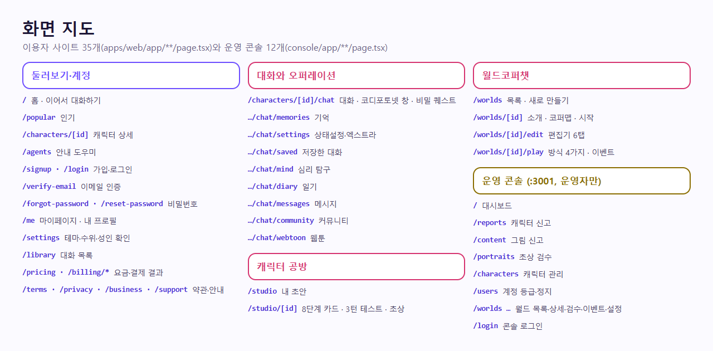

# 앱 역할

정본: `CodiComperChat_project_plan.md` §7.2, §8. 최종 갱신 2026-11-04 — 네 앱이 연결되어 동작한다.

| 앱 | 스택 | 위치 | 역할 |
|----|------|------|------|
| web | Next.js 16 (React 19, App Router) | `apps/web/` | 홈·인기·캐릭터 상세, 대화(채팅)·이어하기·기억·상태설정·지난 이야기·엑스트라, 오퍼레이션(심리 탐구·일기·메시지·커뮤니티·웹툰), 코디포토넷, 비밀 퀘스트, 공방(8단계), 대화 목록, 마이페이지·설정(성인 확인 포함), 로그인·가입·이메일 인증·비밀번호 찾기, 요금·결제, 약관 |
| console | Next.js 16 | `console/` | 운영자 전용 콘솔 (아래 "운영 콘솔은 별도 앱이다") |
| api | Nest.js 12 (TypeScript, ESM) + Prisma 7 | `apps/api/` | 인증·계정·성인 확인, 캐릭터, 대화와 컨텍스트 조립, 기억·이야기 정리, 공방(초안·테스트·발행·초상 검수), 신고, 결제(보류), 코레딧·모델·오퍼레이션(웹툰 포함)·비밀 퀘스트, 요청 한도, AI 호출 대기열. 웹이 유일하게 직접 치는 대상 |
| ai | FastAPI (Python 3.12) | `services/ai/` | `/infer` `/summarize` `/critique-test` `/remember` `/suggest-replies` `/assist` `/ground-check` `/draft-field` `/draft-quest` `/moderate-image` `/mind` `/diary` `/board-posts` `/board-comments` `/photonet` `/webtoon/plan` `/webtoon/panel`, `/train`(403). 그림은 같은 프로세스의 diffusers 엔진. Nest만 내부에서 호출 |



<!-- logic-structure -->
## 로직 구조

```text
apps/web (이용자) ──┐
                    ├──▶ apps/api (Nest) ──▶ services/ai (FastAPI)
console (운영자) ───┘          │
                               └──▶ PostgreSQL
두 Next 앱은 쿠키 이름(session · console_session)과 배포(도메인)가 다르다
```

## 화면 지도 (계획서 §8 → 구현)

| 계획서 §8 | 구현 | 경로 |
|---|---|---|
| 홈 — 진행 중 캠페인, 캐릭터 선택 | 히어로 + "이어서 대화하기"(최근 3개) + 캐릭터 카드 | `/` |
| 세션(채팅) — 스트림, 선택지, 세션 종료 | 대화 + 대답 추천(선택지 대신) + 새로하기(저장/저장 안 함)·이어하기. **스트리밍은 아직 아님**(답이 다 오면 보인다) | `/characters/:id/chat` |
| 캠페인 상태 패널 — 관계, 열린 훅, 지난 요약 | 대화 아래 "지난 이야기"(친밀도·복선·요약), 점 세 개 메뉴의 기억·상태설정, 엑스트라 | 같은 화면, `/chat/memories`, `/chat/settings` |
| 캐릭터 공방 — 7단계, 운영자부터 | 7단계 + 칸별 AI 초안 + 3턴 테스트(판정 통과해야 발행) + 초상(자동 검수). **일반 유저에게도 열림**(사용자 지시) | `/studio`, `/studio/:id` |
| 세션 로그북 | 대화 목록 + 저장한 대화 | `/library`, `/chat/saved` |
| 설정 — 계정, 수위, 알림 | 테마(시간에 따라 자동·밝기 영구·다크 영구)·계정·비밀번호·**콘텐츠 수위(성인 확인·끄기)**·탈퇴. 알림은 "준비 중". 헤더에 해·달 버튼 | `/settings` |

대화 화면에 붙은 신규 기능(모두 사용자 지시): 입력창 위 **코디포토넷**(그림)·**비밀 퀘스트**·**오퍼레이션** 메뉴(심리 탐구·일기·메시지·커뮤니티·웹툰), **추천 프로필** 카드(프로필 고르기 전), 모델 고르기·코레딧, 성인 확인 열림 상자. 공방 외형 단계에는 **AI로 직접 만들기**(25 코레딧). 모든 기능의 화면·API·코드 위치는 [../FEATURES.md](../FEATURES.md).

그 밖에 신규: 인기(`/popular`), 에이전트(사용 안내 챗봇 `/agents`), 마이페이지(`/me`), 요금·결제(`/pricing`, `/billing/*`), 운영자(`/admin/*`). 라벨·경로 전체는 [../plan/NAVIGATION_IA.md](../plan/NAVIGATION_IA.md).

### 월드코퍼챗 화면 (2026-11-06)

| 화면 | 경로 | 하는 일 |
|------|------|---------|
| 목록 | `/worlds` | 공개 세계관, 내 세계관, 새로 만들기 |
| 소개 | `/worlds/[id]` | 설명·파트 제목·등장인물·코퍼맵, 주인공 고르고 시작 |
| 편집기 | `/worlds/[id]/edit` | 기본·등장인물·장소·코퍼맵·파트·장면 그림·발행 |
| 플레이 | `/worlds/[id]/play` | 대화 방식 4가지, 코퍼맵 옆 칸, 이벤트 창 |
| 콘솔 | `console /worlds`, `/worlds/[id]`, `/worlds/review`, `/worlds/events`, `/worlds/settings` | 운영 |

웹의 `/api/worlds/[...path]`는 Nest `/worlds/*`로 넘기기만 한다(경로 조각을 다시 인코딩해 다른 경로로 새지 않게).

## 서로 어떻게 연결되나

- **web → api**: 서버 컴포넌트·서버 액션만 부른다(`API_BASE_URL`, 기본 `http://localhost:4000`). 로그인 토큰은 httpOnly `session` 쿠키에서 꺼내 `Authorization: Bearer`로 붙인다. 브라우저가 Nest를 직접 부르지 않아 CORS를 열지 않았다. 요청 한도가 사람마다 세어지도록 실제 IP를 `X-Forwarded-For`로 넘긴다
- **api → ai**: `apps/api/src/ai/ai-client.ts`의 `postToAi`가 대기열을 거쳐 부른다(`AI_BASE_URL`, 기본 `http://localhost:8000`). ai는 `AI_SERVICE_TOKEN`이 맞는 요청만 받고, 비우면 루프백만 받는다
- **ai → Ollama**: `services/ai/app/services/llm.py`(`OLLAMA_BASE_URL`, `OLLAMA_MODEL`)

## 운영 콘솔은 별도 앱이다 (2026-10-21)

| 앱 | 스택 | 위치 | 포트 | 역할 |
|----|------|------|------|------|
| console | Next.js 16 (React 19, App Router) | `console/` (저장소 루트) | 3001 (e2e 3102) | 운영자 전용: 대시보드, 신고함, 초상 검수, 그림 신고, 캐릭터 관리, 계정 등급·생년월일 정정 |

- 이용자 사이트와 나눈 이유: 운영 화면을 별도 도메인에 두고 허용 IP만 들여보내 따로 막을 수 있게, 운영자 로그인 쿠키(`console_session`, SameSite=Strict)를 이용자 쿠키와 섞지 않게, 배포·장애를 따로 다루게
- 콘솔도 **Nest만** 부른다(`API_BASE_URL`). 권한은 Nest `AdminGuard`가 판단한다. FastAPI는 모른다
- 디자인 토큰은 이용자 사이트와 같다(`console/app/globals.css`는 `apps/web/app/globals.css`의 토큰을 그대로 쓴다)

공방(Studio)은 여전히 `apps/web` 안의 화면이다(만드는 사람이 이용자라서).

관련: [overview.md](overview.md), [../guidance/web-frontend.md](../guidance/web-frontend.md), [../guidance/studio-workshop.md](../guidance/studio-workshop.md)
