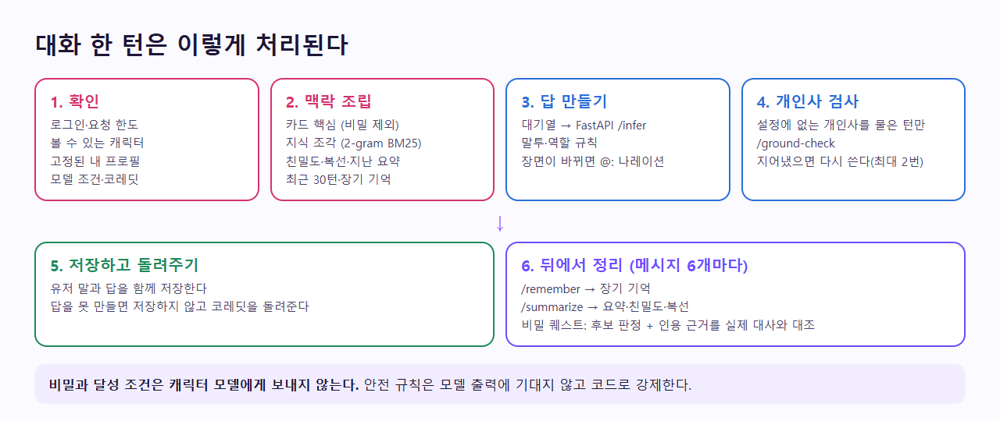
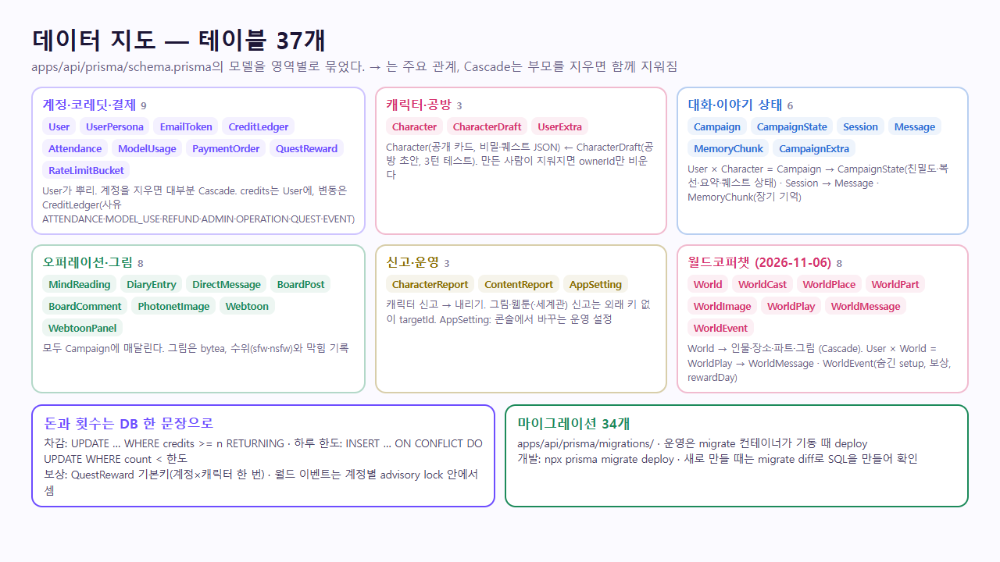
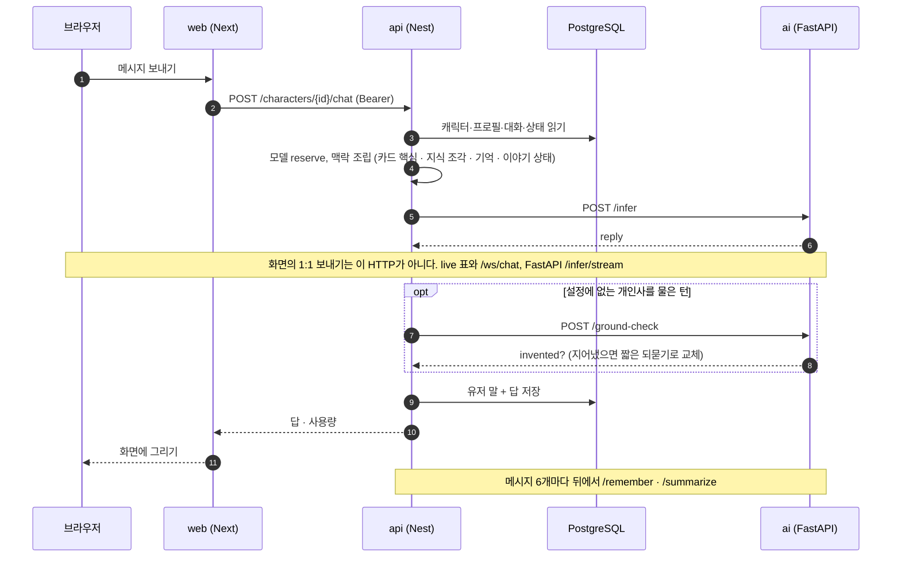
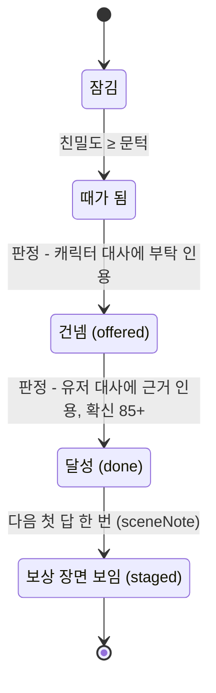
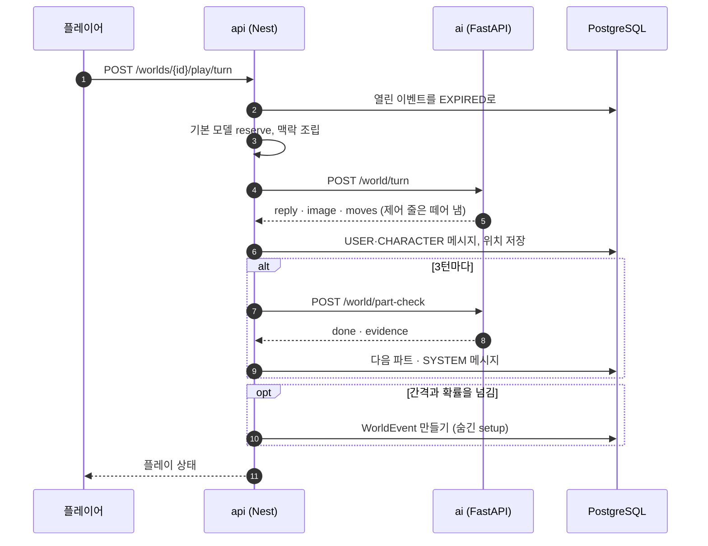
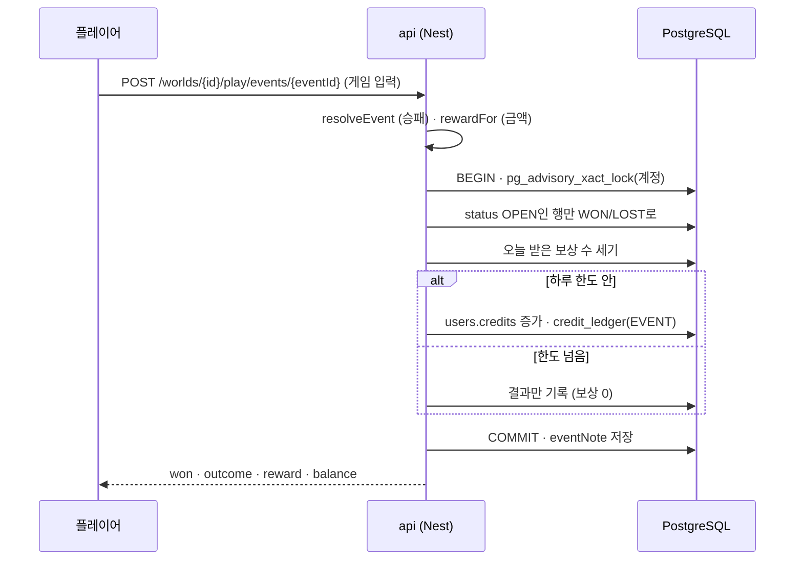
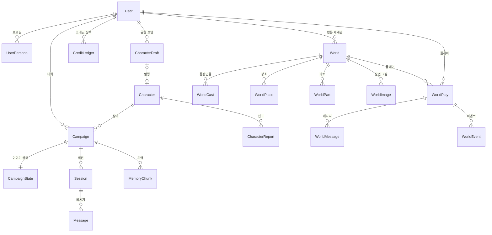
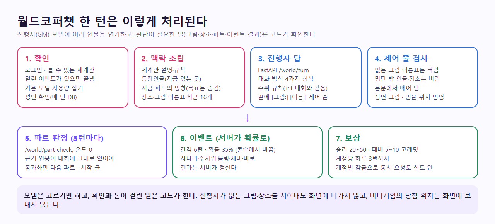

# 데이터 흐름

정본은 `CodiComperChat_project_plan.md` §7.6, §13.4다. 최종 갱신 2026-11-12. 요청/응답 흐름 다이어그램은 [../WORKFLOW.md](../WORKFLOW.md)에 있다. 직접 적은 기억과 때·곳도 대화 상태에 포함한다.

카드는 90초 준비 캐시를 사용한다. 매 요청에서 현재 대화를 찾고 최근 메시지·관계·이야기 요약·성인 설정을 다시 읽는다. 첫 요청 당시 대화가 없었어도 다음 요청에서 생성된 대화를 사용한다. 벡터 검색·엑스트라·퀘스트 조회는 동시에 진행하고, 검색된 기억은 현재 캠페인의 DB에 남은 내용과 대조한다. 최근 12턴과 함께 이전 세션의 요약도 전달한다.

기본 `gemma4:e4b`의 일반 대화 출력 상한은 첫 답 192토큰, 다음 답 96토큰이다. 응답 시간과 기억 회상 검증은 [대화 지연 실측](../trainings/chat-latency.md)에 기록한다.





<sub>상태가 어느 테이블에 남는지</sub>

<!-- logic-structure -->
## 로직 구조

```text
POST /characters/:id/chat {message, personaId, model?}
  │
  ├─ 1. 확인: 로그인 · 볼 수 있는 캐릭터 · 고정된 내 프로필 · 요청 한도
  ├─ 2. 모델: 고른 것 > 대화에 저장된 것 > 기본 → reserve (하루 한도 또는 코레딧)
  ├─ 3. 맥락: 카드 핵심(비밀 제외) + 지식 조각(BM25) + 기억 + 친밀도·복선·요약
  │          + 엑스트라 + 퀘스트 지시(sceneNote) + 성인 여부(매 턴 DB)
  ├─ 4. FastAPI /infer ──▶ 규칙 → 수위 → 나레이션 지시 → 보상 장면 (뒤로 갈수록 강하다)
  ├─ 5. 개인사를 물은 턴만 /ground-check → 지어냈으면 캐릭터의 짧은 되묻기로 교체
  ├─ 6. 저장 (유저 말 + 답). 실패하면 저장 안 하고 reserve를 돌려준다
  └─ 7. 메시지 6개마다 뒤에서: /remember(기억) · /summarize(요약·친밀도·복선·퀘스트 판정)

상태가 남는 곳: Message(대화) · CampaignState(친밀도·복선·요약·퀘스트·때와 곳) · MemoryChunk(기억, 직접 적은 것은 pinned)
              · CreditLedger(코레딧) · WorldPlay/WorldMessage/WorldEvent(월드)
```

<!-- logic-mermaid -->

### 1:1 대화



### 비밀 퀘스트 상태



### 월드 한 턴



### 월드 이벤트 보상



### 데이터 관계



## 브라우저 1:1 보내기 (2026-11-09)

화면의 일반 보내기는 `POST /characters/:id/chat`이 아니다. 웹이 `POST /characters/:id/chat/live`로 일회용 표를 받고, 브라우저가 Nest 웹소켓 `/ws/chat`에 붙는다. 생성은 FastAPI `POST /infer/stream`이다. 로컬 모델 조각만 말풍선에 이어 붙고, 호스팅 모델은 한 덩어리다. 개인사 검사가 답을 고치면 먼저 보인 글을 바꾼 뒤 저장한다. 소켓은 글을 옮길 뿐 추론을 나누거나 빠르게 하지 않는다. 명령어·빈 이어가기·월드 플레이는 아래 HTTP처럼 답이 끝난 뒤에 온다. 공개 API는 이 소켓을 아직 모른다.

## 메시지 한 번 보낼 때 상태가 움직이는 순서 (`POST /characters/:id/chat`)

```text
1. 확인      로그인(토큰 세대까지) · 요청 한도(1분 20번) · 캐릭터를 볼 수 있는지 · 내 프로필(대화마다 고정)
             · 고른 모델 확인(강화 무료: 하루 30번 무료 → 그 뒤 자정까지 1번 10 코레딧, 프리미엄: 코레딧) — 답을 만들기 전에 횟수·코레딧을 한 문장으로 잡고, 실패하면 돌려준다
2. 조립      Nest가 컨텍스트 슬라이스를 만든다 (character-chat.context.ts)
             ├ 캐릭터 카드 핵심 (비밀·해금 조건은 처음부터 서버 프로세스에 들어오지 않는다)
             ├ 페르소나 지식에서 이번 말·직전 대화로 검색한 조각 (RAG, 아래)
             ├ 최근 30턴 (DB에 저장된 기록 — 브라우저가 보낸 기록은 믿지 않는다)
             ├ 장기 기억 (memory_chunks에서 이번 말과 관련된 것)
             ├ 상태설정 (친밀도·호칭) + 지난 이야기 (열린 복선·끝난 일, 앞부분이 30턴 밖으로 밀렸으면 요약)
             ├ 엑스트라 (조건 단어가 이번 말·최근 3턴에 나온 것만, 최대 2명)
             ├ 설정에 없는 개인사 주제를 물었는지 (ungroundedTopics)
             └ 비밀 퀘스트 지시 (questNote — 친밀도가 문턱을 넘었을 때만, 달성 조건은 넣지 않는다)
3. 생성      FastAPI /infer → 답 (대기열의 "기다리는 답" 몫)
4. 개인사 검사 개인사를 물은 턴이면 /ground-check — 설정에 없는 사실을 지어냈으면 최대 2번 다시 쓰게 하고, 그래도면 안전한 말로 대체
5. 저장      답을 받은 뒤에만 유저 말 + 답을 함께 저장 (실패한 턴은 기록에 남지 않고 다시 보낼 수 있다)
6. 배경 정리 답을 돌려준 뒤, 메시지가 6개 쌓일 때마다(3번 오감) 대기열의 "배경" 몫으로
             ├ /remember → memory_chunks에 기억 한 줄씩
             └ /summarize → campaign_states에 지난 이야기 요약·친밀도 변화·복선 델타 머지
                 (퀘스트가 열려 있으면 "건넴·달성" 후보 → 전용 판정 통과 시에만 questState 갱신)
```

배경 정리는 답 속도에 영향을 주지 않는다. 대기열이 붐비면 기다리는 답에 자리를 양보하고, 배경 대기열이 20개를 넘으면 다음 기회로 미룬다.

## 새로하기·이어하기

```text
새로하기(저장)    지금 대화를 CLOSED로 남기고(제목·저장 시각) 한 번 더 정리(/summarize) → 시작 장면부터 새 대화. 프로필 고정도 풀림
새로하기(저장 안 함) 지금 대화와 기억·상태를 지움
이어하기         저장한 대화를 다시 ACTIVE로 (지금 대화는 저장하거나 지운 뒤)
```

## 세션 정리의 모양 (계획서 §13.4)

```text
FastAPI /summarize → { brief, relationDelta, relationReason, hooksOpen, hooksClosed, nextPressure, … }
Nest가 CampaignState에 델타 머지 — 자유 산문으로 덮어쓰지 않는다
  (친밀도는 한 번에 바뀌는 폭을 제한하고 0~100으로 자르며 변화 기록을 남긴다. 상태설정에서 "자동 변화"를 끄면 값은 그대로다.
   복선은 비슷한 것이 이미 있거나 끝난 일이면 버린다)
```

## 비밀 퀘스트 (2026-10-24)

```text
정의      characters.quest (공방 카드의 quest 단계에서 발행 때 복사, 이름·부탁·달성 조건이 다 있을 때만)
진행      campaign_states.questState: (없음) → offered → done  — 대화마다 따로
열림      정리 전 친밀도 ≥ unlockAt 일 때만 판정을 받는다 (그 아래의 판정은 무시)
건넴      캐릭터가 부탁을 실제로 꺼냈나 (후보 → 전용 판정: 인용 근거가 캐릭터 대사에 그대로 있고 확신 85 이상)
달성      건넨 뒤 유저가 달성 조건을 해냈나 (같은 방식, 근거는 유저 대사)
보상      달성 직후 첫 답에 보상 장면 한 번(staged). 갈래가 여럿이면 달성 판정 때 고른 갈래(questState.scene)만. 공식 캐릭터는 100 코레딧 — quest_rewards(계정×캐릭터) 기본키로 한 번만
공개      GET /characters/:id/chat/quest: 건네기 전(locked)엔 제목·내용을 주지 않는다. 공개 캐릭터 응답에는 quest가 없다
```

## 오퍼레이션과 코레딧

```text
심리 탐구 30 · 일기 20 · 커뮤니티 새 글 20 / 글쓰기 10 · 코디포토넷 50 · 웹툰 한 컷 45 (메시지는 무료)
차감  UPDATE users SET credits = credits - n WHERE credits >= n  (한 문장 — 동시 요청도 음수가 되지 않는다) + credit_ledger 한 줄
실패  AI·저장이 실패하면 환불(REFUND). 엔진이 꺼져 있으면 차감 전에 503
```

## 성인 확인과 성인 그림

```text
확인      POST /auth/me/adult { birthDate, consent } — 이메일 인증 + 만 19세(한국 시각) + 동의. 생년월일은 처음 값으로 고정
판단      adultBlock(): 요청마다 DB로 다시 본다 (동의를 거두면 바로 닫힘). 응답에는 adult 여부만
그림      성인 그림(rating=nsfw)은 목록·본문 모두에서 확인이 살아 있을 때만 (아니면 404)
가드      미성년자 설정은 그리기 전에 거절 · 실사 금지 · 그림 검수(어려 보임·강제·실존 인물·실사·혐오·자해)
```

## 페르소나 지식 RAG (2026-09-26 사용자 지시)

캐릭터가 자기 성격·배경을 놓치거나 설정에 없는 사실을 지어내지 않도록, 캐릭터별 설정을 **비공개 JSON**(`apps/api/data/personas/<이름>.json`, git 제외)으로 두고 매 턴 관련 조각만 골라 넣는다. 로컬 소형 모델(Ollama `gemma4:e4b`)은 긴 카드 원문을 받으면 뒷부분을 놓치고 빈칸을 지어내기 쉬워서, 짧은 핵심(`core`) + 검색된 조각 몇 개로 줄인다.

```text
Nest 컨텍스트 조립기 (apps/api/src/persona-rag)
  1. PersonaKnowledgeStore  JSON 로드·형식 검증 (저장하면 몇 초 안에 반영, 깨진 파일은 무시하고 로그)
  2. retriever              유저 말 + 직전 두 턴 → 글자 2-gram BM25 + 키워드 보너스 → 상위 3개(700자 이내)
  3. buildContextSlice      core → directorNote, 검색된 조각 → activeLore
FastAPI 시스템 프롬프트     "이번 대화와 관련된 설정 자료"로 표시 + 끝에 흐름·환각 방지 규칙
```

- 관련 조각이 없으면 아무것도 넣지 않는다 → "설정에 없는 개인적 사실은 지어내지 않는다" 규칙이 작동한다
- 지식 파일이 없는 캐릭터는 예전 방식(카드 원문 전부)으로 대화한다. `PERSONA_RAG=off`로 끌 수 있다
- 비밀·해금 조건은 이 파일에 넣지 않는다(공개 카드 필드만 — 기획서 §7.8). 이 JSON은 저장소에 올라가지 않는다
- 검색은 어휘 기반이다. 임베딩 모델이 로컬에 생기면 같은 인터페이스(질의 → 점수 매긴 조각)로 바꿔 끼울 수 있다
- 만들기·채우기·확인: [`apps/api/data/personas/README.md`](../../apps/api/data/personas/README.md)

## 공방: 초안 → 테스트 → 발행

```text
초안 저장     card(7층 JSON)을 서버가 정규화(글자 수 상한 — 프로는 긴 글 칸 3배, 바뀐 칸만 엄격히)
AI 초안       칸 하나씩 /draft-field, 비밀 퀘스트는 /draft-quest로 한 번에 (제안만, 카드는 안 바뀜. 비밀·이름은 AI에 보내지 않음)
3턴 테스트    /infer 3번(실제 대화와 같은 조립) → /critique-test(규칙 + 모델 판정: 말투 붕괴·강의·메타·비밀 누설·개인사)
              → lastTest에 카드 지문(cardHash)과 함께 저장. 통과 뒤 카드를 고치면 지문이 달라져 다시 테스트해야 함 (비밀 퀘스트는 테스트에 쓰이지 않아 지문에서 뺀다)
발행          이메일 인증 + 필수 단계 + 이 카드로 테스트 통과 → characters 행 생성/갱신 + 페르소나 지식 JSON 쓰기
              초상은 검수 APPROVED인 것만 캐릭터로 옮김
```

## 초상 그림

```text
업로드 PUT /studio/characters/:id/portrait (원본 그대로, 150KB, 첫 바이트로 형식 확인)
  → FastAPI /moderate-image (gemma4가 항목별 참·거짓 + 확신 → 규칙)
      block   → 400, 저장 안 함
      review  → 저장, portraitReview=PENDING (캐릭터에는 안 실림) → 운영 콘솔 /portraits 승인·반려
      ok      → 저장, APPROVED (발행 중이면 캐릭터에 바로)
  AI가 꺼져 있으면 → PENDING (통과시키지 않는다)
```

## 계정·메일

```text
가입         users 생성 → 인증 메일(뒤에서 발송, 실패해도 가입은 성공) → /verify-email에서 버튼 → emailVerifiedAt
비밀번호 찾기 가입 여부와 상관없이 204 → (있으면) 재설정 메일 → /reset-password → 비밀번호·sessionVersion+1(모든 기기 로그아웃)
비밀번호 변경 sessionVersion+1 → 지금 기기에는 새 토큰
탈퇴         발행 캐릭터 내림·지식 파일 삭제 → users 삭제(Cascade) · payment_orders는 userId만 비우고 남김
```

## 결제

```text
/pricing (동의 체크) → POST /billing/checkout (금액은 서버 상품표) → 결제창(토스 SDK, 개발은 /billing/mock)
  → /billing/success?paymentKey&orderId&amount → POST /billing/confirm
      주문 금액 = 결제창 금액 = 결제사 승인 금액이어야 함 (아니면 FAILED)
      토스 POST /v1/payments/confirm (Idempotency-Key=주문 번호)
      PENDING→PAID로 바꾼 쪽만 프로 기간 연장 (새로고침·동시 요청에도 한 번)
환불: 운영 콘솔 /users → 토스 cancel 성공 뒤에만 REFUNDED + 기간 되돌림
```

## 월드코퍼챗 (2026-11-06)



```text
시작   POST /worlds/:id/play {personaId}
       → world_plays(계정×세계관 하나, 프로필 이름·소개를 복사), locations = 인물별 처음 있는 곳
       → world_messages: 첫 장면(CHARACTER) · "1부 · 제목"(SYSTEM) · 파트 시작 글(@:)
턴     POST …/play/turn {text}
       → 열린 world_events는 EXPIRED
       → /world/turn (최근 16개, storySoFar, 지금 파트, 성인 여부, eventNote)
       → 제어 줄 검사 → imageId, locations 갱신
       → world_messages에 USER·CHARACTER 두 줄 (createdAt 1ms 차이로 순서 고정)
       → turns % 3 == 0 이면 /world/part-check → partIndex+1, SYSTEM 메시지, storySoFar에 근거
       → shouldStartEvent면 world_events(OPEN, setup에 숨긴 값) 만들고 turnsSinceEvent = 0
이벤트 POST …/play/events/:id {입력}
       → 10분 지났으면 EXPIRED + 409
       → resolveEvent(setup, 입력)로 승패 · rewardFor로 금액
       → 트랜잭션: 계정 잠금 → OPEN인 행만 WON/LOST → 오늘 받은 수 < 한도면 rewarded, users.credits 증가, credit_ledger(EVENT)
       → world_plays.eventNote = "이안이(가) … 이겼다 (보상 35 코레딧)" → 다음 턴 진행자 프롬프트 끝
```

그림과 지도는 올릴 때 `/moderate-image` 자동 검수를 거친다. 통과 → 바로 보임, 애매 → `PENDING`(만든 사람만 봄, 콘솔 검수), 막힘 → 400. 진행자에게는 `APPROVED`이고 막히지 않은 그림의 이름표만 간다.

## 왜 원문 전체를 매번 안 넣는가

로어·원문을 다 넣으면 최근 장면이 죽는다 (계획서 §11 리스크표). 그래서:
- 최근 30턴만 원문으로 넣고, 그보다 앞은 `MemoryChunk`(정리한 기억 한 줄)와 "지난 이야기" 요약으로 넣는다
- 캐릭터 설정은 지식 파일에서 이번 말과 관련된 조각만 넣는다(위 RAG)

관련: [../plan/DATABASE.md](../plan/DATABASE.md), [../plan/AI_MODEL_STRATEGY.md](../plan/AI_MODEL_STRATEGY.md)
