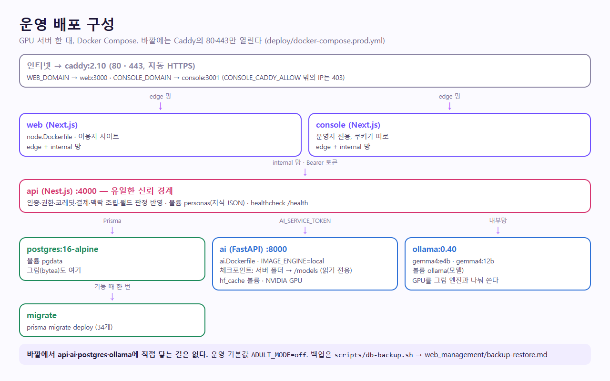
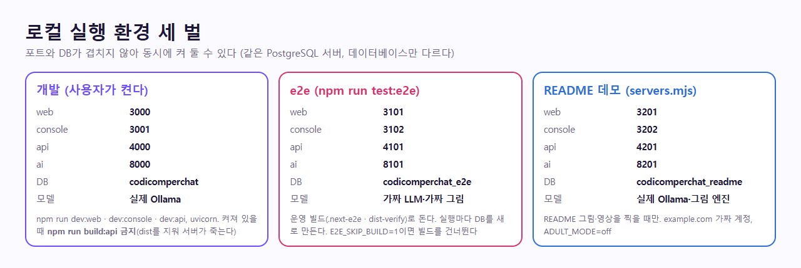
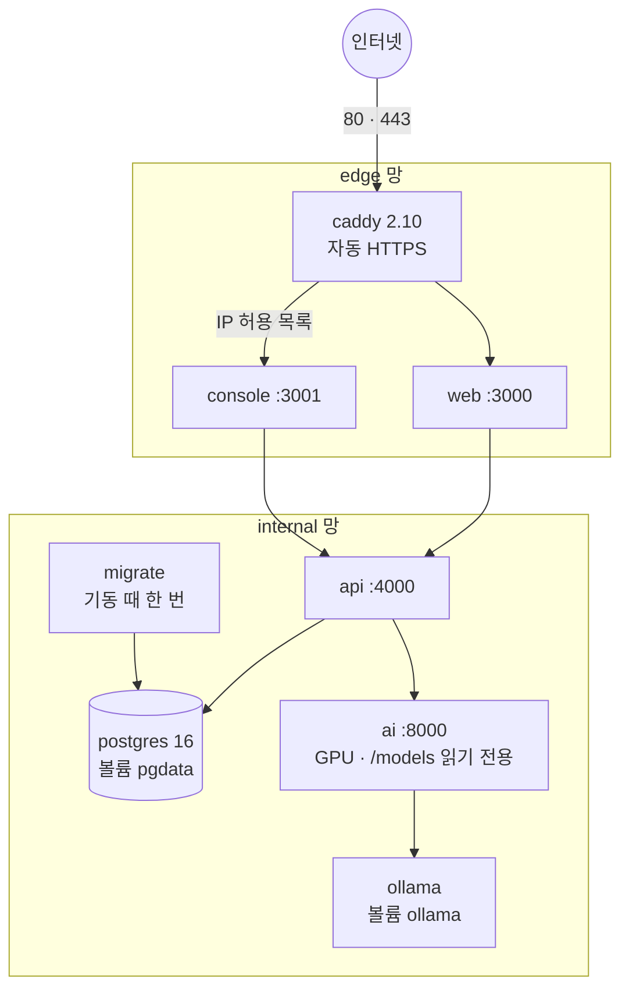
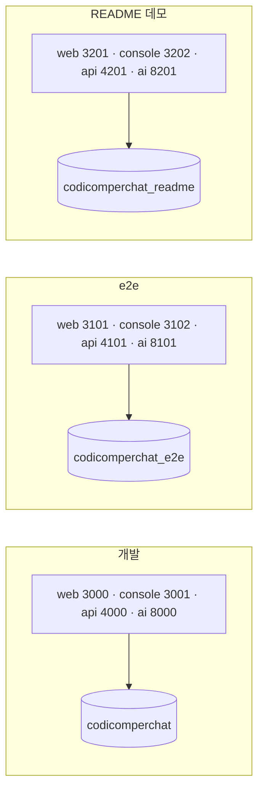

# Docker 토폴로지

저장소에는 compose가 두 개 있다.

| 파일 | 용도 | 서비스 |
|------|------|--------|
| `docker-compose.yml` | 로컬 개발 보조 | `postgres`(설치형이 없을 때만), `mailpit` |
| `deploy/docker-compose.prod.yml` | 운영 (2026-11-03) | 아래 |





<!-- logic-structure -->
## 로직 구조

```text
인터넷 ─▶ caddy (80·443) ─edge─▶ web:3000 ─┐
                       └─edge─▶ console:3001 (IP 허용) ─┤ internal
                                                        ▼
                                                    api:4000 ─▶ postgres:5432
                                                        │        ▲ migrate (기동 때)
                                                        ▼
                                                    ai:8000 ─▶ ollama:11434
                                                    (GPU · /models 읽기 전용)
```

<!-- logic-mermaid -->

### 운영 구성



### 로컬 환경 세 벌



## 운영 구성

```text
                ┌── edge 망 ────────────────────┐
인터넷 ─ 80·443 ─ caddy ─ web ─┐                │
                │        console ─┐             │
                └─────────────────┼─────────────┘
                ┌── internal 망 ──┴──────────────┐
                │ api ─┬─ postgres               │
                │      └─ ai (GPU) ─ ollama (GPU)│
                └────────────────────────────────┘
```

| 서비스 | 이미지 | 바깥 포트 | 저장 | 비고 |
|--------|--------|-----------|------|------|
| caddy | `caddy:2.10-alpine` | 80, 443 | `caddy_data`, `caddy_config` | TLS, 콘솔 IP 제한 |
| web | `deploy/node.Dockerfile` target `web` | 없음 | | |
| console | target `console` | 없음 | | |
| api | target `api` | 없음 | `personas` | |
| migrate | target `api` | 없음 | | 한 번 돌고 끝난다 |
| postgres | `postgres:16-alpine` | 없음 | `postgres_data` | |
| ai | `deploy/ai.Dockerfile` | 없음 | 서버 폴더 `/models`(읽기 전용), `hf_cache` | `gpus: all` |
| ollama | `ollama/ollama:0.40.13` | 없음 | `ollama_models` | `gpus: all` |

- Redis는 쓰지 않는다
- Compose 프로젝트 이름은 `codicomperchat`이다. 백업 스크립트가 이 이름으로 컨테이너를 찾는다
- internal 망은 바깥에서 들어올 수 없지만 나가는 길은 있다. Ollama 모델과 Hugging Face 구성 파일을 받아야 한다
- 한 GPU의 그래픽 메모리를 Ollama와 그림 엔진이 나눠 쓴다. 12GB에서 실측했고, 그림 뒤 검수 때문에 내리고 올리기가 반복돼 SDXL은 느리다. 검수 뒤 대화 모델을 바로 내린다(2026-11-04)
- 나눌 때는 `ai`·`ollama`를 다른 서버로 옮기고 사설망으로 잇는다. FastAPI를 공개 주소에 열지 않는다

절차와 실측: [../web_management/docker-deploy.md](../web_management/docker-deploy.md). 포트: [../web_management/ports-inventory.md](../web_management/ports-inventory.md).

## 월드코퍼챗과 구성 (2026-11-06)

새 컨테이너는 없다. 월드코퍼챗은 기존 `api`(Nest)·`ai`(FastAPI)·`web`·`console`·`db` 안에서 돈다. 진행자와 파트 판정은 같은 Ollama 모델을 쓰고, AI 대기열(동시 수 제한)을 1:1 대화와 나눠 쓴다. 장면 그림·지도는 DB에 들어가 `db` 볼륨이 커진다(세계관당 최대 약 12MB).
