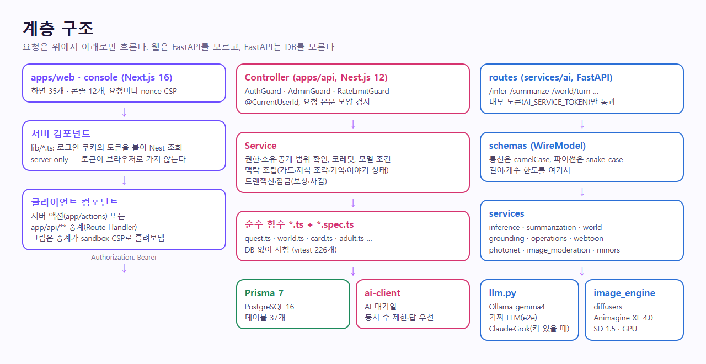

# 계층 구조

최종 갱신 2026-11-06.



## Nest.js (`apps/api`)

```text
Guard(요청 한도 → AuthGuard → AdminGuard) → Controller → Service → PrismaService → PostgreSQL
                                                          └→ postToAi(대기열) → FastAPI
```

- **Guard**: 전역 `RateLimitGuard`(`@RateLimit('chat')`처럼 붙인 라우트만 센다), `AuthGuard`(토큰 서명 + 계정 존재 + 토큰 세대 확인), `AdminGuard`(DB의 역할을 매번 읽음)
- **Controller**: 입력 꺼내기·검증 함수 호출만. 비즈니스 로직 금지
- **Service**: 컨텍스트 조립, 캠페인 상태 머지, FastAPI 호출, 결제사·메일 호출
- **Repository**: 따로 두지 않고 `PrismaService`를 서비스가 직접 쓴다(Prisma가 그 역할). 원시 SQL은 꼭 필요한 곳만(`$queryRaw`: 목록의 마지막 대화 한 번에 가져오기, 요청 한도 upsert)

입력 검증은 class-validator 대신 모듈마다 작은 파서 함수(`auth.dto.ts`의 `parseSignup` 등)로 한다 — 틀리면 `BadRequestException`(400, 한국어 메시지).

모듈 목록은 [../plan/PROJECT_STRUCTURE.md](../plan/PROJECT_STRUCTURE.md).

### Nest ↔ FastAPI 필드명

통신은 camelCase. Nest가 보내는 모양과 `services/ai/app/schemas/`의 Pydantic 계약이 같아야 한다(계획서 §7.5 "세 곳에서 다른 필드명" 경고). 새 필드를 만들 때는 ai 스키마의 이름을 그대로 따른다.

### 월드코퍼챗 (Nest, 2026-11-06)

`src/worlds/`: 컨트롤러 둘(이용자·운영자) → 서비스 넷(`WorldsService` 만들기·보기, `WorldPlayService` 플레이·이벤트, `WorldSettingsService` 운영 설정, `AdminWorldsService`) → Prisma. 판단이 필요한 순수 로직(문서 검사, 공개 범위, 미니게임 판정, 보상 금액, 이벤트 조건, 답 조각 나누기)은 `world.ts` 한 파일에 모아 DB 없이 시험한다. 그림 검수는 공방의 `PortraitReviewService`를 그대로 쓴다.

## FastAPI (`services/ai`)

```text
Schema (Pydantic, WireModel=camelCase) ── 계약
      ↓
Route (app/routes) → Service (app/services) → llm.generate → Ollama /api/chat
                                          └→ image_engine → image_local (diffusers, 같은 프로세스) 또는 WebUI API
```

- Schema: 요청/응답 계약
- Route: 요청 검증, 서비스 호출만
- Service: 프롬프트 조립, 판정(규칙 + 모델), 요약 구조화, 이미지 검수 규칙, 그림 장면 설계·프롬프트 조립(`photonet.py`, `webtoon.py`)
- `image_engine`/`image_local`: 그림 엔진 한곳. `IMAGE_ENGINE=local`(기본)이면 GPU에서 diffusers로 직접 그리고(체크포인트는 `services/ai/models/`), `webui`면 외부 WebUI API. 그래픽 메모리에는 체크포인트 하나만 올리고 그림은 한 번에 하나씩(잠금). `IMAGE_FAKE=1`/`LLM_FAKE=1`이면 작은 가짜 그림
- `llm.generate`: Ollama 호출 한곳. JSON 스키마로 출력 모양을 강제하고, 판정·요약은 `seed`를 고정한다. `LLM_FAKE=1`이면 모델 없이 고정 응답(e2e용)

### Repository 계층은 여기에 두지 않는다 (의도적)

`services/ai`에는 Repository도 DB 세션도 없다. **빠뜨린 것이 아니라 계획서 §7.4의 제약이다** — "FastAPI는 원본 DB를 함부로 쓰지 않는다. 추론에 필요한 슬라이스만 Nest가 조립해 넘긴다." ai에 Repository를 추가하는 것은 경계 위반이다.

`/train`은 스키마도 서비스 계층도 없다. v1 정책상 라우트에서 바로 403 (계획서 §7.7).

서비스 토큰: `AI_SERVICE_TOKEN`이 있으면 그 헤더(`x-ai-token`)가 맞는 요청만, 없으면 루프백만 받는다(`services/ai/app/internal_auth.py`). 단위 시험은 `services/ai/tests`(unittest), 모델 품질은 `evals`가 실제 모델로 잰다.

### 월드코퍼챗 (FastAPI, 2026-11-06)

`app/services/world.py`: `build_system`(진행자 프롬프트), `parse_controls`(제어 줄 검사), `turn`, `part_check`(근거 인용 확인). 수위 규칙은 `inference.py`의 `ADULT_RULE`·`ALL_AGES_RULE`·`coercion_in`과 `minors.py`를 같이 쓴다. DB를 보지 않는다.

## Next.js (`apps/web`)

```text
proxy.ts (CSP·1차 거름망) → 서버 컴포넌트(page.tsx) ── lib/*.ts(읽기) ──┐
                           → 클라이언트 컴포넌트 ── app/actions/*.ts(쓰기, 서버 액션) ─┴→ Nest
```

- `lib/*`는 `server-only`. 브라우저 코드는 Nest 주소도 토큰도 모른다
- 권한 확인은 세 겹: `proxy.ts`(쿠키 유무) → `requireUser()`(Nest에 토큰 검증) → Nest `AuthGuard`

### 월드코퍼챗 (Next, 2026-11-06)

`app/worlds/`: 서버 컴포넌트가 `lib/worlds.ts`로 Nest를 읽고, 편집기·플레이·이벤트 창은 클라이언트 컴포넌트가 `/api/worlds/*` 중계를 부른다. 코퍼맵(`copper-map.tsx`)은 소개·편집기·플레이가 같이 쓴다. 그림은 올리기 전에 브라우저에서 줄인다(`shrink-image.ts`).

## 공통 원칙

- 웹은 FastAPI를 모른다 — Nest를 통해서만
- 학습(`/train`) 경로는 v1에서 라우트만 존재, 막아 둠

관련: [overview.md](overview.md), [../plan/DATABASE.md](../plan/DATABASE.md)
