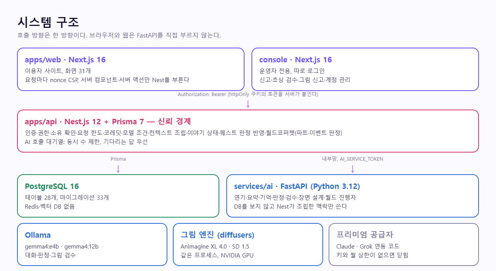
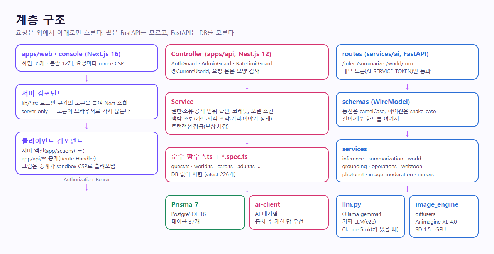
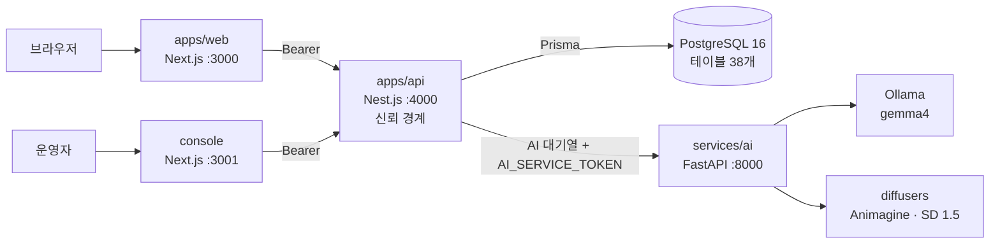
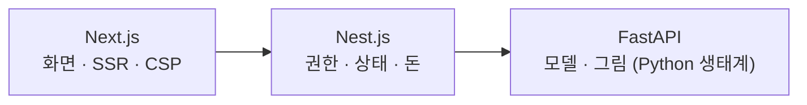

# 시스템 개요

정본: `CodiComperChat_project_plan.md` §7.1. 최종 갱신 2026-11-08 — **구현된 구조**. 2026-11-07부터 웹은 Vercel, API·DB·AI(대화)는 Oracle Cloud ARM VM에서 운영한다([../web_management/oracle-backend.md](../web_management/oracle-backend.md), 구성도 [docker-topology.md](docker-topology.md)). 아래 그림의 Ollama는 로컬 기본이다. 운영은 `LLM_BACKEND=openai`라 대화·요약·판정이 NVIDIA `google/gemma-4-31b-it`으로 가고, 막히면 `gemma4:e4b`가 대신 답한다.

```text
브라우저
  │  (화면·서버 액션. 로그인 토큰은 httpOnly 쿠키)
  ▼
Next.js  apps/web :3000          Next.js  console :3001 (운영자 전용, 따로 로그인)
  │                                 │  같은 방식으로 Nest만 부른다 (/admin/*, AdminGuard)
  │  proxy.ts: 요청마다 CSP(nonce) · 회원 전용 화면 1차 거름망
  │  서버 컴포넌트·서버 액션만 Nest를 부른다 (API_BASE_URL, Authorization: Bearer)
  ▼
Nest.js  apps/api :4000 ─────────────┬──▶ PostgreSQL :5432  (Prisma 7, 테이블 38개)
  │  인증·계정·캐릭터·대화·기억·        ├──▶ 페르소나 지식 JSON (apps/api/data/personas, 파일)
  │  공방·신고·검수·결제·코레딧·        ├──▶ SMTP (메일 발송, MAIL_SMTP_URL)
  │  모델·오퍼레이션·퀘스트·요청 한도   └──▶ 토스페이먼츠 API (결제 승인·취소, 보류)
  │  AI 호출 대기열 (동시 수 제한, 기다리는 답 우선)
  ▼
FastAPI  services/ai :8000  (내부 전용)
  │  연기(/infer)·요약·기억·판정·대답 추천·AI 초안·초상 검수
  │  오퍼레이션·코디포토넷·웹툰(장면 설계·그림·그림 검수)
  ├──▶ 프리미엄 공급자: Anthropic·xAI (코드 있음, PREMIUM_PROVIDERS와 키가 없으면 닫힘)
  ├──▶ 그림 엔진: diffusers (같은 프로세스, GPU, services/ai/models/)
  │      └ 개발 PC 선택: Stable Diffusion WebUI :7860 (IMAGE_ENGINE=webui)
  ▼
Ollama :11434  (gemma4:e4b, 글·그림 읽기)

브라우저 ──▶ 토스 결제창 (js.tosspayments.com) ──▶ /billing/success ──▶ Nest가 승인
```



2026-11-06부터 1:1 캐릭터 대화와 함께 **월드코퍼챗**(한 세계관 안의 여러 인물)이 같은 네 앱 위에서 돈다. 새 서비스는 없고, Nest `worlds` 모듈과 FastAPI `/world/*` 두 경로가 더해졌다 → [data-flow.md](data-flow.md) "월드코퍼챗".



<sub>각 앱 안의 계층은 [layers.md](layers.md), 운영 배포는 [docker-topology.md](docker-topology.md)</sub>

<!-- logic-structure -->
## 로직 구조

```text
[브라우저] ─▶ web/console (Next) ─▶ Nest (신뢰 경계) ─┬─▶ PostgreSQL (상태의 정본)
                                                     └─▶ FastAPI (계산만, DB 없음) ─▶ Ollama · diffusers
원칙: 호출은 한 방향 · 판단은 Nest · 모델 출력은 코드가 검사 · 비밀은 모델에 보내지 않는다
```

<!-- logic-mermaid -->

### 시스템 구조



### 왜 세 프레임워크인가



## 원칙

- 대화·월드·에이전트·포트폴리오 챗봇은 웹소켓이 없다. 브라우저는 HTTP `POST` 한 번으로 답이 끝날 때까지 기다린다. 웹소켓은 개발 서버의 Next 새로고침(`/_next/hmr`)뿐이고, `NODE_ENV=production`이면 CSP가 `ws:`·`wss:`를 열지 않는다
- 프론트는 FastAPI를 직접 호출하지 않는다 (Nest만 부른다)
- FastAPI는 내부망에서만 Nest가 호출한다
- 학습 API는 외부에 열지 않는다 (`/train` 403)
- Next.js Route에 무거운 추론을 넣지 않는다 — 웹의 `app/api/*`는 초상·코디포토넷·웹툰 그림 중계와 CSP 보고 받기뿐
- 결제 비밀 키·SMTP 비밀번호는 Nest에만 있다. 웹에는 토스 공개 키만 내려간다

## 왜 세 프레임워크인가 (계획서 §7.2)

- **Next.js**: 채팅, 대화 상태 패널, 창작 공방, 홈을 한 프론트에서
- **Nest.js**: 진짜 자산은 모델이 아니라 상태 — 유저/카드/대화/관계/복선/권한/결제까지 도메인 API가 커질 것을 전제(실제로 그렇게 됐다)
- **FastAPI**: 프롬프트 조립·판정·요약은 Python 쪽이 편함. v1에서는 "연기·요약 엔진"이지 학습 공장이 아님

관련: [layers.md](layers.md), [apps.md](apps.md), [data-flow.md](data-flow.md), [../plan/CURRENT_STACK.md](../plan/CURRENT_STACK.md)
