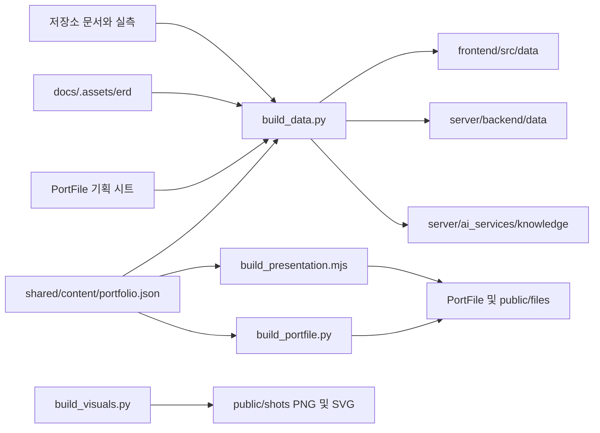

# 포트폴리오 콘텐츠와 배포 구조

2026-11-11 갱신. 제품 코드를 소개하는 별도 포트폴리오다. 제품의 Next·Nest·FastAPI 실행 구조는 바꾸지 않는다.

## 콘텐츠 흐름

상세 페이지는 `lib/content.ts`의 `detailPages`를 `[slug].astro`에서 정적 생성한다. 기존 다섯 페이지에 `updates`와 `frameworks`를 더해 전체 12페이지다. 메인·개발 기록·프레임워크 내용은 콘텐츠 정본을 공유한다.

## 실행과 신뢰 경계

Astro 페이지와 다운로드 파일은 Vercel에서 정적으로 제공한다. 검색과 AI 가이드는 빌드 시 `PUBLIC_API_BASE`에 지정한 Rails만 호출한다. Rails는 입력·요청 한도를 확인하고 내부 토큰으로 Flask를 부른다. Flask의 LangGraph는 질문 분류·검색·근거 선별·생성을 연결한다. 대화 기록은 브라우저 localStorage에 보관하고 최근 일부를 요청에 포함한다.

2026-11-08 기록상 Rails·Flask는 Oracle에 배포됐으며 제품과 Ollama e4b를 공유한다. CPU 동시 처리 제한으로 대화가 겹치면 지연·503이 발생할 수 있다. 정적 자료는 이 API가 응답하지 않아도 읽을 수 있다.

## 최신 상태를 표현하는 규칙

- 코드 구현, 서버 적용, 날짜가 붙은 실측을 구분한다.
- 11월 11일 제품 호스팅 스트리밍·예비 축소·장애 대응은 코드 병합 기록이며 서버 적용과 성능 개선을 확정하지 않는다.
- 시험 수는 `docs/plan/TESTING.md`, 운영 범위는 `docs/STATUS.md`, 최근 함정은 `docs/AGENT_HANDOVER.md`를 근거로 한다.
- 구조 이미지는 설명용이다. 제품 캡처는 개발 환경에서 찍은 원본을 유지하며 운영 화면으로 오인하게 표시하지 않는다.
- 기획 원본은 수정하지 않는다. 기획 시트의 기존 표와 일정도 보존하고 최신 개발 기록을 덧붙인다.

## 갱신과 검증

1. 콘텐츠 정본과 필요한 시트 기록을 갱신한다.
2. `build_visuals.py`, `build_data.py`, `build_portfile.py`를 실행한다. 발표자료 생성에는 `@oai/artifact-tool`을 사용한다.
3. `npm run build --prefix PortFolio/frontend` 뒤 `verify_portfolio.py`로 경로·이미지·문서 복사본·정본 복사본을 확인한다.
4. Word·PDF·발표자료는 렌더링해 배치를 확인한다. 시트는 기존 수식·조건부 서식·병합 범위를 보존했는지 대조한다.
5. `feature/*`에서 기록과 함께 커밋하고, 요청받은 병합·푸시 순서를 따른다. Vercel 사이트 재배포와 Oracle API·AI 갱신은 각각 별도로 확인한다.
