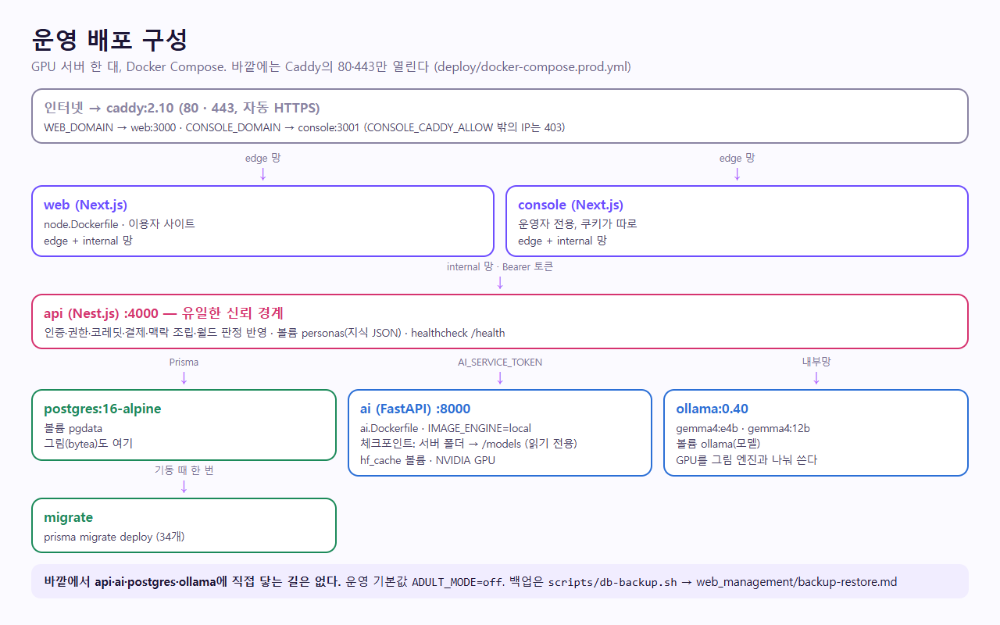
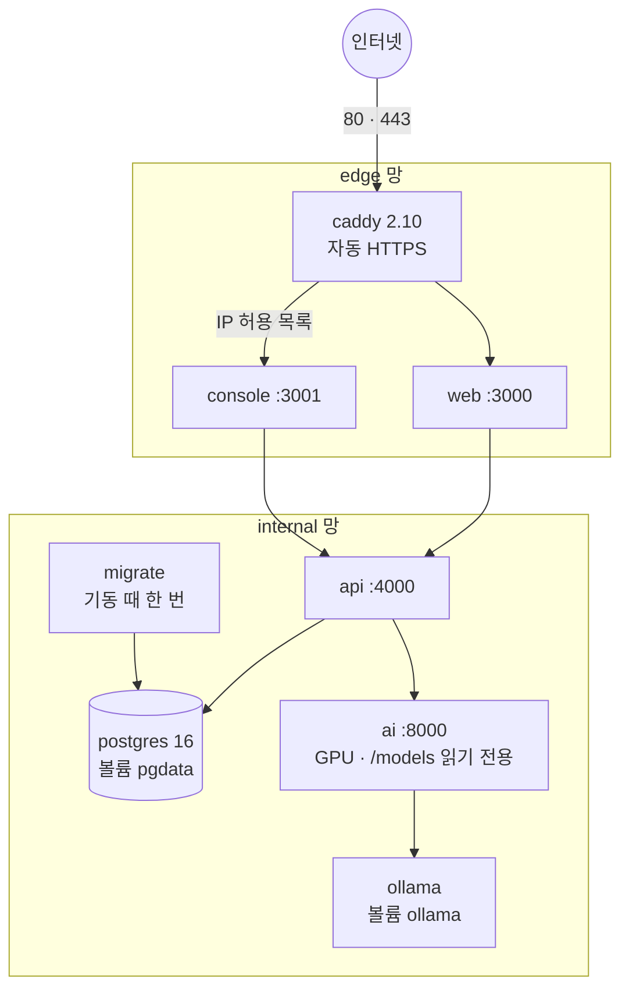
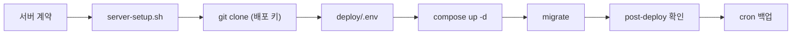

# 배포 (짧은 진입)

> 상태(2026-11-06): **배포 구성은 만들어 개발 PC에서 끝까지 띄워 봤고, 실제 서버 배포는 아직이다.** 사용자 결정은 "Hetzner GEX45에서 24시간, 성인 모드는 끈 채로"이고 계약은 아직이다.
>
> 2026-11-06 늦게 무료로 먼저 여는 길을 더했다: 웹·콘솔은 Vercel, 백엔드는 Oracle Cloud Always Free ARM VM, AI는 GPU 기계(지금 PC → 나중에 GEX45)를 Tailscale로 붙인다. 안내는 [web_management/deploy-guide.html](web_management/deploy-guide.html). 이 구성도 실제 서버에서 아직 돌려 보지 않았다.
>
> PC를 켜 두지 않으려면 AI를 **무료 호스팅 API의 Gemma 4 31B**(NVIDIA NIM·Google AI Studio)로 부르고 Oracle VM의 CPU Ollama를 예비로 둔다(`LLM_BACKEND=openai`, 프로필 `free-api`·`fallback`). 그림 기능은 무료 24시간 방법이 없어 잠긴다. 실제 API 호출은 키가 없어 아직 확인하지 못했다.

| 무엇을 하려는가 | 문서 |
|-----------------|------|
| **Oracle VM 한 번에 올리기** | `deploy/oracle/bootstrap.sh` (VM에서 실행: 준비·레포·값 입력·기동·확인) |
| **Oracle 콘솔 화면 따라 하기** | [web_management/oracle-console-guide.html](web_management/oracle-console-guide.html) (콘솔 화면을 다시 그린 모형, 실제와 100% 같지 않음) |
| **나눠 올리기 (Vercel + Oracle 무료 + GPU AI 노드), 한눈에 보는 안내** | [web_management/deploy-guide.html](web_management/deploy-guide.html) (브라우저로 연다), 구성 `deploy/oracle/`, `deploy/ai-node/` |
| 상시 서버 고르기 | [web_management/hosting-options.md](web_management/hosting-options.md) |
| 서버에 올리기 (절차·서버 조건·실측) | [web_management/docker-deploy.md](web_management/docker-deploy.md) |
| 올리기 전 체크 | [web_management/pre-deploy.md](web_management/pre-deploy.md) |
| 올린 뒤 확인 | [web_management/post-deploy.md](web_management/post-deploy.md) |
| 백업과 복구 | [web_management/backup-restore.md](web_management/backup-restore.md) |
| 구성도 | [Architecture/docker-topology.md](Architecture/docker-topology.md) |
| 환경변수 전체 | [guidance/environment.md](guidance/environment.md), [`deploy/.env.example`](../deploy/.env.example) |
| 보안·법률의 공개 전 필수 | [../SECURITY.md](../SECURITY.md), [../THIRD_PARTY_NOTICES.md](../THIRD_PARTY_NOTICES.md) |
| 로컬 실행 | [guidance/getting-started.md](guidance/getting-started.md) |



<sub>deploy/docker-compose.prod.yml을 그대로 옮긴 그림. 바깥에는 Caddy만 열린다</sub>

<!-- logic-structure -->
## 로직 구조

```text
개발 PC (지금)                         운영 (아직 올리지 않음)
  npm run dev:* + uvicorn                GPU 서버 한 대 (Hetzner GEX45 권장)
        │                                     │ deploy/server-setup.sh
        │ 커밋 → develop → main               ▼
        └──────────── git ──────────▶ docker compose -f deploy/docker-compose.prod.yml up -d
                                              │
                                              ├─ migrate: prisma migrate deploy (34개)
                                              ├─ caddy → web · console (HTTPS)
                                              ├─ api → postgres · ai → ollama
                                              └─ cron: scripts/db-backup.sh (14일 보관)
```

<!-- logic-mermaid -->

### 배포 구성



### 올리는 순서



## 결정된 것

| 항목 | 값 |
|------|-----|
| 구조 | NVIDIA GPU 서버 **한 대**에 전부 (`deploy/docker-compose.prod.yml`). 커지면 `ai`·`ollama`만 나눌 수 있다 |
| 운전 | 24시간. `restart: always`, 부팅 시 도커 자동 시작 |
| TLS | Caddy가 인증서 자동 발급·갱신, `X-Forwarded-*` 덮어쓰기 |
| 바깥에 열리는 것 | 80·443뿐 |
| 운영 콘솔 | 별도 도메인. Caddy와 앱(`CONSOLE_IP_ALLOWLIST`)에서 IP를 두 번 거른다 |
| 비밀값 | `deploy/.env`(git 제외). `node scripts/generate-prod-secrets.mjs`로 새로 만든다 |
| 백업 | 하루 한 번 `scripts/db-backup.sh`, 14일 보관 |
| 대화 모델 | 서버의 Ollama `gemma4:e4b`, `gemma4:12b` |
| 프리미엄 모델 | Claude·Grok 연동 코드 있음. `PREMIUM_PROVIDERS`, `PREMIUM_MONTHLY_CREDITS`, API 키를 넣기 전까지 "준비 중"이다. 실제 호출은 키가 없어 미확인. 켜기 전에 [AI_MODEL_STRATEGY.md](plan/AI_MODEL_STRATEGY.md)의 지출·정책 항목을 본다 |
| 성인 모드 | 기능은 그대로 두고(자기 신고), 공개 서버에서는 끈다. 운영 compose 기본값이 `ADULT_MODE=off`다 |
| 저장소 | 비공개로 전환한다(2026-11-03 결정, 전환 실행은 저장소 소유자). 서버는 읽기 전용 배포 키로 받는다 |
| 호스팅 | Hetzner GEX45, 성인 모드 끈 채로 ([web_management/hosting-options.md](web_management/hosting-options.md)). 아직 계약 전 |
| 결제 | 받지 않는다. 눌러서 프로로 바꾼다(`PRO_CLICK`). 정식 서비스 전 임시 |

## 아직 사람이 해야 할 것

순서와 하는 법: [guidance/owner-checklist.md](guidance/owner-checklist.md).

1. **Hetzner GEX45를 계약하고 서버를 만든다.** 계약 전에 값과 약관을 다시 확인한다. 조건은 [docker-deploy.md](web_management/docker-deploy.md) "서버 조건"
2. 도메인을 사서 DNS를 서버로 돌린다
3. 운영 메일(SMTP) 서비스를 정한다. 없으면 API가 인증 메일을 보내지 못한다
4. 체크포인트 두 파일을 서버로 옮긴다
5. 약관·처리방침의 `[운영자 기재]` 칸을 채우고 법률 검토를 받는다. 저장소를 비공개로 해도 이용자에게 보이는 이 칸은 없어지지 않는다
6. 성인 모드를 공개할지 변호사와 정한다. 국내법과 호스팅 약관이 걸린다 ([../THIRD_PARTY_NOTICES.md](../THIRD_PARTY_NOTICES.md))
7. 토스 상점 계약(결제 재개할 때만)

## 구현하며 남긴 메모

| 무엇 | 왜 | 어디 |
|------|-----|------|
| 앞단 프록시가 `X-Forwarded-For`를 **덮어쓰게** | Nest는 사설망에서 온 이 헤더를 믿는다. 바깥 값을 넘기면 IP 기준 요청 한도를 속일 수 있다. Caddy는 기본으로 덮어쓴다 | `apps/api/src/main.ts` |
| `REQUIRE_HTTPS_EXEMPT_HOSTS=api` | 없으면 내부의 `http://api:4000`이 https로 돌아가 웹이 API를 못 부른다. 공개 도메인은 넣지 않는다 | `apps/api/src/security/https.ts` |
| 서버를 여러 대로 늘리면 `RATE_LIMIT_STORE=db` | 메모리 한도는 대수만큼 늘어난다. 한 대일 때는 필요 없다 | [guidance/environment.md](guidance/environment.md) |
| `AI_CONCURRENCY`를 대수로 나눠 정하기 | 대기열은 서버마다 따로다 | 〃 |
| 운영 스위치 | `NODE_ENV=production`, `APP_ENV=production`이면 개발용 스위치가 켜져 있을 때 시작하지 않는다 | `apps/api/src/security/production.ts`, `services/ai/app/internal_auth.py` |
| 그림 엔진 | 첫 실행 때 모델 구성 파일(수십 KB)을 Hugging Face에서 받아 볼륨에 캐시한다. GPU가 없으면 코디포토넷·웹툰은 "준비 중"으로 잠기고 나머지는 돈다 | [guidance/photonet-engine.md](guidance/photonet-engine.md) |
| DB 마이그레이션 | `migrate` 서비스가 기동 때 적용한다. 지금까지 34개(2026-11-06 월드코퍼챗 포함) | [plan/DATABASE.md](plan/DATABASE.md) |
| `apps/api/data/personas/*.json` | git에 없다. 볼륨 `personas`에 둔다. 공식 캐릭터의 `유지성.json`, `이세연.json`은 개발 PC에서 옮긴다. 공방 캐릭터는 다시 발행하면 생긴다 | [`apps/api/data/personas/README.md`](../apps/api/data/personas/README.md) |
| 웹의 `CONSOLE_BASE_URL` | 빌드할 때 리다이렉트에 박힌다. 도메인을 바꾸면 다시 빌드한다 | `deploy/node.Dockerfile` |

## 월드코퍼챗을 올릴 때 (2026-11-06)

- 새 서비스·환경변수는 없다. 마이그레이션 `20261106120000_world_copperchat`가 테이블 9개와 열거형 값(`CreditReason.EVENT`, `ContentTarget.WORLD`)을 더한다.
- 운영 설정(하루 보상 횟수·이벤트 확률·간격)은 환경변수가 아니라 DB(`app_settings`)에 있고 콘솔에서 바꾼다. 행이 없으면 기본값(3회·35%·6턴).
- 장면 그림·지도는 DB(`bytea`)에 들어간다. 한 장 290KB, 세계관당 그림 40장 + 지도 1장이라 세계관 하나가 최대 약 12MB다. 백업 크기를 본다([web_management/backup-restore.md](web_management/backup-restore.md)).
- 미니게임 보상이 코레딧(유료 기능에 쓰임)이라 공개 전에 경품·사행성 관련 법률 검토를 받는다([guidance/owner-checklist.md](guidance/owner-checklist.md)).
