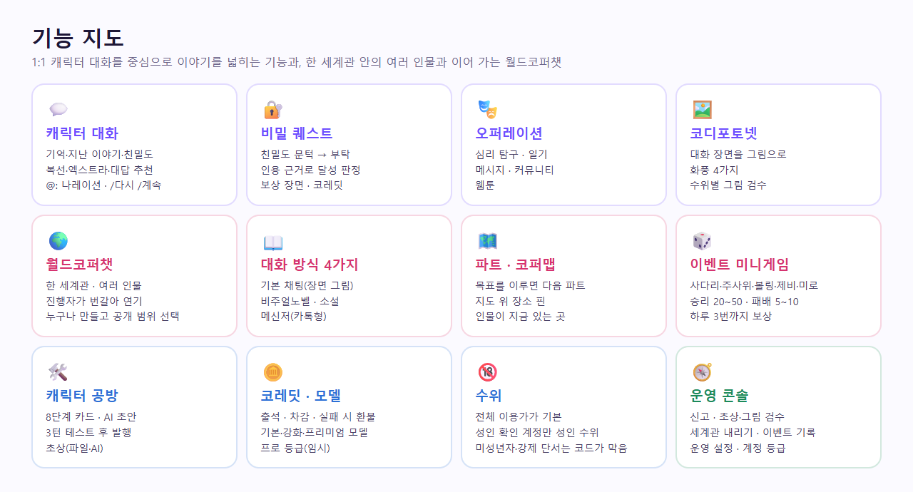
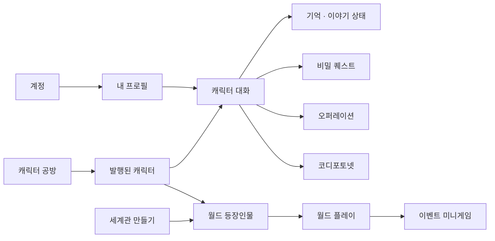
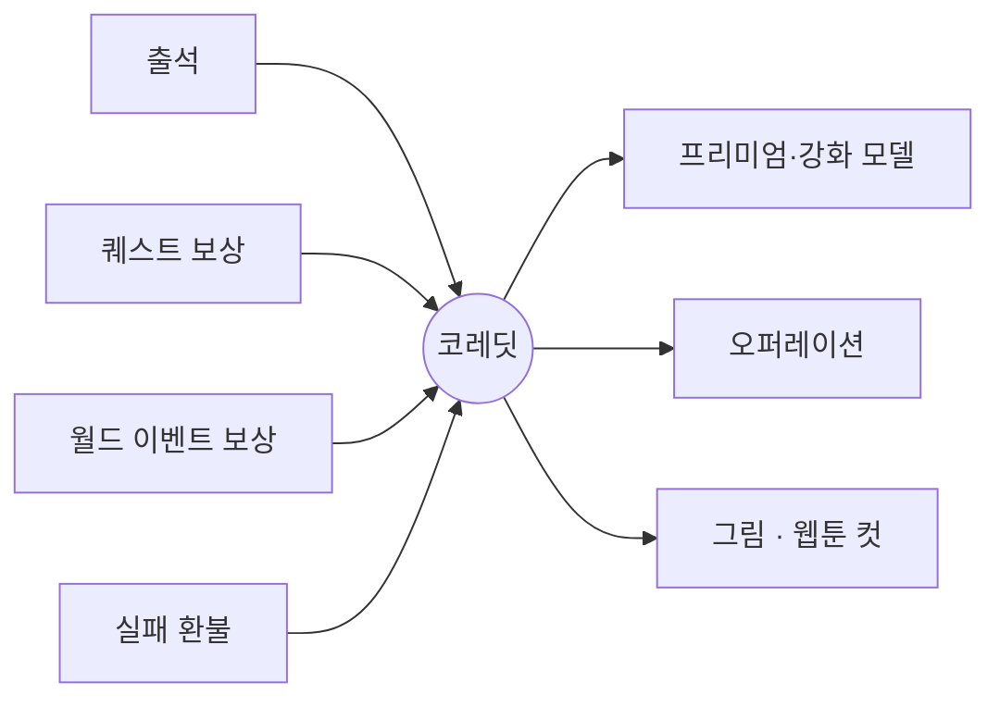

# 기능 카탈로그 (전체 기능 목록)

코디컴퍼챗에 **지금 구현된 모든 기능**을 한곳에 모았다. 각 줄은 *무엇인지 · 어디서 쓰는지(화면) · API · 코드 · 자세한 문서 · 시험* 순서다. 기능을 추가하거나 바꾸면 이 표를 같이 고친다(체크리스트: [plan/CURRENT_STACK.md](plan/CURRENT_STACK.md) "문서 갱신 체크리스트").

- 기준 시점: 2026-11-06. 상태: **구현**(동작·시험 있음) / **일부**(한계 있음, 비고 참고) / **보류**(코드는 있으나 열지 않음) / **준비 중**(화면에 "준비 중"으로 표시). 이 상태는 코드 기준이다. 공개 주소에서 지금 열리는 범위는 [STATUS.md](STATUS.md)에 따로 둔다.
- 경로의 `:id`는 캐릭터 id. API 전체 계약은 [API_DOCUMENTATION.md](API_DOCUMENTATION.md), 화면 구조는 [plan/NAVIGATION_IA.md](plan/NAVIGATION_IA.md).
- 코드 위치의 `api/`는 `apps/api/src/`, `web/`은 `apps/web/`, `ai/`는 `services/ai/app/`, `console/`은 `console/`.
- 시험 열의 이름은 `e2e/tests/<이름>.spec.ts`, "단위"는 `apps/api` vitest.



<!-- logic-structure -->
## 로직 구조

```text
계정 ─▶ 내 프로필(주인공) ─▶ 캐릭터 고르기 ─▶ 대화 ─┬─▶ 기억·지난 이야기·친밀도·복선
                                                   ├─▶ 비밀 퀘스트 (친밀도 문턱 → 부탁 → 판정 → 보상)
                                                   ├─▶ 오퍼레이션 (심리·일기·메시지·커뮤니티·웹툰)
                                                   └─▶ 코디포토넷 (장면 그림)
캐릭터 공방 ─▶ 8단계 카드 → 3턴 테스트 → 발행 ─▶ (월드코퍼챗 등장인물로 데려가기)
월드코퍼챗 ─▶ 세계관 만들기 → 발행 → 플레이(방식 4가지·파트·코퍼맵) → 이벤트 → 보상
코레딧 ◀── 출석 · 퀘스트 보상 · 이벤트 보상   ──▶ 프리미엄 모델 · 오퍼레이션 · 그림
운영 콘솔 ─▶ 신고·검수·내리기·계정·월드 설정
```

<!-- logic-mermaid -->

### 기능이 이어지는 길



### 코레딧이 오가는 곳



## 1. 계정·인증

| 기능 | 화면 | API | 코드 | 시험 / 비고 |
|------|------|-----|------|-------------|
| 가입 · 로그인 · 로그아웃 | `/signup` `/login` | `POST /auth/signup` `login` `logout` | api/auth, web/app/actions/auth.ts | auth · 상태 구현. scrypt 비밀번호, JWT 7일, 약한 비밀번호 거절 |
| 내 정보 · 표시 이름 변경 | `/settings` 계정 | `GET·PATCH /auth/me` | api/auth | auth |
| 비밀번호 변경 | `/settings` | `POST /auth/me/password` | api/auth | email · 변경하면 다른 기기 로그인 끊김(토큰 세대) |
| 이메일 인증 | `/verify-email`, 마이페이지 | `POST /auth/me/verify-email` `POST /auth/verify-email` | api/auth/email-token.ts, api/mail | email · 발행·성인 확인의 전제 |
| 비밀번호 찾기·재설정 | `/forgot-password` `/reset-password` | `POST /auth/password/forgot` `reset` | api/auth | email · 가입 여부 비노출 |
| 회원 탈퇴 | `/settings` | `DELETE /auth/me` | api/account | account · 데이터 삭제, 결제 기록만 법정 보관 |
| 성인 확인·끄기 | `/settings` 콘텐츠 수위, 코디포토넷·웹툰의 성인 버튼(열림 상자) | `POST·DELETE /auth/me/adult` | api/account/adult.ts, web/app/characters/[id]/chat/adult-dialog.tsx | operations · 자기 신고(생년월일+동의+이메일 인증), 본인인증 없음. `ADULT_MODE=off`면 모두 막히고 화면의 입구도 숨는다(운영 compose 기본, adult-off) |
| 나이 확인(프리미엄용) | `/settings#age-settings`, 대화 화면 모델 안내 링크 | `POST /auth/me/birthdate` | api/account, web/app/settings/forms.tsx | models · 자기 신고, 한 번만 입력. 성인 확인과 별개라 `ADULT_MODE=off`여도 쓴다 |
| 요금 등급(무료/프로) | 마이페이지·`/pricing` | `GET /auth/me`(`plan`) | api/plan | plan · 프로는 공방 긴 글 칸 3배, 강화 모델 무제한, 출석 5,000 |
| 프리미엄 월 상한 | 대화 화면 모델 안내("이번 달 제공량 소진") | — | api/models | 단위 · `PREMIUM_MONTHLY_CREDITS`. 운영에서 값이 없으면 열리지 않는다 |

## 2. 프로필(주인공)과 캐릭터 탐색

| 기능 | 화면 | API | 코드 | 시험 / 비고 |
|------|------|-----|------|-------------|
| 내 프로필 캐릭터(이름·소개, 10개까지) | 마이페이지 | `GET·POST /me/personas`, `PATCH·DELETE /me/personas/:id` | api/personas | auth |
| **추천 프로필**(캐릭터가 추천, 선택) | 대화 화면 "추천 프로필" 카드 | `GET /characters/:id`(`recommendedPersona`) 후 `POST /me/personas` | web/…/chat/recommended-persona.tsx, api/characters | persona-recommend · 그대로/고쳐서 쓰기, 같은 이름이면 재사용 |
| 홈 · 이어서 대화하기 | `/` | `GET /characters`, `GET /me/conversations` | web/components/character-list.tsx | popular |
| 인기 순위 | `/popular` | `GET /characters/popular` | api/characters | popular |
| 캐릭터 상세 · 초상 | `/characters/:id` | `GET /characters/:id` `…/portrait` | api/characters | studio |
| 공식 캐릭터 2명(유지성·이세연) | 홈·인기 | 시드 | api/prisma/seed.mjs, docs/plan/CHARACTERS.md | 초상·퀘스트·추천 프로필 포함 |
| 신고 | 캐릭터 상세 맨 아래 | `GET /characters/:id/report/reasons`, `POST /characters/:id/report` | api/reports | reports |
| 대화 목록 · 저장한 대화 | `/library` | `GET /me/conversations`, `GET /characters/:id/chat/saved` | api/conversations | chat |

## 3. 대화

| 기능 | 화면 | API | 코드 | 시험 / 비고 |
|------|------|-----|------|-------------|
| 대화 보내기·기록 | `/characters/:id/chat` | `GET·POST /characters/:id/chat` | api/character-chat, web/…/chat/character-chat.tsx | chat · 답은 한 번에 옴(스트리밍 없음) |
| 새로하기(저장/저장 안 함)·이어하기 | 대화 위 버튼 | `POST …/chat/new`, `GET …/chat/saved`, `POST …/saved/:campaignId/resume`, `DELETE …/saved/:campaignId` | api/character-chat | chat |
| 대답 추천(3개) | 입력창 옆 ✦ | `POST …/chat/suggestions` | api/character-chat, ai/services/suggestion.py | chat |
| 명령어 | 입력창 | `POST …/chat/regenerate` `continue` `undo` | api/character-chat | commands · `/다시` `/계속` `/되돌리기` `/상황 내용` `/도움말` |
| 최근 대사 수정·삭제·방향 추천 | 최근 12개 말풍선 | `PATCH·DELETE …/chat/messages/:messageId`, `POST …/rewrite` | api/character-chat, ai/services/rewrite.py | 방향은 유저가 적은 문장으로 그 줄만 다시 씀 |
| 때와 곳 | 대화 위 한 줄, 세계관 제목 옆 | 보내기 응답의 `scene` | api/character-chat/scene.ts | 시간·장소 단서가 있을 때만 갱신 |
| 글 꾸미기 | 말풍선 | — | web/lib/chat-format.ts, web/components/chat-text.tsx | format · `*행동*`(40% 회색 기울임) `**굵게**` `~취소선~` 코드·제목·인용·상자·정보창·`@이름`, HTML은 실행되지 않음 |
| **나레이션 `@:`** | 말풍선(가운데 상자) | — | 위와 같음 + ai/services/inference.py(규칙 8) | format · 장면이 바뀌면 모델이 첫 줄에 씀. 시작 장면에도 쓸 수 있음 |
| 모델 고르기(기본 무료·강화 무료·프리미엄) | 입력창 아래 | `GET /models` | api/models | models · 로컬 강화 태그는 `gemma4:12b`, 하루 30번 뒤 1번 10 코레딧. 운영 `LLM_BACKEND=openai`에서는 고른 무료 이름과 관계없이 호스팅 31B가 답하고 강화 한도만 남을 수 있다 → [STATUS.md](STATUS.md) · T06. 프리미엄은 키가 없어 "준비 중", 열어도 만 18세 미만·생년월일 없음은 잠금 |
| 프로필 고정 | 대화 | — | api/conversations | chat · 첫 메시지 뒤 새로하기 전까지 못 바꿈 |

## 4. 기억·이야기 상태

| 기능 | 화면 | API | 코드 | 시험 / 비고 |
|------|------|-----|------|-------------|
| 장기 기억(보기·직접 적기·지우기·정리) | `/chat/memories` | `GET·POST …/memories`, `DELETE …/memories/:id`, `POST …/memories/refresh` | api/memories, ai/services/remember.py | 직접 적은 것은 매 턴 넣고, 말은 상황과 맞을 때만. 프로필·상대 설명을 하면 `/notice-facts`로 자동 저장 |
| 지난 이야기(요약·친밀도 자동 변화·복선) | 대화 아래 접이식 패널 | `GET …/chat/story`, `DELETE …/story/hooks/:hookId` | api/campaign-state, ai/services/summarization.py | chat · 대화 3번(메시지 6개)마다 뒤에서 정리 |
| 상태설정(친밀도·메모·호칭·자동 변화 끄기) | `/chat/settings` | `GET·PATCH …/chat/state` | api/chat-state | chat |
| 엑스트라(조연, 1인 20개·대화당 3명) | 대화 아래 패널 | `GET·POST·PATCH·DELETE /me/extras`, `GET·PUT·DELETE …/chat/extras` | api/extras | chat |
| 개인사 환각 가드 | 보이지 않음 | `/ground-check`(내부) | api/character-chat/grounding.ts, ai/services/grounding.py | evals · 설정에 없는 개인사를 지어내면 다시 쓰게 함 |
| 페르소나 지식 RAG | 보이지 않음 | — | api/persona-rag | 캐릭터별 비공개 JSON(git 제외) 검색 |

## 5. 코레딧

| 기능 | 화면 | API | 코드 | 시험 / 비고 |
|------|------|-----|------|-------------|
| 출석(무료 1,000·프로 5,000) · 잔액 · 내역 | 마이페이지 코레딧 카드 | `POST /me/attendance`, `GET /me/credits` | api/credits | models |
| 값표 | 곳곳 | — | api/credits/credits.ts | 심리 탐구 30 · 일기 20 · 커뮤니티 20/10 · 코디포토넷 50 · **웹툰 한 컷 45** · **공방 AI 초상 25** · 퀘스트 보상 100 · 강화 무료 초과 10 · 메시지 무료 |
| 차감·환불 | — | — | api/credits, api/operations(`charged`) | 한 문장으로 차감(음수 불가), 실패하면 환불 |

## 6. 캐릭터 공방

| 기능 | 화면 | API | 코드 | 시험 / 비고 |
|------|------|-----|------|-------------|
| 초안 만들기·목록·자동 저장 | `/studio` `/studio/:id` | `GET·POST /studio/characters`, `GET·PATCH·DELETE …/:id` | api/studio, web/app/studio | studio |
| 8단계 카드(정체성·외형·성격·캠페인 역할·비밀·첫인사·로어북·**비밀 퀘스트**) | 편집기 | 〃 | api/studio/card.ts | studio |
| 칸별 AI 초안 | 칸 옆 "AI 초안" | `POST …/:id/draft-field` | ai/services/draft.py | studio · 비밀·이름·예시는 제외 |
| 말투 샘플 | 성격·말투 단계 | `POST …/:id/samples` | api/studio | studio |
| 3턴 테스트·판정·테스트 초기화 | 미리보기 | `POST …/:id/test/chat` `test/critique` `test/reset` | api/studio, ai/services/critique.py | studio · 카드를 고치면 무효 |
| 발행 · 공개 범위 · 내리기 | 위쪽 막대 | `POST …/:id/publish` `unpublish`, `PATCH …/:id/visibility` | api/studio/studio-publish.service.ts | studio · 이메일 인증 + 필수 단계 + 테스트 통과 |
| 프로 등급 글자 수 3배·프롬프트 연장 | 긴 글 칸 | — | api/studio/card.ts | plan |
| 초상 올리기(**내 파일 선택**) | 외형 단계 | `PUT·DELETE·GET …/:id/portrait` | api/studio/portrait.ts | studio · 형식·150KB·첫 바이트 검사 |
| **AI로 초상 만들기(25 코레딧)** | 외형 단계 "AI로 직접 만들기" | `POST …/:id/portrait/generate` | api/studio/studio-portrait-ai.service.ts, ai/services/portrait.py, web/app/studio/[id]/portrait-ai.tsx | portrait-ai · 화풍 4×생김새 8항목, 전체 이용가, 검수 거침. 후보를 보고 고른 그림만 저장하며 여러 장 뽑을 수 있다. 후보는 화면을 나가면 사라진다 |
| 추천 프로필 칸(선택) | 비밀 퀘스트 단계 아래 | `PATCH …/:id`(`card.recommendedPersona`) | api/studio/card.ts | studio-recommend · 발행하면 캐릭터에 실린다. 3턴 테스트를 무효로 만들지 않는다 |
| 비밀 퀘스트 한 번에 AI 제작 | 비밀 퀘스트 단계 | `POST …/:id/draft-quest` | ai/services/draft.py | quest |
| 초상 자동 검수 | 올릴 때 | `/moderate-image`(내부) | api/studio/portrait-review.service.ts, ai/services/image_moderation.py | moderation |

## 7. 비밀 퀘스트

| 기능 | 화면 | API | 코드 | 시험 / 비고 |
|------|------|-----|------|-------------|
| 숨은 부탁(이름·부탁·달성 조건·보상 장면·열리는 친밀도) | 대화 "비밀 퀘스트" 열림 상자 | `GET …/chat/quest` | api/quests, web/…/chat/secret-quest.tsx | quest · 건네기 전엔 `???`, 달성 조건은 캐릭터에게 알리지 않음 |
| 엄격 판정 | 보이지 않음 | `/summarize`(`quest`) | ai/services/summarization.py | 후보 + 전용 판정(인용 근거 대조, 확신 85↑). 실제 gemma 16/16 |
| 보상 | 열림 상자 | — | api/credits(`grantQuestReward`) | 공식 캐릭터만 100 코레딧(계정×캐릭터 1회), 유저 캐릭터는 보상 장면만 |
| 현재 퀘스트 | — | 시드 | api/prisma/seed.mjs, services/ai/evals/quest_seyeon.py | 유지성 「접어 둔 문제집」(친밀도 40). 이세연 「결재되지 않은 서류」(친밀도 50): 혼인에 이르거나, 기혼인 채 이어져 실제 충돌이 벌어지면 달성. 실제 gemma 장면 10개 모두 맞음 |

## 8. 오퍼레이션(대화 플러그인)

입력창 위 "✦ 오퍼레이션" 메뉴. 진행 중인 대화가 있어야 쓴다.

| 기능 | 화면 | API | 코드 | 시험 / 비고 |
|------|------|-----|------|-------------|
| 심리 탐구(30) | `/chat/mind` | `GET·POST …/chat/ops/mind` | api/operations, ai/services/operations.py | operations |
| 일기(20) | `/chat/diary` | `GET·POST …/ops/diary` | 〃 | operations |
| 메시지(무료, 대화와 따로) | `/chat/messages` | `GET·POST …/ops/messages` | 〃 | operations |
| 커뮤니티(새 글 20·글쓰기 10) | `/chat/community` | `GET …/ops/board`, `POST …/ops/board/refresh` `board/posts` | 〃 | operations |

## 9. 그림 — 코디포토넷·웹툰

| 기능 | 화면 | API | 코드 | 시험 / 비고 |
|------|------|-----|------|-------------|
| 코디포토넷(50) | 입력창 위 왼쪽 버튼(열림 상자) | `GET·POST …/ops/photonet`, `GET …/ops/photonet/:imageId` | api/operations, ai/services/photonet.py, web/…/chat/photonet.tsx | operations · 등장인물·줄거리·고른 대사를 읽고 장면 설계, 화풍 4·비율 3 |
| **웹툰(콘티 무료·컷 45)** | `/chat/webtoon` | `GET·POST …/ops/webtoon`, `POST·GET …/webtoon/:webtoonId/panels/:index` | api/operations/webtoon.*, ai/services/webtoon.py | webtoon · 외모를 먼저 정해 모든 컷에서 같게, 컷은 하나씩 |
| 그림 엔진 | — | `GET /photonet/status`(내부) | ai/services/image_engine.py, image_local.py | 기본 diffusers(같은 프로세스), 선택 WebUI. GPU 없으면 "준비 중". [guidance/photonet-engine.md](guidance/photonet-engine.md) |

## 10. 성인 모드(수위)

| 기능 | 화면 | 코드 | 시험 / 비고 |
|------|------|------|-------------|
| 전체 이용가(기본) / 성인 분리 | 코디포토넷·웹툰의 토글 | api/operations, ai/services/photonet.py | operations, webtoon |
| 성인 확인 필요·동의 철회 시 즉시 닫힘 | 〃 | api/account/adult.ts | operations · 성인 그림은 목록·본문에서 404 |
| 미성년자 설정 원천 차단 | 〃 | ai/services/photonet.py(`minor_hint`) | operations, webtoon · 그리기 전에 400·환불 |
| 실사 금지·그림 검수(어려 보임·강제·실존 인물·실사·혐오·자해) | 〃 | ai/services/photonet_moderation.py | evals 밖(실측만) |
| 거짓 정보 책임 고지 | 동의 문구·약관 | web/app/terms | security |
| 대화 수위 (2026-11-06): 성인 확인한 계정은 모든 대화가 성인 수위, 로컬 모델에서만 | 설정 → 콘텐츠 수위 | api/character-chat(`adultChat`), ai/services/inference.py(`rating_rule`) | ai tests/test_rating.py, evals.adult_chat · [trainings/adult-chat.md](trainings/adult-chat.md) |
| 대화의 미성년자·강제 단서 → 그 턴은 성적 진행 금지 | 〃 | ai/services/minors.py, inference.py(`coercion_in`) | 〃 · 강제 장면 거부 16/16 |

공개 전 필수 점검은 [../SECURITY.md](../SECURITY.md)와 [../THIRD_PARTY_NOTICES.md](../THIRD_PARTY_NOTICES.md). 신고·검토·접근 차단·계정 정지는 13장 「그림 신고」에 있다. 성인 그림에서는 실사 유사도 90 이상도 막는다.

## 11. 에이전트·안내

| 기능 | 화면 | API | 코드 | 시험 / 비고 |
|------|------|-----|------|-------------|
| 에이전트(사용 안내 챗봇, 비로그인 가능) | `/agents` | `POST /agent-chat/messages` | api/agent-chat, ai/services/assist.py | 범위를 묶어 범용 비서가 되지 않게 |
| 약관·개인정보·사업자·고객센터 | `/terms` `/privacy` `/business` `/support` | — | web/app/terms·privacy·business·support | security · 법률 검토 전 초안 |
| 프로젝트 소개 | `/project` | — | web/app/project/page.tsx | 2026-11-07 추가. `PORTFOLIO_URL`이 있으면 포트폴리오 사이트 버튼. 운영에서 열리는지는 [STATUS.md](STATUS.md) |

## 12. 화면 공통

| 기능 | 화면 | 코드 | 시험 / 비고 |
|------|------|------|-------------|
| 헤더·드로어·푸터 | 모든 화면 | web/components | [plan/NAVIGATION_IA.md](plan/NAVIGATION_IA.md) |
| 테마(시간 자동·영구 설정·헤더 해·달) | 헤더, `/settings` | web/lib/theme*.ts | theme · 한국 시각 오전 7시 밝게/오후 10시 어둡게 |
| 회원 전용 화면 보호 | — | web/proxy.ts → requireUser → Nest AuthGuard | auth |

## 13. 운영 콘솔(`console/`, 운영자만) — 월드코퍼챗 메뉴는 15장

| 기능 | 화면 | API | 시험 |
|------|------|-----|------|
| 대시보드(처리할 일·숫자·AI 대기열) | `/` | `GET /admin/stats` | console |
| 신고함(내리기·기각·복구) | `/reports` | `GET …/reports`, `POST …/take-down` `dismiss-reports` `restore` | reports, console |
| 초상 검수(승인·반려) | `/portraits` | `GET·POST /admin/portraits` | moderation |
| **그림 신고**(코디포토넷·웹툰, 접근 차단·계정 정지·정지 풀기) | `/content`, 이용자는 그림 옆 신고 버튼 | `GET·POST /characters/:id/content-reports`, `GET /admin/content-reports`, `POST …/:id/block` `dismiss`, `POST /admin/users/:id/unsuspend` | content-reports, 단위 · 코디포토넷으로 시험. 웹툰 신고는 같은 부품이고 브라우저로 눌러 보지 않았다. 운영자 계정은 정지하지 않음 |
| 캐릭터 관리 | `/characters` | `GET /admin/characters` | console |
| 계정 등급·결제 내역·환불·생년월일 고치기 | `/users` | `GET /admin/users`, `POST …/plan`, `POST …/birthdate`, `POST /billing/:id/refund`(운영자) | billing |

운영자 지정: `npm run user:role --workspace api -- 이메일 admin`. 상세 [guidance/operations.md](guidance/operations.md).

## 14. 요금·결제

실제 결제는 보류이고, 정식 서비스 전까지 눌러서 프로로 바꾼다.

| 기능 | 화면 | API | 비고 |
|------|------|-----|------|
| **눌러서 프로로 바꾸기(30일, 임시)** | `/pricing` | `POST /billing/pro-click` | billing · `PRO_CLICK`. 이미 프로면 409, 닫혀 있으면 403, 주문 기록 없음, 토스를 켜면 닫힘 |
| 요금 안내·결제·승인·내역·환불 (보류) | `/pricing` `/billing/*` | `GET /billing/products`, `POST checkout` `confirm`, `GET orders`, `POST :id/refund` | billing · 토스페이먼츠 연동 코드와 시험 결제(mock)는 있으나 **운영에서 열지 않음**(2026-10-21 사용자 결정) |

## 15. 플랫폼(보이지 않는 기능)

| 기능 | 위치 | 문서·시험 |
|------|------|-----------|
| 요청 한도(사람·IP별) | api/security | [../SECURITY.md](../SECURITY.md), 단위 |
| AI 호출 대기열(동시 수 제한·기다리는 답 우선) | api/ai/ai-queue.ts | [WORKFLOW.md](WORKFLOW.md) |
| 보안 헤더·nonce CSP·CSP 보고 | web/proxy.ts, api/main.ts | security |
| 메일 발송(SMTP·폴더·로그) | api/mail | `npm run mail:check --workspace api` |
| HTTPS 강제·HSTS | api/security/https.ts, web/lib/https.ts, console/lib/https.ts | 단위 · `REQUIRE_HTTPS`, 내부 호스트는 `REQUIRE_HTTPS_EXEMPT_HOSTS` |
| 운영 기동 검사 | api/security/production.ts, ai/internal_auth.py | 단위 · 개발용 스위치가 켜져 있거나 토큰이 짧으면 시작하지 않음 |
| FastAPI 내부 인증 | ai/internal_auth.py | 토큰 또는 루프백 |
| **운영 배포 구성** | deploy/(GPU 목표), deploy/oracle/(지금), [web_management/oracle-backend.md](web_management/oracle-backend.md) | **2026-11-07 실제 배포**: Vercel 웹 + Oracle API·DB·AI. 연결 손 확인([plan/TESTING.md](plan/TESTING.md) "운영 배포 확인") |
| 웹 → API 이용자 IP 넘기기 | web/lib/client-ip.ts, deploy/oracle/Caddyfile | `WEB_PROXY_TOKEN`이 맞을 때만 Caddy가 `X-Forwarded-For`를 믿음. 서버에서 `caddy validate` |
| 대화 모델 호스팅 API + 예비 | ai/services/llm.py | unittest(`test_llm_openai`, `test_llm_stream`) · 운영 실측 NVIDIA 19초, 예비 CPU 32초 |
| DB 백업 | scripts/db-backup.sh, [web_management/backup-restore.md](web_management/backup-restore.md) | 복구 연습 1회 |
| 상태 확인 | `GET /health` | — |
| 계획서 `/campaigns/*` 자리 | api/campaigns | 501(실제 대화는 `/characters/:id/chat*`) |
| 개발 도구 | apps/api/scripts | `user:role` `user:plan` `persona:build` `persona:search` `billing:check` `mail:check` |
| 커밋 기록 작성기 | scripts/record-commit.mjs | `node --test scripts/record-commit.test.mjs` |
| CI | .github/workflows/ci.yml, scripts/ci-local.mjs | [plan/TESTING.md](plan/TESTING.md) |

## 한눈에 안 보이는 한계

스트리밍 없음 · 퀘스트는 캐릭터당 1개 · 본인인증 없음(자기 신고) · SD 1.5 AI 초상은 옷·머리 같은 세부 선택이 가끔 빠짐 · 웹툰 컷 사이 얼굴이 조금씩 달라짐 · 프리미엄 모델(Claude·Grok)은 연동 코드가 있으나 실제 키로 호출해 보지 않았고 `PREMIUM_PROVIDERS`를 켜기 전까지 "준비 중" · 실제 결제 보류(눌러서 프로로 대신함). 해야 할 일 전체는 [TASKS.md](TASKS.md).

## 15. 월드코퍼챗 (2026-11-06)

정본 [plan/WORLD_COPPERCHAT.md](plan/WORLD_COPPERCHAT.md). 화면 그림: [../README.md#월드코퍼챗](../README.md#월드코퍼챗).

| 기능 | 화면 | API | 코드 | 시험 / 비고 |
|------|------|-----|------|-------------|
| 세계관 목록·검색 | `/worlds` | `GET /worlds`, `/worlds/mine` | web/app/worlds/page.tsx | worlds.spec |
| 세계관 만들기·고치기 (기본·등장인물·장소·파트·그림·발행) | `/worlds/[id]/edit` | `POST·PUT·DELETE /worlds…` | web/app/worlds/[id]/edit, api/worlds/worlds.service.ts | world.spec(문서 검사), worlds.spec |
| 등장인물 데려오기 | 편집기 등장인물 탭 | `GET /worlds/cast-candidates` | 〃 | 볼 수 없는 캐릭터는 저장 거절 |
| 공개 범위·발행 조건 | 편집기 발행 탭 | `/publish`, `/unpublish` | world.ts `publishProblems`, `canView` | worlds.spec |
| 장면 그림 이름표·자동 검수 | 편집기 장면 그림 탭 | `PUT /worlds/:id/images` | PortraitReviewService 재사용 | worlds.spec(통과·대기·거절) |
| 대화 방식 4가지 | `/worlds/[id]/play` | `POST …/play/turn` | ai/services/world.py `MODE_STYLE`, web play/world-play.tsx | evals.world_turn 23/24 |
| 진행자의 그림 고르기·장소 이동 | 플레이 | 〃 | world.py `parse_controls` | test_world 9개 |
| 파트와 판정 | 플레이 위 띠 | 〃 (3턴마다) | world-play.service.ts `checkPart`, `/world/part-check` | worlds.spec(가짜 판정) |
| 코퍼맵 | 소개·편집기·플레이 | `/worlds/:id/map` | web/app/worlds/copper-map.tsx | worlds.spec |
| 이벤트 미니게임 5종 | 플레이 창 | `POST …/play/events/:id` | world.ts `makeSetup`·`resolveEvent`, play/event-game.tsx | world.spec, worlds.spec |
| 보상·하루 한도 | 결과 창 | 〃 | world-play.service.ts `playEvent` | worlds.spec(20~50·5~10·3번·409) |
| 수위 | — | — | world.py `_rating` | test_world `test_rating_rules` |
| 운영: 목록·상세·검수·이벤트·설정·대시보드 | 콘솔 `/worlds/*` | `/admin/world*` | console/app/worlds, api/worlds/admin-worlds.* | worlds.spec |
