# docs/ 안내 (문서 허브)

`docs/`는 이 프로젝트의 문서 허브다. 코드 옆 README(`services/ai/README.md`, `e2e/README.md`, `apps/api/data/personas/README.md`)와 분리해서 기획·아키텍처·Git 기록·실행 가이드·운영 기록을 **폴더별로 고정된 용도**로 모은다.

제품 기획의 원본은 여기 없다 — 루트 [CodiComperChat_project_plan.md](../CodiComperChat_project_plan.md)를 먼저 본다. 이 문서를 포함해 `docs/` 전체는 그 원본에서 파생된 것이며, 원본을 수정할 때는 `.agents/skills/codicomperchat/SKILL.md` §0 원본 보존 원칙을 따른다.

> 현재(2026-11-07) 네 앱이 연결되어 동작한다 — 가입·이메일 인증 → 캐릭터 대화(기억·지난 이야기·엑스트라·모델 고르기·명령어·글 꾸미기·나레이션) → 공방 제작(8단계·비밀 퀘스트·AI 초상)·3턴 테스트·발행, 신고·초상 검수, 코레딧, 오퍼레이션(심리 탐구·일기·메시지·커뮤니티·웹툰), 코디포토넷(전체 이용가/성인), 비밀 퀘스트, 운영 콘솔. 실제 결제는 보류하고 눌러서 프로로 바꾼다. 프리미엄 모델은 코드만 있고 닫혀 있다. DB는 PostgreSQL(테이블 28개), Redis는 쓰지 않는다. **2026-11-07에 실제로 배포했다**: 웹은 Vercel, API·DB·AI(대화)는 Oracle Cloud ARM VM. 지금 서버의 정본은 [web_management/oracle-backend.md](web_management/oracle-backend.md), 과정은 [web_management/deploy-log-2026-11-07.md](web_management/deploy-log-2026-11-07.md). GPU 서버 절차(`docker-deploy.md`)는 그림 엔진용 목표 문서로 남는다.
>
> **처음 보는 사람·에이전트는 [AGENT_HANDOVER.md](AGENT_HANDOVER.md)(지금 상태), [TASKS.md](TASKS.md)(할 일), [FEATURES.md](FEATURES.md)(전체 기능 목록)부터.**

---

<!-- logic-structure -->
## 로직 구조

```text
처음 온 사람 ─▶ README(루트) ─▶ docs/README (이 파일: 지도)
                                   │
       ┌───────────────┬───────────┼──────────────┬────────────────┬───────────────┐
       ▼               ▼           ▼              ▼                ▼               ▼
  지금 상태        무엇이 있나   어떻게 생겼나   어떻게 하나      실제로 재 본 것   운영·배포
  AGENT_HANDOVER   FEATURES     Architecture/   guidance/        trainings/       web_management/
  TASKS            API_DOC      plan/*          getting-started  find_debug/      DEPLOYMENT
                                WORKFLOW        world-copperchat repeater/        owner-checklist
       │
       └─ 기록: branchs/ (커밋·병합 기록) · 정본 규칙: ../.agents/skills/codicomperchat/SKILL.md
```

<!-- logic-mermaid -->

### 문서 지도

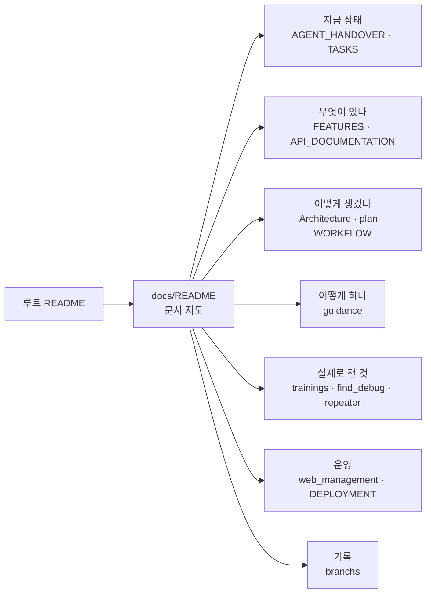

### 시스템 구조

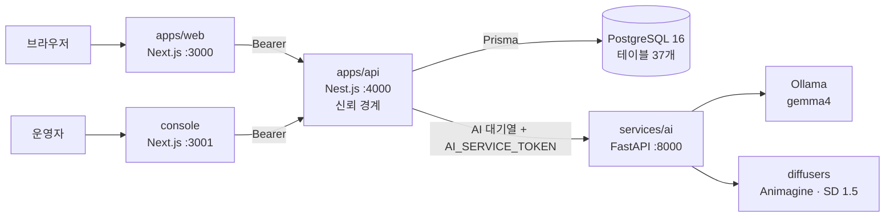

## 구조 그림 한눈에

그림은 모두 `scripts/readme-media/`로 다시 만든다(HTML → PNG, 서버 필요 없음). 값은 저장소에서 읽은 사실이다.

문서마다 맨 앞의 **로직 구조** 절에 텍스트 상자 그림과 mermaid 그림(흐름도·순서도·상태도·관계도)이 있다. mermaid 문법은 `node scripts/check-mermaid.mjs`로 확인한다(GitHub와 같은 mermaid 11로 파싱, 인터넷 필요). 2026-11-06 기준 161개 블록, 108개 문서.

| 그림 | 무엇을 보나 | 자세한 문서 |
|------|------------|-------------|
| [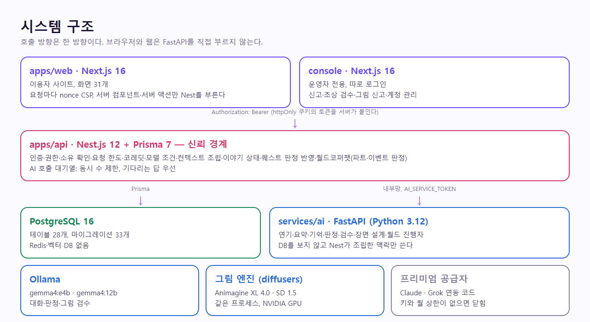](.assets/readme/architecture.png) | 앱 네 개와 호출 방향, 신뢰 경계 | [Architecture/overview.md](Architecture/overview.md) |
| [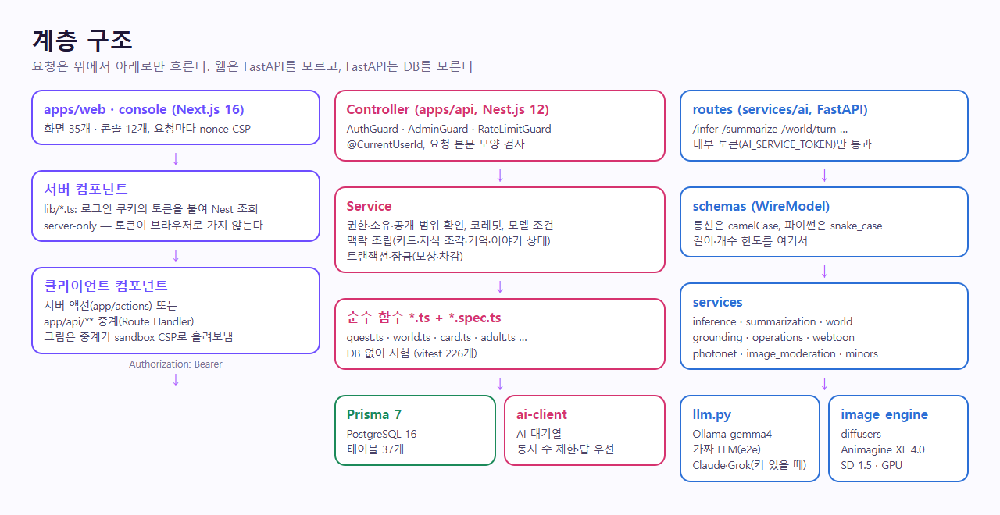](.assets/readme/layers.png) | Next → Nest(Controller·Service·순수 함수·Prisma) → FastAPI(routes·schemas·services·llm) | [Architecture/layers.md](Architecture/layers.md) |
| [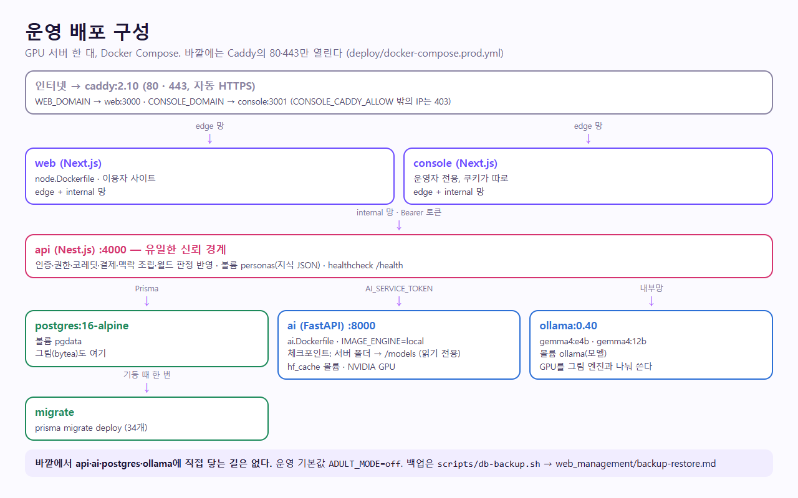](.assets/readme/deploy-topology.png) | 운영 컨테이너 8개, edge·internal 망, 볼륨 | [Architecture/docker-topology.md](Architecture/docker-topology.md) |
| [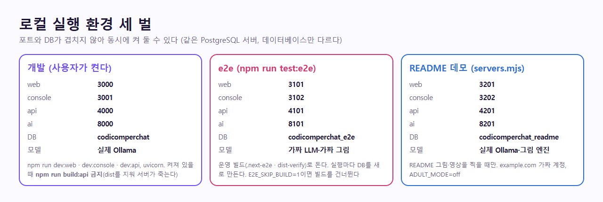](.assets/readme/dev-environments.png) | 개발·e2e·README 데모의 포트와 DB | [web_management/ports-inventory.md](web_management/ports-inventory.md) |
| [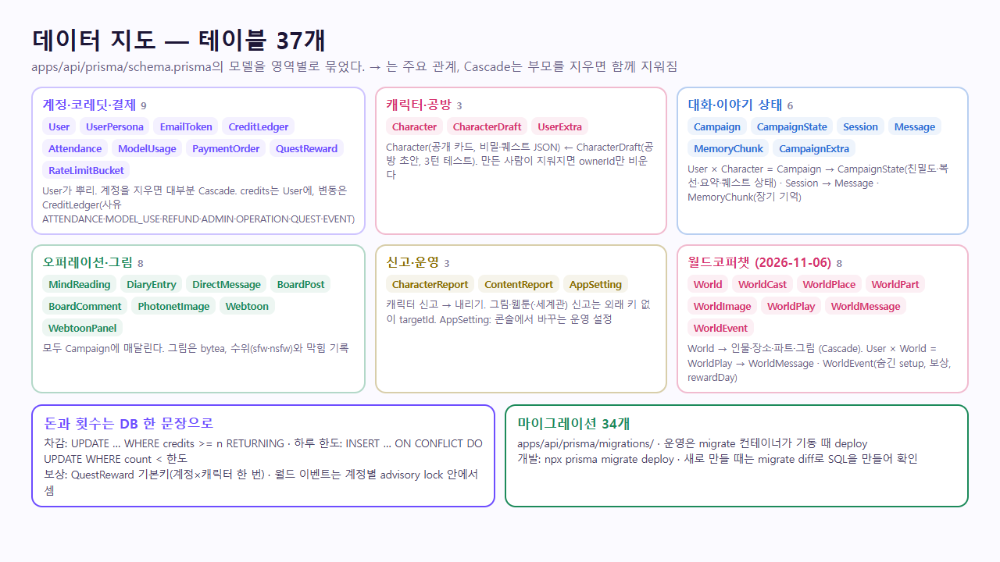](.assets/readme/data-map.png) | 테이블 37개를 영역별로 | [plan/DATABASE.md](plan/DATABASE.md) |
| [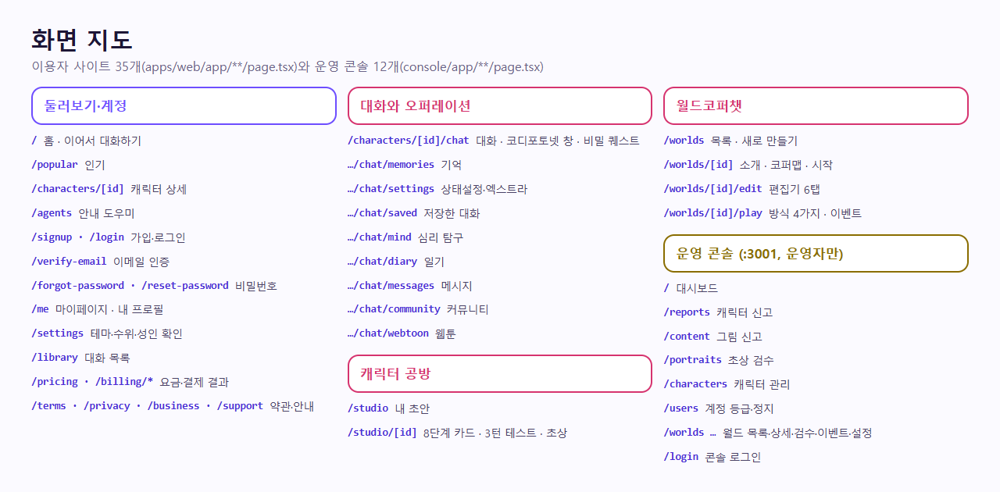](.assets/readme/screen-map.png) | 이용자 화면 35개, 콘솔 12개 | [Architecture/apps.md](Architecture/apps.md) |
| [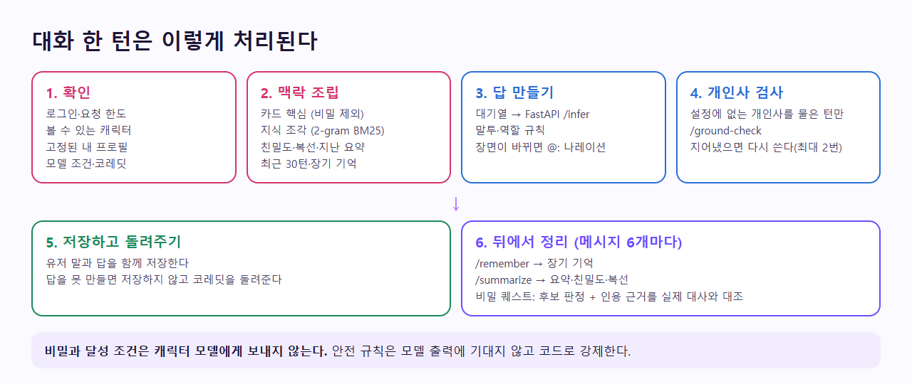](.assets/readme/chat-turn.png) | 1:1 대화 한 턴의 처리 순서 | [Architecture/data-flow.md](Architecture/data-flow.md) |
| [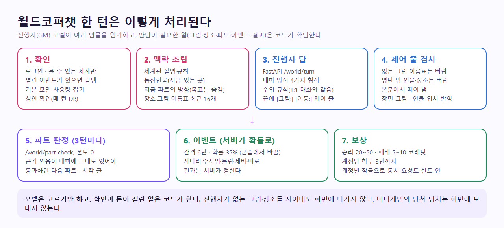](.assets/readme/world-flow.png) | 월드코퍼챗 한 턴의 처리 순서 | [plan/WORLD_COPPERCHAT.md](plan/WORLD_COPPERCHAT.md) |
| [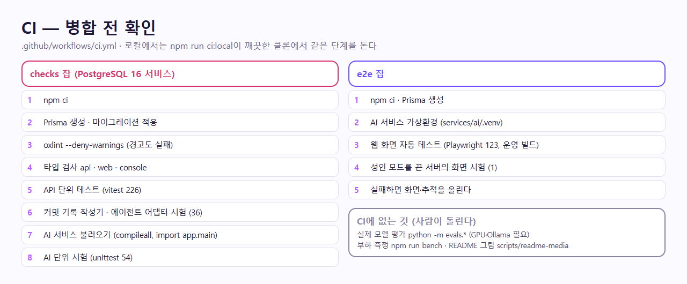](.assets/readme/ci-pipeline.png) | 병합 전 확인 단계 | [plan/TESTING.md](plan/TESTING.md) |
| [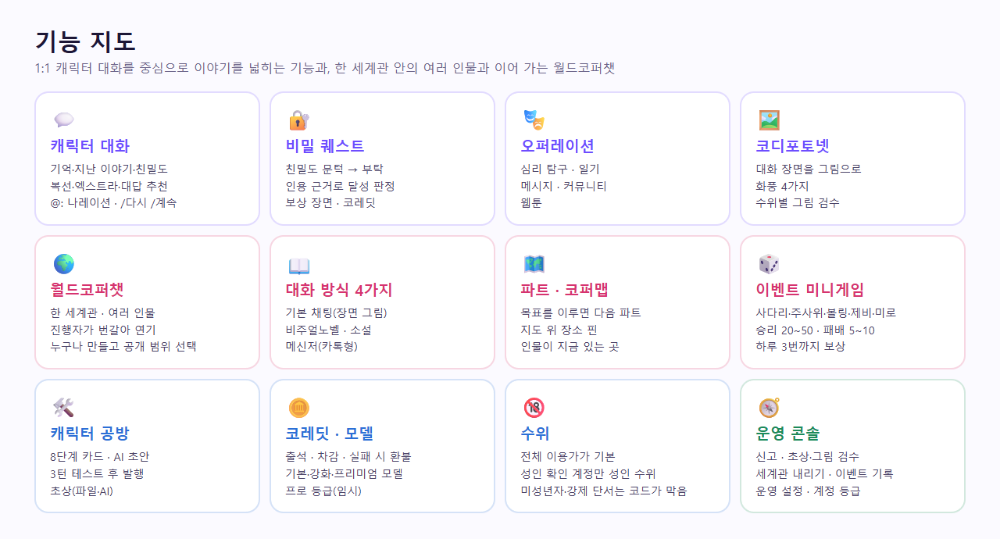](.assets/readme/features.png) | 기능 12칸 | [FEATURES.md](FEATURES.md) |
| [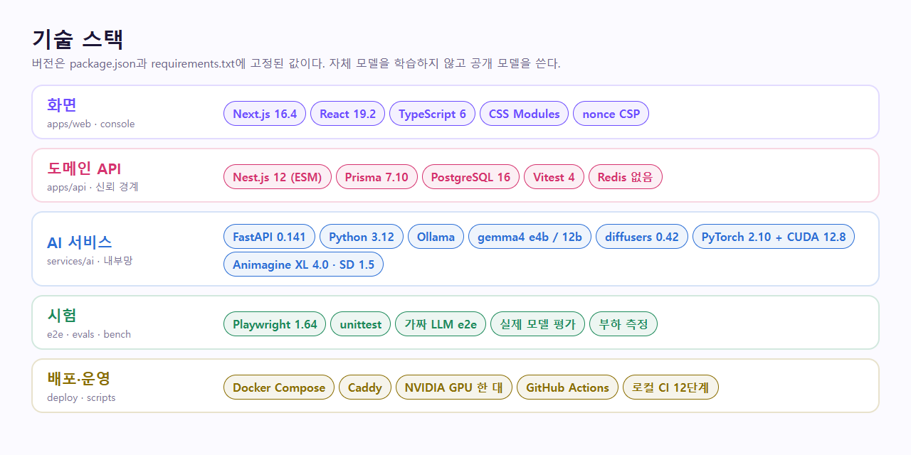](.assets/readme/stack.png) | 프레임워크와 버전 | [plan/CURRENT_STACK.md](plan/CURRENT_STACK.md) |

## 폴더 맵

```text
docs/
├── README.md                 ← 이 파일 (허브 인덱스)
├── AGENT_HANDOVER.md         ← 에이전트 인수인계 (현재 상태·작업 약속·함정)
├── TASKS.md                  ← 작업 지시서 (다음에 할 일, 선행 조건, 끝난 기준)
├── FEATURES.md               ← 전체 기능 카탈로그 (화면·API·코드·시험)
├── API_DOCUMENTATION.md      ← API 전체 (Nest·FastAPI 경로, 요청 한도, 보안 헤더, 메일, 결제)
├── DEPLOYMENT.md             ← 배포 짧은 진입 + 배포 때 꼭 할 것
├── WORKFLOW.md               ← AI 호출 파이프라인 요약 (대화 한 턴, AI 대기열)
├── plan/                     ← 기획·정책·스택 정본급
├── Architecture/             ← 시스템 구조 설명
├── branchs/                  ← 브랜치·커밋 기록 (필수)
├── guidance/                 ← "따라 하기" 실행 가이드
├── find_debug/               ← 날짜별 디버그 일지
├── trainings/                ← 실제로 돌려 본 결과와 판단 (모델 학습 기록이 아님)
├── .assets/readme/           ← 루트 README의 그림·영상 (scripts/readme-media가 만든다)
├── repeater/                 ← 인프라 장애·해결 지식
├── vaildates/                ← 검증 체크리스트 (철자 의도적 유지)
└── web_management/           ← 배포·포트·운영 기록
```

**한 줄로 구분하면:**

| 성격 | 폴더 |
|------|------|
| 무엇이 맞고 무엇이 정책인가 | `plan/`, `Architecture/` |
| Git을 어떻게 남기는가 | `branchs/`, `guidance/commit-message.md`·`branch-merge.md` |
| 어떻게 돌리는가 | `guidance/` |
| 깨졌을 때 / 검증 / 배포 | `find_debug/`, `repeater/`, `vaildates/`, `web_management/` |
| 실제로 재 본 것 | `trainings/` |

---

## 2026-11-06에 바뀐 것

| 바뀐 것 | 정본 |
|---------|------|
| **월드코퍼챗** 새 기능: 세계관·여러 인물·대화 방식 4가지·파트·코퍼맵·이벤트 미니게임 | [plan/WORLD_COPPERCHAT.md](plan/WORLD_COPPERCHAT.md) · [guidance/world-copperchat.md](guidance/world-copperchat.md) · [trainings/world-copperchat.md](trainings/world-copperchat.md) |
| 대화 수위(전체 이용가·성인, 미성년자·강제 단서는 코드가 막음) | [trainings/adult-chat.md](trainings/adult-chat.md) |
| 나레이션 7/12 → 48/48, 보상 장면 2/8 → 20/20 | [trainings/narration-and-reward.md](trainings/narration-and-reward.md) |
| 그림 폴더 `docs/assets/` → `docs/.assets/` | [.assets/README.md](.assets/README.md) |
| 에이전트 어댑터 7개(Gemini·Manus·Kimi·Ollama·OpenCode·Qwen·Windsurf)와 어긋남 시험 | [../.agents/README.md](../.agents/README.md) |
| 운영 콘솔 월드코퍼챗 메뉴 | [guidance/operations.md](guidance/operations.md) |

## 문서 정본 표

같은 값을 여러 문서에 적으면 어긋난다. 값은 아래 정본에 적고, 다른 문서는 링크로 가리킨다. 코드를 바꾸면 해당 정본을 같은 브랜치에서 고친다.

| 무엇 | 정본 |
|------|------|
| 작업 규칙 | [../.agents/skills/codicomperchat/SKILL.md](../.agents/skills/codicomperchat/SKILL.md) |
| 지금 상태, 사용자 결정, 함정 | [AGENT_HANDOVER.md](AGENT_HANDOVER.md) |
| 다음에 할 일 | [TASKS.md](TASKS.md) |
| 스택, 버전, 포트 | [plan/CURRENT_STACK.md](plan/CURRENT_STACK.md) |
| 구현된 기능과 한계 | [FEATURES.md](FEATURES.md) |
| 시험 수, 시험 방법 | [plan/TESTING.md](plan/TESTING.md) |
| 실측 결과와 판단 | [trainings/](trainings/README.md) |
| 테이블 | [plan/DATABASE.md](plan/DATABASE.md) |
| API 계약 | [API_DOCUMENTATION.md](API_DOCUMENTATION.md) |
| 환경변수 | [guidance/environment.md](guidance/environment.md) |
| 공개 전 보안·법률 체크 | [../SECURITY.md](../SECURITY.md) |
| 모델·라이선스 | [plan/AI_MODEL_STRATEGY.md](plan/AI_MODEL_STRATEGY.md), [../THIRD_PARTY_NOTICES.md](../THIRD_PARTY_NOTICES.md) |
| 배포 | [DEPLOYMENT.md](DEPLOYMENT.md), 지금 서버 [web_management/oracle-backend.md](web_management/oracle-backend.md), 과정 [web_management/deploy-log-2026-11-07.md](web_management/deploy-log-2026-11-07.md), [web_management/](web_management/) |

`branchs/commits/`, `find_debug/`, 날짜가 붙은 `trainings/` 결과 노트는 그때의 기록이라 지금 상태에 맞춰 고치지 않는다.

---

## 앱과 포트

| 앱 | 스택 | 위치 | 포트 (개발 / e2e) | 상태 |
|----|------|------|------|------|
| console | Next.js 16 (TSX) | `console/` | 3001 / 3102 | 동작 (운영자 전용 콘솔, 2026-10-21) |
| web | Next.js 16 (TSX) | `apps/web/` | 3000 / 3101 | 동작 (화면 35개, 엄격 CSP, 라이트·다크, 월드코퍼챗 4화면) |
| api | Nest.js 12 (TypeScript, ESM) + Prisma 7 | `apps/api/` | 4000 / 4101 | 동작 (계획서의 `/campaigns/*`만 501 — 대화는 `/characters/:id/chat*`) |
| ai | FastAPI (Python 3.12) | `services/ai/` | 8000 / 8101 | 동작 (`/train`만 403), 로컬 Ollama `gemma4:e4b` + 같은 프로세스의 그림 엔진(diffusers) |
| DB | PostgreSQL 16 | 설치형 | 5432 | 동작 (테이블 37개, 마이그레이션 34개) |
| 캐시/잡 | Redis | — | — | 쓰지 않음 |

정본: [plan/CURRENT_STACK.md](plan/CURRENT_STACK.md)

---

## 빠른 링크

- 기획 원본: [CodiComperChat_project_plan.md](../CodiComperChat_project_plan.md)
- **인수인계: [AGENT_HANDOVER.md](AGENT_HANDOVER.md)** · **할 일: [TASKS.md](TASKS.md)** · **전체 기능: [FEATURES.md](FEATURES.md)**
- 저장소 라이선스·보안·제3자 고지: [../LICENSE](../LICENSE) · [../SECURITY.md](../SECURITY.md) · [../THIRD_PARTY_NOTICES.md](../THIRD_PARTY_NOTICES.md)
- 기여 순서: [../CONTRIBUTING.md](../CONTRIBUTING.md) · 에이전트 규칙 정본: [.agents/skills/codicomperchat/SKILL.md](../.agents/skills/codicomperchat/SKILL.md)
- 현재 스택: [plan/CURRENT_STACK.md](plan/CURRENT_STACK.md)
- 소유자가 직접 할 일: [guidance/owner-checklist.md](guidance/owner-checklist.md)
- 처음 띄우기: [guidance/getting-started.md](guidance/getting-started.md) · 환경변수: [guidance/environment.md](guidance/environment.md)
- 운영자 할 일: [guidance/operations.md](guidance/operations.md)
- 오퍼레이션·코디포토넷·웹툰·수위: [plan/OPERATIONS.md](plan/OPERATIONS.md) · 그림 엔진: [guidance/photonet-engine.md](guidance/photonet-engine.md) · 비밀 퀘스트: [plan/SECRET_QUEST.md](plan/SECRET_QUEST.md) · 공식 캐릭터: [plan/CHARACTERS.md](plan/CHARACTERS.md)
- API 전체: [API_DOCUMENTATION.md](API_DOCUMENTATION.md) · DB: [plan/DATABASE.md](plan/DATABASE.md)
- 테스트·CI: [plan/TESTING.md](plan/TESTING.md) · 디자인: [plan/DESIGN.md](plan/DESIGN.md)
- 커밋 메시지: [guidance/commit-message.md](guidance/commit-message.md)
- 브랜치·병합: [guidance/branch-merge.md](guidance/branch-merge.md)
- 커밋 기록: [branchs/README.md](branchs/README.md)

---

## docs에서 하지 말 것

1. **`docs/commits/`에 커밋 기록** → 금지. 오직 `docs/branchs/commits/`만
2. 커밋 기록 생략 ("작다/나중에")
3. `Architecture/`를 안 고치고 구조만 코드로 바꾸기
4. `plan/CURRENT_STACK.md`와 다른 포트/스택 문구를 다른 문서에 방치
5. `vaildates` 폴더명 "교정"
6. `docs/trainings/`에 돌려 보지 않은 수치, 실제 학습 코드, 캐릭터 카드 원본 내용을 넣기
7. `find_debug/`에만 남기고 재발 가능한 인프라 이슈를 `repeater/`·`web_management/ports-inventory.md`로 안 옮기기
8. 루트 `CodiComperChat_project_plan.md`를 `docs/` 안으로 옮기거나 이름 변경 (§0 원본 보존 원칙)
