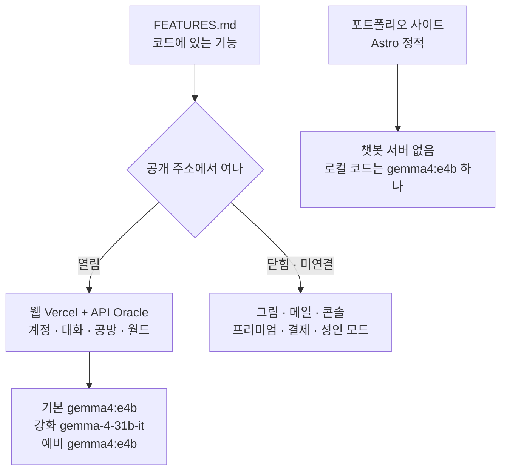

# 기능과 운영 현황

구현된 기능과, 지금 공개 주소에서 실제로 열리는 범위를 나눈다. 기준 2026-11-08 (마지막 배포: `main` `0fc2302`, 2026-11-08).

이 문서는 **추가**다. 기획 원본 `CodiComperChat_project_plan.md`와 기능 목록 [FEATURES.md](FEATURES.md)의 기존 줄을 여기 적힌 현황으로 바꾸지 않는다. 날짜가 붙은 실측·커밋 기록도 그때의 기록으로 둔다. 2026-11-08에 살아있는 안내의 현재 수(마이그레이션 36개, 대화 도구, 고객센터 문의)만 맞췄고, 원본 문장은 지우지 않았다.

| 묻는 것 | 정본 | 고치는 방법 |
|---------|------|-------------|
| 코드에 어떤 기능이 있나 | [FEATURES.md](FEATURES.md) | 기능을 넣거나 빼면 그 표에 **줄을 추가**하거나, 동작이 바뀐 줄만 고친다 |
| 지금 어느 주소에서 무엇이 켜져 있나 | 이 문서, 서버 값의 정본은 [web_management/oracle-backend.md](web_management/oracle-backend.md) | 배포가 바뀌면 이 표와 oracle-backend를 고친다. 기능 목록의 "구현"을 "운영 중"으로 덮어쓰지 않는다 |
| 스택·테이블 수·시험 수 | [plan/CURRENT_STACK.md](plan/CURRENT_STACK.md), [plan/DATABASE.md](plan/DATABASE.md), [plan/TESTING.md](plan/TESTING.md) | 숫자를 이 문서에 복제하지 않는다 |

<!-- logic-structure -->
## 로직 구조

```text
코드에 있음 (FEATURES)
        │
        ├─ 공개 웹 + Oracle API에서 열림 ──▶ 계정 · 대화 · 공방 · 월드 · 소개 페이지
        ├─ 코드는 있으나 운영에서 닫힘 ──▶ 그림 엔진 · 메일 · 콘솔 연결 · 프리미엄 · 결제 · 성인 모드
        └─ 제품 웹이 아님 ──▶ 포트폴리오 사이트 (정적 페이지만, 챗봇 서버 없음)
```

<!-- logic-mermaid -->

### 기능이 현황으로 나뉘는 곳



## 1. 지금 열려 있는 것

공개 전이다. 아래는 미리 올려 둔 주소에서 확인한 범위다.

| 무엇 | 어디 | 현황 |
|------|------|------|
| 이용자 웹 | Vercel `https://codicomperchat-web.vercel.app` | 홈·인기·캐릭터·대화·공방·월드·마이페이지·설정·요금·약관·`/project` 소개. `main` 배포 |
| API · DB · 대화 AI | Oracle `https://api.168-110-61-178.sslip.io` | caddy · api · postgres · ai · ollama. 대화는 NVIDIA 호스팅 `gemma-4-31b-it`, 막히면 CPU `gemma4:e4b` |
| 공식 세계관 | 웹 `/worlds` | 「코퍼 시티: 멈춘 시계탑」시드가 공개·발행됨 (2026-11-07) |
| 대화 수정 · 직접 적는 기억 · 때와 곳 | 대화 화면 | 코드는 마지막 대사만 점 세 개 메뉴로 고친다. 공개 웹은 `main`을 받으면 화면이 바뀌고, Oracle API는 아직 최근 12줄을 허용한다. 마이그레이션은 서버에 적용돼 있다. 로그인한 상태로 공개 주소에서 써 보는 확인은 하지 않았다 |
| 프로젝트 소개 | 웹 `/project` | 2026-11-07에 추가. `PORTFOLIO_URL`이 있으면 포트폴리오 사이트 버튼 |
| 포트폴리오 사이트 | Vercel `https://codicomperchat-portfolio.vercel.app` | Astro 정적 10페이지. 제품 웹이 아니다. 챗봇 Rails·Flask는 Oracle 서버에 얹었다(`https://portfolio-api.168-110-61-178.sslip.io`, 모델 `gemma4:e4b`, 제품과 Ollama 공유) |

## 2. 코드에는 있고 운영에서는 닫힌 것

[FEATURES.md](FEATURES.md)에서는 구현·일부·보류로 남아 있다. 공개 주소의 상태만 여기 적는다.

| 기능 | 코드 | 지금 운영 |
|------|------|-----------|
| 코디포토넷 · 웹툰 그림 · AI 초상 | 있음. GPU의 diffusers | Oracle에는 GPU가 없다. 그림 엔진은 안 올림 |
| 이메일 인증 · 비밀번호 찾기 | 있음 | SMTP가 비어 메일이 나가지 않음 |
| 운영 콘솔 | `console/` 화면 13개, Vercel 프로젝트 있음 | `API_BASE_URL`·허용 IP가 없어 API에 연결 안 됨 |
| 고객센터 문의 | `/support`에서 운영자에게 보내고 콘솔에서 답함 | 코드에만 있다. 공개 API는 이 표를 아직 모른다 |
| 1:1 답 웹소켓 | 토큰이 나오는 대로 말풍선을 채운다 | 코드에만 있다. 공개 API는 이 소켓을 아직 모른다. 모델이 빨라지지는 않는다 |
| 모델 고르기 (기본 `gemma4:e4b` · 강화 `gemma-4-31b-it` · 프리미엄) | 대화 화면에 있음 | 기본 대화는 로컬 e4b, 강화는 키가 있으면 클라우드 31B. 예비도 e4b. 강화 한도는 그대로. 서버에서 잘못된 키로 확인하지 않음 → [TASKS.md](TASKS.md) T06 |
| 프리미엄 (Claude · Grok) | 연동 코드 | 키 없음. 화면은 준비 중 |
| 실제 결제 | 토스 연동 코드 | 보류. 프로는 눌러서 바꾸는 임시 |
| 성인 모드 | 수위 분리 · 확인 · 그림 가드 | 운영 `ADULT_MODE=off`. 호스팅 백엔드에서 "로컬 모델만"은 코드로 막히지 않음 → T05 |
| 처리방침의 국외 이전 표 | 약관 초안 | NVIDIA · Vercel · Oracle이 표에 없음 → U11. 문구는 사용자가 고친다 |

## 3. 문서를 고칠 때

- **추가:** 새 화면·새 주소·새로 확인한 한계. FEATURES에 줄을 넣고, 운영에서 열리는지는 이 문서에 넣는다.
- **수정:** 적힌 문장이 지금 코드·서버와 다를 때 그 문장만. 기획 원본, 지난 실측, 커밋 기록은 수정 대상이 아니다.
- 같은 숫자를 여러 문서에 베끼지 않는다. 어긋난 옛 수(예: 테이블 28개)를 보면 [plan/DATABASE.md](plan/DATABASE.md)로 고친다.
