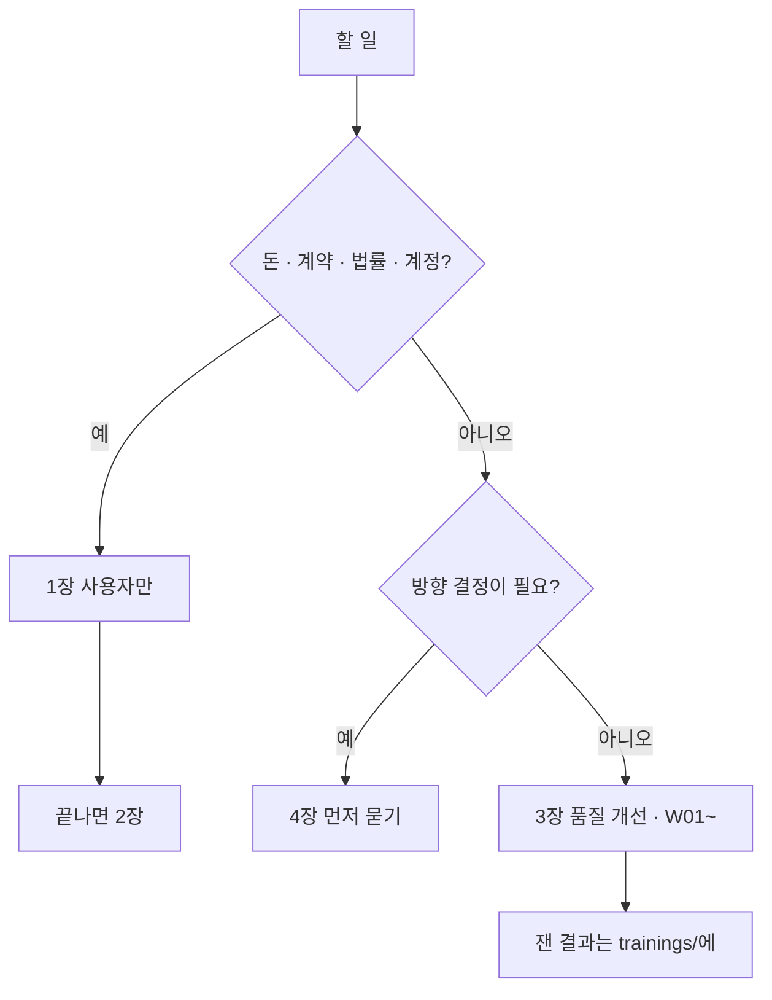

# 작업 지시서

다음에 할 일의 정본이다. 에이전트나 사람이 이 문서만 보고 일을 고르고 끝낼 수 있게 쓴다. 기준 시점 2026-11-07. 이날 Vercel(웹) + Oracle Cloud(API·DB·AI 대화)에 실제로 올렸다([web_management/deploy-log-2026-11-07.md](web_management/deploy-log-2026-11-07.md)).

규칙은 [SKILL.md](../.agents/skills/codicomperchat/SKILL.md), 지금 상태와 함정은 [AGENT_HANDOVER.md](AGENT_HANDOVER.md)에 있다. 일을 시작하기 전에 둘 다 읽는다.

<!-- logic-structure -->
## 로직 구조

```text
할 일이 생김
  │
  ├─ 사용자만 할 수 있나? (돈·계약·법률·계정) ──예──▶ 1장 (에이전트는 하는 법만 안내)
  │                                                     └─ 끝나면 2장이 풀린다
  ├─ 방향 결정이 필요한가? ──────────────────예──▶ 4장 (만들기 전에 묻는다)
  └─ 아니오 ─▶ 3장 품질 개선 · 월드 W01~ (기준을 낮춰 통과시키지 않는다)
                  │ 끝나면
                  ▼
             표에서 지우고, 잰 결과는 trainings/에 남긴다
```

<!-- logic-mermaid -->

### 할 일 나누기



## 쓰는 법

1. 위에서부터 **막히지 않은** 작업 하나를 고른다. 한 번에 하나씩 한다.
2. "선행"이 안 끝났으면 건너뛴다. 사용자 몫(`U`)은 대신 하지 않고 필요하다고 알린다.
3. "방향 확인"이 붙은 작업은 만들기 전에 사용자에게 방향을 묻는다.
4. 작업별 `feature/*` 브랜치에서 하고, 커밋마다 기록을 남긴다. 병합과 푸시는 사용자가 말할 때만 한다.
5. 끝나면 이 문서에서 그 줄을 지우고, 바뀐 기능·수치는 [문서 정본 표](README.md#문서-정본-표)대로 고친다.
6. "끝난 기준"을 실제로 돌려 본 결과를 보고한다. 못 돌린 것은 못 돌렸다고 적는다.

시작할 때 쓰는 문구:

```text
docs/AGENT_HANDOVER.md와 docs/TASKS.md를 읽고, 막히지 않은 첫 작업을 진행해.
시작 전에 고른 작업과 선행 조건 확인 결과를 알려 줘. 병합과 푸시는 내가 말할 때만 해.
```

## 1. 사용자만 할 수 있는 일

에이전트는 대신 하지 않는다. 막히면 어떤 일이 필요한지 알린다. 하는 법은 [guidance/owner-checklist.md](guidance/owner-checklist.md).

| ID | 할 일 | 막고 있는 것 |
|----|-------|--------------|
| U01 | 저장소 비공개 전환. 2026-11-06 확인에서 아직 공개 상태다 | T01, T02 |
| U02 | `gh auth login` | T02 |
| U03 | `LICENSE` 권리자 이름과 준거법을 어떻게 할지 결정, 라이선스 문안 법률 검토 | T01 |
| U04 | GPU 서버(Hetzner GEX45) 계약. 그림 엔진(코디포토넷·웹툰)은 GPU가 있어야 열린다. 지금 Oracle 서버는 GPU가 없다 | T03 |
| U05 | 운영 메일(SMTP) 서비스 선택. 지금 서버는 메일 설정이 비어 인증·재설정 메일이 안 간다. 도메인은 선택(지금은 `sslip.io`) | T03, T04 |
| U06 | 약관·처리방침의 `[운영자 기재]` 기입과 법률 검토 | 공개 |
| U07 | GitHub Actions와 README 화면이 원격에서 제대로 보이는지 한 번 보기 | 없음 |
| U08 | 운영 콘솔을 열 IP 결정(`CONSOLE_IP_ALLOWLIST`). Vercel `codicomperchat-console`은 있으나 API에 연결하지 않았다 | T04 |
| U09 | 프리미엄(Claude·Grok) 키와 월 한도. 각 콘솔에서 사용 한도를 먼저 걸고 서버 `.env`에 직접 넣는다(채팅에 붙이지 않는다) | 프리미엄 공개 |
| U10 | (권장) 2026-11-07 작업 대화에 개인키 내용과 `WEB_PROXY_TOKEN` 값이 한 번씩 드러났다. 새 키로 바꾸고 토큰을 서버·Vercel 함께 교체 | 없음 |
| U11 | **처리방침(`apps/web/app/privacy/page.tsx`)의 국외 이전 표를 지금 구성에 맞춘다.** 표에는 Anthropic·xAI만 있고, 실제로 이용자 내용이 가는 NVIDIA(대화·판정·그림 검수), Vercel(모든 웹 요청), Oracle(저장 데이터)이 없다. 법률 검토 때 함께 고친다. 에이전트는 처리방침 문구를 대신 쓰지 않는다 | 공개 |
| U12 | 호스팅 API(NVIDIA) 약관 확인: 입력 보관·학습 사용 여부, 무료 티어의 상업적 이용과 한도. Vercel 무료 요금제의 상업적 이용, Oracle 무료 한도 유지 조건 ([../THIRD_PARTY_NOTICES.md](../THIRD_PARTY_NOTICES.md) 1장·2-0장) | 공개 |

## 2. 사용자 일이 끝난 뒤

### T01. `LICENSE` 마무리

- **선행:** U03.
- **할 일:** 2.0판(2026-11-06)은 공개·비공개 어느 쪽에서도 맞게 썼다. 권리자 이름과 준거법 조항을 사용자가 정한 대로 넣고, 파일 끝의 관리자 메모를 정리한다. 법적 문서이므로 문안을 먼저 보여 주고 승인을 받는다.
- **끝난 기준:** 승인한 문안 반영, [../README.md](../README.md)와 [SECURITY.md](../SECURITY.md)의 관련 문구 일치.

### T02. GitHub 설정 확인

- **선행:** U01, U02.
- **할 일:** 브랜치 보호(`main`·`develop`)와 비밀 스캔이 지금 요금제의 비공개 저장소에서 되는지 읽어 본다. 설정을 바꾸는 것은 사용자 승인 뒤에 한다. 비공개 저장소의 Actions 무료 시간도 본다. e2e까지 도는 CI가 있다.
- **끝난 기준:** 되는 것·안 되는 것을 [SECURITY.md](../SECURITY.md) "공개 전 필수"와 [web_management/pre-deploy.md](web_management/pre-deploy.md)에 적는다.

### T04. Oracle 서버 마무리

- **선행:** 메일은 U05, 콘솔은 U08. 나머지는 없음.
- **할 일:** 공식 캐릭터 지식 파일(`apps/api/data/personas/유지성.json`, `이세연.json`)을 서버 볼륨 `personas`로 옮긴다. `scripts/db-backup.sh`를 서버 cron에 건다(하루 한 번, 14일). U05가 끝나면 `MAIL_SMTP_URL`·`MAIL_FROM`·`WEB_BASE_URL`을 서버 `.env`에 넣고 api를 다시 띄운다. U08이 끝나면 콘솔 Vercel 환경변수(`API_BASE_URL`, `CONSOLE_IP_ALLOWLIST`)를 넣고 다시 배포한다. 다시 띄울 때 compose 파일 두 개를 함께 준다.
- **끝난 기준:** 로그인한 상태의 대화 한 턴이 운영에서 돈다(시험 계정), 인증 메일 도착, 백업 파일 생김, 콘솔 로그인. 결과를 [web_management/oracle-backend.md](web_management/oracle-backend.md)에 적는다.

### T05. 호스팅 API 서버에서 성인 모드를 막는 코드 장치

- **선행:** 없음. 방향 확인: 막는 방식(시작 거부 vs 호출 거부)을 만들기 전에 사용자에게 묻는다.
- **왜:** `LLM_BACKEND=openai`이면 프리미엄이 아닌 모든 호출이 호스팅 API로 간다. 그런데 "성인 대화는 로컬 모델에서만"이라는 약속은 코드로 지켜지지 않는다. 지금은 운영 compose 기본값 `ADULT_MODE=off`에만 기대고 있다([../services/ai/README.md](../services/ai/README.md), [../SECURITY.md](../SECURITY.md)).
- **할 일:** `apps/api/src/security/production.ts`에 `NODE_ENV=production`이고 `ADULT_MODE`가 켜졌는데 AI 쪽이 `openai`이면 시작하지 않는 검사를 더하거나, 성인 수위 호출을 `provider=ollama` 로컬로만 보내게 한다. Nest는 AI의 `LLM_BACKEND`를 모르므로 어느 쪽에서 막을지가 설계 결정이다.
- **끝난 기준:** 그 조합에서 시작이 거부되거나 성인 호출이 호스팅 API로 가지 않는 단위 시험, 문서 갱신.

### T03. GPU 서버 설치와 확인

- **선행:** U04, U05.
- **할 일:** [web_management/docker-deploy.md](web_management/docker-deploy.md) 순서대로 진행한다. Oracle 서버에서 배운 것(CRLF, sslip.io, 프록시 토큰)은 [web_management/deploy-log-2026-11-07.md](web_management/deploy-log-2026-11-07.md)에 있다. 배포 키, `deploy/server-setup.sh`, 운영 모드의 `PRO_CLICK`은 **실서버에서 돌려 본 적이 없다.** 페르소나 지식 파일(`apps/api/data/personas/유지성.json`, `이세연.json`)은 git에 없으니 서버 볼륨으로 옮긴다.
- **끝난 기준:** [web_management/post-deploy.md](web_management/post-deploy.md) 전체 확인, 재부팅 복귀, 백업 복구 연습. 서버 GPU에서 `evals.image_speed`를 재서 [guidance/photonet-engine.md](guidance/photonet-engine.md)에 적는다.

## 3. 결정 없이 할 수 있는 품질 개선

모두 실제 모델로 잰 수치가 기준에 못 미친 항목이다. 기준을 낮춰 통과시키지 않는다.

| ID | 할 일 | 지금 | 끝난 기준 |
|----|-------|------|-----------|
| ~~Q01~~ | **끝남(2026-11-06).** 판정 쪽이 갈래 번호를 고르고 그 장면만 넘긴다. 20/20, 갈래 고르기 6/6. [trainings/narration-and-reward.md](trainings/narration-and-reward.md) — 이세연 보상 장면. 모델이 사직서 장면을 쓰지 않고 혼인 갈래도 흔들린다. 판정이 어느 갈래로 달성했는지 알려 주게 하면 해당 장면만 넘길 수 있다 | 2026-11-06 2/8 (혼인 2/4, 충돌 0/4), 2026-11-04 4/8 | `python -m evals.quest_reward --repeat 8` 75% 이상 |
| ~~Q02~~ | **끝남(2026-11-06).** 괄호 장면 지시가 있는 턴에만 맨 끝에 형식 지시를 붙였다. 48/48. [trainings/narration-and-reward.md](trainings/narration-and-reward.md) — 나레이션 `@:`. 장면이 바뀌어도 첫 줄에 안 쓰는 경우가 있고, 평범한 대화에 쓴 경우도 1건 있다 | 2026-11-06 7/12 (기준 80%) | `python -m evals.run --suite narration` 기준 통과 |
| Q03 | 유지성 퀘스트 판정이 "끝까지 풀기" 장면을 놓칠 때가 있다. 잘못 통과는 0건이다 | 2026-11-06 15/16 | `python -m evals.quest_yujiseong` 전부 맞음, 잘못 통과 0 |
| Q04 | 웹툰 컷 사이 옷 색. 같은 시드로 머리와 얼굴은 비슷해졌지만 앞치마 색이 컷마다 다르다. 외모 태그에 옷 색을 넣는 방법을 본다 | 눈으로 비교함 | 같은 콘티의 컷을 눈으로 비교한 결과를 [plan/OPERATIONS.md](plan/OPERATIONS.md)에 적음 |
| Q06 | 성인 모드 그림 가드가 애니메이션 그림을 잘못 막는 경우. 공개 서버는 성인 모드를 끄므로 켜기 전에 본다 | 2번 중 1번 잘못 막음(표본 작음) | `python -m evals.photonet_guard`를 여러 번 돌려 잘못 막는 비율을 재고 줄인다 |
| Q07 | 좁은 화면(390px) 대화의 모델 고르기 칸이 눌려 글자가 안 보이고, 공방 AI 초상 칸이 좁다. README 화면을 찍다 발견했다 | 고치지 않음 | 좁은 화면 스크린샷으로 확인, e2e 통과 |
| Q08 | **호스팅 31B 모델(NVIDIA `gemma-4-31b-it`)로 평가를 다시 돌린다.** 운영 대화가 이 모델로 나가는데 평가 11묶음과 프롬프트·판정은 `gemma4:e4b`로 맞췄다. 말투, 퀘스트 판정(잘못 통과 0), 개인사 환각, 월드 형식이 같은 기준을 넘는지 모른다 | 안 잼 | `LLM_BACKEND=openai`로 `python -m evals.run --repeat 2 -v`와 퀘스트 평가 2종, 결과를 [trainings/oracle-deploy-latency.md](trainings/oracle-deploy-latency.md)에 적음. 미달이면 기준을 낮추지 않고 항목으로 남김 |
| Q05 | SDXL 속도를 메모리가 넉넉한 상태에서 다시 잰다. 개발 PC는 남은 RAM이 약 400MB라 같은 작업이 29초에서 수 분까지 흔들렸다 | 원인 일부만 확인 | `evals.image_speed` 결과가 두 번 비슷하게 나옴 |

### 월드코퍼챗 (2026-11-06)

| ID | 할 일 | 지금 | 끝난 기준 |
|----|-------|------|-----------|
| W01 | 인물의 장소 이동. 진행자가 `[이동:]` 줄을 거의 쓰지 않는다 | `evals.world_turn` 0/24 | 이동 지시를 구체화하거나 유저가 위치를 고르는 버튼. 평가에 이동 사례를 넣고 기준을 정한다 |
| W02 | 긴 플레이의 앞일 요약. 최근 16개 메시지와 마친 파트 기록만 넘긴다 | 없음 | 1:1 대화의 `/summarize`처럼 정리. 30턴 플레이로 앞일을 기억하는지 확인 |
| W03 | 세계관 신고 화면 (`ContentTarget.WORLD`는 있다) | 운영자가 직접 내림 | 상세 화면 신고 → 콘솔 처리, e2e |
| W04 | 파트 판정 실측 (실제 모델) | 단위 시험과 가짜 판정만 | 퀘스트 판정 평가처럼 장면 묶음으로 잘못 통과 0 |
| W05 | 메신저형 줄바꿈 흔들림 | 형식 5/6 | `evals.world_turn` 메신저 6/6 이상을 두 번 |

## 4. 방향 확인이 필요한 일

만들기 전에 사용자에게 묻는다.

| ID | 할 일 | 물어볼 것 | 추천 |
|----|-------|-----------|------|
| D01 | 스트리밍 응답 | 개인사 가드가 답 전체를 본 뒤 다시 쓰는 구조와 어떻게 맞출지. 먼저 보여 주고 나중에 바꾸면 지어낸 내용이 잠깐 보인다 | 공개 뒤에 이용자 반응을 보고 정한다 |
| D02 | 캐릭터당 퀘스트 여러 개, 여러 번의 정리에 걸친 달성 | 코레딧 보상 규칙. 보상이 실제 지출과 이어진다 | 지금 공식 캐릭터는 하나씩이라 급하지 않다 |
| D03 | 프리미엄 키 연결과 실제 호출 | 언제, 어느 공급자부터, 월 한도(`PREMIUM_MONTHLY_CREDITS`) 값. 돈이 나간다 | 클릭 프로를 닫을지 함께 정한다 |
| D04 | 성인 모드 공개 | 법률 검토 뒤에 정한다. Hetzner 약관이 음란물을 금지한다 | 공개 서버에서는 끈 채로 둔다 |
| D05 | 정식 서비스 전환: `PRO_CLICK=off`, 토스 결제, 프로 안내 문구, 가격 | 시기와 가격 | |
| D06 | `main` 병합 방식. 규칙은 `release/*` 검증 후 병합이지만 지금까지 `develop`을 직접 병합했다 | 앞으로 어느 쪽으로 할지 | 혼자 운영하는 동안은 직접 병합 |
