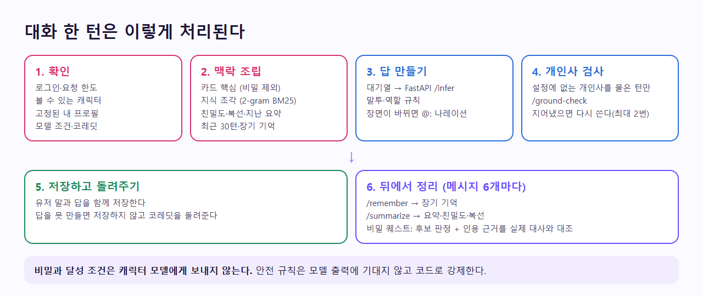
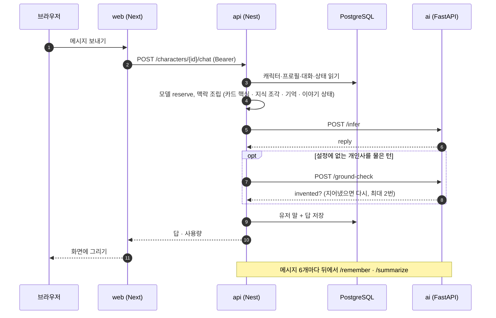
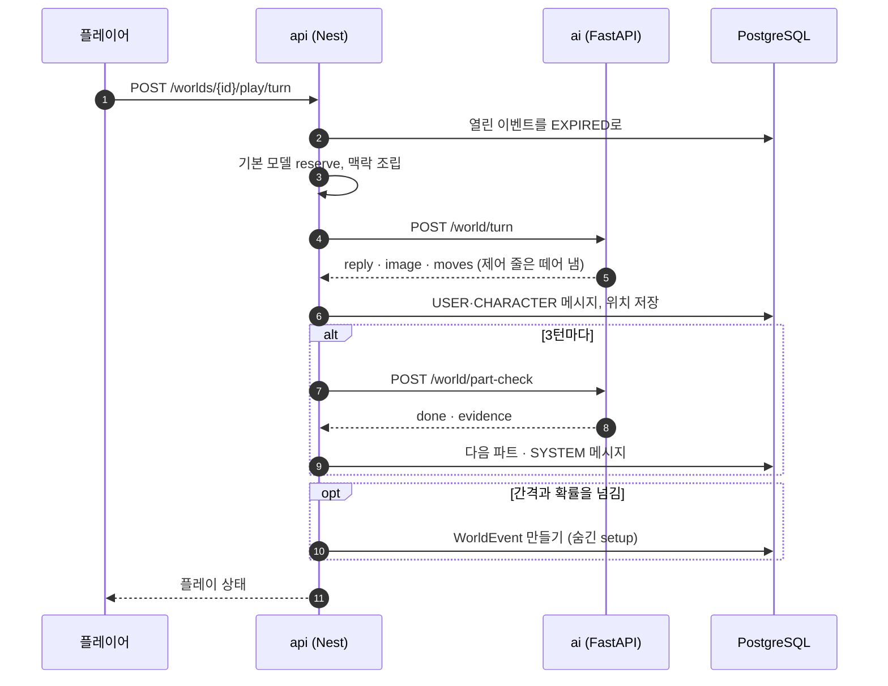
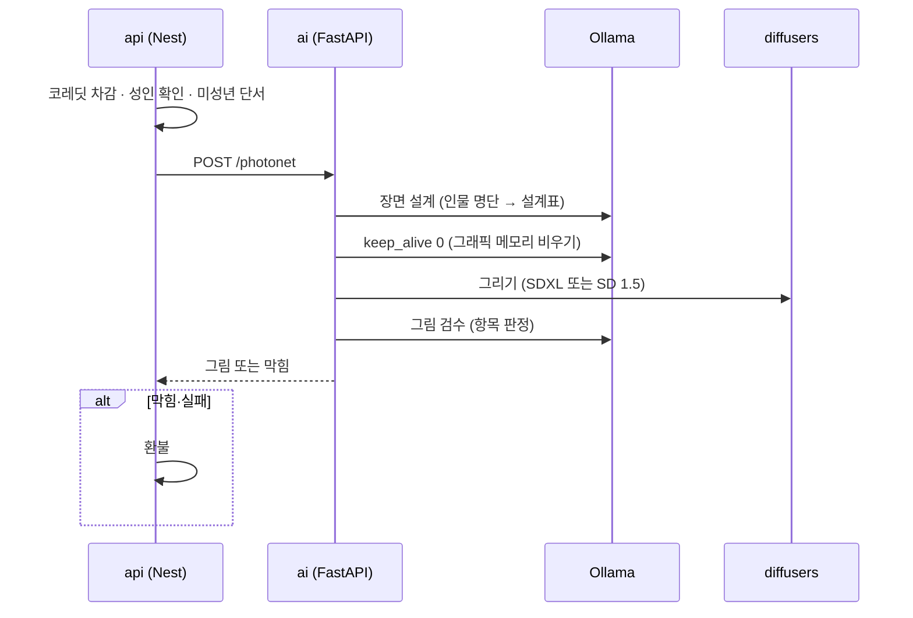
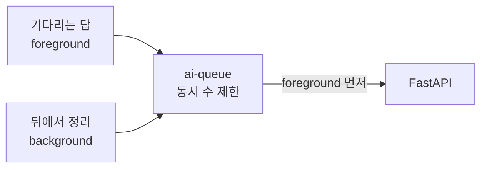
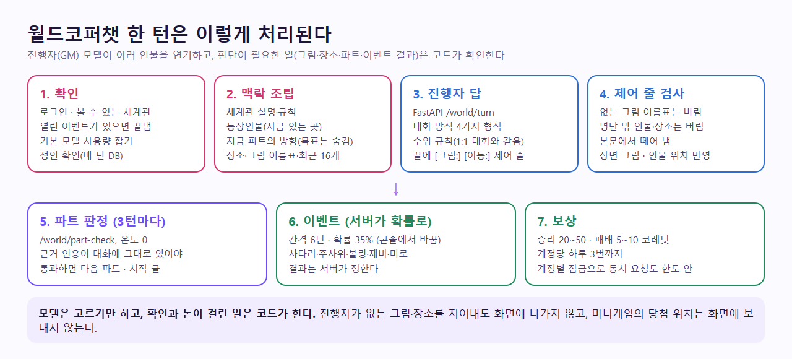

# AI 호출 파이프라인 (요약)

정본: `CodiComperChat_project_plan.md` §7.6. 최종 갱신 2026-11-08 — 실제 동작. 상태(State) 관점의 자세한 순서는 [Architecture/data-flow.md](Architecture/data-flow.md). 최근 12줄 수정·방향 다시 쓰기는 이 한 턴과 별도 경로이고, 직접 적은 기억은 3번의 맥락에 항상 들어간다.



<!-- logic-structure -->
## 로직 구조

```text
POST /characters/:id/chat {message, personaId, model?}
  │
  ├─ 1. 확인: 로그인 · 볼 수 있는 캐릭터 · 고정된 내 프로필 · 요청 한도
  ├─ 2. 모델: 고른 것 > 대화에 저장된 것 > 기본 → reserve (하루 한도 또는 코레딧)
  ├─ 3. 맥락: 카드 핵심(비밀 제외) + 지식 조각(BM25) + 기억(직접 적은 것은 매 턴) + 친밀도·복선·요약
  │          + 엑스트라 + 퀘스트 지시(sceneNote) + 때·곳 + 성인 여부(매 턴 DB)
  ├─ 4. FastAPI /infer ──▶ 규칙 → 수위 → 나레이션 지시 → 보상 장면 (뒤로 갈수록 강하다)
  ├─ 5. 개인사를 물은 턴만 /ground-check → 지어냈으면 다시 (최대 2번)
  ├─ 6. 저장 (유저 말 + 답). 실패하면 저장 안 하고 reserve를 돌려준다
  └─ 7. 메시지 6개마다 뒤에서: /remember(기억) · /summarize(요약·친밀도·복선·퀘스트 판정)

그림 한 장: 장면 설계(LLM, keep_alive 0) → 미성년 단서 검사 → SDXL/SD1.5 → 그림 검수 → 저장
월드 한 턴: /world/turn → 제어 줄 검사 → 저장 → 3턴마다 /world/part-check → 확률로 이벤트
AI 대기열: 기다리는 답(foreground) 먼저, 뒤에서 하는 정리(background)는 양보
```

<!-- logic-mermaid -->

### 1:1 대화 한 턴



### 월드 한 턴



### 그림 한 장



### AI 대기열



## 한 번의 유저 메시지 처리

```text
Next.js (서버 액션)
  → Nest POST /characters/:id/chat { message, personaId }
      → 로그인·요청 한도·볼 수 있는 캐릭터·고정된 내 프로필 확인
      → 컨텍스트 슬라이스 조립 (character-chat.context.ts)
          ├ 캐릭터 카드 핵심 (페르소나 지식 JSON의 core, 없으면 카드 원문) — 비밀 제외
          ├ 활성 로어 (지식 JSON에서 이번 말·직전 대화로 검색한 조각만)
          ├ 대화 상태 (친밀도·호칭·열린 복선·끝난 일, 오래되면 지난 이야기 요약)
          ├ 최근 메시지 30턴 (DB 기록)
          ├ 장기 기억 (memory_chunks에서 관련된 것)
          └ 엑스트라 (등장 조건이 맞을 때만)
      → AI 대기열 (기다리는 답 우선) → FastAPI POST /infer → 답 한 번에
      → 개인사를 물은 턴이면 FastAPI POST /ground-check → 지어냈으면 다시 쓰기(최대 2번)
      → 유저 말 + 답 저장 → 답 돌려줌
      (컨텍스트에는 비밀 퀘스트 지시도 붙는다: 친밀도가 문턱을 넘으면 "부탁을 꺼낼 때", 건넨 뒤엔 "되풀이하지 않기", 달성 직후엔 보상 장면 — 달성 조건은 절대 넣지 않는다. 보상 장면은 놓치지 않게 프롬프트 맨 끝 `sceneNote`로 보낸다)
      (답에서 장면이 바뀌면 모델이 첫 줄을 `@: ` 나레이션으로 쓴다 — 웹이 그림 상자로 그린다)
  → (뒤에서, 메시지 6개마다) 대기열의 배경 몫으로
      FastAPI POST /remember  → memory_chunks
      FastAPI POST /summarize → Nest가 campaign_states에 델타 머지
          └ 비밀 퀘스트가 열려 있으면 같은 호출에서 "건넸나·해냈나" 후보를 받고, 전용 판정(인용 근거를 실제 대사와 대조, 확신 85 이상)을 한 번 더 통과해야 반영한다
```

그 밖의 AI 호출: 대답 추천 `/suggest-replies`, 공방 칸 초안 `/draft-field`, 공방 퀘스트 한 번에 제작 `/draft-quest`, 공방 3턴 판정 `/critique-test`, 초상 검수 `/moderate-image`, 에이전트 `/assist`, 오퍼레이션 `/mind` `/diary` `/board-posts` `/board-comments`, 코디포토넷 `/photonet`(+`/photonet/status`), 웹툰 `/webtoon/plan` `/webtoon/panel`. 모두 Nest가 대기열을 거쳐 부른다.

## 그림 한 장 (코디포토넷·웹툰)

```text
Nest: 로그인·요청 한도·성인 확인(성인 모드면 DB로 매번)·엔진 준비 확인(꺼져 있으면 503, 코레딧 안 뺌)
  → 코레딧 차감 (한 장 50, 웹툰 한 컷 45 — 실패하면 환불)
  → FastAPI POST /photonet (또는 /webtoon/panel)
      성인 모드: 미성년자 관련 설정이 있으면 그리기 전에 400
      ① 로컬 LLM이 장면 설계표를 쓴다 (등장인물 명단·줄거리·대화·고른 대사 → 사람·외모·표정·행동·장소). 답하자마자 Ollama에서 내린다(keep_alive 0)
      ② 코드가 프롬프트를 조립한다 (인물 수 태그, 인물마다 성인 태그, BREAK, 수위 태그, 화풍·품질 태그)
      ③ 그림 엔진이 그린다 — IMAGE_ENGINE=local: 같은 프로세스에서 diffusers / webui: 외부 WebUI API
      ④ WebP로 줄인다 → 그림 검수(gemma가 그림을 읽는다, 수위별 규칙, 끝나면 다시 내린다) → 걸리면 422(환불)
  → Nest가 DB에 저장 (photonet_images / webtoon_panels)
```

웹툰은 콘티(무료)를 먼저 짠다: 외모를 한 번 정한 뒤(`_looks`) 컷마다 구도·행동·해설·대사를 쓰고, 컷은 하나씩 따로 요청해 그린다. 한 편의 컷은 웹툰 id에서 만든 같은 시드로 그린다. 자세한 것: [guidance/photonet-engine.md](guidance/photonet-engine.md), [plan/OPERATIONS.md](plan/OPERATIONS.md).

## 월드코퍼챗 한 턴 (2026-11-06)



1. `POST /worlds/:id/play/turn` → 볼 수 있는 세계관인지, 플레이가 있는지 확인. 열린 이벤트는 끝낸다(EXPIRED).
2. 기본 모델 사용량을 잡는다(`ModelsService.reserve`). 실패하면 돌려준다.
3. 세계관·인물(지금 있는 곳)·장소·그림 이름표·최근 16개·지난 이야기·지금 파트·주인공·성인 여부·이벤트 결과를 모아 `/world/turn`.
4. 답 끝의 제어 줄을 떼고, 있는 이름표면 그림을 붙이고, 명단 안 인물·장소면 위치를 바꾼다.
5. 유저 말과 답을 저장. 3턴마다 `/world/part-check` → 통과하면 다음 파트 메시지들.
6. 확률에 걸리면 이벤트를 만든다. 상태 전체를 돌려준다.

자세히: [plan/WORLD_COPPERCHAT.md](plan/WORLD_COPPERCHAT.md).

## 원칙

- 숨은 디렉터를 매 턴 풀 생성으로 돌리지 않는다 — 본 생성은 캐릭터 한 번, 판정은 필요한 턴에만 짧게
- 판정·요약은 같은 입력에 같은 결과가 나오게 모델의 seed를 고정한다
- 학습(`/train`)은 v1에서 막아 둔다(403)
- **스트리밍은 아직 아니다**(계획서 §5.3 "스트리밍 출력"). 답이 다 오면 한 번에 보인다 — 개인사 검사가 답 전체를 본 뒤 다시 쓰게 하는 구조와 맞추려면 설계가 더 필요하다

## AI 호출 대기열 (`apps/api/src/ai/ai-queue.ts`)

| 항목 | 값 |
|------|-----|
| 동시 호출 | `AI_CONCURRENCY`(기본 2, API 서버 한 대 기준) |
| 순서 | 기다리는 답(foreground) 먼저. 배경(기억·요약)은 한 자리를 늘 남겨 두고 쓴다 |
| 오래 기다리면 | 기다리는 답 60초 → 503 "지금 대화가 많아요", 배경 대기열 20개 초과 → 다음 기회로 |
| 응답 제한 시간 | 기다리는 답 130초, 배경 150초 → 504 |
| 상태 | `GET /health`의 `ai` (`inFlight`, `waitingForeground`, `waitingBackground`, `concurrency`) |

## 컨텍스트 예산 (계획서 §13.3)

| 조각 | 우선순위 | 지금 |
|------|----------|------|
| 시스템 + 카드 핵심 | 고정 | 성격 축, 말투, 금지 말투. 비밀은 넣지 않는다 |
| 캠페인 상태 | 짧고 구조화 | 친밀도 숫자 + 근거 한 줄 + 열린 복선 목록 |
| 활성 로어 | 매칭된 것만 | 지식 조각 상위 3개(700자 이내) |
| 최근 턴 | 우선 | 30턴 |
| 장기 기억 검색 | K개 | 관련 기억 몇 줄 |
| 디렉터 노트 | 2~4문장 | 지식의 core가 이 자리 |

관련: [API_DOCUMENTATION.md](API_DOCUMENTATION.md), [plan/AI_MODEL_STRATEGY.md](plan/AI_MODEL_STRATEGY.md), [plan/TESTING.md](plan/TESTING.md)
