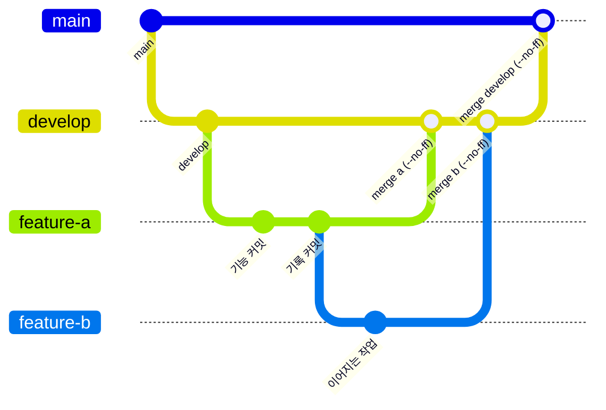

# 브랜치 맵

정본 규칙: `.agents/skills/codicomperchat/SKILL.md` §5, 상세: [../guidance/branch-merge.md](../guidance/branch-merge.md)

```text
main          ← 배포 통합만
└── develop   ← 개발 통합만
      ├── feature/*         # 신규 기능
      ├── bugfix/*          # 버그 수정
      └── experimental/*    # 검증 안 된 실험
```

- 작업·커밋은 `feature/*` 등에서만
- `develop`/`main` 병합은 항상 `git merge --no-ff`
- feature 완료 시 `develop`에 `--no-ff`로 합류, 배포는 `release/*` 검증 후 `main`

로직 단계(§10)를 feature 브랜치로 쪼개는 제안은 [../plan/LOGIC_AND_GIT_BRANCH_STRATEGY.md](../plan/LOGIC_AND_GIT_BRANCH_STRATEGY.md) 참고.

<!-- logic-structure -->
## 로직 구조

```text
feature/* ──┐
bugfix/* ───┼──(--no-ff)──▶ develop ──(--no-ff, 사용자가 말할 때)──▶ main
experimental/*┘
```

<!-- logic-mermaid -->

### 브랜치 맵



## 현재 상태 (2026-11-07)

- 원격: `origin` (GitHub). `develop`이 개발 통합, `main`은 사용자가 지시할 때 `develop`을 병합한다(마지막: 2026-11-07). `release/*`는 아직 쓴 적이 없다
- **Vercel 웹은 `main`에서 배포한다.** `main`에 올라간 것은 웹에 나갈 수 있다는 뜻이다. Oracle 서버는 이 PC의 `main`을 `git archive`로 보낸다([../web_management/oracle-backend.md](../web_management/oracle-backend.md))
- 다른 도구·세션이 `claude/*` 브랜치를 원격에 만들 수 있다(2026-11-07에 `claude/project-thread-pz0x5f`, `claude/project-thread-po3i10`을 병합). 병합 전에 `git branch -a --no-merged main`으로 남은 것을 본다
- 작업은 기능별 `feature/*`·고침은 `fix/*`에서 하고, 사용자가 말하면 쌓인 순서대로 `develop`에 `--no-ff`로 병합한다. 푸시는 요청받았을 때만 한다. 지금 쌓인 브랜치: [../TASKS.md](../TASKS.md) T03
- 커밋마다 `commits/`에 기록 md, 병합마다 병합 기록 md, 목록은 [README.md](README.md)
- 푸시하면 GitHub Actions CI가 돈다(`.github/workflows/ci.yml`). 같은 단계를 내 PC에서: `npm run ci:local`
