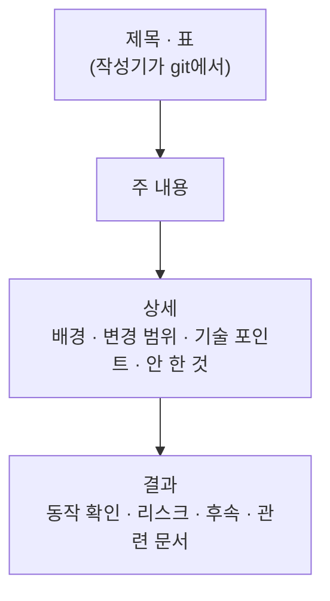

<!--
커밋 기록 md 템플릿. 정본: .agents/skills/codicomperchat/SKILL.md §4
파일명 형식: YYMMDD_HHMM_[커밋ID]_[커밋이름]_[커밋브랜치].md
예: 260915_1420_a1b2c3d_campaign-state-api_feature-api.md
- YYMMDD: 연2+월+일, 구분자 없음
- HHMM: 시분 한 덩어리 (중간에 _ 넣지 않음)
- 커밋이름: kebab-case, 공백/`/` 금지
- 브랜치의 `/`는 `-`로 치환 (feature/api -> feature-api)
- 시각은 `git log -1 --format=%ci` 기준
이 주석 블록은 실제 기록 파일을 만들 때 지운다.
-->

# [커밋 요약 한 줄]

| 항목 | 내용 |
|------|------|
| Subject | `type(scope): 한국어 요약` |
| Full SHA | `` |
| Short SHA | `` |
| Branch | `` |
| Parent | `` |
| Date | `` (git log -1 --format=%ci) |

<!-- logic-structure -->
## 로직 구조

```text
제목 · 표(커밋·브랜치·날짜)  ← 작성기가 git에서 읽는다
## 주 내용 → ## 상세(배경·변경 범위·기술 포인트·안 한 것) → ## 결과(동작 확인·리스크·후속·관련 문서)
                         ← --notes 파일에 이 부분을 쓴다
```

<!-- logic-mermaid -->

### 기록 파일의 구성



## 주 내용

- (3~7개 bullet, 무엇을 바꿨는지)
-
-

## 상세

**배경**
(왜 이 작업이 필요했는지. 관련 기획 문서/이슈가 있으면 링크)

**변경 범위**
(건드린 앱/모듈: apps/web, apps/api, services/ai, prisma 등)

**기술 포인트**
(설계상 의사결정, 트레이드오프)

**안 한 것**
(의도적으로 범위에서 뺀 것 — 계획서 v1 범위와 충돌하지 않는지 확인)

## 결과

**동작 확인**
(로컬 실행/테스트 결과)

**리스크**
(남아있는 위험, 후속 확인 필요 사항)

**후속**
(다음에 할 일)

**관련 문서**
(연결되는 docs/plan, docs/Architecture 등 링크)
