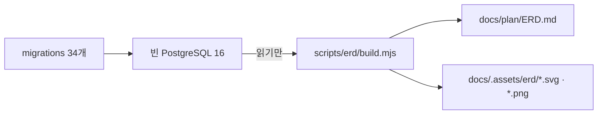

# 실제 DB에서 뽑은 ERD와 생성기를 추가한다

| 항목 | 내용 |
|------|------|
| Subject | `docs(db): 실제 DB에서 뽑은 ERD와 생성기를 추가한다` |
| Full SHA | `aa202299028d7f24d5666a633ebbdf4515019cd6` |
| Short SHA | `aa20229` |
| Branch | `claude/project-thread-gkkp1j` |
| Parent | `fd71be2` |
| Date | 2026-11-07 06:44:37 +0000 |

<!-- logic-structure -->
## 로직 구조

```text
migrations/*.sql → 빈 PostgreSQL 16 → scripts/erd/build.mjs(읽기만) → docs/plan/ERD.md · .assets/erd/*.mmd → mmdc → *.svg · *.png
```

<!-- logic-mermaid -->

### 이 커밋의 흐름



## 주 내용

- `docs/plan/ERD.md` 추가: 전체 관계도 1장 + 영역별 상세 5장(계정·대화·오퍼레이션·월드코퍼챗·독립), 외래 키·키·인덱스·열거형 표
- `docs/.assets/erd/`에 그림 SVG·PNG와 원본 `.mmd` 6쌍
- `scripts/erd/build.mjs`·`README.md`·`mermaid.json`: 마이그레이션을 마친 DB를 읽어 ERD를 다시 만드는 생성기
- `DATABASE.md`: 열거형·마이그레이션 수(14→17, 33→34)와 CampaignState 관계(1:0..1)를 실측에 맞춤, ERD 링크
- `docs/README.md`·`AGENT_HANDOVER.md`에 ERD 링크

## 상세

**배경**
사용자 요청 "프로젝트 구조를 보고 정확한 ERD". 기존 DATABASE.md의 erDiagram은 주요 관계 20줄만 있었다.

**변경 범위**
docs, scripts/erd. 앱 코드·스키마·마이그레이션은 건드리지 않았다.

**기술 포인트**
schema.prisma를 손으로 옮기지 않고 마이그레이션을 실제로 적용한 DB를 읽었다. 칸 순서만 schema.prisma를 따른다. 관계 기호는 외래 키 칸의 NULL 허용(부모 쪽 0..1)과 고유 여부(자식 쪽 0..1)에서 정한다. 외래 키 없이 id만 담는 칸(personaId·targetId 등)은 관계선으로 그리지 않고 표로 따로 적었다.

**안 한 것**
생성기를 CI에 넣지 않았다(PostgreSQL·mmdc가 필요). 그림 생성은 수동.

## 결과

**동작 확인**
빈 PostgreSQL 16에 마이그레이션 34개 적용 오류 없음, 테이블 37개. DB 칸·NULL 허용을 schema.prisma와 대조해 어긋남 없음(`campaign_extras.triggers`는 Prisma 목록 칸이라 DB에서 NULL 허용). 생성기 두 번 실행해 결과 동일. mmdc로 ERD.md의 mermaid 7블록 모두 그려짐. `node --test scripts/*.test.mjs` 36개 통과. `scripts/check-mermaid.mjs`는 컨테이너에서 jsdelivr에 닿지 않아 돌리지 못했다.

**리스크**
SVG는 보는 쪽 글꼴(나눔고딕 → 맑은 고딕 → 애플 SD 고딕)로 그려져 글자 폭이 조금 다를 수 있다. PNG는 나눔고딕으로 고정.

**후속**
스키마를 바꾸면 `scripts/erd/README.md`대로 다시 만든다.

**관련 문서**
[docs/plan/ERD.md](../../plan/ERD.md) · [docs/plan/DATABASE.md](../../plan/DATABASE.md) · [scripts/erd/README.md](../../../scripts/erd/README.md)
