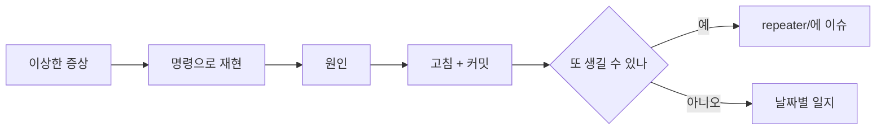

# 디버그 일지

그날그날 잡은 버그·원인·해결을 남기는 곳. `repeater/`가 "재발 가능한 인프라 지식 베이스"라면, 여기는 **일지**다.

<!-- logic-structure -->
## 로직 구조

```text
이상한 증상 ─▶ 재현 (명령으로) ─▶ 원인 (코드 밖? 시험? 환경?) ─▶ 고침 + 커밋 해시
                                                        │
                       같은 일이 또 생길 수 있나? ──예──▶ ../repeater/ 에 이슈 문서
                                                        │
                                              날짜별 일지 (이 폴더)에 남긴다
```

<!-- logic-mermaid -->

### 디버깅 흐름



## 규칙

1. 파일명 `YYYY-MM-DD.md` (하루 단위로 추가/갱신)
2. 이슈마다 **증상 / 원인 / 해결 / 재발 방지**
3. 재현 명령은 코드 블록으로

## 흐름

find_debug(일지)에서 정제된 내용이, 다시 터질 수 있는 이슈라면 [../repeater/](../repeater/)로, 포트/배포 이슈라면 [../web_management/ports-inventory.md](../web_management/ports-inventory.md)로 옮겨진다.

## 기록

- [2026-11-03.md](2026-11-03.md) — 전체 e2e 시간 초과와 `chat.spec.ts:31` (미해결)
- [2026-10-16.md](2026-10-16.md) — 부하에서만 실패하는 시험, DB 한도 Retry-After 61초, 깨끗한 클론에서 429, e2e DB 이름 어긋남, CSP report-to 미전달, 토스 테스트 키 확인 범위

- [2026-11-06.md](2026-11-06.md) — 월드 진행자 변형 제어 줄, 소설형 형식, 콘솔 e2e 주소, 브랜치 HEAD, heredoc 이스케이프, 강제 장면, 보상 갈래

- [2026-11-11.md](2026-11-11.md) — 배포 1:1 한 턴 3분 53초: 호스팅 한 번에 받기 45초 → CPU 예비. 웹·콘솔 빌드 타입 오류, 남은 e2e 실패 3개
