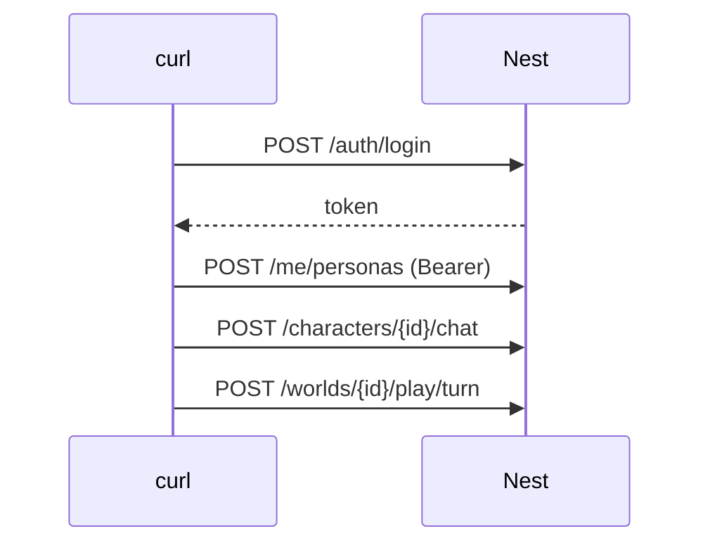

# API 사용 (curl로 직접 부르기)

개발 중 Nest를 직접 불러 확인하는 법. 전체 목록·응답은 [../API_DOCUMENTATION.md](../API_DOCUMENTATION.md). 최종 갱신 2026-11-04.

<!-- logic-structure -->
## 로직 구조

```text
POST /auth/signup 또는 /auth/login ─▶ { token }
        │ Authorization: Bearer <token>
        ▼
/me/personas (주인공) ─▶ /characters/:id/chat ─▶ /characters/:id/chat/ops/* ─▶ /worlds/*
오류: 401 로그인 · 403 권한·코레딧 · 404 못 봄 · 409 상태 충돌 · 429 너무 자주
```

<!-- logic-mermaid -->

### 토큰을 받아 쓰는 순서



## 전제

- api(4000)·ai(8000)·Ollama가 떠 있다 ([getting-started.md](getting-started.md))
- 로그인이 필요한 요청은 `Authorization: Bearer <토큰>`. 웹은 이 토큰을 httpOnly 쿠키에 넣어 서버에서 붙인다

## 명령

```bash
API=http://localhost:4000

# 가입 → 토큰 (응답의 token)
curl -s -X POST $API/auth/signup -H "Content-Type: application/json" \
  -d '{"email":"me@example.com","password":"pass1234word","displayName":"민준"}'

# 로그인 → 토큰
TOKEN=$(curl -s -X POST $API/auth/login -H "Content-Type: application/json" \
  -d '{"email":"me@example.com","password":"pass1234word"}' | node -pe 'JSON.parse(require("fs").readFileSync(0)).token')

# 캐릭터 목록 (로그인 없이)
curl -s $API/characters

# 대화하려면 내 프로필 캐릭터가 필요하다
PERSONA=$(curl -s -X POST $API/me/personas -H "Authorization: Bearer $TOKEN" -H "Content-Type: application/json" \
  -d '{"name":"민준","description":"고3 수험생"}' | node -pe 'JSON.parse(require("fs").readFileSync(0)).id')

# 캐릭터와 대화 (답이 다 오면 한 번에 온다. 첫 답은 모델을 올리느라 오래 걸릴 수 있다)
curl -s -X POST $API/characters/<캐릭터id>/chat -H "Authorization: Bearer $TOKEN" -H "Content-Type: application/json" \
  -d "{\"message\":\"지금 뭐 해?\",\"personaId\":\"$PERSONA\"}"

# 지금 대화 기록 · 지난 이야기 · 기억
curl -s $API/characters/<캐릭터id>/chat         -H "Authorization: Bearer $TOKEN"
curl -s $API/characters/<캐릭터id>/chat/story   -H "Authorization: Bearer $TOKEN"
curl -s $API/characters/<캐릭터id>/chat/memories -H "Authorization: Bearer $TOKEN"

# 서버·AI 대기열 상태
curl -s $API/health

# ── 눌러서 프로로 (정식 서비스 전 임시) ──
curl -s -X POST $API/billing/pro-click -H "Authorization: Bearer $TOKEN"

# ── 코레딧·모델 ──
curl -s -X POST $API/me/attendance -H "Authorization: Bearer $TOKEN"      # 출석 (하루 한 번)
curl -s $API/me/credits -H "Authorization: Bearer $TOKEN"                 # 잔액·내역
curl -s $API/models -H "Authorization: Bearer $TOKEN"                     # 고를 수 있는 모델·오늘 횟수·초과 코레딧(overage)

# ── 추천 프로필 (캐릭터 응답에 recommendedPersona) ──
curl -s $API/characters/<캐릭터id>      # { …, recommendedPersona: { name, description } | null }

# ── 비밀 퀘스트 상태 (건네기 전에는 제목·내용 없음) ──
curl -s $API/characters/<캐릭터id>/chat/quest -H "Authorization: Bearer $TOKEN"

# ── 성인 확인 (이메일 인증된 계정, 만 19세 이상) ──
curl -s -X POST $API/auth/me/adult -H "Authorization: Bearer $TOKEN" -H "Content-Type: application/json" \
  -d '{"birthDate":"1990-01-01","consent":true}'
curl -s -X DELETE $API/auth/me/adult -H "Authorization: Bearer $TOKEN"    # 성인 콘텐츠 끄기

# ── 오퍼레이션 (진행 중인 대화가 있어야 함, 코레딧이 든다) ──
curl -s -X POST $API/characters/<캐릭터id>/chat/ops/mind  -H "Authorization: Bearer $TOKEN"   # 심리 탐구 30
curl -s -X POST $API/characters/<캐릭터id>/chat/ops/diary -H "Authorization: Bearer $TOKEN"   # 일기 20

# ── 코디포토넷 (그림 엔진이 준비돼 있어야 함, 50 코레딧) ──
curl -s $API/characters/<캐릭터id>/chat/ops/photonet -H "Authorization: Bearer $TOKEN"        # ready·잔액·최근 그림·성인 가능 여부
curl -s -X POST $API/characters/<캐릭터id>/chat/ops/photonet -H "Authorization: Bearer $TOKEN" -H "Content-Type: application/json" \
  -d '{"prompt":"비 오는 날 카페 창가","style":"애니메이션","ratio":"가로","rating":"sfw"}'

# ── 웹툰 (콘티 무료 → 컷마다 45 코레딧) ──
WT=$(curl -s -X POST $API/characters/<캐릭터id>/chat/ops/webtoon -H "Authorization: Bearer $TOKEN" -H "Content-Type: application/json" \
  -d '{"prompt":"","panels":3}' | node -pe 'JSON.parse(require("fs").readFileSync(0)).webtoon.id')
curl -s -X POST $API/characters/<캐릭터id>/chat/ops/webtoon/$WT/panels/0 -H "Authorization: Bearer $TOKEN"   # 첫 컷 그리기

# ── 공방: AI로 초상 후보 만들기 (25 코레딧, 저장은 PUT …/portrait) / 퀘스트 한 번에 제안 ──
curl -s -X POST $API/studio/characters/<초안id>/portrait/generate -H "Authorization: Bearer $TOKEN" -H "Content-Type: application/json" \
  -d '{"style":"애니메이션","options":{"gender":"female","age":"30s","hairColor":"black","hairStyle":"ponytail","eyeColor":"purple","outfit":"suit","expression":"cold","background":"city"}}'
curl -s -X POST $API/studio/characters/<초안id>/draft-quest -H "Authorization: Bearer $TOKEN"
```

### 월드코퍼챗 (2026-11-06)

만들기 → 그림 올리기 → 발행 → 시작 → 한 턴 → 이벤트까지 `curl` 순서는 [world-copperchat.md](world-copperchat.md) 4장. 그림 올리기는 JSON이 아니라 **그림 원본 본문**(`Content-Type: image/png` 등, `--data-binary @파일`)이고, 이름표·인물은 쿼리(`?label=&character=`)로 준다.

## 기대 결과

| 요청 | 결과 |
|------|------|
| 가입·로그인 | `{ token, user }` (`user.emailVerified`는 처음에 false) |
| 대화 | `{ reply }` · 프로필 없음 400, 한도 초과 429(`Retry-After`), 모델이 밀리면 503·504 |
| `/health` | `{ status: "ok", …, ai: { inFlight, waitingForeground, waitingBackground, concurrency } }` |

## 절대 하지 말 것

- 웹/클라이언트 코드에서 `services/ai`(FastAPI)를 직접 호출하는 것. 항상 Nest(`apps/api`)를 거친다
- 진짜 비밀번호·토큰을 문서나 대화에 붙이는 것 (위 예시는 개발용 값)

계획서 §13.1의 `/campaigns/*`는 라우트만 있고 501이다 — 대화는 위의 `/characters/:id/chat*`을 쓴다.
