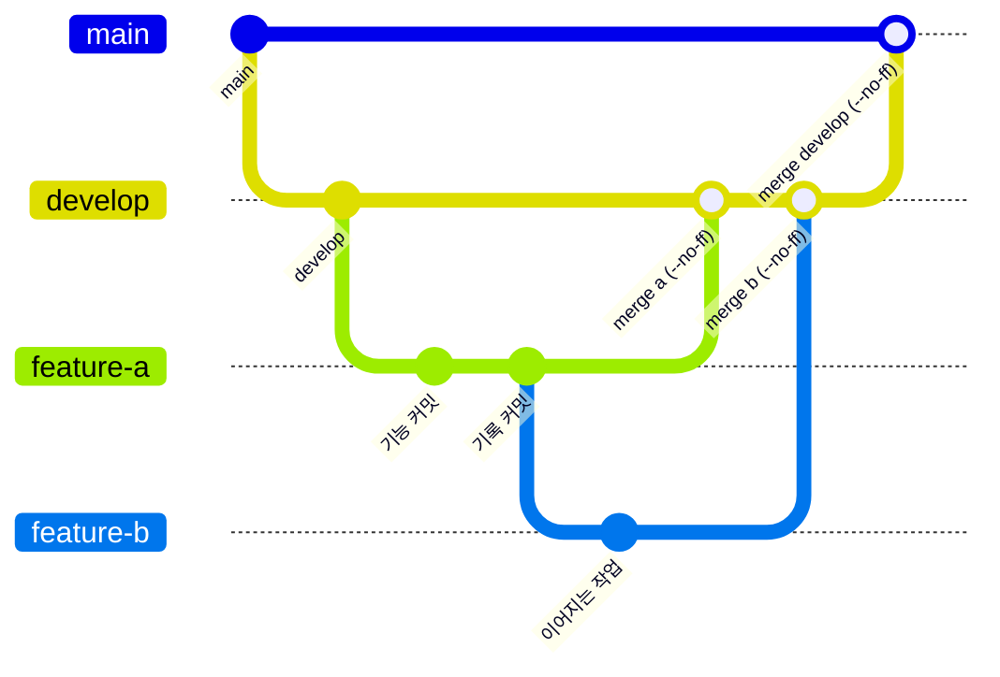
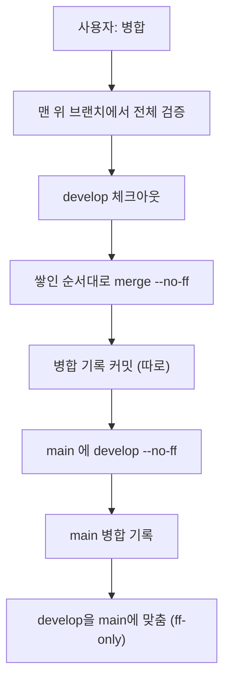

# 브랜치·병합 규칙 (상세)

정본: `.agents/skills/codicomperchat/SKILL.md` §5. 이 문서는 그 상세판이다.

<!-- logic-structure -->
## 로직 구조

```text
main ◀──(--no-ff)── develop ◀──(--no-ff)── feature/a ◀── feature/b (쌓기)
  ▲ 사용자가 말할 때만        ▲ 쌓인 순서대로                 │
  │                           │                              └ 커밋마다 docs/branchs/commits 기록
  └ 병합 커밋마다 기록 ───────┘ (병합과 기록 커밋을 한 명령으로 묶지 않는다)
금지: fast-forward 병합 · force-push · .env 커밋
```

<!-- logic-mermaid -->

### 브랜치와 병합



### 병합 절차



## 브랜치 구조

```text
main          ← 배포 통합만
└── develop   ← 개발 통합만
      ├── feature/*        # 신규 기능
      ├── bugfix/*         # 버그 수정
      └── experimental/*   # 검증 안 된 실험
```

| 필수 | 내용 |
|------|------|
| 작업·커밋 | `feature/*` `bugfix/*` `experimental/*` 에서만 |
| 일자 통합 | `develop` / `main` 만 |
| 병합 방식 | **`git merge --no-ff`** (fast-forward 금지) |
| feature 완료 | 사용자가 "병합"이라고 말하면 `develop`에 `--no-ff`로 합류 |
| 푸시 | 사용자가 요청할 때만. **main 병합 뒤 develop·main을 같이** 푸시한다(main 병합 전에 develop만 먼저 푸시 금지) |
| 배포 | `release/*`에서 검증 후 `main`으로. 지금까지는 사용자 지시로 `develop`을 직접 병합했다. 어느 쪽으로 할지 먼저 묻는다 |

## 금지 사항

- feature 브랜치끼리 장기간 서로 합치기
- `develop` 없이 `main`에 feature 직행
- 일상적인 기능 작업을 `develop`에 직접 커밋
- fast-forward merge (커밋 그래프가 일자로 뭉개져 이력 추적이 어려워짐)
- force-push (사용자가 명시적으로 요청한 경우 제외)
- `.env` 등 시크릿 파일 커밋

## 표준 병합 절차

```bash
git checkout develop
git pull origin develop
git merge --no-ff feature/xxx -m "merge: feature/xxx into develop (no-ff)"
```

병합 후에도 `docs/branchs/commits/`에 병합 기록 md를 남긴다 (§ `docs/branchs/TEMPLATE.md`). 작성기: `node scripts/record-commit.mjs --name merge-xxx --notes <파일> --sha <병합 커밋> --branch develop --commit`. 시험 결과를 보고하고, 푸시는 요청받았을 때만 한다.

## 병합과 푸시를 함께 시킬 때 (2026-11-11 사용자 지시)

"병합하고 푸시까지"라고 하면 **main 병합을 끝낸 뒤에** `develop`과 `main`을 같이 푸시한다. `develop`만 먼저 푸시하지 않는다(2026-11-11에 develop 푸시 순서를 어겨 지적받았다). 시험·병합·기록·푸시를 한 명령으로 묶지 않고, 각 결과를 읽은 뒤 다음으로 간다.

```bash
# 1. 맨 위 브랜치에서 전체 검증 (docs/AGENT_HANDOVER.md §5)
# 2. develop: 쌓인 순서대로 --no-ff → 병합 기록 커밋 (따로)
git checkout develop && git merge --no-ff feature/xxx -m "merge: feature/xxx into develop (no-ff)"
# 3. main: develop을 --no-ff → 병합 기록 커밋 (따로)
git checkout main && git merge --no-ff develop -m "merge: develop into main (no-ff)"
# 4. develop을 main에 맞춤 (main이 develop을 품고 있어 ff-only가 된다)
git checkout develop && git merge --ff-only main
# 5. 푸시 전에 원격이 앞서 있지 않은지(fast-forward로 올라가는지) 본 뒤 둘을 같이
git fetch origin && git merge-base --is-ancestor origin/develop develop && git merge-base --is-ancestor origin/main main && git push origin develop main
```

**다른 세션이 같은 저장소에서 병합 중일 수 있다.** 병합 전에 `git fetch`와 `git log --all --oneline -8`로 `develop`·`main`이 내 브랜치 밖에서 움직였는지 본다. 내 브랜치가 이미 `develop`에 들어가 있으면(`git merge-base --is-ancestor <내 브랜치> develop`) 병합과 병합 기록을 하지 않는다. 병합 기록 스크립트는 `HEAD`를 기록하므로 병합할 것이 없을 때 돌리면 다른 커밋의 틀린 기록이 남는다.

브랜치를 쌓아 작업했으면 아래 브랜치부터 순서대로 병합한다.

## 쌓인 브랜치 병합 (2026-11-06에 쓴 방식)

작업이 이어질 때는 다음 브랜치를 앞 브랜치 위에서 만들었다(예: `feature/world-core` 위의 `feature/docs-assets-rename`). 병합은 **쌓인 순서대로** 하나씩 `develop`에 `--no-ff`로 한다. 앞 브랜치를 먼저 병합하면 뒤 브랜치의 병합 커밋에는 그 브랜치에서만 생긴 커밋이 들어간다.

```bash
git checkout develop
for b in feature/a feature/b feature/c; do git merge --no-ff "$b" -m "merge: $b into develop" || break; done
# 병합 커밋을 다 만든 뒤 기록을 남긴다 (병합과 기록 커밋을 한 명령으로 묶지 않는다)
```

`git checkout -b`가 `couldn't set 'HEAD'`로 실패하면 브랜치만 만들어지고 HEAD는 그대로일 수 있다. 커밋 전에 `git branch --show-current`로 확인한다(2026-11-06에 한 번 겪었다).

## 이 프로젝트가 아직 git 저장소가 아닐 때

`git init` → 초기 커밋 → `develop` 브랜치 생성까지는 사용자 승인 후 진행한다. 저장소를 새로 만드는 것은 되돌리기 쉬운 작업이지만, 브랜치 전략을 실제로 적용하는 시점(첫 feature 브랜치 생성 등)은 사용자와 먼저 맞춘다.

관련: `docs/plan/CURRENT_STACK.md` (모노레포 구조), `docs/branchs/README.md` (커밋 기록 목록)
