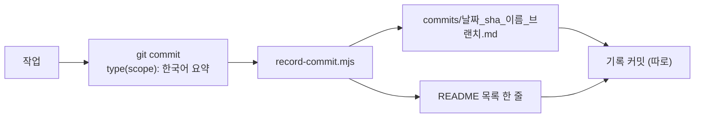

# 커밋 메시지 규칙 (상세)

정본: `.agents/skills/codicomperchat/SKILL.md` §3. 이 문서는 그 상세판이다.

<!-- logic-structure -->
## 로직 구조

```text
type(scope): 한국어 요약          ← type·scope는 영어
                                   예: feat(worlds): 월드코퍼챗 … 추가
본문 (한국어, 무엇을·왜)

바닥글 (Co-Authored-By는 안내가 있을 때만)
   │
   ▼
node scripts/record-commit.mjs --name <kebab> --notes <본문> --commit
   → docs/branchs/commits/<날짜>_<sha>_<이름>_<브랜치>.md + README 목록 한 줄 (별도 커밋)
```

<!-- logic-mermaid -->

### 커밋에서 기록까지



## 언어 규칙

| 구간 | 언어 | 비고 |
|------|------|------|
| type / scope | **영어** | `feat`, `fix`, `docs` … |
| 제목 요약 | **한국어** | 한 줄, 마침표 없음 |
| 본문 | **한국어** | 무엇을 · 왜 |
| 바닥글 | **한국어** | 관련/후속 이슈 등 |

> 드리프트 주의: 일부 옛 체크리스트나 도구별 어댑터에 "제목은 영어만"이라고 적혀 있을 수 있다. **구버전이다.** type/scope만 영어, 요약·본문·바닥글은 한국어가 정본이다.

## 형식

```text
type(scope): 한국어 한 줄 요약

한국어 본문 (무엇을·왜)

관련: …
후속: …
```

- `type(scope):` 뒤에 한 칸
- 제목 끝에 마침표 금지
- 본문은 "무엇을 했는지"보다 "왜 했는지"를 우선한다

## type 목록

`feat` `fix` `docs` `chore` `refactor` `test` `perf` `ci` `style` `build`

## scope 목록 (이 프로젝트 기준)

`web` (Next.js) · `api` (Nest.js) · `ai` (FastAPI) · `db` · `prisma` · `docs` · `branchs` · `docker` · `infra`

새 scope가 필요하면 실제 코드 구조(`apps/`, `services/`)에 맞춰 추가하고, 이 표에도 반영한다.

### 2026-11-06에 더 쓴 scope

`worlds`(Nest 월드코퍼챗), `world`(여러 앱에 걸친 월드 고침), `web`·`console`·`ai`(앱 단위 기능), `assets`(docs/.assets), `agents`(에이전트 어댑터), `trainings`(실측 문서), `readme`, `quests`.

## 예시

✅ `feat(ai): 세션 요약 스트리밍 응답 추가`
✅ `fix(api): 캠페인 상태 머지 시 훅 중복 저장 수정`
❌ `feat(api): add campaign endpoint` — 요약이 영어라 금지
❌ `작업함` — type/scope 없음, 요약 없음

### 2026-11-06 예시

```text
feat(worlds): 월드코퍼챗 DB와 세계관·플레이·이벤트 API 추가
fix(world): 변형 제어 줄 버리기와 코퍼맵 핀 잘림 고침
docs(assets): docs/assets를 docs/.assets로 옮김
```

## 바닥글의 `Co-Authored-By`

쓰는 도구의 안내가 정한 값만 쓴다. 안내가 없으면 넣지 않는다.

## 병합 커밋

```text
merge: feature/xxx into develop (no-ff)
```

관련: `docs/guidance/branch-merge.md`
