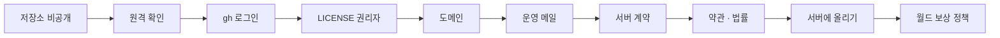

# 소유자가 직접 할 일

공개까지 소유자만 할 수 있는 일을 순서대로 적었다. 계정, 계약, 돈, 법적 책임이 걸린 일이라 에이전트가 대신하지 않는다. 값과 약관은 바뀔 수 있으니 진행할 때 다시 확인한다.

| 순서 | 할 일 | 비용 |
|------|-------|------|
| 1 | [저장소 비공개 전환](#1-저장소-비공개-전환) | 없음 |
| 2 | [원격 확인](#2-원격-확인) | 없음 |
| 3 | [GitHub CLI 로그인](#3-github-cli-로그인) | 없음 |
| 4 | [`LICENSE` 권리자 줄 결정](#4-license-권리자-줄-결정) | 없음 |
| 5 | [도메인 구매](#5-도메인-구매) | 연 단위 요금 |
| 6 | [운영 메일 준비](#6-운영-메일-준비) | 서비스에 따라 다름 |
| 7 | [서버 계약](#7-서버-계약) | 2026-11-03 확인 값 월 €214, 설치비 €209, VAT 별도 |
| 8 | [약관·처리방침 작성과 법률 검토](#8-약관처리방침-작성과-법률-검토) | 자문 비용 |
| 9 | [서버에 올리기](#9-서버에-올리기) | 없음 |

> **2026-11-07 진행 상황**: 무료 구성으로 먼저 올렸다 — 웹은 Vercel, API·DB·AI(대화)는 Oracle Cloud ARM VM([../web_management/oracle-backend.md](../web_management/oracle-backend.md)). 그래서 5(도메인)는 `sslip.io`로 미뤘고, 7(GPU 서버 계약)은 그림 엔진을 열 때 필요하다. 지금 남은 소유자 일: 6 운영 메일, 운영 콘솔을 열 IP 결정, 프리미엄 키·월 한도, (권장) 개인키·`WEB_PROXY_TOKEN` 교체. 목록 정본은 [../TASKS.md](../TASKS.md) 1장.

<!-- logic-structure -->
## 로직 구조

```text
1 저장소 비공개 ─▶ 2 원격 확인 ─▶ 3 gh 로그인 ─▶ 4 LICENSE 권리자
        ▼
5 도메인 ─▶ 6 운영 메일 ─▶ 7 서버 계약 ─▶ 8 약관·법률 검토 ─▶ 9 서버에 올리기
        ▼
10 월드 이벤트 보상 정책 (법률 검토 · 최종 값 · 약관 조항)
에이전트는 하는 법을 안내하고, 돈·계약·계정 일은 대신 하지 않는다
```

<!-- logic-mermaid -->

### 소유자 할 일 순서



## 1. 저장소 비공개 전환

1. GitHub에서 `samam0234/CodiComperChat`을 연다.
2. **Settings** → 맨 아래 **Danger Zone** → **Change visibility** → **Make private**을 고른다.
3. 저장소 이름을 입력해 확인한다.

확인: 로그아웃한 브라우저에서 저장소 주소를 열면 404가 나온다.

- 공개였던 동안 받아 간 사본은 되돌릴 수 없다.
- 커밋 기록에 비밀값이 없는지는 작업 트리만 검색했다. 전체 이력은 확인하지 않았다.

## 2. 원격 확인

`develop`과 `main`은 2026-11-06에 푸시했다. 푸시하면 GitHub Actions CI가 돈다. 저장소 **Actions** 탭에서 성공했는지 보고, 첫 화면의 그림과 소개 영상 링크가 열리는지 본다. 비공개 저장소는 Actions 무료 시간이 요금제에 따라 제한되니 Settings → Billing에서 확인한다.

## 3. GitHub CLI 로그인

```bash
gh auth login
```

GitHub.com → HTTPS → 브라우저 로그인을 고른다. 끝나면 `gh auth status`로 확인하고, 에이전트에게 브랜치 보호와 비밀 스캔 확인을 맡긴다([../TASKS.md](../TASKS.md) T02).

## 4. `LICENSE` 권리자 줄 결정

`LICENSE` 2.0판은 권리자를 아직 프로젝트 이름으로 적고, 준거법 조항을 넣지 않았다. 다음을 정한다.

- 권리자: 개인 실명, 또는 사업자를 낸 뒤 상호
- 준거법과 분쟁 관할
- 문안 전체를 변호사에게 검토받기

정하면 에이전트가 문안을 보여 주고 승인을 받아 고친다([../TASKS.md](../TASKS.md) T01).

## 5. 도메인 구매

도메인 판매 업체에서 두 주소를 쓸 도메인을 산다.

- 이용자 사이트: 예) `example.kr`
- 운영 콘솔: 예) `console.example.kr`

DNS 설정은 서버 IP를 받은 뒤 7번에서 한다.

## 6. 운영 메일 준비

가입 인증과 비밀번호 찾기 메일을 보낼 SMTP 서비스를 고른다. 없으면 이용자가 인증 메일을 받지 못해 캐릭터를 발행할 수 없다.

1. 트랜잭션 메일 서비스에 가입하고 도메인을 인증한다(SPF·DKIM DNS 기록을 넣는다).
2. SMTP 주소를 받아 `deploy/.env`의 `MAIL_SMTP_URL`에 넣는다.

확인은 서버에 올린 뒤 `npm run mail:check --workspace api -- 내주소`로 한다.

## 7. 서버 계약

결정은 Hetzner GEX45이고, 성인 모드는 끈 채로 연다. 후보와 근거: [../web_management/hosting-options.md](../web_management/hosting-options.md).

1. [Hetzner GPU 서버 페이지](https://www.hetzner.com/dedicated-rootserver/matrix-gpu/)에서 GEX45의 값과 재고를 다시 확인한다.
2. [약관](https://www.hetzner.com/legal/terms-and-conditions/)을 읽는다. 8.2항이 음란물을 금지한다.
3. 계약할 때 Ubuntu LTS를 고르고 SSH 공개 키를 넣는다.
4. 서버 IP를 받으면 도메인 DNS에 A 기록 두 개를 넣는다(이용자 사이트, 콘솔).

## 8. 약관·처리방침 작성과 법률 검토

- `apps/web/app/terms`, `apps/web/app/privacy`의 `[운영자 기재]` 칸을 채운다. 채울 내용을 에이전트에게 주면 넣어 준다.
- 변호사에게 함께 묻는다: 이용약관, 개인정보처리방침과 보관 기간, 국외 서버(핀란드) 이용 고지, 환불 기준, 생년월일 자기 신고, 저장소 `LICENSE`.
- 성인 모드는 이 검토 전에는 켜지 않는다. 체크리스트: [../../SECURITY.md](../../SECURITY.md) "공개 전 필수".

## 9. 서버에 올리기

서버 접속 정보를 안전하게 준비한 뒤 에이전트에게 맡기거나 [../web_management/docker-deploy.md](../web_management/docker-deploy.md)를 따른다. 비밀값은 대화에 붙이지 말고 서버의 `deploy/.env`에 직접 넣는다.

`deploy/.env`에서 소유자가 정할 값:

| 키 | 값 |
|----|-----|
| `MAIL_SMTP_URL` | 6번에서 받은 주소 |
| `CONSOLE_IP_ALLOWLIST` | 운영 콘솔에 들어갈 내 IP |
| 도메인 관련 값 | [`deploy/.env.example`](../../deploy/.env.example) 참고 |
| `PRO_CLICK` | 기본 `on`. 정식 서비스 전까지 눌러서 프로로 바꾼다 |
| `PREMIUM_PROVIDERS` | 비워 둔다. 프리미엄을 열 때만 넣는다 |
| `PREMIUM_MONTHLY_CREDITS` | 기본 `0`이면 열리지 않는다. 100,000이면 코레딧 값 35만 원, 원가는 그 3분의 1 이하다 |

올린 뒤 확인: [../web_management/post-deploy.md](../web_management/post-deploy.md).

## 10. 월드코퍼챗 보상 정책 확인 (2026-11-06)

미니게임 보상이 유료 기능에 쓰이는 코레딧이다. 지금은 하루 3번, 승리 20~50·패배 5~10으로 돈(코레딧)을 걸지 않고 받기만 한다. 공개 전에:

- [ ] 경품·사행성 관련 국내 규정에 맞는지 법률 검토(돈을 걸지 않는 무료 참여라도 확인)
- [ ] 하루 보상 횟수·확률을 콘솔에서 최종 값으로 정하기
- [ ] 약관에 이벤트 보상 조항 넣기(지금 약관에는 없다)
