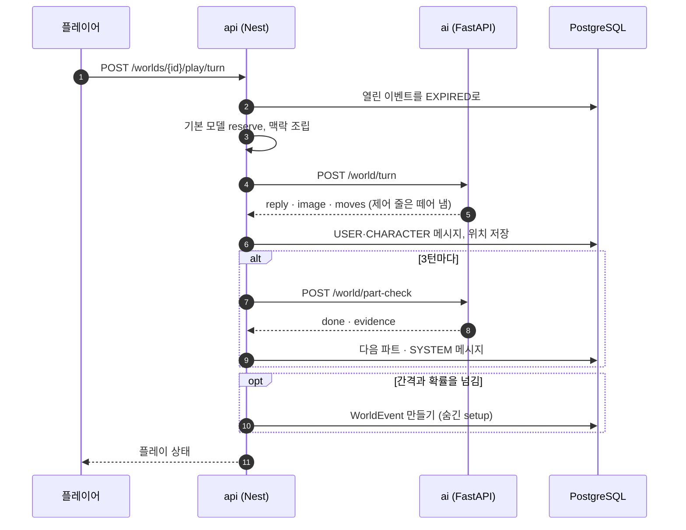
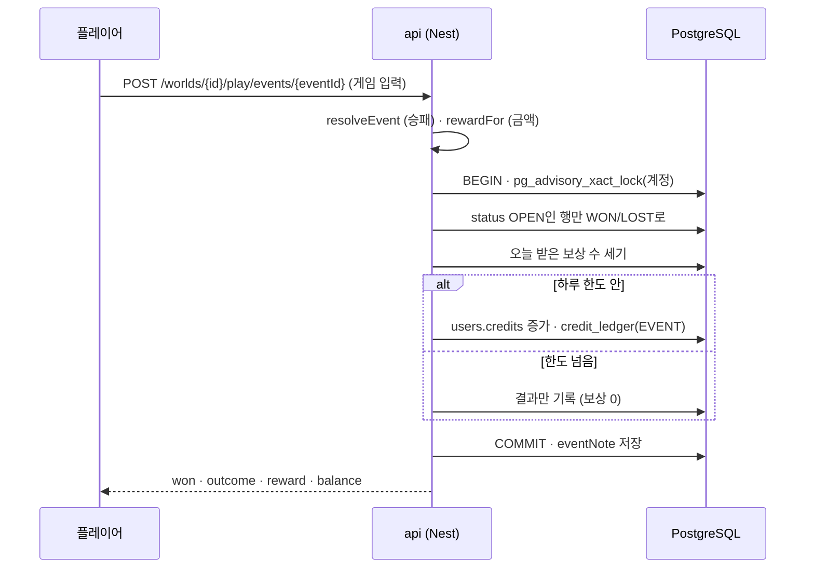

# 월드코퍼챗 쓰기·실행·시험·디버깅

설계와 결정은 [../plan/WORLD_COPPERCHAT.md](../plan/WORLD_COPPERCHAT.md), 실측은 [../trainings/world-copperchat.md](../trainings/world-copperchat.md). 이 문서는 손으로 해 볼 때의 순서다.

<!-- logic-structure -->
## 로직 구조

```text
만들기: /worlds → 새 세계관 → 편집기 6탭 → 저장 → 발행
플레이: 소개 → 주인공 → 시작 → 말 보내기 ─┬─ 답(방식별 화면) · 장면 그림
                                          ├─ 3턴마다 파트 판정 → 다음 파트
                                          ├─ 코퍼맵 (인물 위치)
                                          └─ 이벤트 창 → 결과·보상
막혔을 때: 6장 디버깅 표 (그림 · 파트 · 이벤트 · 위치 · 형식)
```

<!-- logic-mermaid -->

### 월드 한 턴



### 이벤트 보상



## 1. 세계관 만들기 (이용자)

1. 로그인 → 헤더 **월드** → **+ 새 세계관 만들기**. 편집기(`/worlds/<id>/edit`)가 열린다.
2. **기본**: 제목, 한 줄 소개, 세계관 설명(20자 이상), 세계의 규칙(선택), 첫 장면(`@: 서술`, `이름: 대사` 형식 가능), 대화 방식 4가지 중 하나.
3. **등장인물**: 이름으로 찾아 **데려오기**(공개 캐릭터나 내 캐릭터) 또는 **+ 직접 쓰기**. 말투와 소개가 진행자의 연기 근거다. 처음 있는 곳·사는 곳은 장소를 먼저 만들어야 고를 수 있다.
4. **장소·코퍼맵**: 지도 그림을 올리고(선택), 지도를 눌러 핀을 놓는다. 목록에서 장소를 고른 채 지도를 누르면 그 핀을 옮긴다.
5. **파트**(선택): 제목·끝나는 조건·시작 글. 조건은 "대화 기록만 보고 예/아니오로 판정할 수 있는 눈에 보이는 일"로 쓴다. 나쁜 예: "주인공이 성장한다". 좋은 예: "주인공이 등대지기에게서 배의 이름을 듣는다".
6. **장면 그림**: 이름표를 붙여 올린다. 인물을 고르면 비주얼노벨의 서 있는 그림이 된다. **등장인물을 바꿨으면 먼저 저장**해야 인물을 고를 수 있다(서버가 저장된 명단으로 확인한다).
7. **저장** → **발행** 탭에서 공개 범위를 고르고 발행. 빠진 것이 있으면 무엇인지 알려 준다.

큰 그림은 브라우저가 긴 변 1600px·webp 280KB 아래로 줄여 올린다. 그래도 크면 "충분히 줄이지 못했어요".

## 2. 플레이

1. 세계관 소개(`/worlds/<id>`)에서 주인공(내 프로필)을 고르고 **플레이 시작**. 프로필이 없으면 마이페이지에서 만든다.
2. 입력창: 행동은 `*별표*`, 장면 지시는 `(괄호)`. Enter로 보내고 Shift+Enter는 줄바꿈.
3. 위쪽 띠에 지금 파트(`2부 / 3 · 제목`)가 보인다. 파트가 없으면 "자유 진행".
4. **코퍼맵** 버튼: 옆 칸에 지도와 인물의 지금 위치.
5. 이벤트 창이 뜨면 게임을 하거나 **나중에**(다음 말을 보내면 그 이벤트는 끝난다). 이미 닫았다면 위쪽 띠의 **이벤트 열기**.
6. 처음부터 하려면 소개 화면의 **처음부터**(기록이 지워진다).

비주얼노벨형은 대사 상자를 눌러 다음 줄로 넘긴다(`▼ 2/5`). 마지막 줄(`■`) 뒤에 입력한다. 지난 대사는 **지난 대사 기록**.

## 3. 로컬에서 띄우기

월드코퍼챗은 별도 서버가 없다. 평소처럼 네 앱을 띄우면 된다([getting-started.md](getting-started.md)).

```bash
cd apps/api && npx prisma migrate deploy   # world_* 테이블 9개(마이그레이션 20261106120000_world_copperchat)
npm run dev:api        # :4000
npm run dev:web        # :3000  → /worlds
npm run dev:console    # :3001  → /worlds
cd services/ai && .venv/Scripts/python.exe -m uvicorn app.main:app --port 8000
```

- 이벤트를 바로 보고 싶으면 콘솔 **월드코퍼챗 → 운영 설정**에서 확률 100%, 최소 간격 1턴. 끝나면 되돌린다(기본 35%, 6턴).
- 로컬 모델 없이 화면만 보려면 AI 서비스를 `LLM_FAKE=1`로 켠다. 진행자 답은 고정 한 줄, 파트 판정은 유저 말에 `[파트완료]`가 있으면 통과.

## 4. API로 해 보기

```bash
TOKEN=...   # 로그인 토큰 (POST /auth/login)
ID=$(curl -s -X POST localhost:4000/worlds -H "Authorization: Bearer $TOKEN" | jq -r .id)
curl -s -X PUT localhost:4000/worlds/$ID -H "Authorization: Bearer $TOKEN" -H 'Content-Type: application/json' \
  -d '{"world":{"title":"시험","setting":"증기선이 오가는 항구 도시 이야기입니다","opening":"@: 밤이다","cast":[{"name":"서린","summary":"관리인"}]}}'
curl -s -X PUT "localhost:4000/worlds/$ID/images?label=%EB%B0%A4" -H "Authorization: Bearer $TOKEN" -H 'Content-Type: image/png' --data-binary @scene.png
curl -s -X POST localhost:4000/worlds/$ID/publish -H "Authorization: Bearer $TOKEN" -H 'Content-Type: application/json' -d '{"visibility":"PRIVATE"}'
curl -s -X POST localhost:4000/worlds/$ID/play -H "Authorization: Bearer $TOKEN" -H 'Content-Type: application/json' -d '{"personaId":"<내 프로필 id>"}'
curl -s -X POST localhost:4000/worlds/$ID/play/turn -H "Authorization: Bearer $TOKEN" -H 'Content-Type: application/json' -d '{"text":"안녕하세요"}'
```

이벤트 입력 모양: 사다리 `{"choice":0~3}`, 제비 `{"choice":0~4}`, 주사위 `{}`, 볼링 `{"aim":-1~1,"power":0~1}`, 미로 `{"moves":"RRDD…"}`.

## 5. 시험

```bash
npx vitest run src/worlds/world.spec.ts                     # apps/api, 순수 함수 15개
.venv/Scripts/python.exe -m unittest tests.test_world       # services/ai, 9개
npm run test:e2e -- tests/worlds.spec.ts                    # 루트, 6개 (운영 빌드)
E2E_SKIP_BUILD=1 npm run test:e2e -- tests/worlds.spec.ts   # 화면 코드를 안 고쳤으면
.venv/Scripts/python.exe -m evals.world_turn --repeat 3     # services/ai, 실제 모델 형식 평가
```

e2e는 이벤트 설정을 바꿨다가 되돌린다(`test.describe.serial`). 시험이 중간에 죽으면 e2e DB의 `app_settings`에 확률 0이 남을 수 있지만 e2e DB는 실행마다 새로 만든다.

## 6. 디버깅

| 증상 | 볼 곳 | 원인과 조치 |
|------|------|-------------|
| 그림 이름표가 플레이에 안 나옴 | 편집기 그림 상태, 콘솔 검수 | 검수 대기·거절·막힘이면 진행자에게 이름표가 가지 않는다. 통과한 그림도 진행자가 맞는 장면이라고 볼 때만 고른다(실측 16/24) |
| "등장인물에 없어요"로 그림 업로드 실패 | 편집기 | 인물을 바꾼 뒤 저장하지 않았다. 저장 후 다시 |
| 파트가 안 넘어감 | `world_messages`, API 로그 `WorldPlay` | 3턴마다만 판정한다. 목표가 모호하면 판정이 넘기지 않는다. 판정 호출 실패는 경고 로그 "파트 판정 실패(이야기는 계속)" |
| 이벤트가 안 뜸 | 콘솔 운영 설정 | 확률 0이거나 최소 간격을 못 채웠다. 열린 이벤트가 있으면 새로 뜨지 않는다 |
| 이벤트 보상이 0 | 콘솔 이벤트 기록 "한도 초과" | 오늘 받은 수가 하루 보상 횟수에 닿았다(한국 시각 자정에 초기화) |
| 이벤트 결과가 409 | | 이미 끝났거나(같은 이벤트 두 번), 10분이 지났거나, 그 사이 말을 보냈다 |
| 미로를 출구까지 갔는데 패배 | outcome의 `valid`·`inTime` | 서버가 이동 문자열을 다시 걸어 본다. 90초(+5초)를 넘겼거나 벽을 지나는 이동이 섞였다 |
| 인물 위치가 안 바뀜 | | 진행자가 `[이동:]` 줄을 쓰지 않았다(알려진 한계) |
| 답이 `@: 잠시 정적이 흐른다.` | AI 로그 | 진행자 답이 제어 줄뿐이거나 비었다 |
| 메신저형에 서술이 섞임 | | 작은 모델의 흔들림(형식 평가 5/6). 화면은 서술 줄을 작은 회색 알림으로 보인다 |
| 남이 세계관을 404로 봄 | 콘솔 상세 | 발행 전·비공개·내려감. 링크 공개는 주소로만 보인다 |
| 프롬프트에 무엇이 들어갔나 | `services/ai/app/services/world.py` `build_system` | 파이썬에서 `WorldTurnRequest`를 만들어 `build_system(...)`을 찍어 본다 |
