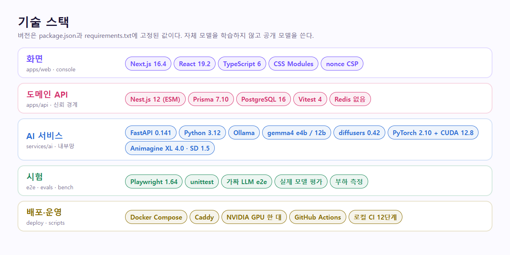
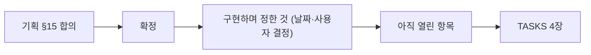
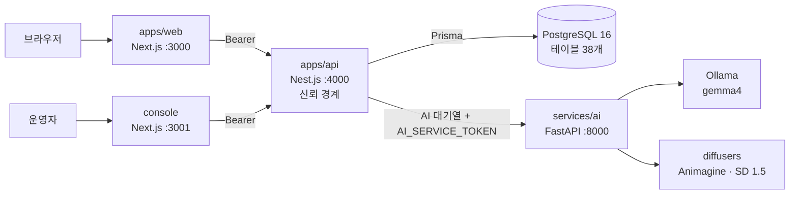

# 현재 스택 스냅샷

이 문서는 루트 `CodiComperChat_project_plan.md`(원본, §7·§9·§13)에서 파생된 개발용 요약이다. **원본과 모순되면 원본이 이긴다** — 이 문서를 먼저 고치고 원본을 나중에 맞추지 않는다.

> 최종 갱신 2026-11-08. 앱이 서로 연결되어 실제로 동작한다(가입 → 캐릭터 대화 → 기억·이야기 정리·최근 대사 수정·때와 곳, 공방 제작·발행, 신고·검수, 코레딧·오퍼레이션·코디포토넷·웹툰·비밀 퀘스트, 실제 결제 대신 눌러서 프로로 바꾸기). **2026-11-07에 웹(Vercel)과 API·DB·AI(Oracle)를 올렸고, 2026-11-08에 대화 도구를 다시 배포했다.** 전체 GPU 서버(Hetzner GEX45) 계약과 법률·보안 점검은 남아 있다 — 공개 전 필수: [../../SECURITY.md](../../SECURITY.md), 모델·소프트웨어 라이선스: [../../THIRD_PARTY_NOTICES.md](../../THIRD_PARTY_NOTICES.md), 저장소 라이선스: [../../LICENSE](../../LICENSE)(독점).



<!-- logic-structure -->
## 로직 구조

```text
기획 원본 §15 합의 ─▶ 확정 표 ─▶ 구현하며 정한 것 (날짜·사용자 결정과 함께)
                                         │
                                         ▼
                              아직 열린 항목 ─▶ TASKS.md 4장 (방향 확인)
스택이 바뀌면: 이 문서 → PROJECT_STRUCTURE → 앱 README → docs/README 앱과 포트 (문서 갱신 체크리스트)
```

<!-- logic-mermaid -->

### 결정이 쌓이는 순서



### 시스템 구조



## 확정 (계획서 §15 "합의")

| 영역 | 값 |
|------|-----|
| 프론트 | Next.js 16.4.4 (React 19.2.8, App Router, TSX) — `apps/web/` (이용자 사이트), `console/` (운영 콘솔, 2026-10-21 분리) |
| 도메인/상태 API | Nest.js 12 (TypeScript, ESM) — `apps/api/` |
| AI 추론 | FastAPI (Python 3.12) — `services/ai/`. 로컬 Ollama(`gemma4:e4b`)를 부른다 |
| DB | PostgreSQL 16 — 로컬 개발은 Docker가 아니라 **설치형** (`D:\PostgreSQL\16`, 2026-09-25 전환 · [docker-run.md](../guidance/docker-run.md)) |
| ORM | Prisma 7 (Nest 쪽) — `apps/api/prisma/schema.prisma`, 테이블 38개·마이그레이션 36개 · [DATABASE.md](DATABASE.md) |
| 세션 캐시·잡 | Redis — **아직 쓰지 않는다.** 요청 한도는 메모리/PostgreSQL, AI 호출 대기열은 프로세스 메모리로 해결했다(아래) |
| 저장소 형태 | 모노레포 (`apps/web`, `apps/api`, `console/`, `services/ai`, `e2e/`, `docker-compose.yml` — compose는 `postgres`·`mailpit`) |

## 구현하면서 정한 것

| 영역 | 값 | 근거·위치 |
|------|-----|-----------|
| 인증 | **자체 이메일·비밀번호** (scrypt + HS256 JWT 7일, `AUTH_SECRET`). 웹은 httpOnly `session` 쿠키 | 기획서 §7.8 "v1은 이메일 또는 소셜 하나면 충분"의 이메일 쪽. `apps/api/src/auth` |
| 이메일 인증·비밀번호 찾기 | 메일 링크 일회용 토큰(DB에는 해시만). 캐릭터 **발행은 인증한 계정만** | `auth/email-token.ts`, `mail/` |
| 로그인 토큰 무효화 | 토큰에 계정의 세대(`sessionVersion`)를 싣고, 비밀번호 변경·재설정 때 올려 이전 토큰을 모두 끊는다 | `auth/session.ts` |
| 메일 발송 | SMTP(`MAIL_SMTP_URL`) / 폴더(`MAIL_OUTBOX_DIR`, 시험용) / 개발 중 로그. **개발 메일 서버는 Mailpit**(docker compose, SMTP 1025·웹 8025). 운영 메일 서비스는 미정 | `mail/mail.service.ts`, 확인 `npm run mail:check --workspace api` |
| 회원 탈퇴 | 계정·데이터 삭제, 발행 캐릭터는 먼저 내림, 결제 기록은 법정 보관(계정 연결만 끊음) | `account/` |
| LLM | **개발 중에는 로컬 Ollama `gemma4:e4b`** (2026-09-26, Gemini에서 교체). **운영(2026-11-07)은 NVIDIA 호스팅 API `google/gemma-4-31b-it`(OpenAI 호환, `LLM_BACKEND=openai`)이 기본이고, 막히면 CPU Ollama `gemma4:e4b`가 대신 답한다(`LLM_FALLBACK_OLLAMA=1`).** 그림 인식(검수)도 같은 모델. Gemma 4는 Apache 2.0 — [THIRD_PARTY_NOTICES.md](../../THIRD_PARTY_NOTICES.md) | `services/ai/app/services/llm.py`, [AI_MODEL_STRATEGY.md](AI_MODEL_STRATEGY.md) |
| 배포 (2026-11-03) | **NVIDIA GPU 서버 한 대에서 24시간.** `deploy/docker-compose.prod.yml`: Caddy(TLS)·web·console·api·postgres·ai·ollama, 바깥 포트 80·443뿐, `restart: always`, 백업 `scripts/db-backup.sh`. **Hetzner GEX45로 결정, 계약 전**, 성인 모드는 끈 채로 연다 | [../web_management/docker-deploy.md](../web_management/docker-deploy.md) |
| 지금 배포 (2026-11-07) | **웹은 Vercel(`codicomperchat-web`, icn1), API·DB·AI는 Oracle Cloud A1.Flex(ARM, GPU 없음, 도쿄).** `deploy/oracle/docker-compose.yml` + `docker-compose.ai.yml`. 도메인 대신 `api.168-110-61-178.sslip.io`. 웹→Caddy는 `WEB_PROXY_TOKEN`으로 이용자 IP를 넘긴다. 포트폴리오 사이트는 별도 Vercel(Astro 정적, 챗봇 서버 없음). GPU 서버(위 줄)는 그림 엔진용 목표로 남는다. 기능이 코드에 있는지와 지금 열리는지는 [../STATUS.md](../STATUS.md) | [../web_management/oracle-backend.md](../web_management/oracle-backend.md), [../web_management/deploy-log-2026-11-07.md](../web_management/deploy-log-2026-11-07.md) |
| 저장소 비공개 (2026-11-03) | 비공개로 전환한다. 서버는 읽기 전용 배포 키로 받는다. 라이선스의 clone·복제·실행·호스팅 금지는 그대로다. 공개였던 동안 받아 간 사본은 되돌릴 수 없다 | [../../LICENSE](../../LICENSE) |
| 그림 엔진 (2026-10-24) | **services/ai 안에서 diffusers로 직접 그린다**(`IMAGE_ENGINE=local`, 기본, 선택 설치 `requirements-image.txt`: PyTorch 2.10 CUDA 12.8 · diffusers 0.42). 애니메이션·웹툰 = Animagine XL 4.0, 수채화·실사풍 = SD 1.5, 체크포인트는 `services/ai/models/`(git 제외). 개발 PC 대안으로 기존 Stable Diffusion WebUI(`IMAGE_ENGINE=webui`). GPU 없으면 그림 기능만 "준비 중" | `services/ai/app/services/image_local.py`, `image_engine.py`, [../guidance/photonet-engine.md](../guidance/photonet-engine.md) |
| 프리미엄 월 상한 (2026-11-04) | 서비스 전체가 한 달에 프리미엄으로 쓸 코레딧 `PREMIUM_MONTHLY_CREDITS`. 운영에서 값이 없으면 0이라 열리지 않는다 | `models/models.ts` |
| 코레딧·모델 (2026-10-21~25) | 출석 1,000(프로 5,000), 100 코레딧 = 350원. 강화 무료 `gemma4:12b` = 무료 하루 30번 → 그 뒤 자정까지 1번 10 코레딧, 프로 무제한. 프리미엄(Claude·Grok)은 코레딧. 연동 코드는 있으나 키가 없어 "준비 중"이고, 만 18세 미만·생년월일 없음은 잠근다 | `credits/`, `models/`, [AI_MODEL_STRATEGY.md](AI_MODEL_STRATEGY.md) |
| 오퍼레이션 (2026-10-23~24) | 심리 탐구 30 · 일기 20 · 메시지(무료) · 커뮤니티 20/10 · 코디포토넷 50 · **웹툰 한 컷 45(콘티 무료)** | `operations/`, [OPERATIONS.md](OPERATIONS.md) |
| 성인 모드 (2026-10-24) | 코디포토넷·웹툰의 전체 이용가/성인 분리. 성인 확인 = **생년월일 + 동의 + 이메일 인증(자기 신고, 본인인증 없음 — 사용자 결정)**, 거짓 입력의 법적 책임은 이용자(약관·동의 문구). 미성년자 설정 원천 차단·실사 금지·그림 검수. 운영 compose는 `ADULT_MODE=off`가 기본이라 공개 서버에서는 꺼져 있다 | `account/adult.ts`, [OPERATIONS.md](OPERATIONS.md) "수위" |
| 공식 캐릭터 2명 (2026-10-25) | 유지성(23세 과외 선생님 대학생, 비밀 퀘스트 있음)·**이세연**(34세 회장 직속 비서, 시작 장면은 나레이션 먼저). 둘 다 그림 엔진으로 만든 공식 초상 포함. 시드가 이미 있어도 운영자가 바꾼 카드·초상은 덮지 않는다 | `apps/api/prisma/seed.mjs`, `prisma/assets/portraits/`, [CHARACTERS.md](CHARACTERS.md) |
| 추천 프로필 (2026-10-25) | 캐릭터마다 "추천하는 내 프로필"(선택). 대화 화면 카드에서 그대로 쓰거나 이름·소개를 고쳐 내 프로필로 만들고 바로 고른다. `characters.recommendedPersona`(공개) | `web/…/chat/recommended-persona.tsx`, [../FEATURES.md](../FEATURES.md) |
| 공방 AI 초상 (2026-10-25) | 외형 단계 "AI로 직접 만들기": 화풍 4가지 × 생김새 8항목, **한 장 25 코레딧**, 전체 이용가만, 올린 그림과 같은 자동 검수, 실패 시 환불. 후보를 보고 고른 그림만 저장(2026-11-04). "그림 고르기"는 "내 파일 선택"으로 | `api/studio/studio-portrait-ai.service.ts`, `ai/services/portrait.py` |
| 대화 서식 (2026-10-25) | `*행동*` = 40% 회색 기울임, `@:` = 나레이션(모델이 장면 전환 때 첫 줄에 씀) | `web/lib/chat-format.ts`, `ai/services/inference.py` |
| 대화 도구 (2026-11-08) | 마지막 대사만 수정·삭제·방향 다시 쓰기(말풍선 옆 점 세 개). 직접 적은 기억은 `pinned`라 매 턴 넣는다. 때·곳(`sceneTime`·`scenePlace`)은 시간·장소 단서가 있을 때만 바뀐다. 마이그레이션 `20261108123000_chat_memory_scene`은 칸만 더한다 | `character-chat/`, `scene.ts`, `memories/` |
| 비밀 퀘스트 (2026-10-24) | 캐릭터가 건네는 숨은 미션. 직접·AI 제작, 엄격 판정(인용 근거 대조). 공식 캐릭터만 100 코레딧(계정×캐릭터당 한 번) | `quests/`, [SECRET_QUEST.md](SECRET_QUEST.md) |
| AI 호출 대기열 | 동시 호출 `AI_CONCURRENCY`(기본 2, **서버 한 대 기준**), 기다리는 답 우선·배경 작업(기억·요약)은 양보, 대기 60초 넘으면 503, 응답 130초(배경 150초) 넘으면 504 | `apps/api/src/ai/ai-queue.ts` |
| 요청 한도 | 고정 창. 기본은 서버 메모리, 서버가 여러 대면 `RATE_LIMIT_STORE=db`(PostgreSQL `rate_limit_buckets`) | `security/rate-limit.ts`, `security/rate-store.ts` |
| 요금 등급 | FREE / PRO. PRO는 공방 긴 글 칸 글자 수 3배(매 턴 들어가는 짧은 칸은 그대로) | `plan/plan.ts`, `studio/card.ts` |
| 운영 콘솔 | 별도 Next.js 앱(`console/`). 운영자만 로그인(`console_session`), 대시보드·신고·초상 검수·캐릭터·계정 등급. 이용자 사이트의 `/admin/*`는 콘솔로 보낸다 | [../guidance/operations.md](../guidance/operations.md) |
| 눌러서 프로로 (2026-11-03, 정식 서비스 전 임시) | `/pricing`의 버튼으로 결제 없이 프로 30일. `PRO_CLICK`: 개발 기본 열림, 운영 코드 기본 닫힘, 운영 compose 기본 `on`, 토스를 켜면 닫힘. 주문 기록을 만들지 않는다 | `billing/pro-click.ts` |
| 프리미엄 나이 (2026-11-03) | 만 18세 미만·생년월일 없음은 잠금. 자기 신고이며 설정에서 한 번만 입력. 성인 확인(만 19세)과 별개 | `models/models.ts` `PREMIUM_MIN_AGE`, `account/` |
| 결제 (**보류**, 2026-10-21 사용자 결정) | **토스페이먼츠**(SDK v2 결제창 + 승인·취소 API). 키가 없으면 개발 중 가짜 결제(mock), 운영에서는 결제를 열지 않음. 정기 결제 없음 | `billing/`, 확인 `npm run billing:check --workspace api` |
| 가격 | 프로 30일 4,900원 · 1년 49,000원 — **출시 전 임시값**, `BILLING_PRICE_PRO_30/365`로 바꾼다 | `billing/products.ts` |
| 초상 이미지 | 공방에서 올림(webp·jpeg·png, 150KB). **자동 검수**(로컬 모델) → 통과·운영자 검수·거절. 승인된 것만 남에게 보임 | `studio/portrait-review.service.ts`, FastAPI `/moderate-image` |
| 페르소나 지식 RAG | 캐릭터별 비공개 JSON(`apps/api/data/personas`, git 제외) → 글자 2-gram BM25로 관련 조각만 | `persona-rag/`, [../Architecture/data-flow.md](../Architecture/data-flow.md) |
| 보안 헤더·CSP | 요청마다 nonce를 쓰는 엄격한 CSP(`apps/web/proxy.ts`), 위반은 `/api/csp-report`로 받아 로그 | [../API_DOCUMENTATION.md](../API_DOCUMENTATION.md) "보안 헤더" |
| 화면 디자인 | "밤하늘 아래 이어지는 이야기" — 보라·분홍 그라데이션, 라이트·다크 두 벌 | [DESIGN.md](DESIGN.md) |
| 테스트 | API vitest(단위·통합, 실제 PostgreSQL·SMTP 포함), 웹 Playwright e2e(운영 빌드, 가짜 LLM·가짜 결제·가짜 그림 엔진), AI unittest, AI 품질 평가(`services/ai/evals`, 실제 모델) | [TESTING.md](TESTING.md) |
| CI | GitHub Actions(`.github/workflows/ci.yml`), 내 PC에서 같은 단계 재현 `npm run ci:local` | [TESTING.md](TESTING.md) "CI" |

### 2026-11-06에 정한 것

| 항목 | 결정 | 정본 |
|------|------|------|
| 월드코퍼챗 | 기획 원본 밖의 새 기능(사용자 요청). 누구나 만들고 공개 범위 선택, 이벤트는 서버가 확률로, 보상 하루 3회 | [WORLD_COPPERCHAT.md](WORLD_COPPERCHAT.md) |
| 대화 수위 | 계정 설정 하나로 성인 수위, 노골적 묘사까지, 학습하지 않음, 성인 수위는 로컬 모델에서만 | [../trainings/adult-chat.md](../trainings/adult-chat.md) |
| 운영 설정 저장 | 환경변수가 아니라 DB `app_settings`(콘솔에서 바꿈) | [DATABASE.md](DATABASE.md) |

## 아직 열린 항목 (계획서 §15 "아직 열린 것")

- 정확한 세계관 장르
- 첫 공식 캐릭터 이름·설정 본문 — 유지성, [CHARACTERS.md](CHARACTERS.md) 원고를 Prisma seed로 반영(비밀 퀘스트 「접어 둔 문제집」 포함). 세부 설정(비밀·갈등 씨앗 방향)은 사용자 확정 대기
- 호스티드 LLM 벤더 — 제품 차원의 벤더는 미정(개발은 로컬 Ollama). 정해지면 [AI_MODEL_STRATEGY.md](AI_MODEL_STRATEGY.md)와 함께 갱신
- 과금 수치 — 구조는 만들었고 **금액 확정만 남음**(위 "가격")
- 영문 표기 `CodiComperChat` 유지 여부
- 서버 계약(Hetzner GEX45로 결정), 도메인, 운영 메일 서비스, 토스 상점 계약(결제 보류), 약관 법률 검토
- 성인 모드: 방식은 그대로 둔다(2026-11-03 사용자 결정). Gemma 4는 Apache 2.0이라 모델 라이선스 문제는 없다. 자기 신고와 음란물 규정의 법률 검토, 호스팅 약관 확인이 공개 전에 남아 있다
- 프리미엄 모델: 연동 코드는 넣었다(2026-11-03 사용자 결정, [AI_MODEL_STRATEGY.md](AI_MODEL_STRATEGY.md)). API 키, 지출 한도, 실제 호출 확인이 남았다
- 라이선스의 권리자 줄과 공개 저장소 문구(`LICENSE`, 저장소 전환 뒤 정리 — [../TASKS.md](../TASKS.md) T04)

## 스캐폴딩 단계에서 확정된 것 (2026-09-15)

| 영역 | 값 | 비고 |
|------|-----|------|
| 모노레포 도구 | npm workspaces (`workspaces: ["apps/*"]`) | 루트 `package.json`. `services/ai`는 Python이라 워크스페이스 밖 |
| Node | v24 / npm 11 | CI도 24. `engines` 고정은 아직 안 함 |
| 스타일링 | **CSS Modules** (Next.js 내장) | 외부 CSS 프레임워크 없음. 토큰은 `app/globals.css` |
| 폰트 | 시스템 폰트 스택 (Pretendard → Apple SD Gothic Neo → Malgun Gothic → …) | 외부 글꼴을 받지 않는다(CSP `font-src 'self'`, 빌드가 네트워크에 기대지 않게) |
| 전역 셸 | 헤더 / 우측 드로어 / 푸터 | [NAVIGATION_IA.md](NAVIGATION_IA.md) |
| api 모듈 시스템 | **ESM** (`"type": "module"`, `module: nodenext`) | 상대 import에 `.js` 확장자 필수 |
| api 테스트 | **vitest** | |
| api 린트 | **oxlint** (CI는 `--deny-warnings`) | |
| ai Python | **3.12** | `services/ai/.venv` |
| ai 의존성 | `services/ai/requirements.txt` (fastapi, uvicorn[standard], httpx) | 루트 `npm install`로 안 깔림 |
| ai 학습 API | `/train`은 **코드에서 403으로 차단** | v1 정책 (기획서 7.7장) |
| 통신 필드명 | **camelCase** (프론트·Nest·FastAPI 공통) | ai는 `WireModel`이 변환 |
| ai Repository 계층 | **두지 않음 (의도적)** | FastAPI는 DB를 직접 보지 않는다 (기획서 7.4장) |

## 포트

| 서비스 | 개발 | e2e(자동 테스트) | 비고 |
|--------|------|------------------|------|
| Next.js (`apps/web`) | 3000 | 3101 | e2e는 별도 빌드 폴더 `.next-e2e` |
| Next.js (`console`, 운영 콘솔) | 3001 | 3102 | `npm run dev:console`. 바깥에 열 때는 따로 막는다 |
| Nest.js (`apps/api`) | 4000 | 4101 | `PORT` env로 변경 |
| FastAPI (`services/ai`) | 8000 | 8101 | 내부 전용. e2e는 가짜 LLM(`LLM_FAKE=1`) |
| PostgreSQL | 5432 | 5432 (DB `codicomperchat_e2e`) | `npm run ci:local`은 `codicomperchat_ci`·`codicomperchat_ci_e2e` |
| Ollama | 11434 | 쓰지 않음 | |
| Stable Diffusion WebUI (선택) | 7860 (127.0.0.1) | 쓰지 않음(가짜 그림 엔진) | `IMAGE_ENGINE=webui`일 때만. `--server-name 127.0.0.1` 필수 |
| Mailpit (개발 메일) | 1025 SMTP · 8025 웹 | 쓰지 않음(메일은 폴더로) | `docker compose up -d mailpit`, 127.0.0.1에만 열림 |
| Redis | — | — | 쓰지 않음 |

e2e·CI 재현은 포트·DB·빌드 폴더가 개발 환경과 겹치지 않아 개발 서버를 켜 둔 채 돌릴 수 있다. 그림 엔진은 끈다([TESTING.md](TESTING.md)).

## 역할 분리 원칙 (계획서 §7.1, 위반 금지)

- 프론트는 FastAPI를 직접 호출하지 않는다 (웹 → Nest → FastAPI)
- FastAPI는 내부망에서만 Nest가 호출한다
- 학습 API(`/train`)는 외부에 열지 않는다
- Next.js Route에 무거운 추론을 넣지 않는다 (웹의 `app/api/*`는 초상 그림 중계와 CSP 보고 받기뿐)

## API 경계 (계획서 §13.1, §13.2)

전체 목록과 응답은 [../API_DOCUMENTATION.md](../API_DOCUMENTATION.md). 계획서 목록과의 차이:

- **계획서의 `/campaigns/*` 경로는 라우트만 있고 501이다.** 실제 대화는 캐릭터 기준 경로 `/characters/:id/chat*`(대화·새로하기·이어하기·대답 추천·기억·상태설정·지난 이야기·엑스트라)로 만들었다 — 유저마다 캐릭터당 "지금 대화"가 하나이고 저장한 대화를 이어하는 구조라서. 계획서 반영 여부는 §0 원칙에 따라 확인 필요
- 계획서 목록 밖 신규 경로(모두 사용자 지시): `/characters/:id`(상세), `/characters/:id/portrait`, `/characters/:id/report`, `/me/personas`, `/me/extras`, `/me/conversations`, `/agent-chat/messages`(사용 안내 챗봇, 범용 비서가 되지 않게 범위를 묶음), `/billing/*`, `/admin/*`(신고·초상 검수·계정 등급·환불), `/auth/*` 확장(인증 메일·비밀번호 찾기·탈퇴)
- 캐릭터 응답은 `secret`·`secretUnlockCondition`을 늘 뺀다 (§13.3). 비밀은 AI에도 보내지 않는다
- FastAPI가 안으로만 여는 것: `/infer`, `/infer/stream`(1:1 화면용 NDJSON. 로컬 조각만 나오고 호스팅은 한 덩어리. 2026-11-09), `/rag/query`·`/rag/personal`(기억·공통 말투 벡터. 해시 임베딩, 가중치 학습 없음. 2026-11-12), `/summarize`, `/critique-test`, `/train`(403), 그리고 §13.2 밖 신규 `/assist`(에이전트), `/suggest-replies`(대답 추천), `/remember`(기억 정리), `/ground-check`(개인사 환각 검사), `/draft-field`·`/draft-quest`(공방 AI 초안·퀘스트 제작), `/moderate-image`(초상 검수), `/mind` `/diary` `/board-posts` `/board-comments`(오퍼레이션), `/photonet`·`/photonet/status`(코디포토넷), `/webtoon/plan`·`/webtoon/panel`(웹툰). 브라우저 1:1은 Nest `POST /characters/:id/chat/live` 표와 웹소켓 `/ws/chat`으로 이 조각을 본다. 소켓은 추론을 나누지 않는다. 공개 API는 이 경로를 아직 모른다

## 핵심 도메인 (계획서 §7.5)

계획서의 8개(`User` `Character` `LoreEntry` `Campaign` `CampaignState` `Session` `Message` `MemoryChunk`) 중 `LoreEntry`를 뺀 7개가 테이블로 있다 — 로어는 공방 카드(JSON)와 페르소나 지식 파일로 대신한다. 그 밖에 구현하며 생긴 테이블 21개(전체 28개). 전체는 [DATABASE.md](DATABASE.md).

DB 연결: Prisma 7부터 `apps/api/prisma.config.ts`(CLI용) + `PrismaService`의 `@prisma/adapter-pg`(런타임용). 실행 방법은 [docker-run.md](../guidance/docker-run.md).

## v1 범위 밖 (계획서 §9.2, 에이전트가 임의로 구현 확장 금지)

유저 캐릭터 광장/카드 마켓, 자체 LLM 학습, 멀티플레이/파티 채팅, 음성 통화·만화 자동생성, 생산성 기능(일정/할일/검색), 복잡한 전투 룰북

> 참고: 공방은 기획서 v1에서 "운영자용"이었으나 사용자 지시로 일반 유저도 만들고 공개·링크 공개·비공개로 발행할 수 있게 했다(목록은 공개만). 카드 "마켓"(거래·랭킹)은 만들지 않았다. 계획서 반영 여부 확인 필요.

## 문서 갱신 체크리스트

다음이 바뀌면 **이 파일을 가장 먼저** 갱신하고, 그 다음 관련 문서(`plan/*`, `Architecture/*`, `web_management/ports-inventory.md`, `guidance/environment.md`)를 맞춘다:

- [ ] 포트가 확정되거나 바뀜
- [ ] 인증/LLM/결제/메일 벤더가 정해짐
- [ ] 저장소 구조(앱·폴더)가 바뀜
- [ ] Prisma 스키마에 테이블이 추가·변경됨
- [ ] API 경계(§13)에 엔드포인트가 추가/변경됨
- [ ] 환경변수가 추가·변경됨 (`.env.example` 두 곳과 [../guidance/environment.md](../guidance/environment.md))
- [ ] 의존성·모델이 추가·교체됨 ([../../THIRD_PARTY_NOTICES.md](../../THIRD_PARTY_NOTICES.md)) — 보안 장치가 바뀜 ([../../SECURITY.md](../../SECURITY.md))
- [ ] v1 범위(§9.2)가 팀 합의로 조정됨 — 계획서 원본도 §0 원칙에 따라 함께 갱신
