# ERD (개체 관계도)

정본은 코드다: 스키마 `apps/api/prisma/schema.prisma`, 실제 테이블은 `apps/api/prisma/migrations/`. 이 문서의 그림과 표는 **마이그레이션을 모두 적용한 PostgreSQL 16을 직접 읽어** 만든 것이다(`scripts/erd/build.mjs`). 손으로 옮겨 적은 칸은 없다. 각 칸의 뜻은 `schema.prisma`의 주석과 [DATABASE.md](DATABASE.md)에 있다. 최종 갱신 2026-11-07.

<!-- erd:counts -->
테이블 **37개** · 외래 키 **40개** · 열거형 **17개** · 마이그레이션 **34개**
<!-- /erd:counts -->

<!-- logic-structure -->
## 로직 구조

```text
apps/api/prisma/migrations/*/migration.sql
        │ 빈 PostgreSQL에 순서대로 적용 (또는 prisma migrate deploy를 마친 DB)
        ▼
information_schema · pg_constraint · pg_indexes · pg_enum  ── 읽기만 한다
        │ node scripts/erd/build.mjs --db <URL>
        ▼
docs/plan/ERD.md (이 문서의 <!-- erd:* --> 구간) + docs/.assets/erd/*.mmd
        │ mmdc (scripts/erd/README.md)
        ▼
docs/.assets/erd/*.svg · *.png
```

<!-- logic-mermaid -->

### 이 문서가 만들어지는 순서

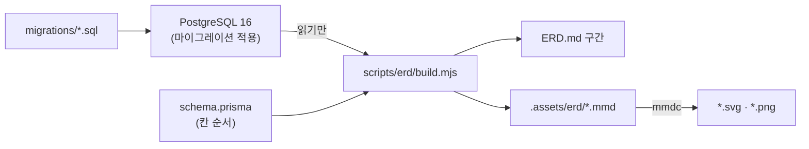

## 읽는 법

| 표기 | 뜻 |
|---|---|
| `PK` · `FK` · `UK` | 기본 키 · 외래 키 · 단독 고유 키 |
| `UK(a+b)` | 여러 칸을 묶은 고유 키 (그 칸들의 조합이 겹치지 않는다) |
| `NULL` | 비어 있을 수 있다. 표시가 없으면 `NOT NULL` |
| `기본 …` | **DB에 걸린** 기본값. `now()`는 `CURRENT_TIMESTAMP` |
| 관계선 이름 | `외래 키 칸 · 부모 행을 지울 때 동작(CASCADE·SET NULL·RESTRICT)` |
| `\|\|--o{` | 부모 1 : 자식 0..N |
| `\|o--o{` | 외래 키가 비어 있을 수 있음 (부모 0..1 : 자식 0..N) |
| `\|\|--o\|` · `\|o--o\|` | 1 : 0..1 (외래 키 칸이 고유) |

DB에 기본값이 없는 두 가지는 앱(Prisma)이 채운다: 모든 `id`(문자열)는 `@default(cuid())`, `updatedAt`은 `@updatedAt`. 타입 이름은 PostgreSQL 그대로이고(`timestamp(3)`은 밀리초까지, 시간대 없음), 대문자로 시작하는 타입은 아래 [열거형](#열거형)이다.

## 전체 관계도

37개 테이블과 외래 키만 그린 지도. 칸까지 보려면 아래 영역별 그림을 본다.


<!-- erd:overview -->
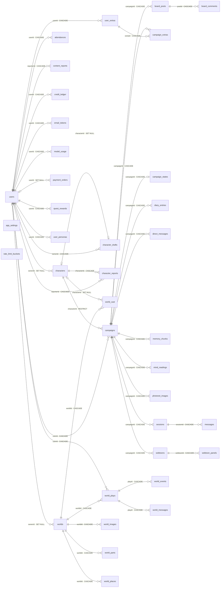
<!-- /erd:overview -->

## 영역별 상세

다른 영역의 테이블은 `id`만 그리고 "○○ 그림에 전체"라고 적었다. 큰 그림은 [SVG](../.assets/erd/)를 새 탭에서 열면 확대해 볼 수 있다.

### 1. 계정 · 결제 · 코레딧


<!-- erd:account -->
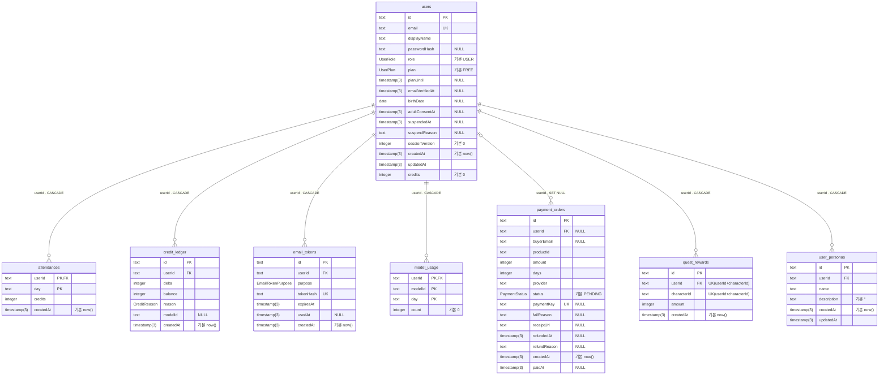
<!-- /erd:account -->

### 2. 캐릭터 · 대화

`campaigns`가 유저 × 캐릭터 대화 한 판이다. `characters`를 지우려 하면 대화가 남아 있는 한 막힌다(`RESTRICT`) — 운영에서 캐릭터는 지우지 않고 내린다(`takenDownAt`).


<!-- erd:chat -->
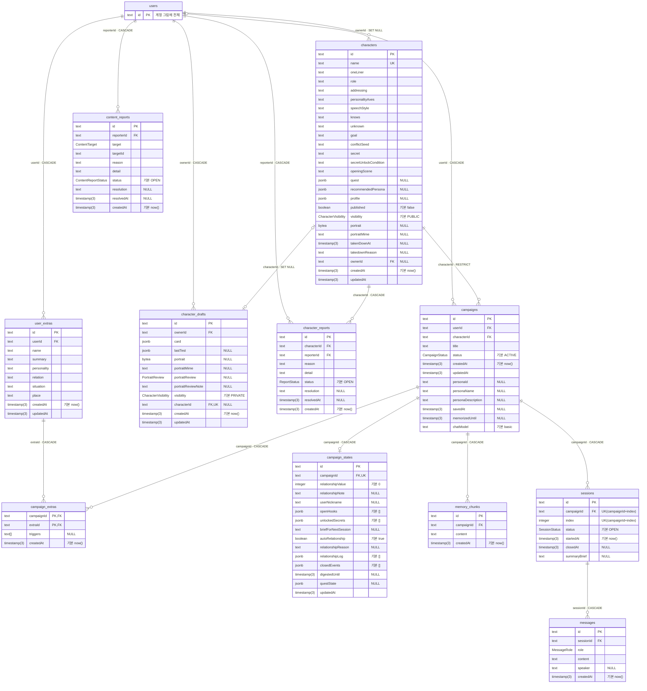
<!-- /erd:chat -->

### 3. 오퍼레이션 (대화 플러그인)

전부 대화(`campaigns`)에 매달려 있어 대화를 지우면 함께 지워진다.


<!-- erd:ops -->
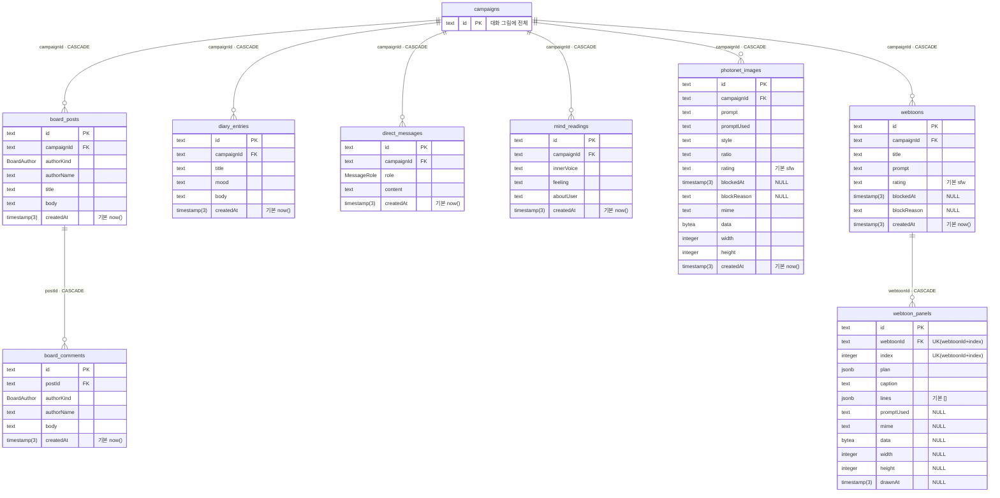
<!-- /erd:ops -->

### 4. 월드코퍼챗


<!-- erd:world -->
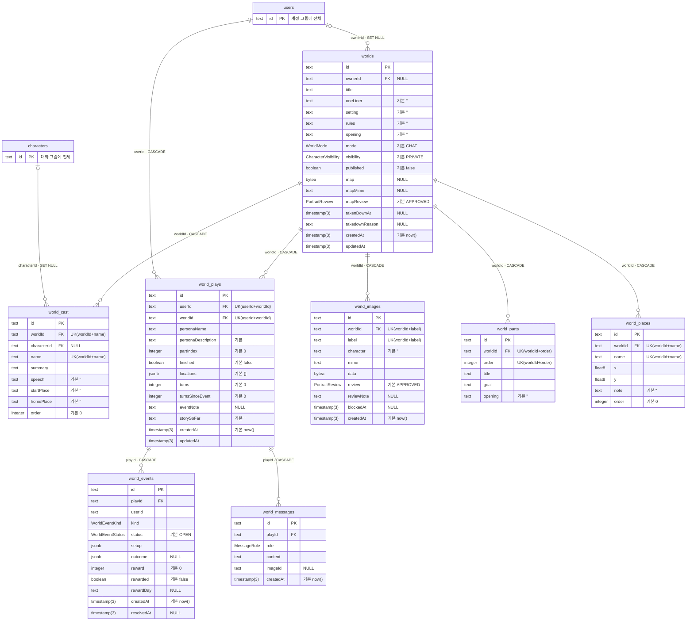
<!-- /erd:world -->

### 5. 독립 테이블

외래 키가 없다. `rate_limit_buckets`는 `RATE_LIMIT_STORE=db`일 때만 쓰는 요청 한도 카운터, `app_settings`는 운영 콘솔이 바꾸는 키 → JSON 설정이다.

<!-- erd:standalone -->
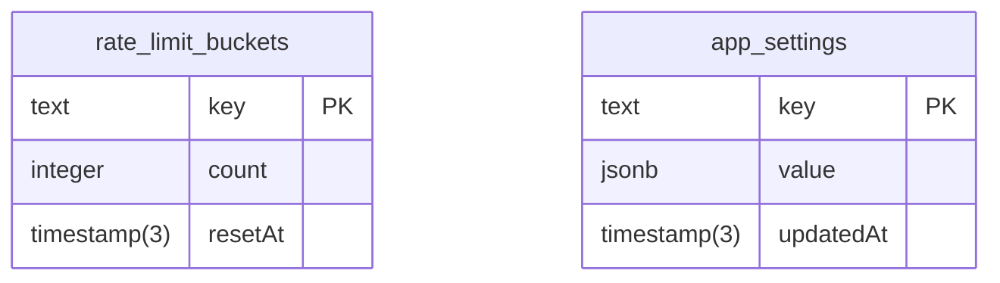
<!-- /erd:standalone -->

## 외래 키 없이 다른 행의 id를 담는 칸

DB 제약은 없고 앱 코드가 뜻을 정한다. 그래서 관계선으로 그리지 않았다. 근거는 `schema.prisma`의 주석이다.

| 칸 | 담는 것 | 외래 키를 두지 않은 이유 (schema.prisma) |
|---|---|---|
| `campaigns.personaId` | 대화에 고정한 내 프로필(`user_personas.id`) | 프로필을 고치거나 지워도 대화가 흔들리지 않게 이름·소개(`personaName`·`personaDescription`)를 복사해 둔다 |
| `content_reports.targetId` | `target`에 따라 `photonet_images`·`webtoons`·`worlds`의 id | 그림이 지워져도 신고는 남게 |
| `quest_rewards.characterId` | 보상을 준 캐릭터 id | 계정 × 캐릭터당 한 번만 주는 기록 (`UK(userId+characterId)`) |
| `world_events.userId` | 이벤트를 받은 계정 id | 하루 보상 한도를 세는 칸 (`INDEX(userId, rewardDay)`) |
| `world_messages.imageId` | 함께 보여 줄 장면 그림(`world_images.id`) | 주석: "WorldImage id" |
| `credit_ledger.modelId` | 모델 id 또는 `op:이름`·`quest:캐릭터 id`·`event:종류` | 이유(`reason`)에 따라 다른 것을 적는 칸 |

## 외래 키 전체

<!-- erd:fks -->
| 외래 키 칸 | 가리키는 곳 | 부모를 지우면 |
|---|---|---|
| `board_comments.postId` | `board_posts.id` | CASCADE |
| `board_posts.campaignId` | `campaigns.id` | CASCADE |
| `campaign_extras.campaignId` | `campaigns.id` | CASCADE |
| `campaign_states.campaignId` | `campaigns.id` | CASCADE |
| `diary_entries.campaignId` | `campaigns.id` | CASCADE |
| `direct_messages.campaignId` | `campaigns.id` | CASCADE |
| `memory_chunks.campaignId` | `campaigns.id` | CASCADE |
| `mind_readings.campaignId` | `campaigns.id` | CASCADE |
| `photonet_images.campaignId` | `campaigns.id` | CASCADE |
| `sessions.campaignId` | `campaigns.id` | CASCADE |
| `webtoons.campaignId` | `campaigns.id` | CASCADE |
| `campaigns.characterId` | `characters.id` | RESTRICT |
| `character_drafts.characterId` | `characters.id` | SET NULL |
| `character_reports.characterId` | `characters.id` | CASCADE |
| `world_cast.characterId` | `characters.id` | SET NULL |
| `messages.sessionId` | `sessions.id` | CASCADE |
| `campaign_extras.extraId` | `user_extras.id` | CASCADE |
| `attendances.userId` | `users.id` | CASCADE |
| `campaigns.userId` | `users.id` | CASCADE |
| `character_drafts.ownerId` | `users.id` | CASCADE |
| `character_reports.reporterId` | `users.id` | CASCADE |
| `characters.ownerId` | `users.id` | SET NULL |
| `content_reports.reporterId` | `users.id` | CASCADE |
| `credit_ledger.userId` | `users.id` | CASCADE |
| `email_tokens.userId` | `users.id` | CASCADE |
| `model_usage.userId` | `users.id` | CASCADE |
| `payment_orders.userId` | `users.id` | SET NULL |
| `quest_rewards.userId` | `users.id` | CASCADE |
| `user_extras.userId` | `users.id` | CASCADE |
| `user_personas.userId` | `users.id` | CASCADE |
| `world_plays.userId` | `users.id` | CASCADE |
| `worlds.ownerId` | `users.id` | SET NULL |
| `webtoon_panels.webtoonId` | `webtoons.id` | CASCADE |
| `world_events.playId` | `world_plays.id` | CASCADE |
| `world_messages.playId` | `world_plays.id` | CASCADE |
| `world_cast.worldId` | `worlds.id` | CASCADE |
| `world_images.worldId` | `worlds.id` | CASCADE |
| `world_parts.worldId` | `worlds.id` | CASCADE |
| `world_places.worldId` | `worlds.id` | CASCADE |
| `world_plays.worldId` | `worlds.id` | CASCADE |
<!-- /erd:fks -->

## 복합 키 · 고유 키 · 인덱스

기본 키가 `id` 하나인 테이블은 빼고, 그 밖의 키와 인덱스를 모두 적었다.

<!-- erd:keys -->
| 테이블 | 종류 | 칸 |
|---|---|---|
| `attendances` | 복합 PK | `userId`, `day` |
| `campaign_extras` | 복합 PK | `campaignId`, `extraId` |
| `model_usage` | 복합 PK | `userId`, `modelId`, `day` |
| `campaign_states` | UNIQUE | `campaignId` |
| `character_drafts` | UNIQUE | `characterId` |
| `characters` | UNIQUE | `name` |
| `email_tokens` | UNIQUE | `tokenHash` |
| `payment_orders` | UNIQUE | `paymentKey` |
| `quest_rewards` | UNIQUE | `userId`, `characterId` |
| `sessions` | UNIQUE | `campaignId`, `index` |
| `users` | UNIQUE | `email` |
| `webtoon_panels` | UNIQUE | `webtoonId`, `index` |
| `world_cast` | UNIQUE | `worldId`, `name` |
| `world_images` | UNIQUE | `worldId`, `label` |
| `world_parts` | UNIQUE | `worldId`, `order` |
| `world_places` | UNIQUE | `worldId`, `name` |
| `world_plays` | UNIQUE | `userId`, `worldId` |
| `board_comments` | INDEX | `postId`, `createdAt` |
| `board_posts` | INDEX | `campaignId`, `createdAt` |
| `campaigns` | INDEX | `userId`, `characterId`, `status` |
| `character_drafts` | INDEX | `ownerId`, `updatedAt` |
| `character_reports` | INDEX | `status`, `createdAt` |
| `character_reports` | INDEX | `characterId`, `status` |
| `content_reports` | INDEX | `status`, `createdAt` |
| `content_reports` | INDEX | `target`, `targetId`, `status` |
| `credit_ledger` | INDEX | `userId`, `createdAt` |
| `diary_entries` | INDEX | `campaignId`, `createdAt` |
| `direct_messages` | INDEX | `campaignId`, `createdAt` |
| `email_tokens` | INDEX | `userId`, `purpose` |
| `memory_chunks` | INDEX | `campaignId`, `createdAt` |
| `messages` | INDEX | `sessionId`, `createdAt` |
| `mind_readings` | INDEX | `campaignId`, `createdAt` |
| `model_usage` | INDEX | `day` |
| `payment_orders` | INDEX | `userId`, `createdAt` |
| `photonet_images` | INDEX | `campaignId`, `createdAt` |
| `rate_limit_buckets` | INDEX | `resetAt` |
| `user_extras` | INDEX | `userId`, `updatedAt` |
| `user_personas` | INDEX | `userId` |
| `webtoons` | INDEX | `campaignId`, `createdAt` |
| `world_events` | INDEX | `userId`, `rewardDay` |
| `world_events` | INDEX | `status`, `createdAt` |
| `world_images` | INDEX | `review` |
| `world_messages` | INDEX | `playId`, `createdAt` |
| `worlds` | INDEX | `published`, `visibility`, `takenDownAt` |
| `worlds` | INDEX | `ownerId` |
<!-- /erd:keys -->

## 열거형

<!-- erd:enums -->
| 열거형 | 값 |
|---|---|
| `BoardAuthor` | `USER` · `RESIDENT` |
| `CampaignStatus` | `ACTIVE` · `CLOSED` |
| `CharacterVisibility` | `PUBLIC` · `UNLISTED` · `PRIVATE` |
| `ContentReportStatus` | `OPEN` · `BLOCKED` · `DISMISSED` |
| `ContentTarget` | `PHOTONET` · `WEBTOON` · `WORLD` |
| `CreditReason` | `ATTENDANCE` · `MODEL_USE` · `REFUND` · `ADMIN` · `OPERATION` · `QUEST` · `EVENT` |
| `EmailTokenPurpose` | `VERIFY_EMAIL` · `RESET_PASSWORD` |
| `MessageRole` | `USER` · `CHARACTER` · `SYSTEM` |
| `PaymentStatus` | `PENDING` · `PAID` · `FAILED` · `REFUNDED` |
| `PortraitReview` | `APPROVED` · `PENDING` · `REJECTED` |
| `ReportStatus` | `OPEN` · `RESOLVED` · `DISMISSED` |
| `SessionStatus` | `OPEN` · `CLOSED` |
| `UserPlan` | `FREE` · `PRO` |
| `UserRole` | `USER` · `ADMIN` |
| `WorldEventKind` | `LADDER` · `DICE` · `BOWLING` · `LOTTERY` · `MAZE` |
| `WorldEventStatus` | `OPEN` · `WON` · `LOST` · `EXPIRED` |
| `WorldMode` | `CHAT` · `VISUAL_NOVEL` · `NOVEL` · `MESSENGER` |
<!-- /erd:enums -->

## 검증

2026-11-07에 다음으로 확인했다.

- 빈 PostgreSQL 16에 마이그레이션 34개를 이름 순서대로 적용 → 오류 없음, 테이블 37개.
- DB의 칸 목록·NULL 허용을 `schema.prisma`의 스칼라 필드와 한 칸씩 대조 → 어긋남 없음. 단 `campaign_extras.triggers`(`String[]`)는 DB에서 NULL 허용인데, Prisma가 목록 칸에 `NOT NULL`을 걸지 않기 때문이다(스키마와 마이그레이션은 일치).
- 외래 키 45줄(나중 마이그레이션이 `ON DELETE`를 바꾸며 다시 만든 5개 포함) → 최종 40개. 모두 `schema.prisma`의 `@relation`과 같다.

2026-11-08 마이그레이션 `20261108123000_chat_memory_scene`은 테이블을 늘리지 않고 칸만 더한다. `memory_chunks.pinned`(기본 거짓), `campaign_states.sceneTime`·`scenePlace`, `world_plays.sceneTime`·`scenePlace`. 위 34개 대조를 이 칸이 생긴 뒤 빈 데이터베이스에 다시 돌리지는 않았다.

## 다시 만들기

스키마를 바꾼 뒤 [scripts/erd/README.md](../../scripts/erd/README.md)대로 돌린다. 테이블이 늘면 `build.mjs`의 `groups`에 넣어야 한다(빠지면 멈춘다).
