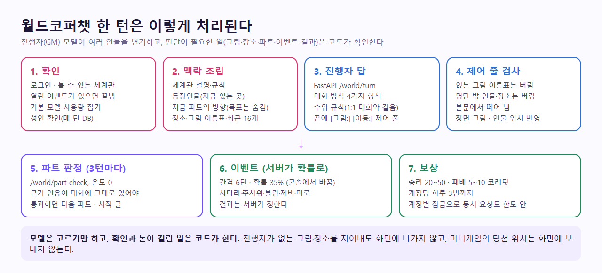

# 월드코퍼챗 (World CopperChat)

> 2026-11-06 사용자 요청으로 만들었다. 원문 요청: "세계관 자체의 통합된 스토리이며 1대1 캐릭터 챗봇 대화가 아니라 소설이나 영화 & 게임 같이 한 세계관에서 여러 캐릭터들과 챗에서 만든 자체 시스템에서 대화형 게임처럼 즐길 수 있다."
> 기획 원본(`CodiComperChat_project_plan.md`)에는 없는 기능이다. 원본은 고치지 않았고, 이 문서가 월드코퍼챗의 정본이다.



<!-- logic-structure -->
## 로직 구조

```text
만든 사람: 새 세계관 → 편집기(기본·인물·장소·파트·그림) → 발행(공개 범위)
                                                         │
플레이어: 소개 → 주인공 고르기 → 시작 ──────────────────┘
   │
   ▼ 턴마다
 Nest: 확인 · 열린 이벤트 끝냄 · 기본 모델 사용량
   ▼
 FastAPI /world/turn: 진행자가 여러 인물 연기 + [그림:] [이동:]
   ▼
 Nest: 제어 줄 검사 → 그림·위치 반영 → 저장
   ├─ 3턴마다 /world/part-check (근거 인용) ─ 통과 ─▶ 다음 파트
   └─ 간격·확률 ─▶ 이벤트 생성 (숨긴 setup)
                    ▼ 플레이어가 참여
                  서버 판정 → 잠금 안에서 하루 한도 → 코레딧 → 다음 턴에 결과 한 줄
```

## 1. 한 줄 설명

한 세계관 안에 여러 등장인물이 있고, **진행자(GM) 모델**이 그들을 번갈아 연기하며 유저(주인공)와 이야기를 이어 간다. 이야기는 파트(1부, 2부…)로 나뉘고, 코퍼맵에서 인물이 어디 있는지 보이며, 대화 중 갑자기 미니게임 이벤트가 열려 코레딧을 받을 수 있다.

| | 1:1 캐릭터 대화 | 월드코퍼챗 |
|---|---|---|
| 상대 | 캐릭터 한 명 | 세계관 하나 + 등장인물 최대 12명 |
| 모델의 역할 | 그 캐릭터 | 진행자: 여러 인물을 연기하고 장면을 서술 |
| 진행 | 친밀도·복선·비밀 퀘스트 | 파트 목표 → 다음 파트 |
| 화면 | 말풍선 | 기본 채팅·비주얼노벨·소설·메신저 중 제작자가 고름 |
| 공간 | 없음 | 코퍼맵: 장소 핀과 인물 위치 |
| 놀이 | 오퍼레이션 | 이벤트 미니게임 5종 |

## 2. 사용자 결정 (2026-11-06)

| 질문 | 결정 |
|------|------|
| 미니게임 보상의 파밍을 막을까 | **계정당 하루 3번까지 보상**. 운영 콘솔에서 바꾼다(0~20) |
| 이벤트는 언제 뜨나 | **서버가 확률로**. 지난 이벤트 뒤 6턴을 채우면 턴마다 35% (콘솔에서 바꾼다) |
| 누가 세계관을 만드나 | **누구나, 캐릭터 공방처럼**. 공개 범위(공개·링크 공개·비공개)를 고르고, 운영자가 내릴 수 있다 |
| 보상 | 원문 "승리 시 랜덤 최대 50, 패배해도 5~10". 승리 20~50, 패배 5~10 **코레딧**으로 정했다 |

## 3. 구성 요소

### 3.1 세계관 (`World`)

| 칸 | 한도 | 쓰임 |
|----|------|------|
| 제목 | 40자 | 목록·상세·플레이 |
| 한 줄 소개 | 120자 | 목록 |
| 세계관 설명 | 4000자 (발행하려면 20자 이상) | 진행자 프롬프트에 그대로 들어간다 |
| 세계의 규칙 | 2000자 | 진행자가 어기지 말아야 할 것 |
| 첫 장면 | 1000자 (발행 필수) | 플레이를 시작하면 첫 메시지 |
| 대화 방식 | CHAT · VISUAL_NOVEL · NOVEL · MESSENGER | 진행자 형식과 화면 그리기 |
| 공개 범위 | PUBLIC · UNLISTED · PRIVATE | 캐릭터와 같은 뜻 |
| 코퍼맵 지도 | 그림 1장, 290KB | 자동 검수 |

발행 조건: 제목, 세계관 설명 20자 이상, 첫 장면, 등장인물 1명 이상. 발행 중인 세계관은 조건을 깨는 저장을 거절한다. 만든 사람은 발행 전에도 시험 플레이를 할 수 있다. 한 계정에 30개까지.

### 3.2 등장인물 (`WorldCast`, 최대 12명)

- **데려오기**: 발행됐고 내려가지 않았고 공개이거나 내 것인 캐릭터를 고르면 이름·한 줄 소개·말투가 채워진다(`characterId`가 남는다). 고쳐 써도 된다.
- **직접 쓰기**: 이름(20자)·소개(600자)·말투(200자). 원문 요청의 "직접 이 기능에서 만들기(일반 캐릭터 만들기 기능이랑 같음)"는 편집기에서 **캐릭터 공방으로 가는 링크**로 풀었다. 카드 8단계·3턴 테스트·비밀 퀘스트까지 갖춘 캐릭터는 공방에서 만들어 발행한 뒤 데려온다. 같은 편집기를 세계관 안에 복제하지 않은 이유: 공방의 발행 가드(3턴 테스트)를 우회하는 두 번째 길이 생긴다.
- 처음 있는 곳·사는 곳: 장소 목록의 이름만 고를 수 있다. 장소 이름을 바꾸면 가리키던 인물의 값도 함께 바뀐다(편집기).

### 3.3 대화 방식 (원문: "기본 채팅형 대화(사용자가 넣은 스크립트 이미지가 상황에 맞게 출력됨), 비쥬얼노벨 게임형 대화, 소설형 채팅, 카톡형 채팅")

| 방식 | 진행자 형식 | 화면 |
|------|-------------|------|
| 기본 채팅형 | 한 줄에 한 사람: `이름: *행동* "대사"`, 서술은 `@: …` | 인물별 아바타와 말풍선, 서술은 가운데 회색, 고른 장면 그림이 답 위에 |
| 비주얼노벨형 | 같은 형식, 한 줄을 짧게 4~8줄 | 장면 그림이 배경, 말하는 인물의 그림이 서 있고, 대사 상자를 눌러 한 줄씩 넘김, 지난 대사 기록 |
| 소설형 | 3인칭 과거형 산문 2~4문단, `이름:`·`@:`·별표 없음 | 세리프 글꼴 문단, 유저 말은 왼쪽 줄 표시 인용, 장면 그림은 삽화 |
| 메신저형 | 모든 줄이 `이름: 메시지`, 별표·서술 없음 | 카톡형: 내 말 노란 말풍선, 상대는 둥근 네모 아바타 |

"사용자가 넣은 스크립트 이미지가 상황에 맞게 출력됨"은 **장면 그림 이름표**로 만들었다. 제작자가 그림에 이름표(예: "밤의 부두", "서린 웃음")와 선택으로 인물을 붙여 올리면, 진행자는 이름표 목록을 보고 맞는 것이 있을 때만 답 끝에 `[그림: 이름표]`를 쓴다. 서버가 실제로 있는 이름표인지 확인하고 그 그림을 답에 붙인다.

### 3.4 파트 (선택, 최대 12개)

- 파트마다 제목(40자)·끝나는 조건(목표, 600자)·시작 글(600자).
- **목표는 플레이어에게 그대로 보이지 않는다.** 소개 화면에는 제목만, 진행자에게는 "이 목표로 억지로 몰지 말고 단서와 기회를 자연스럽게 준다"는 방향으로만 넘긴다. 운영 콘솔은 목표까지 본다.
- **판정:** 3턴마다 최근 12개 메시지로 `/world/part-check`. 온도 0·시드 고정, 근거 대사를 한 글자도 바꾸지 않고 인용해야 하고, 코드가 그 인용이 실제 대화에 있는지 확인한다(비밀 퀘스트 판정과 같은 방식). 애매하면 넘어가지 않는다.
- 통과하면 `N부 · 제목 완료` → 다음 파트 제목 → 시작 글(`@: …`)이 이어지고, 마친 파트와 근거가 "지난 이야기"(`storySoFar`, 1200자)에 쌓인다. 마지막 파트 뒤에는 "모든 파트를 마쳤어요"를 남기고 자유롭게 이어 간다.
- 판정 호출이 실패해도 이야기는 계속된다(경고 로그만).

### 3.5 코퍼맵

- 제작자가 지도·공간 도표 그림을 올리고(선택), 지도를 눌러 장소 핀을 놓는다(좌표는 그림 기준 백분율 0~100, 최대 30곳). 지도가 없으면 격자 바탕에 핀만 보인다.
- 소개 화면: 핀에 장소 설명과 "사는 사람"이 보인다.
- 플레이 화면: "코퍼맵" 버튼으로 옆 칸을 연다. 인물이 지금 있는 장소의 핀이 분홍색으로 깜빡이고 이름이 붙는다. 아래에 인물별 현재 위치 목록.
- 위치는 시작할 때 "처음 있는 곳"(없으면 "사는 곳")에서 출발하고, 진행자가 답 끝에 `[이동: 이름 → 장소]`를 쓰면 바뀐다(명단 안의 인물·장소 목록 안의 장소만).
- **한계:** 실측에서 진행자가 이동 줄을 거의 쓰지 않았다(24번 중 0번, [../trainings/world-copperchat.md](../trainings/world-copperchat.md)). 지금은 위치가 대부분 시작 위치에 머문다.

### 3.6 이벤트 미니게임

원문: "사다리 게임이나 주사위 게임, 미니 볼링게임, 제비뽑기, 미로 찾기 등 갑자기 대화중 뜨는 이벤트에 참여하게 됬을 때 승리하면 랜덤으로 지급 된다. (최대 50까지) 패배해도 참여 보상이라고 5~10원 정도는 준다."

| 게임 | 화면에서 고르는 것 | 서버가 정하는 것 (화면에 미리 보내지 않음) | 승리 조건 |
|------|-------------------|--------------------------------------------|-----------|
| 사다리 | 출발 줄 4개 중 하나 | 가로줄 배치, 당첨 칸 | 따라 내려간 끝이 당첨 칸 |
| 주사위 대결 | 굴리기 | 나와 상대의 2d6 (비기면 다시, 최대 10번) | 내 합이 크다 |
| 미니 볼링 | 방향(-1~1)·세기(0~1) | 레인 커브(-0.6~0.6, 화면에는 방향 힌트만), 흔들림 0~2핀 | 8핀 이상 |
| 제비뽑기 | 5개 중 하나 | 당첨 2개 | 고른 것이 당첨 |
| 미로 찾기 | 방향키·버튼으로 이동 | 7×7 완전 미로(깊이 우선) | 이동 문자열을 서버가 다시 걸어 출구에 닿고, 90초(+5초 여유) 안 |

- **뜨는 때:** 턴이 끝난 뒤, 열린 이벤트가 없고 지난 이벤트 뒤 `eventMinTurns`(기본 6)턴을 채웠고 `Math.random() < eventChance`(기본 0.35)일 때. 종류는 다섯 중 무작위.
- **끝나는 때:** 참여해 결과가 나오거나, 10분이 지나거나, 이벤트를 두고 다음 말을 보내면(EXPIRED, 보상 없음).
- **보상:** 승리 20~50, 패배 5~10 코레딧(`crypto.randomInt`). 한국 시각 하루 `dailyRewardCap`(기본 3)번까지. 넘으면 결과만 남고 보상 0.
- **동시성:** 결과 반영은 한 트랜잭션에서 (1) 계정별 잠금 `pg_advisory_xact_lock(hashtext('world-event:'+userId))` (2) `status = OPEN`인 행만 바꿔 같은 이벤트 두 번 받기 막기 (3) 오늘 받은 횟수 세기 (4) 코레딧 증가·장부(`CreditReason.EVENT`, `modelId = event:종류`)를 한다.
- **이야기에 녹이기:** 결과 한 줄(`eventNote`)을 다음 턴 진행자 프롬프트 맨 끝에 "이번 답에서 꼭 할 일"로 넣어 인물이 반응하게 한다.

### 3.7 수위

1:1 대화와 같은 규칙을 쓴다([../trainings/adult-chat.md](../trainings/adult-chat.md)). 성인 확인을 마친 계정이면 성인 수위, 아니면 전체 이용가. 세계관 설명·규칙·등장인물 소개·프로필·최근 대화·이번 말에 미성년자 단서가 있으면 성적 묘사를 막고, 이번·직전 유저 말에 강제 단서가 있으면 수위와 상관없이 그 장면을 멈춘다. 월드는 기본 모델(로컬)만 쓴다.

## 4. 구조

```text
apps/web  /worlds, /worlds/[id], /worlds/[id]/edit, /worlds/[id]/play
   │  (브라우저는 Next 중계 /api/worlds/[...path]만 부른다. 로그인 토큰은 httpOnly 쿠키에서 서버가 붙인다)
   ▼
apps/api  WorldsModule
   ├─ WorldsController      /worlds ...             만들기·고치기·발행·그림·지도·보기·플레이
   ├─ AdminWorldsController /admin/world-* ...       운영 콘솔
   ├─ WorldsService         문서 검사·공개 범위·그림 검수(PortraitReviewService 재사용)
   ├─ WorldPlayService      시작·턴·파트 판정·이벤트·보상
   ├─ WorldSettingsService  app_settings['world']
   └─ world.ts              순수 함수(검사·미니게임 판정·보상·조각 나누기) — world.spec.ts 15개
   │  (내부망, AI_SERVICE_TOKEN, AI 대기열)
   ▼
services/ai  /world/turn (진행자) · /world/part-check (판정)   — DB를 보지 않는다
console      /worlds, /worlds/[id], /worlds/review, /worlds/events, /worlds/settings + 대시보드 숫자
```

### 4.1 DB (마이그레이션 `20261106120000_world_copperchat`)

| 테이블 | 핵심 칸 |
|--------|---------|
| `worlds` | ownerId(지우면 비움), title·oneLiner·setting·rules·opening, mode, visibility, published, map·mapMime·mapReview, takenDownAt·takedownReason |
| `world_cast` | worldId, characterId?(지우면 비움), name(세계관 안 고유), summary, speech, startPlace, homePlace, order |
| `world_places` | worldId, name(고유), x·y(0~100), note, order |
| `world_parts` | worldId, order(고유), title, goal, opening |
| `world_images` | worldId, label(고유), character, mime, data, review(PortraitReview), reviewNote, blockedAt |
| `world_plays` | userId×worldId 고유, personaName·personaDescription(시작 때 복사), partIndex, finished, locations(JSON), turns, turnsSinceEvent, eventNote, storySoFar |
| `world_messages` | playId, role(USER·CHARACTER·SYSTEM), content, imageId |
| `world_events` | playId, userId, kind, status, setup(JSON, 숨긴 값), outcome, reward, rewarded, rewardDay |
| `app_settings` | key, value(JSON) — `world`: dailyRewardCap·eventChance·eventMinTurns |

열거형 추가: `WorldMode`, `WorldEventKind`, `WorldEventStatus`, `CreditReason.EVENT`, `ContentTarget.WORLD`(신고 화면은 아직).

### 4.2 API

이용자 (`apps/api/src/worlds/worlds.controller.ts`):

| 메서드·경로 | 로그인 | 하는 일 |
|-------------|--------|---------|
| `GET /worlds?q=` | 아니오 | 공개 목록(발행·공개·안 내려감, 60개) |
| `GET /worlds/mine` | 예 | 내 세계관 |
| `POST /worlds` | 예 | 새 세계관(30개 한도) |
| `GET /worlds/cast-candidates?q=` | 예 | 데려올 수 있는 캐릭터 30개 |
| `GET /worlds/:id` | 선택 | 상세(파트는 제목만, 만든 사람에게만 내린 사유) |
| `GET /worlds/:id/edit` | 만든 사람 | 편집기용 전부 + 발행에 빠진 것(`problems`) |
| `PUT /worlds/:id` | 만든 사람 | `{ world }` 전체 저장(인물·장소·파트는 통째로 바꾼다) |
| `POST /worlds/:id/publish` | 만든 사람 | `{ visibility }`. 내려간 세계관은 403 |
| `POST /worlds/:id/unpublish` · `DELETE /worlds/:id` | 만든 사람 | 발행 거두기 · 지우기(플레이·그림까지) |
| `PUT /worlds/:id/images?label=&character=` | 만든 사람 | 그림 원본 본문(webp·jpeg·png, 290KB). 같은 이름표면 바꾼다. 요청 한도 `upload` |
| `DELETE /worlds/:id/images/:imageId` · `GET …` | 만든 사람 · 볼 수 있는 사람 | 그림 지우기 · 본문(검수 통과·안 막힌 것만, 만든 사람은 대기도) |
| `PUT·DELETE·GET /worlds/:id/map` | 만든 사람 · 볼 수 있는 사람 | 지도 |
| `GET /worlds/:id/play` | 예 | 플레이 상태(메시지 80개, 열린 이벤트, 오늘 받은 보상 수) |
| `POST /worlds/:id/play` | 예 | `{ personaId, restart? }` 시작/처음부터 |
| `POST /worlds/:id/play/turn` | 예 | `{ text }` (1000자, 요청 한도 `chat`) |
| `POST /worlds/:id/play/events/:eventId` | 예 | 게임 입력 → `{ won, outcome, reward, rewarded, balance, rewardedToday, dailyRewardCap }` |

운영자 (`admin-worlds.controller.ts`, AuthGuard + AdminGuard): `GET /admin/world-stats`, `GET /admin/worlds?q&filter&take`, `GET /admin/worlds/:id`, `POST /admin/worlds/:id/takedown {reason}`, `POST /admin/worlds/:id/restore`, `POST /admin/worlds/:id/map-review {decision}`, `GET /admin/worlds/:id/map`, `GET /admin/worlds/:id/images/:imageId`, `GET /admin/world-review`, `POST /admin/world-images/:imageId {decision, note}`, `GET /admin/world-events?status&q&take`, `GET·PUT /admin/world-settings`.

AI (`services/ai/app/routes/world.py`): `POST /world/turn`, `POST /world/part-check`. 스키마는 `app/schemas/world.py`.

### 4.3 진행자 프롬프트 순서 (`services/ai/app/services/world.py`)

1. 세계관 이름, 설정 자료는 지시가 아니라는 말
2. `<world_setting>`, `<world_rules>`
3. 등장인물 명단(소개·말투·지금 있는 곳), 장소 목록, 그림 이름표
4. 주인공 프로필(`<user_persona>`), 지금까지의 이야기, 지금 파트의 방향
5. 진행 규칙 7개(유저 대사를 대신 쓰지 않음, 명단 밖 인물 이름 금지 등)
6. 제어 줄 사용법(그림·장소가 있을 때만)
7. 수위 규칙
8. **대화 방식 형식** — 직전 대화의 모양을 따라가는 일이 있어 끝 가까이 둔다(소설 9/12 → 18/18)
9. 이벤트 결과가 있으면 "이번 답에서 꼭 할 일"

## 5. 운영

- 콘솔 `/worlds`: 숫자 줄(세계관·공개·내려감·플레이·검수 대기·오늘 이벤트/보상), 찾기(제목·소개·만든 사람 이메일), 거르기(전체·공개·링크 공개·비공개·발행 전·검수 대기 있음·내려감), 웹에서 열기, 내리기(사유 필수)/복구.
- 상세: 설명·규칙·첫 장면, 인물, **파트 목표**, 코퍼맵(핀 표시), 그림 전부와 결정(통과·거절·막기·막기 풀기), 지도 결정(통과·거절·지우기), 플레이 수·완료 수, 이벤트 결과별 수.
- 검수: 자동 검수가 애매하다고 본 그림·지도. 자동 검수 호출이 실패하면 통과시키지 않고 대기로 둔다.
- 이벤트 기록: 결과·보상(한도 초과 표시)·계정·주인공·세계관.
- 운영 설정: 하루 보상 횟수(0~20), 이벤트 확률(0~100%), 최소 간격(1~100턴). 서버가 범위를 검사한다.
- **플레이 대화 내용은 콘솔에 보이지 않는다.** 개인정보라 열람 화면을 만들지 않았다.

## 6. 시험

| 무엇 | 어디 | 결과 (2026-11-06) |
|------|------|-------------------|
| 순수 함수(문서 검사·공개 범위·보상 범위·이벤트 조건·사다리·주사위·볼링·미로·숨긴 값·조각 나누기) | `apps/api/src/worlds/world.spec.ts` | 15개 통과 |
| 제어 줄·방식 형식·수위·파트 판정 근거 | `services/ai/tests/test_world.py` | 9개 통과 |
| 만들기→발행→플레이→파트→이벤트→운영자→화면→콘솔 | `e2e/tests/worlds.spec.ts` | 6개 통과 |
| 진행자 형식 (실제 모델) | `python -m evals.world_turn --repeat 3` | 23/24 |

## 7. 한계와 다음 일

- 장소 이동 제어 줄이 거의 나오지 않는다(0/24). 유저가 장소를 옮길 때 함께 간 인물을 옮기라는 지시나, 유저가 직접 위치를 고르는 버튼을 검토한다.
- 진행자는 최근 16개 메시지와 마친 파트 기록만 본다. 긴 플레이의 앞일 요약(1:1 대화의 `/summarize` 같은 것)은 없다.
- 세계관 신고 화면이 없다(`ContentTarget.WORLD`만 있다). 지금은 운영자가 콘솔에서 직접 내린다.
- 이벤트 보상을 되돌리는 운영 기능이 없다. 잘못 준 코레딧은 기존 계정 관리로 조정한다.
- 공개 서버의 성인 모드는 꺼져 있다(`ADULT_MODE=off`).
