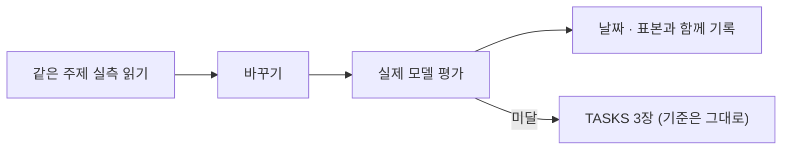

# 연구·학습 노트

이 프로젝트에서 **실제로 돌려 본 결과**와 그 결과로 내린 판단을 모은다. 코드 설명이 아니라 "무엇을 해 봤고, 무엇이 나왔고, 그래서 어떻게 정했나"를 적는다.

> **이 폴더는 모델 학습 기록이 아니다.** v1은 자체 가중치를 학습하지 않는다(계획서 §7.7). 학습 코드와 데이터셋이 없고, `services/ai`의 `/train`은 403을 돌려준다. 프롬프트, 맥락, 판정 규칙, 그림 파이프라인을 실측으로 다듬은 기록이다.

<!-- logic-structure -->
## 로직 구조

```text
프롬프트·판정·그림을 바꾸려 함
   │ 먼저 이 폴더에서 같은 주제의 실측을 읽는다
   ▼
바꾼다 ─▶ 실제 모델로 평가 (evals.* / 표본 늘리기) ─▶ 결과를 날짜·표본 크기와 함께 여기에
   │ 기준 미달이면 기준을 낮추지 않고 TASKS 3장에 남긴다
```

<!-- logic-mermaid -->

### 실측을 쓰는 순서



## 노트

| 노트 | 내용 |
|------|------|
| [eval-2026-11-06.md](eval-2026-11-06.md) | 전체 평가를 새로 돌린 결과, 실패 항목, 이전 결과와 비교 |
| [small-model-prompting.md](small-model-prompting.md) | 작은 모델이 지시를 따르게 만든 시행착오 (말투, 나레이션, 호칭, 끝 지시, 단계 나누기) |
| [world-copperchat.md](world-copperchat.md) | 월드코퍼챗 진행자 형식 평가(13/16 → 23/24), 장소 이동 0/24, README 화면을 찍다 찾은 것 (2026-11-06) |
| [adult-chat.md](adult-chat.md) | 대화 수위: 학습 없이 성인 대화를 연 판단, 강제 장면이 뚫린 일과 코드로 막은 과정 (2026-11-06) |
| [narration-and-reward.md](narration-and-reward.md) | 나레이션 7/12 → 48/48, 보상 장면 2/8 → 20/20으로 고친 과정 (2026-11-06) |
| [memory-and-grounding.md](memory-and-grounding.md) | 페르소나 지식 검색, 개인사 환각 막기, 이야기 상태 정리 |
| [quest-judging.md](quest-judging.md) | 비밀 퀘스트 판정: 코레딧이 나가는 판정을 어떻게 믿을 수 있게 했나 |
| [image-pipeline.md](image-pipeline.md) | 그림 모델, 프롬프트 조립, 그림 검수, 속도, 그래픽 메모리 |
| [oracle-deploy-latency.md](oracle-deploy-latency.md) | Oracle 서버의 호스팅 API(19.0초)·예비 CPU(32.1초) 응답 한 번씩, 시간 제한 사슬, **재지 못한 것**(31B 품질 평가 등) (2026-11-07) |
| [test-infrastructure.md](test-infrastructure.md) | e2e 무작위 실패의 원인 찾기, 부하 측정, 평가 도구 자체의 결함 |
| [korean-grammar.md](korean-grammar.md) | 답·추천의 맞춤법을 가중치 없이 고친 목록. 로컬 모델 4질문에서 교정 전후 차이 0/4 (2026-11-12) |
| [chat-latency.md](chat-latency.md) | 첫 답 320·다음 턴 200토큰, 추가 생성 제거. 이미 떠 있던 `gemma4:e4b` 3.1초·2.9초, 나레이션 16/16. Vercel 경로는 재지 않음 (2026-11-12) |

## 측정 환경

달리 적지 않으면 아래 환경이다. 서버 GPU에서는 아직 재지 않았다.

| 항목 | 값 |
|------|-----|
| GPU | NVIDIA RTX 4070 SUPER, 그래픽 메모리 12GB |
| RAM | 16GB. 평소 다른 프로그램이 많이 써서 남은 RAM이 약 400MB~1.2GB였다 |
| 대화 모델 | Ollama 0.40.14, `gemma4:e4b` |
| 강화 모델 | `gemma4:12b`. 자동 평가는 돌리지 않았다 |
| 그림 엔진 | diffusers, Animagine XL 4.0 Opt(SDXL), Stable Diffusion 1.5 |

## 다시 돌리는 법

```bash
cd services/ai
./.venv/Scripts/python.exe -m evals.run --repeat 2 -v      # 대화·판정·검수 11묶음
./.venv/Scripts/python.exe -m evals.quest_seyeon           # 이세연 퀘스트 판정
./.venv/Scripts/python.exe -m evals.quest_yujiseong        # 유지성 퀘스트 판정
./.venv/Scripts/python.exe -m evals.quest_reward --repeat 4 -v   # 보상 장면
./.venv/Scripts/python.exe -m evals.photonet_guard         # 성인 그림 가드 (그림 엔진 필요)
./.venv/Scripts/python.exe -m evals.image_speed            # 그림 단계별 시간 (그림 엔진 필요)
```

모델이나 프롬프트를 바꾸면 전체를 다시 돌리고, 날짜를 붙인 결과 노트를 새로 쓴다.

## 쓰는 규칙

- **돌려 본 것만 적는다.** 수치에는 표본 크기를 함께 적는다. 표본이 작으면 작다고 적는다.
- **실패도 그대로 적는다.** 기준을 낮추거나 장면을 바꿔 통과시키지 않는다.
- 측정하지 않았으면 "재지 않았다"고 적는다.
- 캐릭터 카드 원문, 캐릭터 비밀, 실제 유저 데이터를 넣지 않는다.
- 코드는 참고용 발췌만 쓴다. 실제 구현은 `apps/`, `services/`에 있다.
- 지난 노트의 수치는 그때의 기록이라 고치지 않는다. 지금 값은 새 노트에 적는다.

이전 실측의 원본 기록은 `docs/branchs/commits/`의 "기술 포인트"와 "동작 확인"에 있다.
