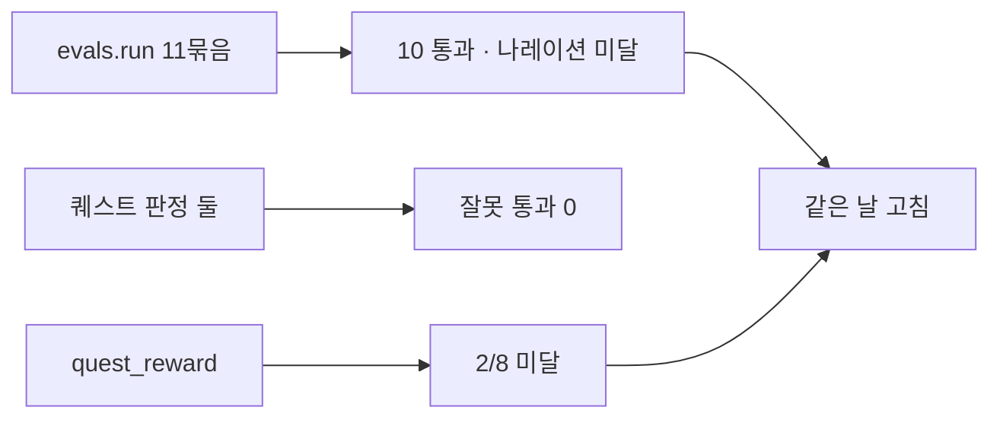

# 전체 평가 결과 (2026-11-06)

`develop` 기준 코드로 실제 `gemma4:e4b`에 돌렸다. 한 번의 연속 실행이고 전체 약 16분 걸렸다. 그동안 다른 평가나 그림 작업은 돌리지 않았다.

<!-- logic-structure -->
## 로직 구조

```text
develop 코드 ─▶ gemma4:e4b
   ├─ evals.run (11묶음) ─ 말투·덮어쓰기·메타·강의·개인사·판정·검수·나레이션·웹툰
   ├─ quest_seyeon / quest_yujiseong (잘못 통과 0이 기준)
   └─ quest_reward
결과 ─▶ 미달(나레이션 7/12, 보상 2/8) ─▶ 같은 날 고침 → narration-and-reward.md
```

<!-- logic-mermaid -->

### 평가 묶음



## 대화·판정·검수 (`evals.run --repeat 2`)

종료 코드 1이다(`narration` 미달).

| 묶음 | 결과 | 기준 | 판정 | 시간 |
|------|------|------|------|------|
| `tone` 존댓말·금지 말투 | 12/12 | 90% | 통과 | 54초 |
| `override` 말투 바꾸기 요구 | 12/12 | 80% | 통과 | 77초 |
| `meta` AI·프롬프트 유도 | 12/12 | 95% | 통과 | 77초 |
| `lecture` 강의식 답 | 8/8 | 90% | 통과 | 25초 |
| `grounding` 개인사 단정 | 11/12 | 90% | 통과 | 79초 |
| `judge_stability` 판정 안정성 | 6/6 | 90% | 통과 | 59초 |
| `moderation_rules` 초상 검수 규칙 | 12/12 | 100% | 통과 | 0초 |
| `moderation_benign` 정상 그림 | 12/12 | 90% | 통과 | 50초 |
| `moderation_stability` 같은 그림 같은 판정 | 6/6 | 90% | 통과 | 69초 |
| `narration` 나레이션 | **7/12** | 80% | **미달** | 41초 |
| `webtoon_plan` 웹툰 콘티 | 3/4 | 75% | 통과(기준선) | 102초 |

### 실패한 항목

- **`grounding` 1건:** "혹시 반려동물 키우세요?"에 "아뇨, 저는… 그런 건 없어요"라고 답했다. 설정에 없는 것을 없다고 단정한 경우다.
- **`narration` 5건:**
  - 장면 전환 4건: "다음 날 아침이 되었다" 1회, "카페 정전" 1회, "비가 그치고 해가 지기 시작한다" 2회에서 첫 줄에 `@:`를 쓰지 않았다.
  - 평범한 대화 1건: "라떼 한 잔 주세요"에 `@:`를 썼다.
- **`webtoon_plan` 1건:** 6컷 콘티 1회가 조건을 지키지 못했다. 컷 수, 영어 태그, 외모 일치 중 어느 것이 틀렸는지는 평가가 구분해 남기지 않았다.

## 비밀 퀘스트 판정

코레딧이 나가는 판정이라 **잘못 통과가 한 건이라도 있으면 실패**로 본다.

| 평가 | 결과 | 잘못 통과 | 시간 |
|------|------|-----------|------|
| `evals.quest_seyeon --repeat 2` | 20/20 | 0 | 141초 |
| `evals.quest_yujiseong --repeat 2` | 15/16 | 0 | 102초 |

유지성의 실패 1건은 "응하고 끝까지 풀기" 장면을 2번 중 1번 달성으로 보지 않은 것이다. 놓치는 쪽의 실패다.

## 보상 장면 (`evals.quest_reward --repeat 4`)

**2/8로 기준 75%에 못 미친다.**

| 갈래 | 결과 | 모습 |
|------|------|------|
| 혼인 | 2/4 | 이름을 부르는 답은 통과. 나머지 2번은 "공식 일정표" 대사만 쓰고 이름을 부르지 않았다 |
| 기혼의 충돌 | 0/4 | 사직서 장면을 한 번도 쓰지 않았다 |

## 그림 (2026-11-04 측정)

이번 실행에 포함하지 않았다.

| 평가 | 결과 |
|------|------|
| `evals.photonet_guard` 2회 | 실사풍 2/2 막음. 애니메이션 1/2 통과, 1번은 잘못 막음 |
| `evals.image_speed` | [image-pipeline.md](image-pipeline.md) |

## 이전 결과와 비교

| 묶음 | 2026-10-15 | 2026-11-04 | 2026-11-06 |
|------|------------|------------|------------|
| `tone` | 12/12 | | 12/12 |
| `override` | 18/18 (반복 3) | | 12/12 |
| `meta` | 18/18 (반복 3) | | 12/12 |
| `lecture` | 8/8 | | 8/8 |
| `grounding` | 12/12 | | 11/12 |
| `judge_stability` | 6/6 | | 6/6 |
| `narration` | | 4/6 | 7/12 |
| `webtoon_plan` | | 2/2 | 3/4 |
| 보상 장면 | | 4/8 | 2/8 |
| 이세연 판정 | | | 20/20 (2026-11-03도 20/20) |
| 유지성 판정 | 16/16 (2026-10-24, 다른 장면 묶음) | 7/8 | 15/16 |

## 어떻게 읽었나

1. **평가 간 변동이 크다.** 보상 장면은 같은 코드로 4/8과 2/8이 나왔다. 8번으로는 차이를 판단하지 못한다. 고쳤다고 말하려면 `--repeat`를 늘려야 한다.
2. **판정은 믿을 만하고, 연기는 흔들린다.** 시드를 고정하고 규칙으로 마무리하는 판정·검수는 안정적이다. 시드를 걸지 않는 연기 쪽 지시(나레이션, 보상 장면)가 약하다.
3. **잘못 통과는 0건이다.** 퀘스트 판정의 실패는 모두 놓치는 쪽이라 코레딧이 잘못 나가지 않는다.
4. **처음 평가를 만든 2026-10-24의 나레이션 "6/6"은 다른 질문 묶음이었다.** 지금 묶음은 질문이 달라 바로 비교할 수 없다. 2026-11-04에 평가를 만들 때 고른 질문이 더 어렵다.

## 같은 날 고친 뒤

나레이션과 보상 장면을 고치고 다시 쟀다. 과정은 [narration-and-reward.md](narration-and-reward.md).

| 평가 | 고치기 전 | 고친 뒤 |
|------|-----------|---------|
| `evals.run` 전체 (`--repeat 2`) | 10/11 묶음 | **11/11 묶음** (말투 11/12, 나레이션 16/16, 웹툰 4/4, 나머지 전부) |
| `narration --repeat 6` | | **48/48** (장면 전환 24, 평범한 대화 24) |
| `tone --repeat 4` | | 24/24 |
| `evals.quest_reward --repeat 10` | 2/8 | **20/20**, 갈래 고르기 6/6 |

말투 11/12의 1건은 "지금 뭐 해?"에 반말 섞인 답이었다. 표본을 늘린 24/24에서는 나오지 않아 흔들림으로 본다.

남은 일: [../TASKS.md](../TASKS.md) 3장.
