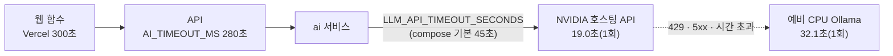
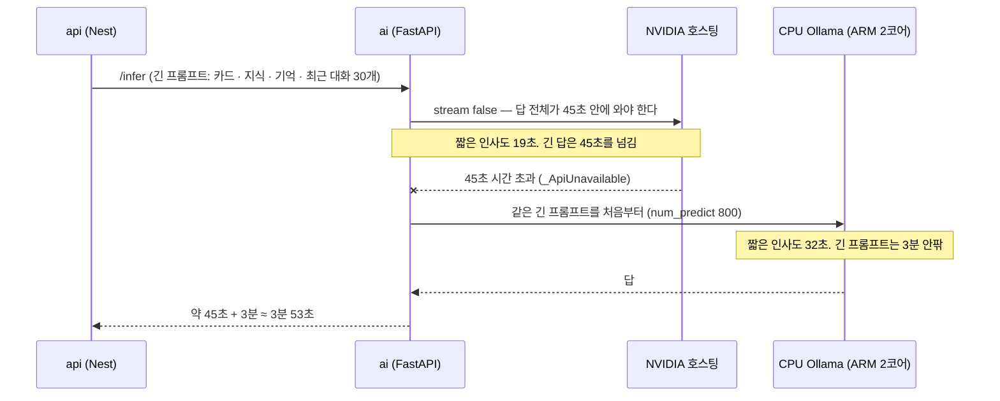

# Oracle 서버의 대화 응답 속도와 아직 안 잰 것 (2026-11-07)

GPU 없는 Oracle ARM 서버에 대화를 올리며 **한 번씩** 잰 값과, 재지 못한 것을 적는다. 표본이 1개라 평균이 아니다. 판단의 근거로 쓰지 말고 "돌아간다"는 확인으로만 쓴다.

| 항목 | 값 | 어떻게 잼 |
|------|-----|-----------|
| NVIDIA 호스팅 API 응답 (`google/gemma-4-31b-it`) | **19.0초**, 답 "안녕하세요, 만나서 반갑습니다!" | `deploy/oracle/ai-deploy.sh` 6단계의 확인 호출(짧은 인사 한 번) |
| 예비 CPU Ollama 응답 (`gemma4:e4b`) | **32.1초**, 답 "안녕하세요." | 같은 스크립트가 API를 건너뛰고 예비로 부름 |
| 서버 | A1.Flex 2 OCPU · 12GB, 스왑 4GB | 서버는 AI를 올리기 전 메모리 사용 약 0.8GB였다 |
| 백엔드 API 상태 확인 | `/health` 200 | 공개 HTTPS |

<!-- logic-structure -->
## 로직 구조

시간 제한은 바깥이 안보다 길어야 안쪽이 먼저 끊고 예비로 넘어갈 시간이 남는다: Vercel 300초 > API 280초 > 호스팅 API 45초(그 뒤 예비 Ollama).

## 알게 된 것

- 호스팅 API 한 번이 19초라 **짧은 인사 한 번도 스트리밍이 아니면 화면에서 길게 느껴진다.** 이 측정일(2026-11-07)의 대화는 한 번에 받아 오는 방식이었다.
- 2026-11-09부터 1:1 화면은 로컬 모델 토큰을 웹소켓으로 바로 보여 준다. 호스팅 모델은 여전히 한 덩어리라, 이 19초는 화면이 비어 있는 시간과 같다. 소켓은 추론을 빠르게 하지 않는다. 공개 API는 이 소켓을 아직 모른다.
- 예비 CPU 응답(32초)은 **짧은 답일 때의 값**이다. 길게 쓰는 월드 진행자나 소설형은 더 오래 걸릴 것으로 보이나 **재지 않았다.**
- API가 막히면 호스팅 쪽 45초를 다 기다린 **뒤에** 예비가 돈다. 최악의 경우 한 번에 `45 + (예비 시간)`초다. 예비 시간이 길면 API의 280초 안에 못 끝날 수 있다.

## 재지 못한 것 (남은 일)

| 못 잰 것 | 왜 중요한가 | 어떻게 잴까 |
|----------|-------------|-------------|
| **호스팅 31B 모델로 품질 평가** | 지금까지의 평가 11묶음과 프롬프트·판정 기준은 `gemma4:e4b`로 맞췄다([eval-2026-11-06.md](eval-2026-11-06.md)). 31B는 다르게 행동할 수 있어(말투 유지, 비밀 퀘스트 판정, 개인사 환각, 월드 형식) 같은 기준을 넘는지 모른다 | `LLM_BACKEND=openai`로 `python -m evals.run --repeat 2 -v`와 퀘스트 평가 2종. 키는 서버가 아니라 로컬 `.env`에서 |
| 긴 답(월드 진행자)의 응답 시간 | 280초 제한에 걸리는지 | 운영에서 시험 계정으로 월드 한 턴 |
| 호스팅 API 한도(분당·일일) | 무료 티어라 한도에 걸리면 예비 CPU로만 돌아 응답이 두 배로 느려진다 | NVIDIA 콘솔의 한도 확인, 429 비율 |
| 호스팅 모델이 그림 검수 입력을 받는가 | `/moderate-image`가 같은 호출 경로를 지난다. 그림을 못 받으면 초상 검수가 실패해 업로드가 막힐 수 있다 | 운영에서 초상 한 장 올려 보기 |
| 동시 요청 | `AI_CONCURRENCY=2`, CPU 예비는 한 번에 하나(`OLLAMA_NUM_PARALLEL=1`) | 부하 도구로 동시 3~5명 |
| 서버 메모리 | AI·Ollama를 올린 뒤의 사용량과 스왑 사용 | `free -m`를 대화 중에 |

기준을 낮춰 통과시키지 않는다. 위 평가에서 기준 미달이 나오면 [../TASKS.md](../TASKS.md) 3장에 남긴다.

## 2026-11-11: 1:1 한 턴 3분 53초 — 원인과 고침

사용자 보고: 배포 환경에서 1:1 대화 한 턴에 약 **3분 53초**가 걸렸다.

### 원인 (코드와 기록된 값으로 맞춘 것, 서버 로그로는 확인하지 못함)

- 호스팅 호출이 **한 번에 받기(`stream: False`)** 라서 시간 제한 45초가 답 **전체**에 걸렸다. 느리지만 쓰고 있는 답도 끊겼다.
- 끊기면 **CPU 예비**가 같은 긴 프롬프트를 처음부터 읽었다. ARM 2코어에서는 프롬프트를 읽는 시간이 대부분이다.
- 뒤에서 하는 정리(매 턴 기억 알아채기, 6개마다 기억·요약)도 호스팅이 막히면 같은 CPU 예비로 내려가, **한 번에 하나뿐인 CPU 자리**(`OLLAMA_NUM_PARALLEL=1`)를 몇 분씩 차지할 수 있었다. 그러면 기다리는 답의 예비까지 줄을 선다.

### 고친 것

| 고침 | 어디 | 효과 |
|------|------|------|
| 글로 답하는 호출(대화·월드 진행자)은 호스팅을 **스트리밍(SSE)** 으로 받는다. 시간 제한은 조각 사이 공백(`LLM_API_READ_TIMEOUT_SECONDS` 40초)과 전체 상한(`LLM_API_TOTAL_TIMEOUT_SECONDS` 150초) | `services/ai/app/services/llm.py` `_iter_openai_pieces` | 느려도 쓰고 있으면 끊지 않는다 → CPU 예비로 가지 않는다. 실시간 화면(웹소켓)에 호스팅 토큰도 바로 흐른다 |
| 첫 조각 전에 막힐 때만 예비로. 조각을 이미 보낸 뒤 끊기면 오류(반쯤 나간 답을 예비 답으로 바꾸지 않음) | 〃 `_iter_hosted_with_fallback` | |
| CPU 예비를 가볍게: 최근 대사 8개(`LLM_FALLBACK_MAX_TURNS`), 출력 320토큰(`LLM_FALLBACK_MAX_TOKENS`) | 〃 | 같은 프롬프트에서 읽을 토큰 2146 → 1363 (−37%, 로컬에서 셈), 출력 상한 800 → 320 |
| 뒤에서 하는 정리는 CPU 예비로 내려가지 않는다. Nest가 `X-AI-Priority: background`를 보내고 FastAPI가 요청 동안 기억한다 | `apps/api/src/ai/ai-client.ts`, `services/ai/app/request_priority.py`, `app/main.py` | CPU 자리를 비워 둔다. 막힌 정리는 다음 턴에 다시 한다(정리 안 된 메시지가 그대로 남는다) |
| JSON 판정·요약은 그대로 한 번에 받기(`LLM_API_TIMEOUT_SECONDS` 45초) | | 답이 짧다 |

### 기대 값과 확인하지 못한 것

| 경우 | 기대 | 근거 |
|------|------|------|
| 호스팅이 답할 때 (보통) | 첫 글자 수 초, 전체 20~40초 안팎 | 짧은 인사 19.0초(2026-11-07, 1회). 이제 45초에 끊기지 않는다 |
| 호스팅이 첫 조각 전에 막힐 때 | 40초 + 가벼운 CPU 예비 | CPU 예비 짧은 인사 32.1초(1회). 가벼운 예비의 실제 시간은 재지 못함 |
| 호스팅이 429(한도)로 바로 막힐 때 | 가벼운 CPU 예비만 | 〃 |

- **서버에서 다시 재지 못했다.** 서버 개인키가 이 PC에 없어 로그·시간을 볼 수 없었다. 서버에 올린 뒤 같은 대화를 몇 번 보내 시간을 재고 여기에 적는다(→ [../TASKS.md](../TASKS.md) U13).
- 호스팅 API의 스트리밍 응답 모양은 OpenAI 호환 SSE(`data: {...}` · `data: [DONE]`)를 가정했다. NVIDIA NIM이 이 모양을 따른다는 공개 문서를 근거로 했고, 실제 키로는 시험하지 못했다(가짜 서버로 시험).
- 호스팅이 자주 429라면 가벼운 예비도 1분을 넘길 수 있다. 그때는 한도를 올리거나(유료 키) 예비 모델을 더 작게 바꾸는 것을 검토한다.

### 시험

- `services/ai/tests/test_llm_openai.py`: 스트리밍으로 받아 모음 · JSON은 한 번에 · 조각이 계속 오면 전체가 길어도 끊지 않음 · 첫 조각 전 막힘 → 가벼운 예비(8개·320토큰) · 조각 뒤 끊김은 오류 · 배경 작업은 예비로 안 감 · `iter_generate`가 호스팅 조각을 여러 개로 넘김
- `services/ai/tests/test_request_priority.py`: 머리글이 처리 스레드까지 전달되고 요청 사이에 새지 않음
- `apps/api/src/ai/ai-client.spec.ts`: Nest가 우선순위 머리글을 보냄
