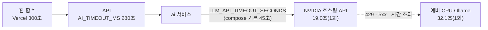

# Oracle 서버의 대화 응답 속도와 아직 안 잰 것 (2026-11-07)

GPU 없는 Oracle ARM 서버에 대화를 올리며 **한 번씩** 잰 값과, 재지 못한 것을 적는다. 표본이 1개라 평균이 아니다. 판단의 근거로 쓰지 말고 "돌아간다"는 확인으로만 쓴다.

| 항목 | 값 | 어떻게 잼 |
|------|-----|-----------|
| NVIDIA 호스팅 API 응답 (`google/gemma-4-31b-it`) | **19.0초**, 답 "안녕하세요, 만나서 반갑습니다!" | `deploy/oracle/ai-deploy.sh` 6단계의 확인 호출(짧은 인사 한 번) |
| 예비 CPU Ollama 응답 (`gemma4:e4b`) | **32.1초**, 답 "안녕하세요." | 같은 스크립트가 API를 건너뛰고 예비로 부름 |
| 서버 | A1.Flex 2 OCPU · 12GB, 스왑 4GB | 서버는 AI를 올리기 전 메모리 사용 약 0.8GB였다 |
| 백엔드 API 상태 확인 | `/health` 200 | 공개 HTTPS |

<!-- logic-structure -->
## 로직 구조

시간 제한은 바깥이 안보다 길어야 안쪽이 먼저 끊고 예비로 넘어갈 시간이 남는다: Vercel 300초 > API 280초 > 호스팅 API 45초(그 뒤 예비 Ollama).

## 알게 된 것

- 호스팅 API 한 번이 19초라 **짧은 인사 한 번도 스트리밍이 아니면 화면에서 길게 느껴진다.** 이 측정일(2026-11-07)의 대화는 한 번에 받아 오는 방식이었다.
- 2026-11-09부터 1:1 화면은 로컬 모델 토큰을 웹소켓으로 바로 보여 준다. 호스팅 모델은 여전히 한 덩어리라, 이 19초는 화면이 비어 있는 시간과 같다. 소켓은 추론을 빠르게 하지 않는다. 공개 API는 이 소켓을 아직 모른다.
- 예비 CPU 응답(32초)은 **짧은 답일 때의 값**이다. 길게 쓰는 월드 진행자나 소설형은 더 오래 걸릴 것으로 보이나 **재지 않았다.**
- API가 막히면 호스팅 쪽 45초를 다 기다린 **뒤에** 예비가 돈다. 최악의 경우 한 번에 `45 + (예비 시간)`초다. 예비 시간이 길면 API의 280초 안에 못 끝날 수 있다.

## 재지 못한 것 (남은 일)

| 못 잰 것 | 왜 중요한가 | 어떻게 잴까 |
|----------|-------------|-------------|
| **호스팅 31B 모델로 품질 평가** | 지금까지의 평가 11묶음과 프롬프트·판정 기준은 `gemma4:e4b`로 맞췄다([eval-2026-11-06.md](eval-2026-11-06.md)). 31B는 다르게 행동할 수 있어(말투 유지, 비밀 퀘스트 판정, 개인사 환각, 월드 형식) 같은 기준을 넘는지 모른다 | `LLM_BACKEND=openai`로 `python -m evals.run --repeat 2 -v`와 퀘스트 평가 2종. 키는 서버가 아니라 로컬 `.env`에서 |
| 긴 답(월드 진행자)의 응답 시간 | 280초 제한에 걸리는지 | 운영에서 시험 계정으로 월드 한 턴 |
| 호스팅 API 한도(분당·일일) | 무료 티어라 한도에 걸리면 예비 CPU로만 돌아 응답이 두 배로 느려진다 | NVIDIA 콘솔의 한도 확인, 429 비율 |
| 호스팅 모델이 그림 검수 입력을 받는가 | `/moderate-image`가 같은 호출 경로를 지난다. 그림을 못 받으면 초상 검수가 실패해 업로드가 막힐 수 있다 | 운영에서 초상 한 장 올려 보기 |
| 동시 요청 | `AI_CONCURRENCY=2`, CPU 예비는 한 번에 하나(`OLLAMA_NUM_PARALLEL=1`) | 부하 도구로 동시 3~5명 |
| 서버 메모리 | AI·Ollama를 올린 뒤의 사용량과 스왑 사용 | `free -m`를 대화 중에 |

기준을 낮춰 통과시키지 않는다. 위 평가에서 기준 미달이 나오면 [../TASKS.md](../TASKS.md) 3장에 남긴다.
