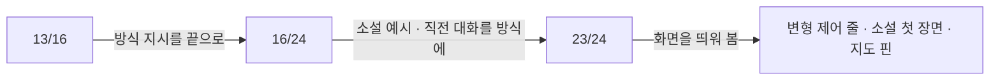

# 월드코퍼챗 진행자 실측 (2026-11-06)

모델은 `gemma4:e4b`, 개발 PC(그래픽 메모리 12GB)에서 실제로 돌렸다. 설계는 [../plan/WORLD_COPPERCHAT.md](../plan/WORLD_COPPERCHAT.md).

<!-- logic-structure -->
## 로직 구조

```text
evals.world_turn: 세계관 1개 × 말 2개 × 방식 4가지 × 반복
   ▼ 코드로 형식 확인 (명단 밖 화자 · 유저 대사 · 제어 줄 · 방식별 모양)
13/16 → (방식 지시를 끝으로) → (소설 예시 · 직전 대화를 방식에 맞춤) → 23/24
   ▼
화면을 실제로 띄워 찾은 것 → 변형 제어 줄 · 소설 첫 장면 · 지도 핀
```

<!-- logic-mermaid -->

### 형식 평가 과정



## 평가가 보는 것 (`evals.world_turn`)

같은 세계관(항구 도시, 인물 3명, 장소 4곳, 그림 이름표 3개, 주인공 "이안")에 두 가지 말을 걸고, 대화 방식 4가지마다 형식을 코드로 확인한다.

| 확인 | 기준 |
|------|------|
| 공통 | 답이 비어 있지 않다, 명단 밖 이름으로 말하지 않는다, 유저 대사를 대신 쓰지 않는다, 제어 줄이 본문에 남지 않는다 |
| 기본 채팅·비주얼노벨 | `이름:`이나 `@:` 줄이 있다 |
| 소설 | `이름:`·`@:` 줄이 없다 |
| 메신저 | 별표·`@:`가 없고 모든 줄이 `이름:` |

그림 이름표를 고른 비율과 장소 이동을 쓴 비율은 참고로만 찍는다. 형식 통과율 80% 미만이면 실패.

## 결과

| 시도 | chat | 비주얼노벨 | 소설 | 메신저 | 형식 합계 | 그림 고름 | 장소 이동 |
|------|------|-----------|------|--------|----------|-----------|-----------|
| 1. 처음 (`--repeat 2`) | 4/4 | 4/4 | **1/4** | 4/4 | 13/16 | 14/16 | 0/16 |
| 2. 방식 지시를 끝으로 (`--repeat 3`, 직전 대화는 모든 방식이 채팅 모양) | 5/6 | 6/6 | **0/6** | 5/6 | 16/24 | 18/24 | 0/24 |
| 3. 소설 예시 추가, 메신저 "한 메시지 안에서 줄을 바꾸지 않는다", 평가의 직전 대화를 방식에 맞춤 (`--repeat 3`) | 6/6 | 6/6 | **6/6** | 5/6 | **23/24** | 16/24 | 0/24 |

## 무엇을 배웠나

1. **작은 모델은 직전 대화의 모양을 따라간다.** 시도 2에서 소설 방식이 0/6이었다. 실패한 답은 모두 `한서린: "…"`처럼 직전 장면(채팅 모양)과 같은 모양으로 시작했다. 실제 플레이에서는 앞 답도 같은 방식이라 평가의 직전 대화를 방식에 맞췄다. 평가를 고친 것이므로 시도 2와 3의 소설 수치는 바로 비교할 수 없다.
2. **형식 지시는 끝에, 예시는 다른 상황으로.** 나레이션 때 배운 규칙([small-model-prompting.md](small-model-prompting.md))이 여기서도 맞았다. 소설 예시는 "비가 그친 골목" 같은 다른 장면으로 쓰고 그대로 쓰지 말라고 했다.
3. **판단은 코드에 남긴다.** 진행자가 지어낸 그림 이름표·장소·인물은 `parse_controls`가 버린다. 단위 시험 `test_drops_unknown_labels_people_and_places`.
4. **장소 이동은 거의 안 쓴다(0/24).** 유저가 "부두로 내려간다", "등대로 올라간다"고 해도 인물 이동 줄을 붙이지 않았다. 지시가 "옮겼으면 쓴다"로 조건부라 "필요할 때만" 지시와 같은 문제로 본다(나레이션 0/6 때와 같다). 아직 고치지 않았다.

## 남은 실패

- 메신저 1건: 한 메시지가 두 줄로 나뉘어 둘째 줄이 `이름:`으로 시작하지 않았다.
- 시도 3의 그림 고름 16/24는 맞는 장면을 골랐는지는 보지 않은 숫자다. 고른 그림이 장면과 맞는지는 눈으로 봐야 한다.

## 재지 않은 것

- 파트 판정의 정확도(실제 모델). 단위 시험은 근거 인용 검사만 보고, e2e는 가짜 판정(`[파트완료]`)이다. 비밀 퀘스트 판정과 같은 방식이라 비슷할 것으로 보지만 근거는 없다.
- 긴 플레이(30턴 이상)에서 인물 말투가 섞이는지.
- 성인 수위의 월드 진행(공개 서버는 끔). 수위 규칙은 1:1 대화와 같은 코드를 쓰고 단위 시험 `test_rating_rules`로 본다.
- 답 시간. README 그림을 만들 때 턴마다 걸린 시간은 [../.assets/README.md](../.assets/README.md)의 기록을 본다.

## README 화면을 찍다 찾은 것 (2026-11-06)

`scripts/readme-media/world.mjs`로 데모 세계관 4개(방식마다 하나)를 만들고 실제 모델로 2턴씩 진행했다. 턴은 3.3~4.8초 걸렸다(모델이 이미 올라온 상태).

| 발견 | 원인 | 고침 |
|------|------|------|
| 본문에 `[장소 이동: 관리소 → 부두]`, 괄호 없는 `장소 이동: -`가 그대로 보임 | 진행자가 약속(`[이동: 이름 → 장소]`)과 다른 모양으로 제어 줄을 썼다. 평가는 `[이동`·`[그림`만 찾아 놓쳤다 | 변형 제어 줄(`장소/위치/인물 이동`, `장면 그림`, 괄호 없음)도 본문에서 버린다. 인물 이름 → 장소 모양만 위치에 반영한다. 단위 시험 `test_strips_loose_control_lines`, 평가의 검사도 넓혔다 |
| 소설형 세계관에서 `마르코: …` 줄로 답함 | 데모의 첫 장면을 채팅 모양(`@:`, `이름:`)으로 썼다. 진행자는 앞 글의 모양을 따라간다(평가 시도 2와 같은 현상) | 편집기의 첫 장면 안내에 "대화 방식에 맞춰 쓰라"를 적고, 데모는 방식마다 첫 장면을 그 모양으로 썼다. 화면은 소설형에서 `이름:` 줄이 와도 "이름 — 대사"로 읽히게 그린다 |
| 코퍼맵 위쪽 핀의 이름표가 잘림 | 지도 상자가 넘침을 숨겼다 | 넘침을 보이고 그림·격자만 모서리를 둥글린다 |

이 세 가지는 평가와 e2e가 잡지 못했다. 평가는 형식만, e2e는 가짜 LLM의 고정 답만 본다. **화면은 실제 모델로 한 번은 띄워 봐야 한다**는 교훈([../AGENT_HANDOVER.md](../AGENT_HANDOVER.md) 9장)이 다시 맞았다.
